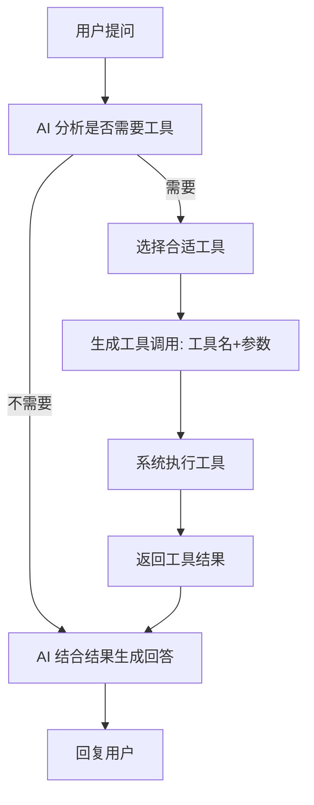
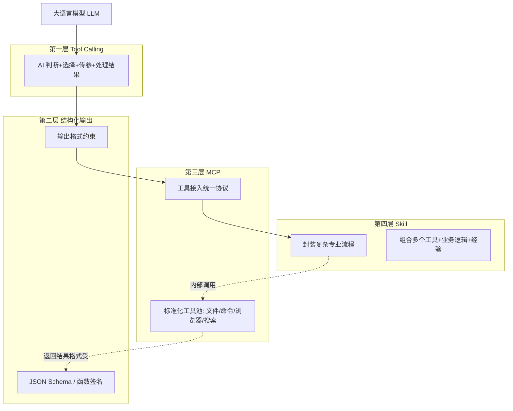

# 工具与技能：AI 调用外部世界的四层递进

> 让 AI 从"只会聊天"变成"能办事"，要经历四层能力的递进——能调用工具（Tool Calling）、能规范输出（结构化输出）、能标准接入（MCP）、能封装技能（Skill）。四层从单次动作到完整流程，从底层原子能力到上层专业能力，逐步把 AI 打造成真正可用的协作者。本文按四层逐层讲解。

**关键词**：Tool Calling、结构化输出、MCP、Skill、工具调用、AI 协作

## 抽象类比

- 没有 Tool Calling 的 AI 像只能口头建议的"顾问"——你问什么它答什么，但不能动手
- 有 Tool Calling 的 AI 像能开检查单、预约设备的"医生"——能调用计算器、搜索、API 等外部工具
- 结构化输出像"按表格填答案"——保证 AI 输出的格式稳定可控，能被下游程序直接消费
- MCP 像"统一电源插座"——不同工具用同一标准接入，AI 不用为每个工具单独写适配
- Skill 像"封装好的工作流"——把多步骤的专业能力打包成可复用的技能，AI 调用一次就能完成完整流程

四层从单次动作到完整流程，从底层原子能力到上层专业能力，逐步把 AI 打造成真正可用的协作者。

## 一、Tool Calling：让 AI 会用工具

### 核心原理

Tool Calling（工具调用）是让大语言模型能够识别何时需要外部工具、选择合适工具、并按规范格式传递参数的技术。它把 AI 从只能口头建议的"顾问"，变成知道该叫谁、怎么联系、需要什么信息的"调度员"。

核心流程：AI 分析问题 → 选择工具 → 生成参数 → 执行调用 → 处理结果 → 生成回答

### 类比：调度员

- 没有 Tool Calling：像医生只能口头建议，不能开检查单
- 有 Tool Calling：医生能开检查单、预约设备、查询病历
- AI 是大脑，工具是手脚：大脑决策、手脚执行

### 解决 AI 的哪些局限

- 知识截止：训练数据有时间限制，调用搜索获取最新信息
- 无法精确计算：大语言模型不擅长精确计算，调用计算器
- 无法访问实时数据：不知道当前天气、股价，调用 API 查询
- 无法操作系统：不能读写文件、执行命令，调用系统工具
- 输出格式不稳定：自由输出格式不可控，调用结构化输出工具

### 关键要素

- 工具定义：用名称、描述、参数告诉 AI 有哪些工具可用
- 工具选择：AI 理解用户意图，匹配最合适的工具能力
- 参数生成：AI 从问题中提取关键信息，按工具要求格式化并验证完整性
- 结果处理：AI 解析工具返回数据，结合上下文生成用户易懂的回答

### 安全与控制

- 权限管理：白名单限制可调用工具、权限分级、敏感操作需用户确认
- 参数验证：格式检查、范围检查、类型检查
- 结果审查：过滤敏感信息、验证结果格式、处理调用失败

### Mermaid 流程图

### 关键术语

- Tool Calling / Function Calling：本质同一概念，OpenAI 用前者，业界通用后者
- Tool Calling 是 Agent（智能体）的基础能力：单次调用是 Tool Calling，多次调用加自主规划就是 Agent

## 二、结构化输出：让 AI 按格式回答

### 核心原理

结构化输出是让大语言模型按照预定义格式（如 JSON、XML、表格）输出数据的技术，确保结果能被程序可靠读取和处理。它让 AI 的输出可预测、可解析、可自动化。

核心流程：定义格式 → AI 按格式填充 → 程序可靠解析

### 类比：填表格 vs 写作文

- 非结构化输出：像写作文，自由发挥但格式不固定
- 结构化输出：像填表格，每栏都有明确要求、格式固定
- 给 AI 出"填空题"而不是"问答题"

### 为什么需要结构化输出

- AI 自由输出的问题：格式不稳定、字段缺失、类型错误、多余内容、难以汇总
- 核心价值：可解析、稳定、自动化、可验证

### 实现方式（由松到严）

- Prompt 工程：在提示词中要求输出格式，简单直接但无法保证 100% 遵守
- Schema 约束：用 JSON Schema 等定义字段类型和必填项，格式严格可验证
- 函数调用：通过函数签名约束输出，类型安全、IDE 友好，需要编程知识
- 专用工具：如 OpenAI 的 `response_format`、Instructor 库、LangChain 结构化输出，可靠性最高、自动重试
- 渐进式约束建议：先宽松后严格，根据场景平衡灵活性和稳定性

### 最佳实践

- 明确定义格式：使用标准格式、明确字段类型和约束、提供示例输出
- 验证输出：检查是否符合 Schema、处理格式错误、自动重试或修正
- 错误处理：捕获解析错误、提供友好错误信息、记录错误日志

### 与 Tool Calling 的关系

- Tool Calling 关注"调用工具时参数怎么传"
- 结构化输出关注"工具返回结果（或 AI 最终回答）的格式怎么控"
- 二者互补：Tool Calling 的参数和返回都需要结构化输出才能被程序可靠处理
- Agent 工作流中，每一步的输入输出都依赖结构化输出保证稳定性

### 关键术语

- JSON Schema：描述 JSON 数据结构的标准
- 信息提取、数据分类、报告生成、API 响应、工作流数据传递都是典型应用

## 三、MCP：工具接入的统一标准

### 核心原理

MCP（Model Context Protocol，模型上下文协议）是一种工具接入的统一协议/插件机制。它让工具提供方按标准暴露能力，AI 客户端按标准接入能力，避免每个工具都自定义一套接口。MCP 的核心不是"某个工具"，而是"让 AI 连接外部世界时有统一协议"。

### 类比：USB-C 插口

- 没有 MCP：每个电器用不同插头，家里乱成一团；每个工具都要 AI 单独适配
- 有 MCP：统一插座标准，工具提供方按标准生产，AI 客户端按标准接入
- MCP 是连接 AI 大脑和外部世界的"手臂"

### 核心概念

- MCP Server：服务提供者，运行在本地或远程，暴露一组工具
- MCP Tool：具体的工具函数，如文件操作、浏览器控制、数据库查询
- Tool Call：AI 调用 MCP 工具的过程
- Context：工具执行所需的上下文信息

### 工作流程

1. 用户提问
2. AI 识别需求，决定调用哪个 MCP 工具
3. AI 准备参数，通过 MCP 协议发送调用请求
4. MCP Server 执行实际操作
5. 工具返回结果给 AI
6. AI 总结结果回复用户

### 常用工具分类（举例）

- 文件操作：Read、Write、Edit、DeleteFile、Glob、LS
- 命令执行：RunCommand、CheckCommandStatus、StopCommand
- 浏览器控制：browser_navigate、browser_click、browser_type、browser_snapshot
- 搜索查询：SearchCodebase、Grep、WebSearch、WebFetch
- 其他：AskUserQuestion、TodoWrite、GetDiagnostics、OpenPreview

### MCP 与 Tool Calling 的区别

- 层次不同：Tool Calling 是 AI 调用工具的"机制"（怎么调用）；MCP 是工具接入的"标准"（怎么对接）
- 关心的问题不同：Tool Calling 关心 AI 如何决策和传参；MCP 关心工具如何被统一描述、发现、调用
- 关系：MCP 让工具更容易被 Tool Calling 使用——MCP 提供标准化的工具池，Tool Calling 负责从中挑工具并调用
- 类比：Tool Calling 是"会用电器的手"，MCP 是"统一的 USB-C 插口标准"

### 关键术语

- MCP Server / MCP Tool / Tool Call / Context
- MCP 让 AI 不只是聊天窗口，而是能安全调用项目工具的协作者

### MCP 的核心价值

- 功能强大：支持文件操作、命令执行、浏览器控制、搜索查询等多种能力
- 易于使用：提供统一调用接口，AI 不用为每个工具单独适配
- 安全可控：通过权限控制、用户确认机制确保操作安全
- 灵活扩展：可以添加自定义 MCP Server，生态可生长

## 四、Skill：封装复杂专业技能

### 核心原理

Skill（技能）是更高层次的能力扩展机制，把一组工具、步骤、经验和标准组合成可复用的完整工作流程。如果说工具是一次动作，Skill 就是一套方法论。它把一次次成功经验沉淀成可重复调用的能力。

### 类比：组装家具的技能

- MCP 工具像锤子、螺丝刀，只会做一个动作
- Skill 像"会装书架的手艺"，把多个工具、步骤、经验组合起来
- 有工具不等于会干活，Skill 把工具、步骤、经验和标准封装在一起

### Skill 的工作原理

- Skill 入口接收任务参数
- Skill 内部按业务逻辑调用多个 MCP 工具
- 中间做数据处理、判断、组合
- 最终返回可用结果（如一份报告、一个项目、一份审查结果）

### 与 MCP 的层次关系

- 层次：MCP 是底层工具，Skill 是高层技能
- 复杂度：MCP 是简单单一操作，Skill 是复杂多步骤流程
- 封装程度：MCP 封装一个功能，Skill 封装多个工具的组合
- 调用方式：MCP 直接调用，Skill 通过 Skill 框架调用
- 关系：Skill 内部会调用多个 MCP 工具，是 MCP 之上的封装
- 类比：MCP 是"螺丝刀"，Skill 是"组装家具"——组装家具的过程中会用很多次螺丝刀

### 常见 Skill 举例

- 代码审查类：审查合并请求、代码差异，输出质量与最佳实践反馈
- 调试器类：运行时调试、收集日志，定位复杂 Bug
- 小程序生成类：基于 Taro 生成多端小程序代码
- 安全审查类：代码安全扫描、漏洞检测
- Web 开发类：创建完整网站、应用、可视化页面
- 文档生成类：生成 PRD、技术架构、设计规范
- Skill 创建器：用来开发新的自定义 Skill

### 何时用 Skill、何时用 MCP

- 用 MCP：简单文件操作、执行单个命令、快速搜索
- 用 Skill：任务复杂需要多步骤、需要专业领域知识、需要生成复杂输出（文档、代码、报告）

### 关键术语

- Skill 框架 / invoke 入口 / 业务逻辑层
- Skill 不是魔法，而是把反复出现的工作流程标准化

## 五、四层关系总览

四层能力从下到上、从原子到组合、从机制到生态，层层递进：

- 第一层 Tool Calling：解决"AI 能不能调用工具"——机制层
- 第二层 结构化输出：解决"AI 输出能不能被程序可靠读取"——格式层
- 第三层 MCP：解决"工具能不能被标准化接入"——协议层
- 第四层 Skill：解决"复杂经验能不能被复用"——能力层

读图要点：下层是上层的地基。LLM 通过 Tool Calling 调用工具，调用过程的参数与结果靠结构化输出保证可靠，工具本身通过 MCP 标准化接入，多个 MCP 工具被 Skill 组合成完整技能；Skill 反过来又依赖 MCP、结构化输出、Tool Calling 三层支撑。

## 六、常见应用场景

- 智能助手：搜索 + 日历 + 邮件 + 地图，Tool Calling 调度多工具完成日常任务
- 数据分析：数据库查询 + Python 计算 + 图表生成 + 报告导出，结构化输出保证结果可解析
- 客服系统：知识库 + 订单查询 + 退款处理 + 工单创建，MCP 标准化接入各业务系统
- 代码助手：代码执行 + 测试框架 + 文档搜索 + Git 操作，Skill 封装"代码审查""调试""安全扫描"等完整流程
- 文档处理：读取 + 编辑 + 搜索 + 网络检索，Skill 封装"生成 PRD""技术架构文档"等模板化工作
- 自动化测试：浏览器自动化 + 命令行测试 + 结果验证，Skill 封装端到端测试流程
- 项目协作：文件读取让 AI 分析文档代码、命令执行让 AI 跑构建测试、报告生成把结果转成 Markdown

## 面试速答

### Q1：Tool Calling 和 MCP 的区别是什么？

- Tool Calling 是 AI 调用工具的"机制"，关心 AI 如何判断需求、选择工具、生成参数、处理结果
- MCP 是工具接入的"标准/协议"，关心工具如何被统一描述、发现、调用
- 关系：MCP 提供标准化的工具池，Tool Calling 负责从中挑工具并调用
- 类比：Tool Calling 是"会用电器的手"，MCP 是"统一的 USB-C 插口标准"

### Q2：MCP 和 Skill 的区别是什么？

- 层次不同：MCP 是底层工具（简单单一操作），Skill 是高层技能（复杂多步骤流程）
- 封装程度：MCP 封装一个功能，Skill 封装多个工具+业务逻辑+经验
- 关系：Skill 内部会调用多个 MCP 工具
- 类比：MCP 是"螺丝刀"，Skill 是"组装家具"——组装家具过程中会反复用螺丝刀

### Q3：结构化输出在四层中起什么作用？

- 它是"格式层"，保证 AI 的输出（包括 Tool Calling 的参数和返回结果）可被程序可靠解析
- 没有结构化输出，Tool Calling 传错参数、MCP 返回结果无法解析、Skill 输出无法被下游使用
- 它是其他三层稳定性的基石

### Q4：什么时候该用 Tool Calling，什么时候该上 Agent？

- Tool Calling 是单次工具调用
- Agent 是多次工具调用 + 自主规划
- 简单单步任务用 Tool Calling 即可；复杂多步、需要自主决策的任务才需要 Agent
- Tool Calling 是 Agent 的基础能力

### Q5：四层为什么要分层？能不能合并？

- 分层是为了解耦：机制（Tool Calling）、格式（结构化输出）、协议（MCP）、能力（Skill）各司其职
- 合并会导致耦合：换一种工具接入方式就得改 AI 调用逻辑，无法复用经验
- 分层让生态可扩展：工具方按 MCP 暴露能力、经验方按 Skill 封装流程，AI 方只需关心 Tool Calling 和结构化输出

## 关键词

Tool Calling、Function Calling、结构化输出、JSON Schema、MCP、Model Context Protocol、MCP Server、MCP Tool、Skill、技能封装、Agent、工具调用、参数生成、信息提取、可解析性