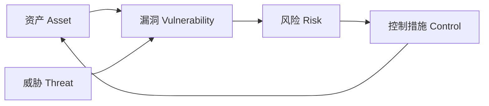
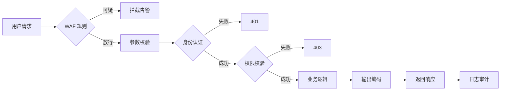
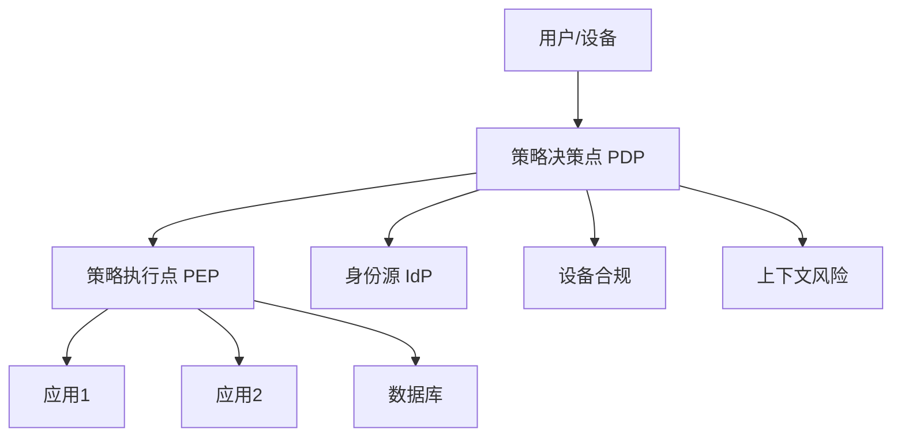
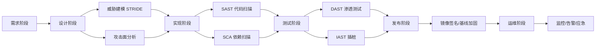
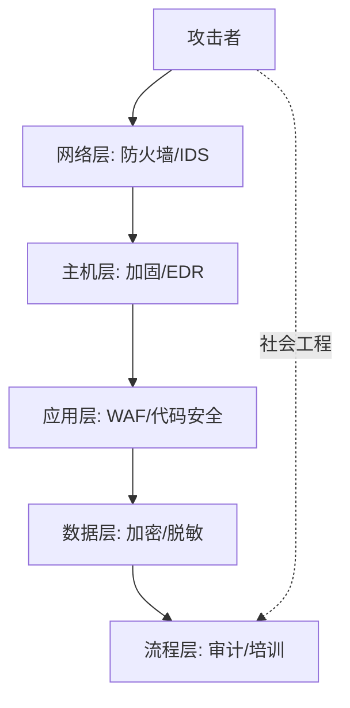

# 网络安全

> 网络安全研究的是"如何让信息系统在攻击者面前仍能保持可用、可信、可控"。本文聚焦攻击手法与防御体系，从 CIA 三要素到 OWASP Top 10，再到零信任与 SDL，搭起一张完整的攻防地图。算法细节请参考 [[密码学]]。

**关键词**：CIA 三要素、OWASP Top 10、Web 攻击、零信任、应急响应

## 抽象类比

网络安全像给一座大楼做安保：门禁卡是认证、刷卡进几楼是授权、监控录像就是审计；墙、门、窗、保安层层设防就是纵深防御。光有大门还不够，得假设"内鬼也可能存在"，每个房间都再加一道门——这就是零信任的核心思想。

攻防双方永远在博弈。攻击者只赢一次就能进来，防御者必须每一次都赢才能守住，所以安全不是"装个防火墙就完事"，而是一套覆盖开发、部署、运维、合规的系统性工程。

## 适合人群

- 后端 / 前端 / 全栈开发者，想知道自己写的代码会被怎么打
- 运维与 SRE，希望理解 WAF、防火墙、SIEM 在做什么
- 准备面试的学生，需要梳理 OWASP Top 10、认证授权、HTTPS 等高频考点
- 对等保、GDPR、ISO 27001 等合规标准有入门需求的项目经理与产品

## 预备知识

- 了解 HTTP 请求结构与常见状态码，参考 [[计算机网络]]
- 理解 TCP/IP 分层与三次握手，参考 [[计算机网络]]
- 知道对称加密 / 公钥加密 / 哈希大致用途，参考 [[密码学]]
- 有过一次登录、Session、Cookie 的实际开发经验

## 一、网络安全是什么

### 1.1 CIA 三要素

- 机密性（Confidentiality）：信息只能被授权的人看到，对应加密、访问控制
- 完整性（Integrity）：信息在传输与存储中不能被悄悄改，对应哈希、数字签名
- 可用性（Availability）：合法用户要用时系统必须能用，对应冗余、抗 DDoS

三个要素缺一不可。例如：银行转账既要别人看不到金额（C），又不能被改成 100 万（I），还得保证你随时能转（A）。

### 1.2 从 CIA 扩展到 AAA

- 认证（Authentication）：你是谁——密码、指纹、短信验证码、U2F
- 授权（Authorization）：你能做什么——RBAC、ABAC、ACL
- 计费 / 审计（Accounting / Audit）：你做了什么——日志、SIEM、行为审计
- 问责（Accountability）：出了事能追到具体人——不可抵赖性

### 1.3 安全的边界与威胁模型

安全没有"绝对"，只有"在一定威胁模型下足够好"。建模时常问三句话：

- 要保护什么资产（数据、服务、品牌）
- 威胁来自谁（外部黑客、内鬼、APT 组织、脚本小子）
- 攻击得手后会损失什么（数据泄露、服务中断、合规罚款）

## 二、常见攻击类型

### 2.1 Web 攻击

- SQL 注入：把恶意 SQL 拼进查询字符串，让数据库执行未授权命令
  - 经典 payload：`' OR '1'='1` 直接绕过登录
  - 防御：参数化查询、ORM、最小权限账号、WAF 规则
- XSS 跨站脚本：把 JS 注入到别人浏览器执行
  - 反射型：从 URL 参数反射
  - 存储型：存到数据库后他人访问触发，危害最大
  - DOM 型：纯前端 JS 拼接
  - 防御：输出转义、CSP、`HttpOnly` Cookie
- CSRF 跨站请求伪造：借用户已登录的 Cookie 冒充用户发请求
  - 防御：CSRF Token、`SameSite=Lax/Strict`、校验 Referer
- SSRF 服务端请求伪造：让服务器替攻击者去发请求，常用来打内网元数据接口（如 AWS 169.254.169.254）
  - 防御：URL 白名单、禁止访问内网段、禁用不必要的协议
- 文件上传漏洞：上传可执行脚本当作图片，再通过解析漏洞触发
  - 防御：白名单后缀、重命名、单独静态域名、禁用执行权限
- 命令注入：把系统命令拼到 `exec` / `system` 调用里
  - 防御：避免调 shell，用参数数组形式的 API
- 目录遍历：用 `../` 跳出限制目录读取任意文件
  - 防御：规范化路径后校验、`basename` 截断

### 2.2 网络层攻击

- DDoS 分布式拒绝服务：用大量流量或请求压垮带宽 / 服务器
  - 体积型：UDP 反射放大、memcached 放大
  - 协议型：SYN Flood、ACK Flood
  - 应用层：HTTP Flood、慢速攻击 Slowloris
- MITM 中间人攻击：在客户端与服务器之间截获 / 篡改流量
  - 公共 WiFi、ARP 欺骗、伪造证书都是常见手段
- ARP 欺骗：在局域网里谎称"我是网关"，把别人流量引过来
- DNS 劫持：篡改 DNS 响应，把域名指向恶意 IP
  - 缓解：DNSSEC、DoH / DoT
- SYN Flood：发海量 SYN 不完成三次握手，撑爆半连接队列
  - 缓解：SYN Cookie、防火墙限速

### 2.3 应用层攻击

- 暴力破解：枚举密码直到命中
  - 防御：限速、验证码、账号锁定、强制复杂密码
- 撞库：拿其他站点泄露的账号密码去尝试登录
  - 防御：异常登录提醒、强制改密、多因子认证
- 会话劫持：偷走 Session ID 冒充用户
  - 防御：`HttpOnly` + `Secure` + `SameSite`、绑定 IP / UA、轮换 ID
- 会话固定（Session Fixation）：攻击者诱导用户用指定 Session ID 登录，登录后即可复用
  - 防御：登录成功后立刻重新生成 Session ID
- 越权访问
  - 水平越权：访问同级别别人的数据（IDOR）
  - 垂直越权：普通用户调用管理员接口
  - 防御：每次操作都校验"是否属于本人"
- IDOR（不安全的直接对象引用）：`/order/123` 改成 `/order/124` 就能看别人订单
  - 防御：基于当前用户身份过滤，而非相信 URL 参数
- 不安全的反序列化：把恶意构造的序列化数据喂给后端，触发任意代码执行
  - 防御：不反序列化不可信数据、用 JSON 替代二进制序列化
- 业务逻辑漏洞：薅羊毛、并发竞态、负数购买、优惠券叠加
  - 防御：业务规则校验、幂等控制、风控引擎

### 2.4 社会工程

- 钓鱼邮件：伪装成银行、HR、合作方骗取凭证
- 伪装（Impersonation）：冒充 IT 部门打电话要密码
- 垃圾邮件：投递恶意附件、勒索软件
- 水坑攻击：黑掉目标常去的网站等鱼上钩

社会工程绕过一切技术防御，是 APT 攻击的常见入口。

## 三、OWASP Top 10（2021 版）

OWASP Top 10 是 Web 应用最严重的十大风险清单，每 3-4 年更新一次。2021 版变化较大，把"敏感数据泄露"并入加密失败，新增了"不安全设计"。

- A01 失效的访问控制：越权、IDOR，从 2017 的第 5 升到第 1
  - 实战提示：默认拒绝，所有接口都要校验权限
- A02 加密失败：明文传输、弱算法、密钥硬编码
  - 实战提示：HTTPS 强制 + HSTS，禁用 MD5 / SHA-1 存密码
- A03 注入：SQL、NoSQL、命令、LDAP、XPath 注入
  - 实战提示：参数化查询、白名单校验
- A04 不安全设计：缺少威胁建模、业务流程本身有漏洞
  - 实战提示：设计阶段就做 STRIDE 分析
- A05 安全配置错误：默认口令、目录列出、错误信息泄露堆栈
  - 实战提示：加固基线、关闭调试页面、统一配置中心
- A06 脆弱和过时的组件：使用了带漏洞的第三方库
  - 实战提示：SCA 扫描、依赖锁文件、定期升级
- A07 身份与认证失败：弱密码、会话不轮换、爆破无限制
  - 实战提示：MFA、登录限速、登出失效
- A08 软件与数据完整性失败：CI/CD 链路被篡改、未签名更新
  - 实战提示：依赖签名、镜像签名、流水线最小权限
- A09 安全日志与监控失败：被打了还不知道
  - 实战提示：关键操作必记日志、SIEM 告警、定期演练
- A10 服务端请求伪造（SSRF）：新增项
  - 实战提示：URL 白名单、禁止内网访问

## 四、Web 安全防御

### 4.1 输入与输出

- 输入验证：白名单优先，长度 / 类型 / 范围 / 格式四道关
- 参数化查询：预编译 SQL，把数据与代码彻底分离
- 输出编码：根据上下文选择 HTML / JS / URL / CSS 转义
- 不要试图用正则过滤 SQL 关键字——黑名单必败

### 4.2 浏览器侧防线

- CSP（Content Security Policy）：限制脚本来源，`script-src 'self'` 可挡绝大多数 XSS
- X-Content-Type-Options: `nosniff`：禁止浏览器嗅探 MIME
- X-Frame-Options: `DENY`：防止被 iframe 嵌套点击劫持
- Referrer-Policy：控制 Referer 泄露
- HSTS：强制 HTTPS，防降级与首次劫持
- SRI（Subresource Integrity）：第三方 JS 被 CDN 篡改时拒绝执行

### 4.3 Cookie 三件套

- `HttpOnly`：JS 读不到，挡 XSS 偷 Cookie
- `Secure`：只走 HTTPS
- `SameSite`：`Strict` 最严、`Lax` 浏览器默认、`None` 必须配 Secure

### 4.4 CSRF 防御组合拳

- 敏感操作要求 CSRF Token
- Cookie 配 `SameSite=Lax`
- 校验 Origin / Referer
- 关键操作二次验证（短信、U2F）

## 五、认证与授权

### 5.1 Session vs Token

- Session：状态存在服务端，靠 Cookie 中的 Session ID 关联，扩展需共享存储
- Token：状态存在客户端，服务端无状态，天然适合分布式 / 移动端

### 5.2 JWT 详解

JWT 由 `Header.Payload.Signature` 三段组成，常见误区：

- JWT 默认是签名而非加密，Payload 是 Base64 可读
- 不要把敏感信息放 Payload
- 撤销 JWT 比较麻烦，需要黑名单或短过期 + Refresh Token

### 5.3 OAuth 2.0 四种授权模式

- 授权码模式（Authorization Code）：最常用，适合有后端的 Web 应用
- 简化模式（Implicit）：已不推荐，被 PKCE 替代
- 密码模式（Resource Owner Password Credentials）：仅限高度信任的官方应用
- 客户端凭证模式（Client Credentials）：服务对服务，无用户参与

OAuth 2.0 是"授权"协议，不是"认证"协议。要做单点登录请用 OIDC（在 OAuth 之上加了 ID Token）。

### 5.4 SSO 与 MFA

- SSO（单点登录）：一次登录访问多个系统，常见实现 CAS、OIDC、SAML
  - CAS：传统 SSO，基于 Ticket，常用于校园 / 政府
  - SAML：企业级，XML 报文，常与 IdP 配合
  - OIDC：基于 OAuth 2.0，JSON 报文，现代云原生主流
- MFA（多因子认证）：知道 + 拥有 + 是什么
  - 知道：密码、PIN
  - 拥有：手机短信、TOTP、U2F 安全密钥
  - 是什么：指纹、人脸、声纹
- 推荐顺序：U2F / WebAuthn > TOTP（Google Authenticator）> 短信
- 短信验证码最弱：存在 SIM 劫持、SS7 漏洞、被钓鱼绕过的风险

### 5.5 授权模型

- RBAC（基于角色）：用户 → 角色 → 权限，简单清晰，最常用
- ABAC（基于属性）：根据用户属性 / 资源属性 / 环境属性动态判定
- ACL（访问控制列表）：直接列每个资源谁能访问，粒度细但难维护
- PBAC（基于策略）：用规则引擎统一描述，适合复杂场景

## 六、网络层安全

### 6.1 HTTPS / TLS

- TLS 在 TCP 与 HTTP 之间，提供加密 + 完整性 + 身份认证
- 握手过程：协商算法、交换证书、生成会话密钥、加密通信
- TLS 1.3 简化握手到 1-RTT，废弃了 RSA 密钥交换与所有弱算法
- HSTS 强制浏览器只走 HTTPS，避免首次访问被劫持降级

### 6.2 VPN 与 IPSec

- VPN：在公网上建私密通道，常见协议 WireGuard、OpenVPN、IPSec
- IPSec：网络层加密，分传输模式（端到端）与隧道模式（站点到站点）
- 零信任时代，传统 VPN 正被 ZTNA（零信任网络访问）替代

### 6.3 防火墙与 WAF

- 防火墙：基于 IP / 端口 / 协议过滤，分包过滤、状态检测、下一代防火墙 NGFW
- WAF（Web 应用防火墙）：基于 HTTP 内容拦截，识别 SQL 注入、XSS 等
- 部署位置：防火墙在网络边界，WAF 在应用前

### 6.4 IDS / IPS

- IDS（入侵检测）：旁路监听，发现可疑就告警，不阻断
- IPS（入侵防御）：串行部署，发现攻击直接丢弃包
- 检测方式：特征库匹配 + 异常行为分析

### 6.5 零信任 Zero Trust

传统安全是"城堡护城河"——进了内网就信任。零信任的核心是"永不信任，始终验证"：

- 身份即边界，不再有"内网即安全"的概念
- 每次访问都校验身份、设备、上下文
- 最小权限、动态授权、持续评估
- 落地组件：身份提供商（IdP）、ZTNA、微隔离、设备合规检查

## 七、安全开发生命周期

### 7.1 SDL（Security Development Lifecycle）

微软提出的开发全流程安全方法论，关键阶段：

- 培训 → 需求分析 → 设计 → 实现 → 验证 → 发布 → 响应
- 核心理念：把安全左移到设计阶段，越早发现成本越低

### 7.2 威胁建模 STRIDE

STRIDE 是六类威胁的缩写，每个对应一个安全属性：

- Spoofing（仿冒）→ 认证
- Tampering（篡改）→ 完整性
- Repudiation（抵赖）→ 不可抵赖
- Information Disclosure（信息泄露）→ 机密性
- Denial of Service（拒绝服务）→ 可用性
- Elevation of Privilege（提权）→ 授权

实操流程：画数据流图（DFD）→ 标出信任边界 → 对每个元素套 STRIDE → 列威胁 → 评级（DREAD）→ 写缓解措施。

### 7.3 安全测试矩阵

- SAST（静态应用安全测试）：扫源码，找注入、硬编码密钥
  - 工具：SonarQube、Checkmarx、Semgrep
  - 优点：覆盖率高，能查到具体代码行
  - 缺点：误报多，无法发现运行时漏洞
- DAST（动态应用安全测试）：扫运行中的服务，模拟攻击
  - 工具：Burp Suite、OWASP ZAP、Nikto
  - 优点：发现真实可利用漏洞
  - 缺点：覆盖率受爬虫能力限制
- IAST（交互式）：在测试环境插桩，结合源码与运行时
  - 工具：Contrast、Seeker
  - 优点：误报低、定位准
  - 缺点：需要 agent，语言覆盖有限
- SCA（软件成分分析）：扫第三方库已知漏洞（CVE）
  - 工具：Snyk、Dependency-Check、Trivy、Black Duck
  - 关键：建立 SBOM（软件物料清单）
- 渗透测试：人工模拟黑客攻击，发现组合漏洞
  - 黑盒：模拟外部攻击者
  - 白盒：开发者提供源码与账号
  - 灰盒：介于二者之间
- 漏洞赏金：外部白帽提交漏洞，按严重程度奖励
  - 平台：HackerOne、Bugcrowd、补天、漏洞盒子

## 八、安全运维与应急响应

### 8.1 日志与审计

- 关键事件必记：登录成功 / 失败、权限变更、敏感数据访问、配置修改
- 日志要素：who、when、what、where、result
- 日志要独立存放，攻击者删不掉

### 8.2 SIEM 与 SOC

- SIEM（安全信息与事件管理）：聚合多源日志，关联分析告警
  - 常见产品：Splunk、ELK + Elastic Security、QRadar
- SOC（安全运营中心）：人 + 流程 + 工具，24×7 监控与处置
- SOAR：自动化编排，把重复响应流程脚本化

### 8.3 应急响应流程

参考 NIST 或 SANS 的六步法：

1. 准备：预案、联系人、取证工具箱、备份
2. 识别：从告警确认是否真的发生事件
3. 抑制：断网、下线、封 IP，止血为主
4. 根除：清除恶意进程、后门、植入物
5. 恢复：从干净备份还原，逐步恢复服务
6. 复盘：写事后报告，改进流程与防御

### 8.4 数字取证

- 保存现场：内存镜像、磁盘镜像、网络抓包
- 链路完整：取证过程可追溯，证据可呈堂
- 常用工具：Volatility（内存）、Autopsy（磁盘）、Wireshark（流量）

### 8.5 备份与容灾

- 3-2-1 原则：3 份数据、2 种介质、1 份异地
- 备份类型：全量 / 增量 / 差异
- 演练：定期做恢复演练，否则备份等于没用
- 容灾指标
  - RPO（恢复点目标）：能容忍丢多少数据
  - RTO（恢复时间目标）：能容忍多久不在线
- 勒索软件时代，离线备份是最后一道防线

## 九、安全合规与标准

- 等保 2.0（网络安全等级保护）：中国强制性制度，分五级，三级以上每年测评
- GDPR（通用数据保护条例）：欧盟，强调用户对数据的知情、删除、可携带权
- ISO 27001：信息安全管理体系（ISMS）国际标准
- PCI-DSS：处理银行卡数据的强制标准，12 类要求
- SOC 2：基于信任服务标准（安全、可用、处理完整性、机密性、隐私）的审计报告
- HIPAA：美国医疗信息隐私
- 个人信息保护法（PIPL）：中国版 GDPR

合规不是"打勾"应付检查，而是借机补齐流程与技术债。

## 十、安全意识与防御纵深

### 10.1 纵深防御 Defense in Depth

不依赖单一防线，多层叠加：网络层 → 主机层 → 应用层 → 数据层 → 流程层。任何一层被突破，下一层还能挡。

### 10.2 核心原则

- 最小权限：只给完成任务所需的最小权限
- 默认拒绝：没有显式允许就拒绝
- 失败安全：异常时进入安全状态，例如鉴权失败 → 拒绝访问
- 经济性：防御成本要匹配资产价值
- 多样性：用不同厂商 / 技术叠加，避免同质化漏洞
- 关注人：技术再好，一个钓鱼邮件就能让一切归零

### 10.3 安全文化

- 高管支持：安全预算与战略必须自上而下
- 全员培训：定期钓鱼演练、安全意识课
- 鼓励报告：发现可疑情况主动上报而非隐瞒
- 容错复盘：内部漏洞不惩罚报告者，重点改进系统

## 面试速答

**Q1：XSS 三种类型是什么？怎么防？**
A：反射型（URL 参数反射到页面）、存储型（存数据库后触发，危害最大）、DOM 型（前端 JS 拼接）。防御组合：输出转义 + CSP 白名单 + `HttpOnly` Cookie + 框架自动转义（React/Vue 默认转义）。

**Q2：CSRF 与 XSS 有什么区别？**
A：XSS 是利用用户对站点的信任，把恶意脚本注入到站点执行；CSRF 是利用站点对用户浏览器的信任，借用户已登录的 Cookie 冒充用户发请求。前者防"输入"，后者防"伪造请求"，用 CSRF Token 和 `SameSite` Cookie 防御。

**Q3：JWT 相比 Session 有什么优缺点？**
A：JWT 无状态、易扩展、适合移动端与微服务；缺点是难以主动撤销（需要黑名单）、Payload 默认可读不能放敏感数据、Token 大小比 Session ID 长。常见做法：短过期 Access Token + 长过期 Refresh Token + 服务端撤销列表。

**Q4：什么是零信任？它解决了什么问题？**
A：核心是"永不信任，始终验证"，不再有"内网即安全"的假设。它解决了远程办公、云迁移、供应链攻击场景下传统边界失效的问题。落地关键：身份统一、设备合规、最小权限、动态策略、持续评估。

**Q5：等保 2.0 与 GDPR 主要区别？**
A：等保 2.0 是中国针对信息系统的等级保护制度，关注系统安全性分级与测评；GDPR 是欧盟针对个人数据保护的法规，关注用户对数据的权利（知情、删除、可携带）。前者偏技术与系统，后者偏数据主体权利，跨境电商与出海产品通常两者都要满足。

## 参考与延伸

- 内部链接：[[密码学]]、[[计算机网络]]、[[API设计]]、[[运维基础]]
- OWASP Top 10 官方：<https://owasp.org/Top10/>
- NIST 网络安全框架：<https://www.nist.gov/cyberframework>
- CWE 漏洞类型列表：<https://cwe.mitre.org/>
- CVE 漏洞数据库：<https://cve.mitre.org/>
- MITRE ATT&CK 攻击知识库：<https://attack.mitre.org/>
