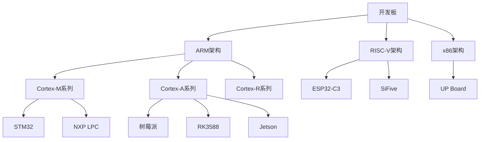
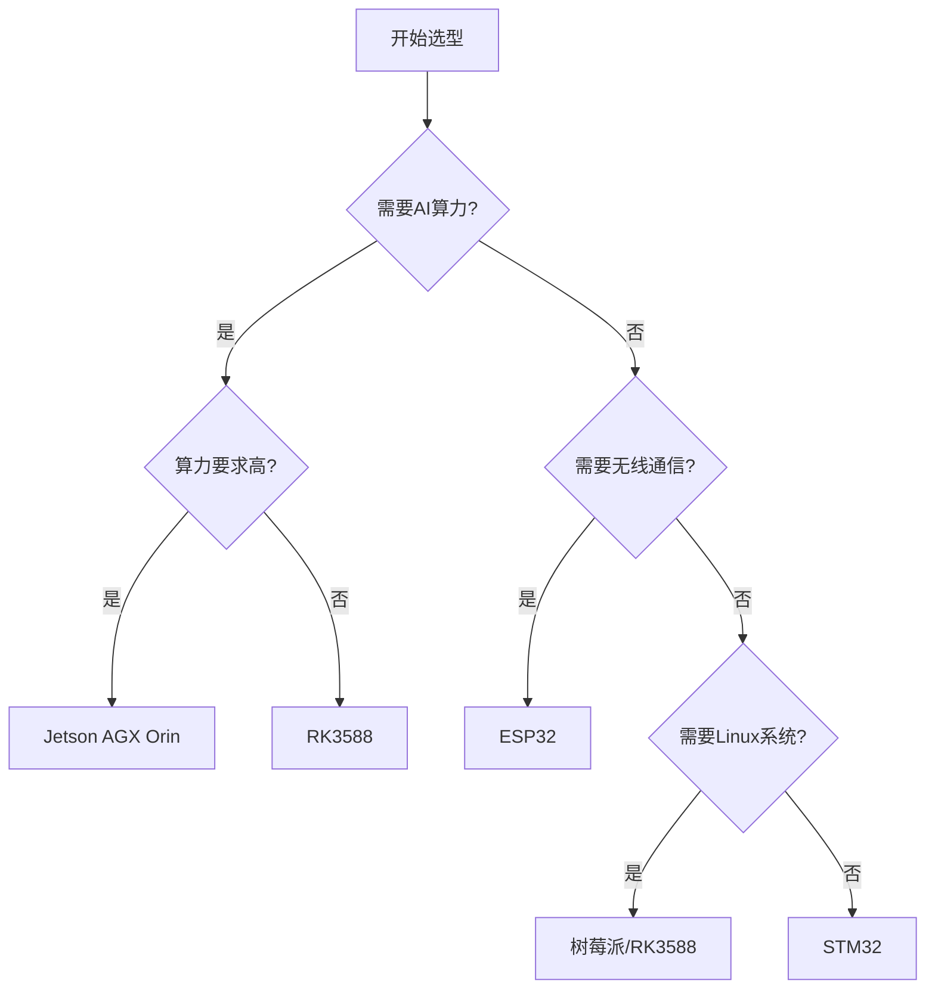

# 开发板

> 先读：开发板就是一块"裸奔"的电路板，上面有处理器、内存、各种接口，但没外壳没屏幕没键盘。它是工程师用来验证想法、调试程序的原型平台。

**关键词**：开发板、SoC、处理器、调试接口、外设、原型设计

## 抽象类比

普通电脑像精装房，拎包入住但不能随便改结构。开发板像毛坯房 + 工具箱，什么都要自己装，但想怎么改就怎么改。

嵌入式工程师不会直接在最终产品上开发（成本太高、风险太大），而是先在开发板上验证所有功能，确认没问题后再设计专用电路板。

## 什么是开发板？

**一句话定义**：开发板是**为嵌入式开发设计的原型电路板**，集成了处理器、内存、存储、各种接口，方便工程师进行软件开发、调试和验证。

### 生活比喻

- **普通电脑**：像成品汽车，能开但不能拆开看发动机
- **开发板**：像汽车底盘 + 工具箱，能看到每个零件，能随便改装
- **最终产品**：像量产汽车，基于开发板验证后的设计方案

**简单说**：开发板 = 处理器（大脑）+ 内存（记忆）+ 接口（五官和手脚）+ 调试工具（听诊器）

---

## 开发板 vs 普通电脑

### 核心区别

| 特性 | 普通电脑 | 开发板 | 为什么这样设计 |
|------|----------|--------|----------------|
| **形态** | 机箱 + 显示器 + 键鼠 | 裸露电路板 | 开发板要方便测量和调试 |
| **接口** | USB、HDMI、网口等标准接口 | GPIO、UART、I2C、SPI 等底层接口 | 开发板要连接各种传感器和执行器 |
| **操作系统** | Windows/macOS/Linux | 裸机/RTOS/嵌入式 Linux | 开发板要测试不同系统 |
| **调试方式** | 屏幕显示、键盘输入 | 串口打印、JTAG 调试、LED 指示 | 开发板没有屏幕，要通过其他方式观察状态 |
| **用途** | 办公、娱乐、开发 | 嵌入式开发、系统验证、原型设计 | 开发板是工具不是产品 |
| **价格** | 几千到几万 | 几十到几千 | 开发板成本要低，方便批量采购 |

### 为什么不用电脑直接开发？

1. **架构不同**：电脑多是 x86 架构，嵌入式多用 ARM/RISC-V
2. **接口不同**：电脑没有 GPIO、UART 等嵌入式接口
3. **资源不同**：电脑资源充足，嵌入式资源受限，需要针对性优化
4. **实时性**：嵌入式往往要求实时响应，电脑系统不保证
5. **功耗**：嵌入式关注低功耗，电脑不考虑这个

**类比**：用电脑开发嵌入式系统，像用卡车学开摩托车——虽然都是车，但操控方式、使用场景完全不同。

---

## 开发板的核心组成

### 基本组件

```
┌─────────────────────────────────────┐
│           开发板                     │
│                                     │
│  ┌───────────┐    ┌──────────┐     │
│  │  处理器    │    │   内存    │     │
│  │  (CPU)    │◄──►│  (RAM)   │     │
│  └─────┬─────┘    └──────────┘     │
│        │                           │
│  ┌─────┴─────┐    ┌──────────┐     │
│  │   存储     │    │  调试接口 │     │
│  │ (Flash)   │    │(UART/JTAG)│    │
│  └───────────┘    └──────────┘     │
│                                     │
│  ┌──────────────────────────┐      │
│  │      各种外设接口         │      │
│  │ GPIO/UART/I2C/SPI/USB... │      │
│  └──────────────────────────┘      │
│                                     │
└─────────────────────────────────────┘
```

### 每个组件的作用

| 组件 | 作用 | 类比 |
|------|------|------|
| **处理器（CPU/SoC）** | 执行代码，是整个板子的大脑 | 像人的大脑，负责思考 |
| **内存（RAM）** | 运行程序时临时存储数据 | 像人的短期记忆，断电就忘 |
| **存储（Flash）** | 永久保存程序和数据 | 像人的长期记忆，断电不忘 |
| **调试接口** | 连接电脑，进行调试和烧录 | 像医生的听诊器，用来诊断 |
| **外设接口** | 连接传感器、执行器等 | 像人的五官和手脚，感知和行动 |
| **电源管理** | 提供稳定电压，管理功耗 | 像人的心脏，提供能量 |
| **时钟电路** | 提供时序信号 | 像人的心跳，维持节奏 |

---

## 开发板的使用场景

### 1. 软件开发与调试

**场景**：编写操作系统、驱动程序、应用程序

**工作流程**：
```
写代码 → 编译 → 烧录到开发板 → 运行测试 → 调试 → 修改代码
```

**优势**：
- 真实硬件环境，不是模拟
- 可以直接测量性能、功耗
- 可以连接真实传感器测试

### 2. 系统验证

**场景**：验证操作系统能否正常启动，驱动是否工作

**验证内容**：
- 系统能否启动
- 内存管理是否正常
- 外设驱动是否工作
- 性能是否达标

### 3. 原型设计

**场景**：在开发板上验证想法，确认可行后再设计产品

**流程**：
```
想法 → 开发板验证 → 确认可行 → 设计专用电路 → 量产
```

**优势**：
- 成本低（开发板可重复使用）
- 风险小（不会损坏最终产品）
- 速度快（快速迭代验证）

### 4. 学习教学

**场景**：学习嵌入式开发、操作系统原理

**优势**：
- 能看到硬件实际运行
- 能动手实践
- 能理解软硬件协同

---

## 常见开发板类型

### 按处理器分类

| 类型 | 代表 | 特点 | 适合场景 |
|------|------|------|----------|
| **MCU 开发板** | STM32、Arduino、ESP32 | 低功耗、低成本、简单 | 简单控制、IoT 设备 |
| **MPU 开发板** | 树莓派、RK3588 | 高性能、能跑 Linux | 复杂应用、AI、多媒体 |
| **FPGA 开发板** | Xilinx、Intel | 可编程硬件、并行处理 | 数字电路设计、信号处理 |
| **AI 开发板** | Jetson、K210 | 集成 NPU、AI 加速 | 边缘 AI、视觉识别 |

### 按用途分类

| 类型 | 特点 | 例子 |
|------|------|------|
| **入门级** | 简单、便宜、资料多 | Arduino、STM32 最小系统板 |
| **通用型** | 接口丰富、适用性广 | 树莓派、RK3588 开发板 |
| **专用型** | 针对特定应用优化 | 汽车电子开发板、工业控制板 |
| **高性能** | 多核、大内存、强算力 | NVIDIA Jetson、RK3588 |

---

## 设计哲学

开发板的设计哲学可以浓缩为一句话：**用通用平台验证专用方案**——先在"试验田"里把想法跑通，再设计最终产品。

### 解决的核心问题

从零设计一块嵌入式电路板需要画原理图、PCB Layout、打样、焊接、调试，周期长达数周甚至数月，而且一旦出错就要重新来过。开发板解决的核心问题是：**如何让工程师跳过硬件设计的漫长周期，直接开始软件开发和系统验证？** 它把"硬件准备好"这件事前置，让你专注于软件和方案验证。

### 关键设计取舍

| 取舍维度 | 选择 | 放弃 | 类比 |
| :--- | :--- | :--- | :--- |
| **通用 vs 专用** | 接口丰富、适用多种场景 | 极致优化的单一用途 | 像瑞士军刀 vs 专用刀具 |
| **开放 vs 封装** | 引脚全部裸露、可测量 | 产品的美观外壳和防护 | 像毛坯房 vs 精装房 |
| **可重复使用 vs 一次性** | 一块板子反复用于多个项目 | 针对单一产品的定制化 | 像实验台 vs 量产流水线 |
| **生态 vs 性能** | 优先考虑资料和社区 | 追求极致硬件参数 | 像选热门车型 vs 小众超跑 |
| **成本 vs 功能** | 留足扩展接口和余量 | 最低物料成本 | 像买带工具箱的毛坯房 |

### 设计哲学的深层逻辑

1. **原型先行**：开发板是"试验田"——先在这里验证所有功能，确认可行后再设计专用电路板，避免在量产板上冒险。
2. **暴露一切**：开发板把所有引脚、调试接口都裸露出来，方便测量和修改。这和最终产品"封装隐藏"的设计完全相反。
3. **生态比参数重要**：一块资料丰富、社区活跃的板子（如树莓派、STM32），比参数更强但没人用的板子更实用——遇到问题能搜到答案。
4. **从通用到专用**：开发阶段用通用板验证，量产阶段设计专用板。开发板是"中间产物"，不是最终产品。

**核心类比**：开发板像一套**配好的厨房**——锅、灶、刀、案板都有，你不用先造锅，只需开始练菜。普通电脑像精装房拎包入住但不能改结构，开发板像毛坯房加工具箱——什么都能改但什么都要自己装。

---

## 深入理解（进阶）

> 💡 如果只想了解开发板的概念，读到这里就够了。下面是技术细节。

### SoC（片上系统）

现代开发板多使用 SoC，将多个功能集成在一个芯片中：

```
┌──────────────────────────────┐
│          SoC 芯片             │
│                              │
│  ┌────┐ ┌────┐ ┌────┐       │
│  │CPU │ │GPU │ │NPU │  ...  │
│  └────┘ └────┘ └────┘       │
│                              │
│  ┌────────────────────┐     │
│  │   内存控制器        │     │
│  └────────────────────┘     │
│                              │
│  ┌────────────────────┐     │
│  │   外设接口          │     │
│  │ UART/I2C/SPI/USB   │     │
│  └────────────────────┘     │
└──────────────────────────────┘
```

RK3588 就是这样的 SoC：集成 CPU、GPU、NPU、视频编解码器等。

### 开发板调试方式

| 方式 | 工具 | 能做什么 |
|------|------|----------|
| **串口打印** | UART + 串口调试助手 | 查看程序输出、日志 |
| **JTAG/SWD** | J-Link、ST-Link | 单步执行、断点、查看内存 |
| **LED 指示** | GPIO 控制 LED | 简单状态指示 |
| **逻辑分析仪** | Saleae 等 | 分析时序、协议 |
| **示波器** | 通用示波器 | 测量电压、频率 |

---

## 总结

### 三句话讲清楚开发板

1. 开发板是为嵌入式开发设计的原型电路板，集成了处理器、内存和各种接口
2. 它让工程师能在真实硬件上开发、调试和验证，而不是在最终产品上冒险
3. 开发板是嵌入式开发的"试验田"，验证成功后才能设计量产产品

### 核心类比

> 开发板像"毛坯房 + 工具箱"——普通电脑是精装房拎包入住但不能改，开发板什么都能改但什么都要自己装。

### 关键词

**开发板、SoC、处理器、调试接口、外设、原型设计**

### 与比赛项目的关系

RK3588 开发板是 StarryOS 项目的目标运行平台，是从软件模拟走向真实硬件的关键载体。在开发板上的成功运行，是项目从"理论验证"到"工程实现"的重要里程碑。

---

## 开发板分类

### 按应用场景分类

| 类型 | 特点 | 适用场景 | 代表产品 |
| :--- | :--- | :--- | :--- |
| **微控制器(MCU)** | 低功耗、低成本、资源有限 | 物联网、传感器节点 | STM32、ESP32 |
| **单板计算机(SBC)** | 高性能、完整系统、Linux支持 | 智能终端、边缘计算 | 树莓派、RK3588 |
| **AI边缘计算** | 集成NPU/TPU、AI加速 | 计算机视觉、深度学习 | Jetson、RK3588 |
| **无线模块** | 专注通信功能 | 物联网网关、远程控制 | ESP32、nRF52 |

### 按处理器架构分类



> **设计思想**：ARM架构统治嵌入式世界，其中 M 系列像"专心做一件事的工人"（低功耗、单任务），A 系列像"多面手经理"（高性能、能跑Linux）。

---

## 主流开发板详解

### 1. 树莓派（Raspberry Pi）：嵌入式开发的瑞士军刀

**类比**：就像一辆经济实惠的家用轿车——用途广泛，配件丰富，社区庞大，是大多数人入门的第一选择。

**设计理念**：通用性优先。树莓派不追求极致性能，而是追求"什么都能做"——从物联网网关到小型服务器，从教学实验到原型开发。

**适用场景**：
- 物联网网关
- 智能家居控制器
- 小型服务器
- 教学和原型开发

**为什么选它**：生态系统成熟，资料丰富，价格便宜，社区活跃——碰到问题几乎都能搜到答案。

---

### 2. RK3588：AI边缘计算的旗舰

**类比**：就像一辆高性能跑车——拥有强大的计算能力和AI加速，适合需要"边跑边算"的场景。

**设计理念**：算力与接口的平衡。RK3588 把强大的 NPU（神经网络处理器）和丰富的外设接口打包在一起，让边缘设备也能跑AI模型。

**适用场景**：
- AI边缘计算
- 计算机视觉
- 智能安防
- 车载娱乐系统

**为什么选它**：在"不贵"和"够强"之间找到了很好的平衡点，是国产芯片里做AI边缘计算的热门选择。

---

### 3. NVIDIA Jetson：AI开发者的首选

**类比**：就像一辆F1赛车——专为AI计算优化，性能顶级，但价格也高。

**设计理念**：极致AI算力。Jetson 把 NVIDIA 的 GPU 技术浓缩到一块小板子上，让你在边缘设备上也能跑复杂的深度学习模型。

**适用场景**：
- 自动驾驶原型
- 机器人视觉
- 深度学习推理
- 边缘AI服务器

**为什么选它**：如果你需要最强的AI算力，并且用 CUDA 生态，Jetson 是目前边缘端的顶配。

---

### 4. ESP32：物联网的小精灵

**类比**：就像一只灵活的小鸟——小巧轻便，自带 Wi-Fi 和蓝牙，便宜到可以到处撒。

**设计理念**：无线连接 + 极致低成本。ESP32 的核心价值不是算力，而是用极低的价格让设备"联网"。

**适用场景**：
- 物联网传感器节点
- 智能家居设备
- 可穿戴设备
- 低功耗网关

**为什么选它**：内置Wi-Fi和蓝牙，超低功耗，价格极便宜——做物联网产品的首选。

---

### 5. STM32：工业级嵌入式的标杆

**类比**：就像一台精密的工业机器——稳定可靠，功能强大，在工业控制领域是绝对的王者。

**设计理念**：可靠性至上。STM32 追求的不是性能，而是"在任何环境下都能稳定运行"——从零下40度到高温车间，从简单的LED控制到复杂的电机驱动。

**适用场景**：
- 工业控制
- 电机驱动
- 仪器仪表
- 汽车电子

**为什么选它**：工业级可靠性，极低功耗模式，外设资源丰富——做硬件产品的不二之选。

---

## 开发板选择指南

### 选择因素

| 因素 | 说明 | 权重 |
| :--- | :--- | :--- |
| **性能需求** | CPU、内存、算力要求 | 高 |
| **功耗约束** | 电池供电还是有线供电 | 高 |
| **接口需求** | 需要哪些外设接口 | 中 |
| **开发环境** | 熟悉的工具链和生态 | 中 |
| **成本预算** | 单位成本和采购量 | 中 |
| **量产可行性** | 是否支持批量生产 | 低 |

### 选型决策树



### 详细对比

| 开发板 | 定位 | 代表场景 | 一句话 |
| :--- | :--- | :--- | :--- |
| **树莓派5** | 通用入门 | 物联网网关 | "什么都能做的瑞士军刀" |
| **RK3588** | AI性价比 | AI边缘计算 | "不贵但够强的AI加速器" |
| **Jetson** | AI旗舰 | 高端AI应用 | "边缘AI的性能天花板" |
| **ESP32** | IoT王者 | 传感器节点 | "几块钱就能让设备联网" |
| **STM32** | 工业标杆 | 工业控制 | "稳定到令人发指" |

---

## 开发板常见误区

### 1. 过度追求性能
- **问题**：选择了远超需求的高性能开发板，增加成本和功耗
- **类比**：送外卖却开了辆法拉利——油钱都赚不回来
- **解决**：根据实际需求选择，MCU能搞定的就不用SBC

### 2. 忽视软件生态
- **问题**：选择了硬件强大但软件支持差的开发板
- **类比**：买了个顶级厨房但找不到会用的厨师
- **解决**：优先选择文档完善、社区活跃的平台

### 3. 不考虑量产
- **问题**：原型阶段使用开发板，量产时难以转换
- **类比**：用乐高搭了个样板间，结果要批量生产时发现乐高太贵
- **解决**：选择有量产方案的开发板或核心板

### 4. 忽略电源设计
- **问题**：外设供电不足导致不稳定
- **类比**：一个插座接了十个电器，随时跳闸
- **解决**：了解开发板电源能力，必要时外接电源

### 5. 调试手段不足
- **问题**：没有调试工具，难以定位问题
- **类比**：医生看病没有听诊器，只能猜
- **解决**：准备调试器、逻辑分析仪等工具

---

## 面试速答

### Q: 开发板和普通电脑有什么区别？为什么不用电脑直接开发嵌入式？
A: 开发板暴露了 GPIO、UART、I2C 等底层接口，能直接连传感器和执行器，架构多为 ARM/RISC-V，能跑 RTOS 或嵌入式 Linux。普通电脑是 x86 架构、没有这些接口、资源充足无法模拟资源受限场景。类比：用电脑开发嵌入式像用卡车学开摩托车，都是车但操控和场景完全不同。

### Q: 选开发板时最看重什么？
A: 第一看**需求匹配**（是否需要 AI 算力、是否需要 Linux、功耗约束）；第二看**生态资料**（文档是否完善、社区是否活跃、遇到问题能否搜到答案）；第三看**接口丰富度**（是否有足够的外设接口）。参数最强不等于最合适，"资料多 + 够用"往往比"参数强 + 没人用"更实用。

### Q: SoC 和 MCU 开发板有什么区别？
A: MCU 开发板（如 STM32、ESP32）集成了 CPU、RAM、Flash 于一体，低功耗、低成本，适合简单控制和 IoT；SoC/MPU 开发板（如 RK3588、树莓派）性能强、能跑完整 Linux，适合复杂应用和 AI 推理。选型看任务复杂度：简单控制选 MCU，需要 OS 和算力选 SoC。

### Q: 开发板能直接当产品用吗？
A: 一般不行。开发板体积大、接口多、没有外壳防护、成本高，适合原型验证和学习。量产时通常会基于开发板验证的方案，设计专用的精简电路板（PCB），去掉不必要的接口和外设，降低成本并满足产品的外观和防护要求。开发板是"试验田"，不是"最终产品"。

### Q: RK3588 开发板为什么适合 AI 边缘计算？
A: RK3588 集成了 CPU、GPU 和 **6 TOPS 算力的 NPU**，能在本地高效运行神经网络推理，同时有丰富的接口（摄像头、串口、存储）连接外设。它在"不贵"和"够强"之间找到了平衡，是国产芯片里做 AI 边缘计算的热门选择。
