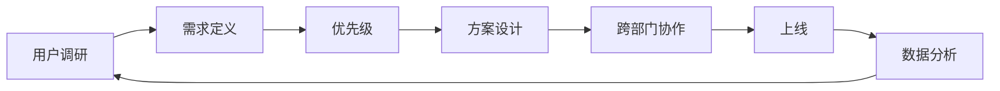
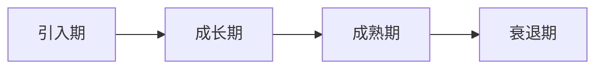
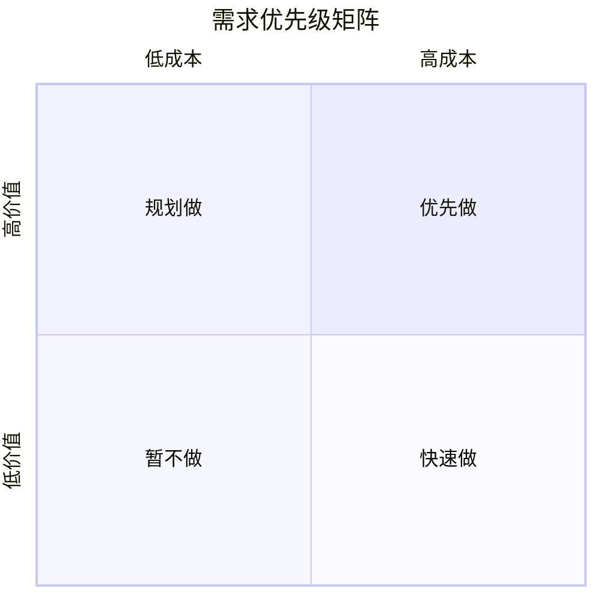

# 产品经理

> 产品经理（Product Manager，PM）是把"用户需求、商业目标、技术可行性"翻译成"可执行的产品方案"的角色，是产品的"小 CEO"，对结果负责但不一定有直接管理权。

**关键词**：产品经理、需求分析、PRD、产品度量、协作边界

## 抽象类比

产品经理像"餐厅的主厨兼菜单设计师"。主厨要决定菜单上有什么菜（产品定义）、食材从哪来（资源协调）、菜品怎么定价（商业策略）、客人吃完满不满意（用户体验），还要带厨房团队按时出餐（项目管理）。但他不亲自炒每一锅菜——那是工程师的活。

再换个类比：产品经理是"造船的总设计师"。船长（CEO）决定开去哪个港口，但船怎么造、用什么材料、几层甲板、配备什么救生设备，是设计师根据航海目的、船员构成、预算来决定的。船造得好不好，决定了能不能顺利到达港口。

## 一、产品经理是什么

### 角色定位

产品经理（PM）是产品的"第一责任人"，对产品的方向、范围、优先级、效果负责。核心特征：

- 没有"直接管理权"，但要"对结果负责"
- 不写代码、不画设计图，但要协调这些角色一起做事
- 不是项目经理，但要推动项目按时上线
- 不是老板，但要替老板想清楚"做什么、不做什么"

### 产品经理 vs 项目经理

- 关注：PM 做什么、为什么做；项目经理怎么做、什么时候做完
- 时间：PM 长期（产品全生命周期）；项目经理短期（项目周期）
- 决策：PM 定义需求、排优先级；项目经理控进度、风险、资源
- 衡量：PM 看用户价值、商业指标；项目经理看按时、按预算、按质量交付

简而言之：PM 决定"做对的事"，项目经理决定"把事做对"。

### 产品经理的核心职责

- 用户调研：理解用户是谁、要什么、痛点在哪
- 需求定义：把模糊的诉求翻译成清晰的需求
- 优先级排序：在有限资源下决定先做什么、后做什么
- 方案设计：画原型、写 PRD、定流程
- 跨部门协作：推动设计、开发、测试、运营一起落地
- 数据分析：上线后看数据，决定迭代方向
- 商业化思考：怎么赚钱、怎么持续赚钱

---

## 二、产品经理的分类

不同类型的产品，对产品经理的能力要求差别很大。

### 按产品类型分

- C 端产品（Consumer）：面向个人用户，重体验、重增长，如微信、抖音
- B 端产品（Business）：面向企业，重效率、重流程，如钉钉、Salesforce
- 数据产品：以数据本身为核心，如 BI 报表、数据中台
- 策略产品：用算法做分发、定价、风控，如推荐、广告
- 平台产品：为其他产品提供能力，如开放平台、支付中台
- 硬件产品：实体设备 + 软件配合，如手机、智能音箱

### 按职业阶段分

- 产品助理：执行需求、画原型、跟进开发
- 产品经理：独立负责一个模块或小产品
- 高级产品经理：负责完整产品线，能定义方向
- 产品总监：管理产品团队，对整体业务负责
- CPO（首席产品官）：制定产品战略，对全公司产品负责

### 不同类型的技能侧重

- C 端：用户洞察、增长、UI/UX 感
- B 端：业务理解、流程梳理、复杂逻辑
- 数据：SQL、数据建模、可视化
- 策略：算法理解、AB 实验、数据驱动
- 平台：抽象能力、API 设计、技术理解

---

## 三、产品生命周期

产品从诞生到退出，会经历四个阶段，每个阶段策略不同。

### 四个阶段

### 引入期（Introduction）

- 特征：产品刚上线，用户少，市场不认可
- 策略：快速验证 PMF（Product-Market Fit），打磨核心功能、积累种子用户
- 风险：方向不对，全盘皆输

### 成长期（Growth）

- 特征：用户快速增长，竞争者开始进入
- 策略：跑马圈地抢占市场份额，做增长黑客、留存优化、商业化探索
- 风险：扩张太快导致产品臃肿、服务质量下降

### 成熟期（Maturity）

- 特征：增长放缓，用户基数大，竞争激烈
- 策略：精细化运营，提升 ARPU、降低成本，做商业化变现、用户分层、差异化
- 风险：被新形态产品颠覆

### 衰退期（Decline）

- 特征：用户流失，市场萎缩
- 策略：转型、收缩、或退出，维护核心用户、寻找第二曲线
- 风险：舍不得退出，耗费资源

---

## 四、需求分析

需求分析是产品经理的"基本功中的基本功"。

### 用户需求 vs 产品需求

- 用户需求：用户说要什么（"我要一匹更快的马"）
- 产品需求：产品该做什么（"提供更快的交通工具"）

PM 的任务是从"用户需求"洞察到"真实诉求"再转化为"产品需求"——用户说的不一定是他想要的，想要的也不一定是他需要的。

### Kano 模型

把需求分五类，决定优先级：

- 基本型（Must-be）：没有就骂街，有了也无所谓，如登录稳定
- 期望型（Performance）：做得越好越满意，如加载速度
- 兴奋型（Attractive）：没有也行，有了惊喜，如彩蛋
- 无差异型（Indifferent）：做不做用户都不在意
- 反向型（Reverse）：做了反而惹用户烦

优先级：基本型 > 期望型 > 兴奋型，无差异不做，反向型避免。

### MoSCoW 优先级法

- Must：必须有，否则产品无法上线
- Should：应该有，重要但可延期
- Could：可以有，资源够再做
- Won't：这次不做，下次考虑

### 需求池管理

- 所有需求进需求池，统一管理
- 字段：来源、用户、场景、价值、工作量、优先级、状态
- 定期评审：每周或每两周梳理一次
- 淘汰机制：长期没人做的需求要清理，避免需求池膨胀

### 需求优先级排序方法

- RICE 模型：Reach（触达）× Impact（影响）× Confidence（信心）÷ Effort（成本）
- Kano 模型：基于用户满意度
- 价值 vs 成本矩阵：高价值低成本优先
- 加权评分：多个维度加权打分

---

## 五、产品设计与文档

产品经理的"输出物"主要是文档和原型。

### 三大文档

- BRD（Business Requirement Document）：商业需求文档，讲"为什么要做、值不值得做"，给老板看
- MRD（Market Requirement Document）：市场需求文档，讲"市场怎么样、用户是谁"，给团队看
- PRD（Product Requirement Document）：产品需求文档，讲"具体做什么、长什么样"，给开发看

实际工作中 BRD 和 MRD 在小公司常被简化，PRD 是必备的。

### PRD 的核心内容

- 背景与目标：为什么做、要达到什么效果
- 用户与场景：谁、在什么场景下、要解决什么问题
- 功能描述：详细的功能点、交互流程、边界条件
- 数据埋点：要采集哪些指标、怎么定义
- 验收标准：什么算做完
- 上线计划：灰度节奏、回滚方案

### 用户故事（User Story）

敏捷开发中常用，格式："作为一个 [角色]，我想要 [功能]，以便 [价值]"。

- 作为注册用户，我想要找回密码，以便能登录账号
- 作为管理员，我想要批量导入用户，以便节省时间

### 原型与流程图

- 低保真原型：纸笔或线框图，验证思路
- 高保真原型：交互完整，可演示
- 流程图：用泳道图表达角色与系统交互
- 状态图：表达对象状态变化（如订单状态）

### 信息架构（Information Architecture）

- 站点地图：整个产品的页面层级
- 导航设计：用户怎么找到内容
- 标签系统：内容怎么命名和分类
- 搜索系统：用户怎么搜到内容

参考 [UI 设计](UI设计.md) 中的视觉与交互部分。

---

## 六、产品度量

产品做得好不好，靠数据说话。

### AARRR 海盗模型

海盗模型是增长分析的经典框架：Acquisition（获取）→ Activation（激活）→ Retention（留存）→ Revenue（变现）→ Referral（传播）。每个环节都要有对应指标，传播会反向带来新获取，形成增长飞轮。

### 北极星指标（North Star Metric）

产品最核心的单一指标，能同时代表用户价值和商业价值：抖音看日均使用时长、知乎看优质回答数、Airbnb 看预订间夜数、Spotify 看总收听时长。选择原则：能反映用户核心价值、能长期可持续、能拆解到具体动作。

### 常用指标

- DAU/MAU：用户规模；DAU/MAU 比值看粘性，> 50% 算高频
- 留存率：次日、7 日、30 日留存
- 转化漏斗：从进入到完成关键路径各步转化率
- ARPU：每用户平均收入
- LTV（用户生命周期价值）/ CAC（获客成本）：商业健康度，< 1 不可持续，= 3 健康，> 5 要么增长太慢要么算漏成本
- NPS（净推荐值）：用户是否愿意推荐

---

## 七、产品决策

产品经理每天都在做决策，要靠数据而非拍脑袋。基本流程是：先定假设（A 比 B 好）→ 设计实验（A/B 测试或灰度）→ 看结果（是否显著、有无副作用）→ 下结论（保留、放弃、继续观察）。

### A/B 测试与灰度发布

把用户随机分组，A 组用旧方案、B 组用新方案。注意样本量要够、时长要覆盖周期性、一次只改一个变量、关注副作用。灰度发布是逐步放量：1% → 5% → 20% → 50% → 100%，边放边监控，出问题立刻回滚，适合大改动、风险高的功能。

### 用户访谈

定性研究，了解"为什么"。不要用引导性问题（"你觉得这个功能好吗？"是错的），用开放性问题（"你上次用这个功能是什么场景？"）。5-8 个用户就能发现主要问题。注意区分"用户说的"和"用户做的"。

### 竞品分析

不是抄竞品，而是理解差异：直接竞品做同样的事（美团 vs 饿了么）、间接竞品解决同样需求（电影 vs 短视频）、潜在竞品可能进入（字节做教育）。分析维度包括功能、体验、商业模式、用户规模、运营策略。

---

## 八、产品经理的协作

产品经理是"协作的中心"，要和各种角色打交道。

### 与设计的协作

- PM 给需求，设计出方案
- PM 不要替设计师画细节，给"目标和约束"即可
- 评审阶段充分讨论，定稿后少改

### 与研发的协作

- PM 写清楚 PRD，开发评估工作量
- PM 不替开发做技术决策，但要理解可行性
- 上线前 PM 验收，是否符合预期

### 与测试的协作

- PM 提供验收标准，测试写用例
- 边界、异常、兼容性由测试把关
- 上线后线上问题 PM 一起复盘

### 与运营的协作

- PM 上线产品，运营推广产品
- 运营反馈一线用户声音，PM 沉淀到需求池
- 数据指标共同制定，避免各看各的

### 与市场/销售的协作

- B 端产品：销售在前线卖，PM 提供 Demo 和方案
- C 端产品：市场做品牌，PM 做产品体验
- 客户反馈通过销售/市场传到 PM，再转化为需求

### 协作边界

- "做什么"由 PM 定；"怎么做"由研发定；"看起来什么样"由设计定
- "什么时候上线"由项目经理定；"上线后效果"由 PM 和运营共担
- 反馈链路：运营/市场把一线声音反馈给 PM，PM 沉淀到需求池

---

## 九、产品经理成长路径

产品经理的成长是"横向拓宽 + 纵向加深"的过程。

### 成长阶段与能力跃迁

- 产品助理（0-1 年）：执行为主，画原型、写 PRD，从执行到独立思考
- 产品经理（1-3 年）：独立负责模块，能定义需求，从单功能到产品线
- 高级产品经理（3-5 年）：负责完整产品线，对数据负责，从产品到业务
- 产品总监（5-8 年）：管理团队，对业务负责，从战术到战略
- CPO（8 年以上）：制定产品战略，对全公司产品负责

### 三个能力维度

- 专业能力：需求分析、原型、PRD、数据分析
- 通用能力：沟通、协调、表达、决策
- 领域能力：对所在行业（电商、社交、金融）的深度理解

### 常见误区

- 需求收集器：用户要什么就做什么，没有取舍
- 画图员：只画原型不思考，沦为"工具人"
- 项目经理：只盯进度不思考方向，没价值
- 自嗨：自己觉得好的功能就做，不看数据
- 越界：替设计师画图、替开发写代码

### 学习方法

- 多用产品：刻意拆解主流产品的设计逻辑
- 多看数据：用数据说话而不是直觉
- 多读书：《启示录》《俞军产品方法论》《幕后产品》
- 多复盘：上线后看效果，对的复盘对的、错的复盘错的
- 多交流：和同行、和用户、和团队

参考 [产品运营](产品运营.md) 了解运营视角，参考 [项目管理](项目管理.md) 了解项目推进方法。

---

## 面试速答

### Q1：产品经理和项目经理有什么区别？

回答思路：核心是"关注点不同"。PM 关注"做什么、为什么做"，对产品方向和效果负责；项目经理关注"怎么做、什么时候做完"，对进度和质量负责。PM 决定"做对的事"，项目经理决定"把事做对"。两者在小团队常重叠，但职责边界清晰：PM 定需求和优先级，项目经理控进度和风险。

### Q2：你怎么做需求优先级排序？

回答思路：综合三种方法。Kano 模型定性，识别基本型/期望型/兴奋型；RICE 模型定量，按 Reach × Impact × Confidence ÷ Effort 打分；价值-成本矩阵可视化，高价值低成本优先做。三者结合用，最终还要结合战略目标人工调整，不是机械算分。

### Q3：你怎么衡量一个产品做得好不好？

回答思路：分三层。北极星指标（如抖音日均时长）反映核心价值；AARRR 海盗模型看全链路健康度，留存是关键；NPS、满意度、客诉率反映体验。三层结合才能全面衡量，单看任何指标都容易误判——只看 DAU 忽略留存，只看留存忽略商业可持续性。

### Q4：什么是 PRD？怎么写好一份 PRD？

回答思路：PRD 是给开发、测试、设计看的产品需求文档，包括背景与目标、用户与场景、功能描述、数据埋点、验收标准、上线计划。写好的关键：背景说清让团队理解"为什么"；流程画清用流程图和状态图表达复杂逻辑；边界写清覆盖空数据、超长文本、并发、异常；验收可量化，每个功能有明确完成标准。

### Q5：上线一个功能后效果不好怎么办？

回答思路：分四步。先确认数据准确，避免基于错误数据决策；再拆解漏斗找流失最大的环节；然后定性访谈判断是需求伪需求还是体验问题；最后决定方向——伪需求果断下线、体验问题迭代优化、数据周期短则延长观察。关键心态是不要为"上线了"强行留，所有功能都要有下线机制。

---

## 相关文档

- [UI 设计](UI设计.md)
- [产品运营](产品运营.md)
- [项目管理](项目管理.md)
- [软件工程](软件工程.md)
- [软件测试](软件测试.md)
- [技术管理入门](技术管理入门.md)

## 外部参考

- [启示录：打造用户喜爱的产品（Marty Cagan）](https://book.douban.com/subject/10770202/)
- [俞军产品方法论](https://book.douban.com/subject/34758851/)
- [AARRR 海盗模型](https://www.growthhackers.com/terms/aarrr-pirate-funnel)
- [Kano 模型](https://en.wikipedia.org/wiki/Kano_model)
- [Product School](https://productschool.com/)

---

## 能力落地闭环

- **产出任务**：从一次用户访谈形成问题陈述、机会假设、PRD、验收标准和版本复盘。
- **验收证据**：目标用户、场景、价值、成功指标、范围与不做事项都能被团队复述。
- **关键边界**：需求数量不是价值；防止把用户表达的方案误当根本问题。

每次实践后用“目标是否达成、依据是什么、哪里返工、下次改变什么”四个问题复盘，把方法沉淀为模板或检查清单，而不是只留下结论。
