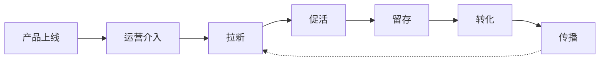
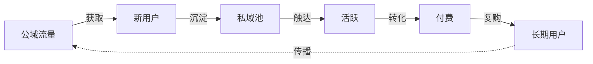
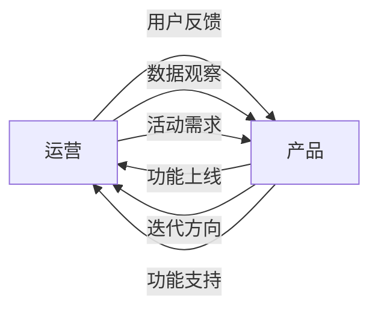

# 产品运营

> 产品运营（Product Operations）是把已经造好的产品"推"到用户面前、让用户留下来、让产品持续产生价值的工作，是产品增长的发动机。

**关键词**：产品运营、用户运营、内容运营、增长黑客、AARRR

## 抽象类比

产品运营像"电影发行 + 影院运营"。产品经理是导演，把电影拍出来；运营是发行方和影院，要决定什么时候上映、在哪些影院排片、怎么做宣传、怎么让观众买票、怎么让观众看完推荐给朋友。电影再好，没人知道、没人看，也产生不了价值。

再换个类比：产品是"种子"，产品经理负责把种子造出来；运营是"耕耘"，负责浇水、施肥、除草、防虫，让种子长成大树并结出果实。耕耘得好，一粒种子能长成森林；耕耘不好，再好的种子也会烂在地里。

## 一、产品运营是什么

### 核心定义

产品运营（Product Operations）是通过内容、用户、活动、数据等手段，让产品获得用户、留住用户、产生价值的工作。它的目标是"让好产品被更多人用、用得更久、用得更深"。

### 与产品经理的区别

- 关注点：PM 造产品，运营推产品
- 时间点：PM 在上线前主导，运营在上线后主导
- 核心产出：PM 出 PRD、原型、功能；运营出活动、内容、数据报告
- 衡量指标：PM 看功能上线、需求完成；运营看 DAU、留存、转化
- 思维方式：PM 解决问题，运营放大价值

简单说：产品经理"造"产品，运营"推"产品。两者相辅相成，缺一不可。

### 运营的核心目标

- 让用户来（拉新）、留下来（留存）、用得深（活跃）
- 让用户付费（转化）、带新用户（传播）

---

## 二、运营的核心分类

运营按对象和手段分成几大类，小公司一人多角色，大公司分工精细。

### 主要分类

- 内容运营：以内容为手段，吸引和留住用户
- 用户运营：以用户为对象，做分层、生命周期管理
- 活动运营：以活动为载体，短期内集中放大效果
- 数据运营：以数据为依据，驱动决策和优化
- 社区运营：以社区为场景，培育氛围和关系
- 新媒体运营：以新媒体渠道为阵地，做品牌和引流

### 各类运营的核心能力

- 内容运营：文案、选题、编辑、视觉
- 用户运营：沟通、分层、活动、心理
- 活动运营：策划、执行、复盘、SOP
- 数据运营：SQL、Excel、看板、分析
- 社区运营：氛围、规则、KOL、内容
- 新媒体运营：选题、文案、设计、视频

### 不同阶段的运营重点

- 启动期：拉新为主，让用户先来
- 成长期：拉新 + 留存并重，做大基数
- 成熟期：留存 + 转化为主，提升 ARPU
- 衰退期：召回为主，延缓流失

---

## 三、用户运营

用户运营是围绕"用户"做的一系列工作，覆盖用户全生命周期。

### AARRR 模型在用户运营的应用

- 拉新（Acquisition）：通过渠道、活动、内容获取新用户
- 促活（Activation）：让新用户完成关键动作，体验核心价值
- 留存（Retention）：让用户持续回来，形成习惯
- 转化（Revenue）：让用户付费或贡献价值
- 召回（Referral 在用户运营里指"召回流失用户"）：把流失用户拉回来

注：AARRR 的 R 在不同语境下指 Referral（传播）或 Retention（留存），用户运营里更常强调留存和召回。

### RFM 模型

用三个维度对用户分层：

- R（Recency）：最近一次活跃时间，越近越好
- F（Frequency）：活跃频次，越高越好
- M（Monetary）：贡献价值（消费/时长/内容），越高越好

把三个维度分高低，得到 8 类用户，针对性运营：

- 高 R 高 F 高 M：核心用户，重点维护
- 低 R 高 F 高 M：曾经的高价值用户，要召回
- 高 R 低 F 低 M：新用户或轻度用户，要培养习惯
- 低 R 低 F 低 M：流失用户，低成本尝试召回

### 用户生命周期管理

- 新用户（0-7 天）：引导教程、首单优惠、新手任务
- 成长期（7-30 天）：习惯养成、内容推荐、社群融入
- 成熟期（30 天以上）：深耕价值、付费转化、推荐传播
- 流失预警：连续 N 天未活跃，触发召回机制
- 流失后：短信、邮件、push、利益点刺激

### KOL 运营

KOL（Key Opinion Leader）是关键意见领袖，对其他用户有影响力。

- 头部 KOL：粉丝量大，价格高，做品牌曝光
- 腰部 KOL：性价比高，做精准转化
- 素人/KOC：真实用户，做口碑和种草
- 自建 KOL：培养自己平台的达人，长期可控

运营反馈如何转化为产品需求，详见 [[产品经理]] 的"需求分析"部分。

---

## 四、内容运营

内容运营通过"生产、分发、消费"全链路管理内容，让内容成为产品的吸引力。

### 内容生产

- UGC（User Generated Content）：用户生产，如抖音、小红书
- PGC（Professional Generated Content）：专业生产，如知乎专栏
- OGC（Occupational Generated Content）：职业生产，如官方编辑
- PUGC：专业用户生产，介于 UGC 和 PGC 之间

### 内容分发策略

- 编辑推荐：人工精选，质量可控
- 算法推荐：基于行为数据个性化推送
- 社交分发：好友看什么我看什么
- 搜索分发：用户主动检索
- 标签分发：按兴趣标签匹配

### 内容审核

- 机审 + 人审：先用 AI 过滤明显违规，再人工复核
- 审核维度：政治、色情、广告、辱骂、侵权
- 处罚机制：警告、删除、限流、封号
- 申诉机制：用户被误判可申诉

### 推荐策略

- 冷启动：新内容靠标签和元数据匹配
- 召回：从海量内容中筛出候选集
- 排序：按相关性、热度、新鲜度加权
- 重排：加入多样性、打散同来源
- 反馈：点击、点赞、评论回流，优化模型

### 内容运营的核心指标

- 生产量、互动率、消费深度（阅读时长/完播率）、覆盖率、转化率（关注、购买）

---

## 五、活动运营

活动是短期内集中放大效果的手段，运营必备能力。

### 活动策划流程

1. 明确目标：拉新？促活？转化？品牌？
2. 选择类型：促销、裂变、抽奖、打卡
3. 设计机制：玩法、规则、奖励
4. 排期执行：时间表、责任人、物料
5. 上线监控：实时看数据，及时调整
6. 复盘总结：效果、问题、改进点

### 常见活动类型

- 促销类：满减、折扣、限时秒杀
- 裂变类：邀请好友得奖励、拼团、砍价
- 抽奖类：转盘、抽签、盲盒
- 打卡类：连续签到、每日任务
- 互动类：投票、PK、征集
- 节日类：双 11、618、春节活动

### 活动执行 SOP

立项（目标、预算、负责人）→ 方案（玩法、规则、UI、文案）→ 开发（技术方案、排期、测试）→ 上线（灰度、监控、客服培训）→ 数据（实时看板、异常告警）→ 复盘（效果对比、问题分析、改进建议）。

### 应急预案

活动上线可能出技术故障（宕机、支付失败）、风控触发（薅羊毛、刷单）、公关危机（规则争议、用户投诉）、法律风险（合规、虚假宣传）。每个风险都要有预案：发现机制、响应人、处理流程、回滚方案。

### 活动复盘要素

- 目标达成：实际 vs 预期
- 过程数据：参与率、转化率、流失点
- ROI：投入产出比
- 问题清单与经验沉淀：下次怎么改进
- 物料归档：素材、文档、数据留底

---

## 六、数据运营

数据是运营的眼睛，没有数据的运营是瞎子摸象。

### 关键指标定义

DAU/MAU、留存率、转化率、ARPU、LTV/CAC 等通用指标的定义详见 [[产品经理]] 的"产品度量"部分。运营视角下要特别关注：

- ROI（投入产出比 = 收益 / 成本）：衡量每次活动、每个渠道的投入产出效率
- 指标口径要"统一"，否则各团队各看各的数据，对不齐结论

### 数据看板

按时间维度分实时看板（当天关键指标）、日报、周报、月报，按场景分常规看板和活动专题看板。

### 漏斗分析

把用户路径拆成步骤看每步流失，如曝光 10000 → 点击 2000（20%）→ 注册 800（40%）→ 激活 400（50%）→ 付费 80（20%）。漏斗的每一步都是优化点，流失最大的环节优先优化。

### 归因分析

用户从看到广告到下单可能经过多个渠道，"功劳"算谁的：

- 首次触达归因：第一次接触的渠道
- 末次触达归因：最后一次接触的渠道
- 线性归因：所有渠道平均分
- 时间衰减归因：越靠后权重越大
- 数据驱动归因：用模型算每个渠道贡献

### 留存分析

- 同期群分析（Cohort）：按注册时间分组，看每周留存曲线
- 曲线形态：持续下降说明没留住用户、先降后平找到核心用户群、持续上升要警惕异常

### A/B 测试

A/B 测试的方法论详见 [[产品经理]] 的"产品决策"部分。运营场景下用 A/B 测试验证活动文案、推送时间、奖励力度、落地页设计等变量。

---

## 七、新媒体与渠道运营

新媒体是当下运营的主战场，每个渠道都有不同的玩法。

### 主要渠道与特点

- 微信：公众号、视频号、小程序、企业微信、社群，私域主阵地、复购率高
- 抖音：短视频、直播、商城，公域流量大、爆款逻辑强
- 小红书：图文种草、视频笔记，女性用户多、种草转化强
- B 站：长视频、知识内容，年轻用户、长尾流量
- 知乎：问答、专栏，男性多、高知、长文阅读
- 微博：话题、热搜，热点事件发酵地
- 快手：下沉市场短视频

### SEO / SEM

- SEO（Search Engine Optimization）：优化自然搜索排名，免费但慢
- SEM（Search Engine Marketing）：竞价广告，付费但快
- 关键词策略：选词、出价、创意、落地页
- 转化漏斗：展现 → 点击 → 咨询 → 留资 → 成交

### 私域流量

私域是"自己可以反复触达、免费触达"的用户池：

- 微信社群：高互动、强信任
- 企业微信：可规模化、可管理
- 公众号：单向广播、内容沉淀
- 小程序：交易闭环、低门槛
- APP：最高粘性、最强掌控

公域获取流量成本越来越高，私域沉淀是长期资产。

### 渠道选择原则

- 用户在哪，运营在哪
- 不同渠道不同内容，不要"一稿多发"
- 测试小成本验证，跑通再放大
- 不要 all in 单一渠道，分散风险

---

## 八、运营增长方法论

增长不是单点突破，而是系统化、数据化的工作。

### 增长黑客（Growth Hacking）

增长黑客是用数据 + 实验 + 工程化思维做增长的方法论（Sean Ellis 提出），核心特征：

- 数据驱动：所有决策基于数据
- 快速实验：假设 → 实验 → 验证 → 复盘
- 跨职能：产品、运营、技术、数据协同
- 杠杆思维：找投入小产出大的点

### 北极星指标

北极星指标的定义、典型案例和选择原则详见 [[产品经理]] 的"产品度量"部分。运营视角的关键是：把北极星指标拆解到可执行的运营动作（如拉新量、激活率、留存率），让每次实验都对应到北极星指标的子项提升。

### AARRR 模型与 ROI

AARRR 海盗模型（获取→激活→留存→变现→传播）的完整框架详见 [[产品经理]] 的"产品度量"部分。运营视角下，每个环节都要有指标、实验、优化方向，形成可迭代的增长闭环。

ROI = (收益 - 成本) / 成本，要看长期：LTV（用户生命周期价值）/ CAC（获客成本）> 3 算健康，< 1 不可持续。

### 增长实验流程

1. 提出假设：X 改动会提升 Y 指标
2. 设计实验：A/B 测试、灰度
3. 上线实验：随机分组、控制变量
4. 看结果：是否显著、是否副作用
5. 决策：放量、回滚、迭代

每周做几个实验，长期积累形成增长飞轮。

---

## 九、运营与产品的协作

运营和产品是"双胞胎"，谁也离不开谁。

### 协作边界

- 产品：定义功能、写 PRD、推动开发
- 运营：拉用户、做活动、看数据、提需求
- 重叠：数据、用户调研、活动策划

### 需求反馈机制

- 运营把一线用户反馈沉淀到需求池
- 产品定期评审运营需求
- 运营优先级由产品统一管理
- 避免运营直接找开发"加需求"

### 数据驱动迭代

- 运营看线上数据，发现"哪些功能没人用"
- 产品看功能数据，决定"迭代还是下线"
- 运营提增长需求，产品评估"做不做、怎么做"
- 共同复盘：功能上线后效果

### 用户调研

- 运营更接近用户，提供定性洞察
- 产品负责转化成需求
- 共同制定调研方案
- 调研结果双方共享

### 用户分群

- 运营按行为分群：活跃、沉默、付费、流失
- 产品按需求分群：新用户、老用户、重度用户
- 双方对齐分群口径
- 分群后做差异化运营和产品设计

### 典型协作场景

- 新功能上线：产品做 PRD、运营做推广方案
- 老功能优化：运营看数据、产品改设计
- 活动策划：运营出方案、产品支持技术
- 用户召回：运营定策略、产品做召回触达

跨职能协作的通用方法，详见 [[敏捷开发]]。

---

## 面试速答

### Q1：产品运营和产品经理有什么区别？

回答思路：核心是"造产品"和"推产品"。PM 负责"造"，定义功能、写 PRD、推动开发；运营负责"推"，拉新、促活、留存、转化。PM 在上线前是主力，运营在上线后是主力。两者高度协同：运营把一线反馈沉淀成需求给产品，产品做出来的功能由运营推给用户。小公司常一人兼任，但职责边界清晰：PM 定"做什么"，运营定"怎么让大家用起来"。

### Q2：什么是 AARRR 模型？怎么用？

回答思路：AARRR 是海盗模型，覆盖获取、激活、留存、变现、传播五环节的漏斗。使用方法：先在每环节定义清晰指标（获取看 CAC、激活看激活率、留存看次日留存、变现看 ARPU、传播看 K 因子）；再用数据找流失最大的环节优先优化；最后用 A/B 测试验证改进效果。核心是不要只盯一个环节，全链路协同才能增长。

### Q3：怎么做用户分层？

回答思路：两种方法结合。RFM 模型按最近活跃、活跃频次、贡献价值分高低得到 8 类用户，针对性运营：高 R 高 F 高 M 是核心 VIP 重点维护，低 R 高 F 高 M 是流失高价值用户要召回。生命周期分层按新用户、成长期、成熟期、流失预警、流失五阶段，每阶段不同目标。RFM 看价值，生命周期看时间，共同构成策略。

### Q4：怎么做活动复盘？

回答思路：复盘回答四个问题。目标达成吗——实际 vs 预期，差距在哪；过程怎么样——拆解漏斗找流失环节；ROI 怎么样——总投入 vs 总产出，相比上次涨跌；下次怎么改进——问题清单、改进建议、可复用经验。复盘产出不是"做完了"，而是"沉淀了什么经验"，要把经验用到下次活动，否则复盘就是浪费时间。

### Q5：怎么选运营渠道？

回答思路：四个原则。用户在哪运营在哪，先调研目标用户活跃平台；不同渠道不同内容，不要"一稿多发"；小成本测试再放大，跑通了再加大投入；不要 all in 单一渠道，分散风险。具体选择还要看产品类型：B 端适合知乎、领英、SEO；C 端电商适合抖音、小红书、微信；知识产品适合 B 站、知乎、公众号。渠道选择是动态的，要定期评估 ROI 及时调整。

---

## 相关文档

- [产品经理](产品经理.md)
- [UI 设计](UI设计.md)
- [项目管理](项目管理.md)
- [软件测试](软件测试.md)
- [CICD](CICD.md)
- [技术管理入门](技术管理入门.md)

## 外部参考

- [增长黑客（Sean Ellis）](https://book.douban.com/subject/26823548/)
- [运营之光（黄有璨）](https://book.douban.com/subject/26830800/)
- [引爆点（Malcolm Gladwell）](https://book.douban.com/subject/25729118/)
- [AARRR 海盗模型](https://www.growthhackers.com/terms/aarrr-pirate-funnel)
- [RFM 模型](https://en.wikipedia.org/wiki/RFM_(market_research))

---

## 能力落地闭环

- **产出任务**：设计一次拉新或留存实验，明确人群、触点、内容、成本和停止条件。
- **验收证据**：同时看转化、留存、生命周期价值、边际成本与负面反馈。
- **关键边界**：短期点击可能透支信任；相关增长需排除季节、渠道和选择偏差。

每次实践后用“目标是否达成、依据是什么、哪里返工、下次改变什么”四个问题复盘，把方法沉淀为模板或检查清单，而不是只留下结论。
