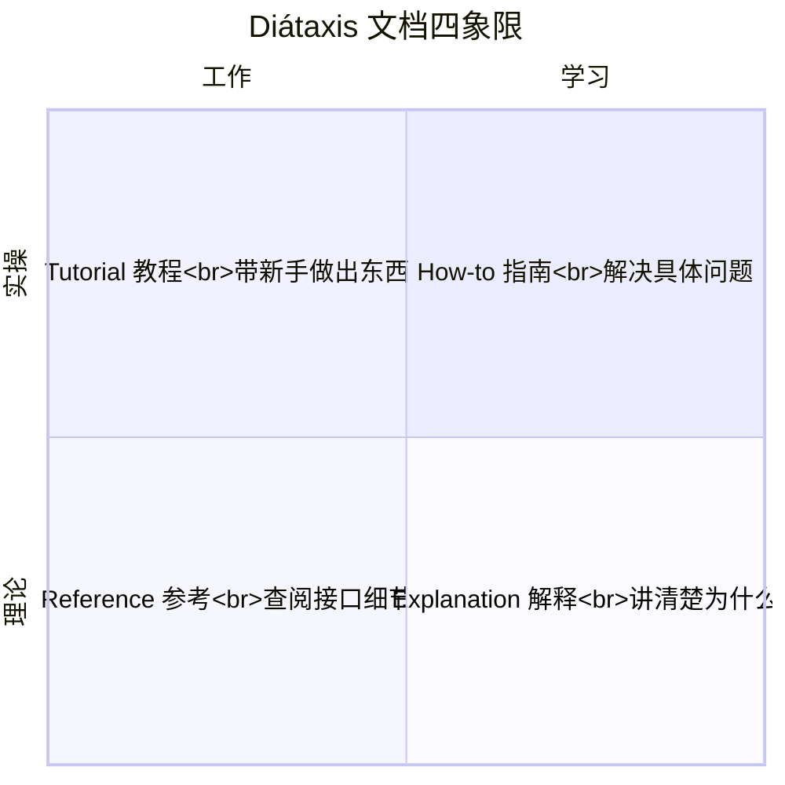
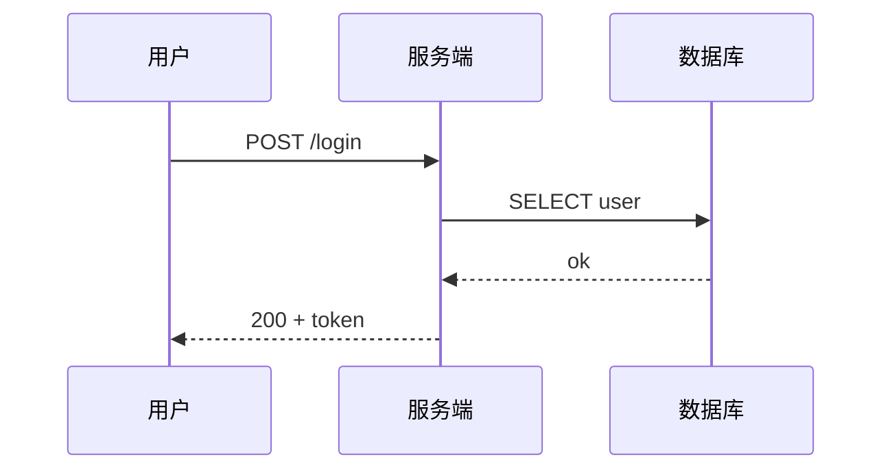
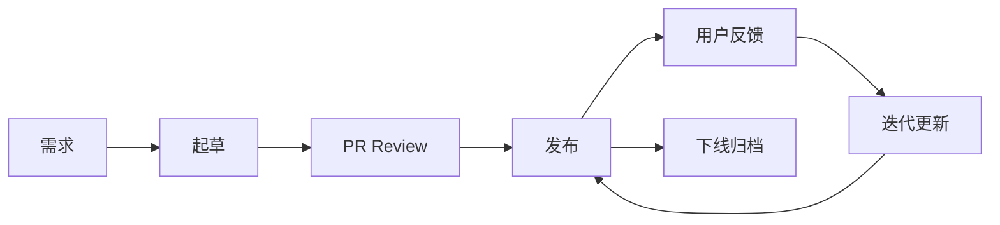
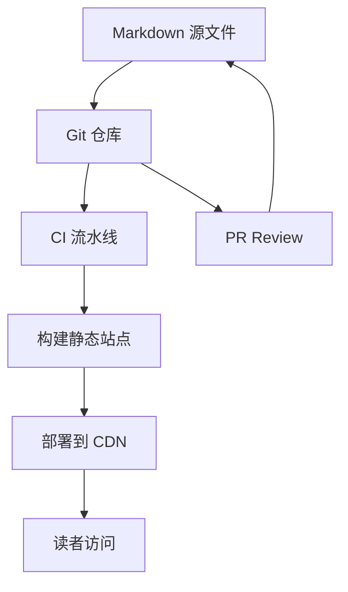
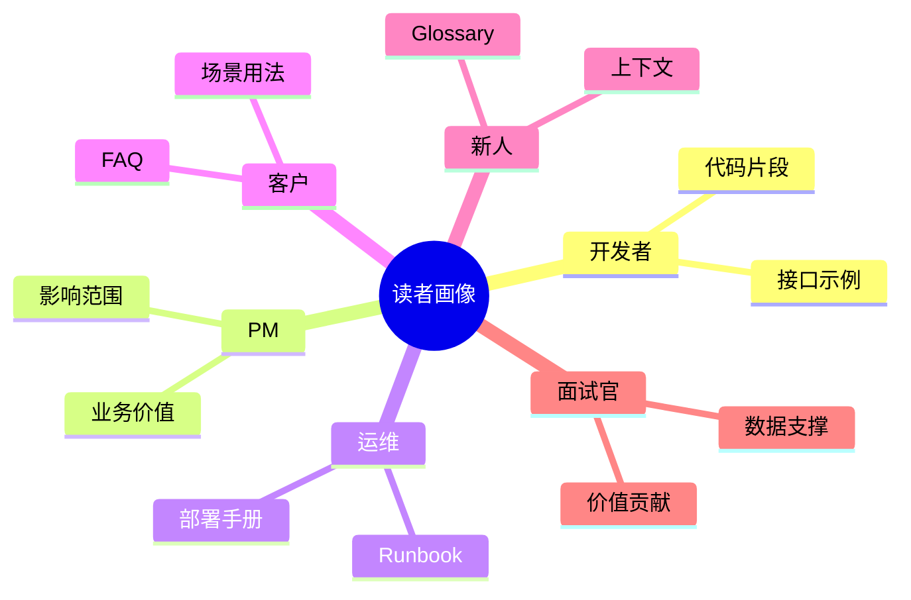

# 技术文档写作

> 技术文档写作是用文字、图示、代码把技术信息准确、清晰、完整地传达给读者的能力，是工程师从"自己能做"到"能让别人也做"的关键分水岭，也是 [[软件工程]] 协作场景里最被低估的核心能力。

**关键词**：技术写作、文档结构、Diátaxis、Docs as Code、可视化、API 文档、面向受众

## 抽象类比

写代码是和机器对话，写文档是和人对话——前者错了编译器立刻报错，后者错了沉默几个月，直到有人踩坑才会被发现。所以技术文档像"程序的注释放大版"：把上下文、动机、约束、用法一次说清楚，避免后人每次都要从头读代码反推你的意图。

也像"产品的地图"：好的地图让陌生人能找到目的地；好的文档让新人、客户、运维、PM 都能快速找到"我要怎么用、出了问题怎么办"。地图没人会去读说明书，文档也一样——读者永远在"赶时间"，所以要为他们"扫读"而非"精读"而写。

## 一、技术文档写作是什么

技术文档写作（Technical Writing）是用结构化的文字、图表、代码示例，把技术信息（架构、设计、接口、用法、运维）准确传达给目标读者的活动。

它和"写文章"最大的区别在于：

- **目的明确**：不是抒情，是让读者"做出某件事"（部署、调用、排错、决策）
- **受众具体**：写之前就要知道读者是谁、知道什么、不知道什么
- **可执行**：文档里写的步骤必须能照着做出来，否则就是"出不来活的文学"

所以技术文档的核心评价标准不是"文笔好"，而是"读者照着做能不能完成任务"。

### 工程师为什么必须学技术写作

- 代码只是"个人产出"，文档才是"团队产出"
- 没有文档的项目，离职一个人就断档
- 评审、晋升、对外分享都需要把技术讲清楚
- 客户交付、合规审计、安全验收都依赖文档

---

## 二、技术文档的价值

### 对个人

- 写文档逼你把思路理清楚——"写不出来说明没想清楚"
- 评审、晋升、技术分享的材料基础
- 建立个人影响力的最低成本路径：一篇好文档可以传播几年

### 对团队

- **降低重复沟通成本**：同样的问题答第二遍时，就该写文档了
- **降低新人 Onboarding 成本**：新人有文档可看，老员工不必反复被打断
- **沉淀组织知识**：代码会重构，文档是历史决策的"考古档案"
- **协作基础**：跨团队、跨时区、跨公司协作时，文档是唯一共同语言

### 对客户

- 交付物的一部分，客户拿不到文档就等于拿不到一半产品
- 减少工单和支持压力：好文档挡掉 80% 的常见问题
- 客户成功、二次开发都依赖文档

### 对项目

- 项目管理视角看，文档是里程碑之一（参考 [[敏捷开发]]）
- 审计、合规、安全验收要求"可追溯"
- 后期维护、二次开发、版本升级的"地基"

---

## 三、技术文档的分类

按用途和读者目标，技术文档大致分五类。每类的写作风格、详细程度、维护频率都不同。

### 3.1 设计文档

- **架构设计文档**：描述系统整体架构、模块划分、技术选型理由、关键约束
- **详细设计文档**：到模块/接口级别的具体设计
- **RFC（Request for Comments）**：发起一项技术变更的提案，需要多方评审
- **ADR（Architecture Decision Record）**：记录架构决策及其上下文、后果

ADR 推荐结构：

- 标题：决策一句话总结
- Status：proposed / accepted / deprecated
- Context：为什么需要这个决策
- Decision：决定了什么
- Consequences：带来什么好处和代价

### 3.2 接口文档

- **API 文档**：每个接口的方法、URL、参数、响应、错误码、示例
- **SDK 文档**：在 API 之上封装客户端用法
- **OpenAPI / Swagger**：用 YAML 描述 RESTful API，可机器消费
- 推荐参考 [[API设计]] 的 RESTful 规范

### 3.3 用户文档

- **使用手册**：完整功能介绍
- **Quick Start**：5 分钟跑通最小可用流程
- **FAQ**：常见问题与答案
- **Troubleshooting**：常见报错与解决方案
- **Release Notes**：版本变更说明

### 3.4 运维文档

- **部署手册**：环境要求、依赖、步骤、回滚预案
- **Runbook**：遇到告警时按步骤处理的"应急手册"
- **SOP（Standard Operating Procedure）**：标准操作流程
- **监控手册**：监控指标定义、阈值、告警含义、Dashboard 地址
- 配合 [[CICD]] 的发布流程，让发布本身可重复、可回滚

### 3.5 学习文档

- **教程 Tutorial**：手把手教学，目标是让读者"做出东西"
- **Onboarding**：新人入职指南
- **最佳实践**：经验沉淀
- **Case Study**：真实案例复盘

---

## 四、好文档的五个特征

### 准确

- 代码示例必须可运行，接口签名必须和实际一致
- 版本号、依赖、命令必须明确（"在 v2.3.1 上测试通过"）
- 文档和代码同步更新——文档过时比没有文档更糟

### 清晰

- 一句话能说清的不要写一段
- 主动语态优先，避免"被建议"、"应当考虑"
- 用具体例子代替抽象描述（"超时 30 秒"优于"长时间未响应"）

### 完整

- 涵盖前置条件、操作步骤、异常处理、回滚方案
- 不假设读者"应该知道"——明确写出前提条件
- 边界情况、错误情况、性能注意事项都要写

### 可发现

- 标题用关键词，方便搜索引擎和文档站搜索
- 章节标题自解释（"如何配置 SSL"而非"配置"）
- 内部链接互通，让读者能在文档网里跳转

### 可维护

- 文档有 owner、有更新日期、有版本
- 文档和代码同仓库，随 PR 一起更新（Docs as Code）
- 定期 Review，下线过时文档

---

## 五、文档结构模板

### Diátaxis 四象限

Daniele Procida 提出的经典分类法，把文档按"学习 vs 工作"和"实操 vs 理论"分四类：



- **Tutorial（教程）**：学习 oriented、实操，目标是带新手做出第一个东西
- **How-to（操作指南）**：工作 oriented、实操，目标是解决一个具体问题
- **Reference（参考）**：工作 oriented、理论，目标是查阅接口、参数、配置
- **Explanation（解释）**：学习 oriented、理论，目标是讲清楚"为什么"

四类文档风格完全不同，混在一起会让读者迷路。

### README 模板

```markdown
# 项目名

> 一句话说明项目做什么

## 特性
- 特性 1
- 特性 2

## Quick Start
（5 分钟跑通最小流程的命令）

## 安装
（依赖、安装步骤）

## 使用
（核心用法、示例）

## 文档
- [完整文档](https://...)
- [API 参考](...)

## 贡献
- Issue / PR 流程
- 代码规范

## License
```

### PRD 模板

- 背景与目标
- 用户场景与需求
- 功能范围与非目标
- 详细设计
- 验收标准
- 风险与依赖
- 排期

---

## 六、写作技巧

### 金字塔原理

结论先行 → 论据展开 → 数据支撑。读者没耐心看长篇铺垫，第一句就要给关键信息。

错误：

> 我们调研了三种方案，分别是 A、B、C，A 的优点是…，B 的优点是…，C 的优点是…，综合来看我们选择 B。

正确：

> 我们选择 B。理由是它兼顾了性能与可维护性，A 的可维护性差，C 的性能不达标。下面是详细对比。

### KISS（Keep It Simple, Stupid）

- 能用一句话说清楚的，不要写一段
- 能用一个简单例子说明的，不要给十个边界情况
- 能用列表的，不要用大段散文

### 受众意识

写之前问自己：

- 读者是谁？是开发、PM、运维、客户、还是面试官？
- 他们知道什么？已经了解哪些背景？
- 他们要做什么？看完之后要做出什么动作？
- 他们在哪看？是 IDE 里、文档站、邮件、还是手机？

### 主动语态

- 主动：`系统在 3 秒后重试`
- 被动：`重试会在 3 秒后被系统执行`（冗长且模糊）

### 可视化优先

- 一图胜千言——架构图、流程图、时序图能减少 80% 文字
- 复杂逻辑用图，简单概念用文字
- 详见第七节

### 代码示例驱动

- 文字描述不如一段可运行代码
- 示例必须真实可跑，不能是伪代码
- 给出"输入 → 输出"的预期结果

---

## 七、可视化与图表

### Mermaid 图

最适合 Docs as Code 的图，随 Markdown 一起版本管理：

- **flowchart**：流程图
- **sequenceDiagram**：时序图，适合 API 调用
- **classDiagram**：类图，参考 [[软件工程#UML 建模]]
- **stateDiagram**：状态机
- **gantt**：项目排期
- **erDiagram**：数据库 ER 图



### UML 与架构图

- [[软件工程#UML 建模]] 用于正式的设计文档
- 架构图常用工具：draw.io、Excalidraw、PlantUML、Mermaid
- 真实系统图参考 [[架构模式]]、[[分布式系统]]

### 截图与标注

- 截图标注重点区域，避免"全屏截图，无重点"
- 红框、箭头、序号配合说明文字
- 截图存图床或仓库，避免外链失效

### 视频录制

- 步骤超过 10 步的"如何做"，录视频比写文字更有效
- 短视频（30 秒 - 3 分钟）适合 Quick Start
- 长视频适合完整教程

---

## 八、版本化与协作

### Docs as Code

把文档当代码管理：

- Markdown 文件存仓库，和源代码一起版本管理
- PR Review 文档变更，确保和代码同步
- CI 校验链接有效性、拼写、格式
- 自动部署到文档站

### 文档生命周期



- **起草**：明确受众、目的、结构
- **Review**：同行评审、目标读者评审
- **发布**：自动构建到文档站
- **维护**：定期 Review、随代码更新
- **下线**：标记 deprecated、归档

### CHANGELOG

- 记录每个版本的关键变更
- 推荐使用 Keep a Changelog 格式
- 分类：Added / Changed / Deprecated / Removed / Fixed / Security

---

## 九、文档工具链

### Markdown 编辑器

- **Obsidian**：双链笔记、本地优先，适合个人知识库
- **Typora**：所见即所得
- **VS Code**：插件丰富，可集成 Preview、Lint、Mermaid

### 静态文档站

- **Docusaurus**：React 风格、功能强大、Meta 出品
- **VitePress**：Vue 风格、构建快、轻量
- **MkDocs**：Python 生态、Material 主题好看
- **Hugo**：极致性能、主题多
- **GitBook**：商业产品，体验好但定制性差

### API 文档专用

- **OpenAPI / Swagger**：RESTful API 描述规范
- **Redoc**：OpenAPI 渲染出的静态文档站
- **Postman**：API 调试 + 文档一体
- **Spring REST Docs / Springdoc**：Java 生态自动生成
- **MkDocs + mkdocstrings**：Python 项目自动生成

### 图床与画图

- 图床：GitHub、阿里云 OSS、七牛云
- 画图：draw.io、Excalidraw、Figma、PlantUML、Mermaid Live Editor

### 协作平台

- GitHub / GitLab：Docs as Code
- 飞书文档 / Confluence：团队 Wiki
- Notion：数据库化文档管理



---

## 十、常见反模式

### 过时文档

- 代码改了，文档没改
- 版本号、命令、接口签名和实际不符
- 解决：Docs as Code、文档和代码同 PR、定期 Review

### 复制粘贴

- 同一信息在多个文档里反复抄
- 一处改了其他地方没改
- 解决：抽取为可复用片段（snippet / include）

### 英文混排混乱

- 中英文之间没空格（"使用Docker部署"）
- 术语翻译不统一（"instance"一会儿"实例"一会儿"实例化"）
- 解决：约定术语表，中英文之间加空格，全角标点统一

### 无示例

- 只有抽象描述，没有具体代码
- "应该传入合理的参数"——什么是合理？
- 解决：每个 API 至少一个完整示例

### 过度详细

- 写成博士论文，读者看不下去
- 1000 行的 README
- 解决：按 Diátaxis 分层，把"参考资料"和"教程"分开

### 无更新机制

- 写完没人维护，文档变垃圾
- 没有 owner、没有最后更新日期
- 解决：每个文档有 owner 字段，CI 检查"超过 1 年未更新"的文档并提示

---

## 十一、面向不同读者的写作

### 面向开发者

- 重点：接口签名、参数、返回值、错误码、示例
- 风格：简洁、代码优先
- 避免：业务背景赘述

### 面向 PM

- 重点：业务价值、用户场景、影响范围、排期
- 风格：结构化、数据支撑、避免技术细节
- 避免：实现细节、内部架构

### 面向运维

- 重点：部署步骤、监控指标、告警阈值、Runbook
- 风格：步骤清晰、可执行、有回滚
- 避免：业务背景

### 面向客户

- 重点：能做什么、怎么用、出了问题怎么办
- 风格：以场景为主、避免技术术语
- 避免：内部架构、技术选型理由

### 面向新人

- 重点：背景、上下文、Why before How
- 风格：耐心、循序、有 Glossary
- 避免：默认读者懂所有缩写

### 面试官

- 重点：项目价值、技术难点、你的贡献
- 风格：结论先行、数据支撑
- 避免：流水账、技术名词堆砌



---

## 面试速答

### Q: 技术文档和注释有什么区别？
A: 注释是给"看代码的人"看的，附着在代码上，解释"为什么这么写"；文档是给"可能不看代码的人"看的，独立于代码存在，解释"怎么用、为什么这么设计、出问题怎么办"。注释受代码上下文约束，文档独立成篇。两者互补，不能互相替代——好代码不能没有注释，好项目不能没有文档。

### Q: Diátaxis 四象限是什么？为什么有用？
A: Diátaxis 把文档按"学习 vs 工作"和"理论 vs 实操"分四类：Tutorial（教程，带新手做出东西）、How-to（指南，解决具体问题）、Reference（参考，查接口）、Explanation（解释，讲为什么）。它的价值在于：让作者意识到"读者目的不同、文档风格就该不同"，避免把所有内容塞进一个 README，让读者迷路。

### Q: 什么是 Docs as Code？带来什么好处？
A: Docs as Code 是把文档当作代码来管理：用 Markdown 写、存 Git 仓库、随 PR Review、CI 校验链接和格式、自动构建发布。好处是：文档和代码同步更新（同一 PR）、有版本历史、可复现、可回滚、和工程协作流程无缝集成。它解决了"文档过时"这一最大痛点。

### Q: 好的技术文档应该具备哪些特征？
A: 五个特征：准确（和实际一致，代码示例可运行）、清晰（一句话能说清的不写一段）、完整（前置条件、步骤、异常、回滚都覆盖）、可发现（标题用关键词、内部链接互通）、可维护（有 owner、有更新日期、随代码迭代）。这五点中"准确"和"可维护"是最容易塌方的两点——文档过时就是这两点的失败。

### Q: 怎么避免文档过时？
A: 几个手段：一是 Docs as Code，文档和代码同 PR、同 Review，强制同步；二是文档加 owner 字段和最后更新日期，CI 检查"超过 N 个月未更新"的文档发出告警；三是把示例代码做成可执行测试，CI 跑通即代表文档示例有效；四是定期 Review，把过时文档标 deprecated 或下线；五是写文档时尽量引用代码、少复制代码，避免代码改了文档没改。

---

## 能力落地闭环

- **产出任务**：完成一篇让陌生读者可独立执行的操作指南，并找人按文档验证。
- **验收证据**：目标、前提、步骤、预期结果、失败处理、版本与边界完整。
- **关键边界**：区分事实、假设和计划；命令必须可复制，截图不能替代可搜索文字。

每次实践后用“目标是否达成、依据是什么、哪里返工、下次改变什么”四个问题复盘，把方法沉淀为模板或检查清单，而不是只留下结论。
