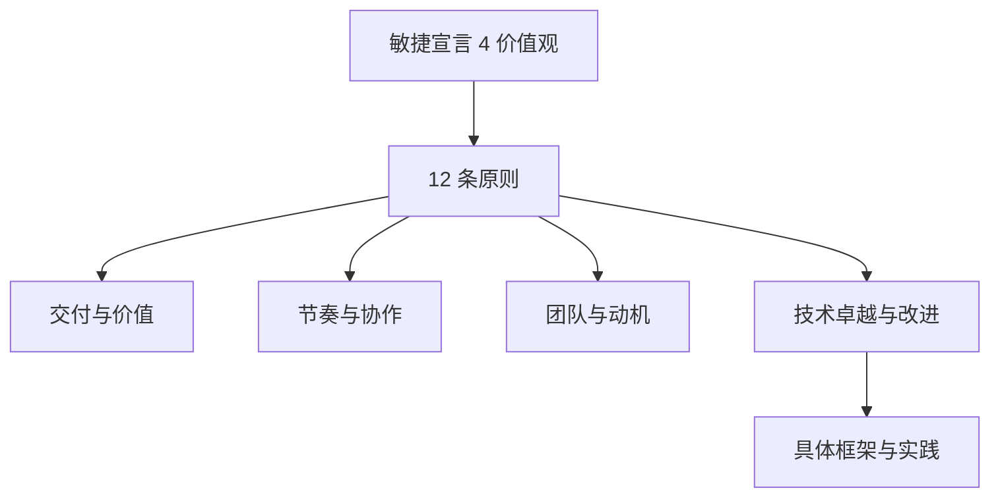
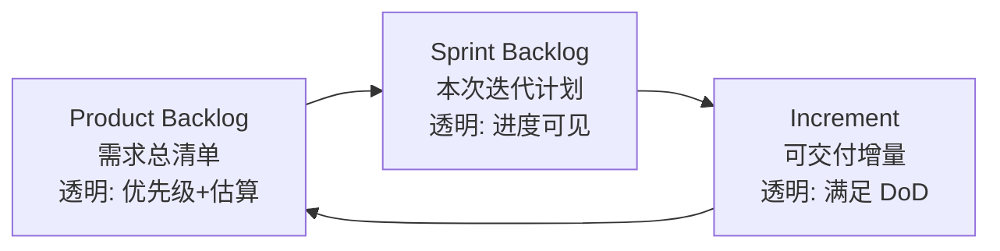
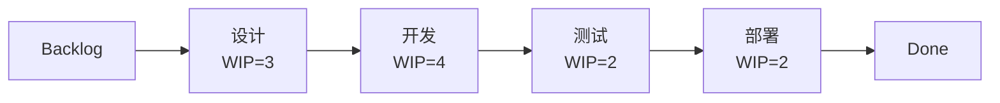
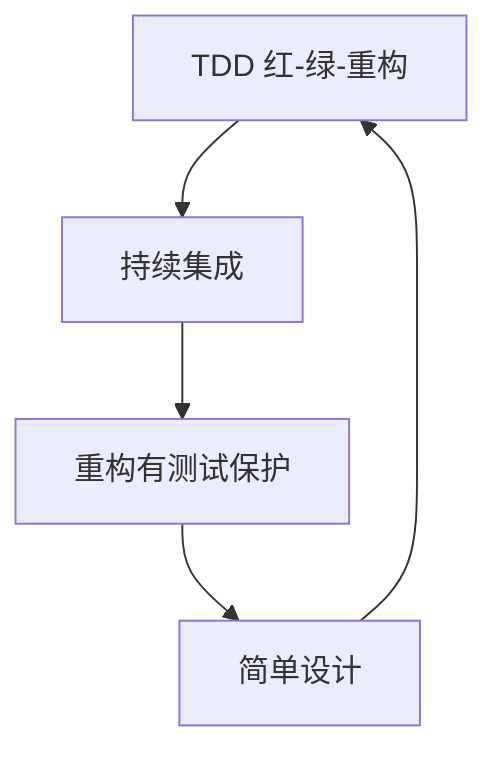
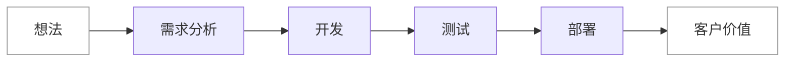
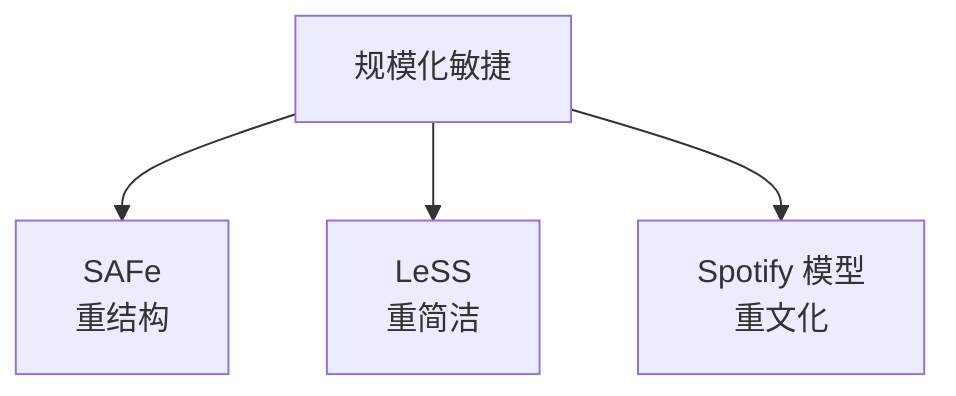
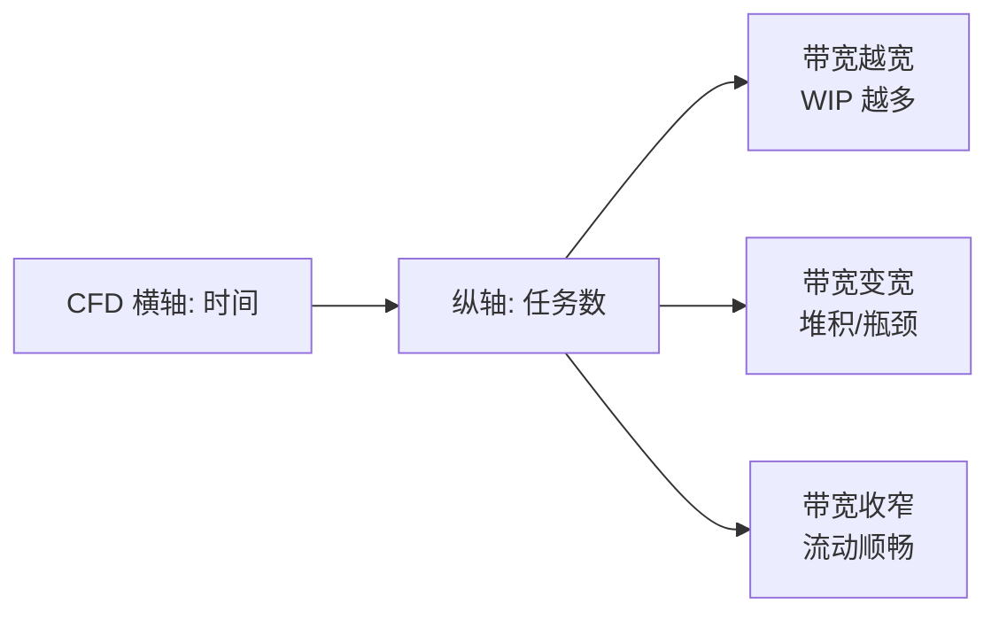
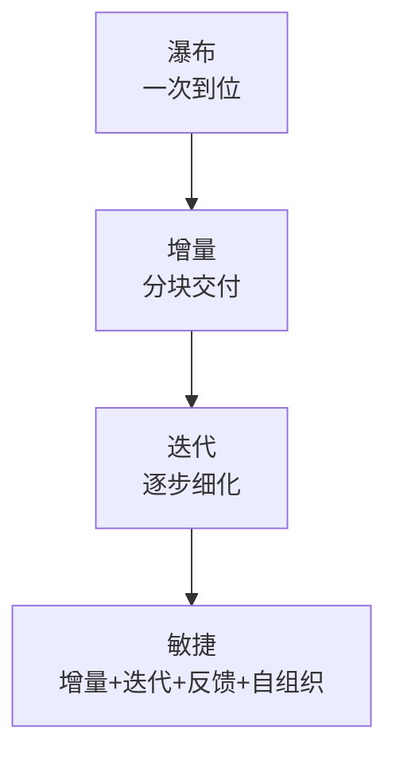

# 敏捷开发深入：从宣言到规模化落地

> 一句话说明：敏捷开发是一组以"小步快跑、持续反馈、响应变化"为核心的软件交付理念与工程实践体系，本文系统讲清它的价值观、框架、工程实践、度量与落地陷阱，与 [[CMMI]] 互补，不重复基础概念。

**关键词**：敏捷宣言、Scrum、看板方法、极限编程、精益开发、规模化敏捷

## 抽象类比

把做软件比作"在陌生城市开车长途旅行"：传统瀑布是出发前把每一段路线、每一个加油站都规划死，一旦走错就只能重新做计划；敏捷则是"先定大方向，每到一个路口就看路况、看油量、看心情再决定下一段"，把不确定性拆成一段段可控的小步。

敏捷不是"不要计划"，而是"计划要细到下一周，但不死押半年后"。它用"短周期反馈循环 + 持续调整"来对抗"前期预测不准"这个软件工程的老难题。

## 一、敏捷宣言的 4 条价值观与 12 条原则

### 1.1 四条价值观

敏捷宣言（Agile Manifesto，2001 年）的 4 条核心价值观：

- 个体和互动 高于 流程和工具
- 可工作的软件 高于 详尽的文档
- 客户合作 高于 合同谈判
- 响应变化 高于 遵循计划

注意右边的项也有价值，但左边的更被看重。把"高于"理解成"当冲突时优先选谁"，而不是"二选一抛弃谁"。

### 1.2 十二条原则

十二原则是价值观的落地细化，可归为四类：

- 交付与价值
  - 第 1 条：尽早持续交付有价值的软件，使用户满意
  - 第 2 条：欢迎需求变化，即使在开发后期；敏捷通过变化赢得竞争优势
  - 第 7 条：可工作的软件是进度的主要度量
- 节奏与协作
  - 第 3 条：频繁交付可工作的软件，周期从几周到几个月，越短越好
  - 第 4 条：业务人员和开发人员每天协作
  - 第 6 条：面对面交谈是最有效的沟通方式
- 团队与动机
  - 第 5 条：围绕有动机的个人构建项目，给予信任和环境
  - 第 8 条：敏捷过程提倡可持续开发，发起人、开发、用户应保持恒定步调
  - 第 11 条：最好的架构、需求和设计出自自组织团队
- 技术卓越与改进
  - 第 9 条：持续关注技术卓越和良好设计以增强敏捷能力
  - 第 10 条：简洁——最大化未完成工作量的艺术
  - 第 12 条：团队定期反思如何更有效，并相应调整行为

## 二、Scrum 框架深入

Scrum 是最流行的敏捷框架，规定了"3-3-4"结构。本节深入每个要素的执行要点，不重复 [[软件工程]] 的基础介绍。

### 2.1 三角色的细节与陷阱

- Product Owner（产品负责人）
  - 唯一有权对 Product Backlog 排序的人，不是"提需求委员会"
  - 必须有决策权，否则团队会陷入"等老板拍板"的停摆
  - 常见陷阱：PO 由多人共担，优先级互相打架
- Scrum Master（流程教练）
  - 不是项目经理，没有分配任务的权力
  - 职责是"保护流程、清除障碍、教团队自组织"
  - 常见陷阱：沦为"开会主持人"或"团队保姆"
- Development Team（开发团队）
  - 跨职能：前端、后端、测试、设计在一个团队里，避免外部依赖
  - 自组织：自己决定怎么把 Backlog 变成 Increment
  - 常见陷阱：团队规模过大（>9 人）或过小（<3 人）

### 2.2 三产物（Artifacts）的透明性

三个产物都强调"透明（Transparency）"，因为后续的"检视"和"调整"建立在数据真实之上。Definition of Done（DoD，完成定义）是 Increment 的质量门槛，必须团队共识、可验证。

### 2.3 四事件（Events）的执行要点

- Sprint Planning（迭代计划会）
  - 时间盒：Sprint 2 周则不超过 4 小时
  - 输出：Sprint Goal + Sprint Backlog
  - 要点：先定目标再拆任务，避免"任务清单填满但目标不清"
- Daily Standup（每日站会）
  - 时间盒：15 分钟，不是状态汇报会
  - 三个问题：昨天做了什么、今天打算做什么、有什么阻碍
  - 陷阱：变成向 Scrum Master 汇报；问题讨论拖到会后小群
- Sprint Review（迭代评审）
  - 时间盒：Sprint 2 周则不超过 2 小时
  - 演示真实可工作的软件，不是 PPT
  - 输出：更新的 Product Backlog
- Sprint Retrospective（迭代回顾）
  - 时间盒：Sprint 2 周则不超过 1.5 小时
  - 讨论"什么做得好、什么要改、下迭代做什么改进"
  - 陷阱：只吐槽不行动；改进项无人认领

## 三、看板方法（Kanban）深入

看板方法源自丰田生产方式，核心是"可视化 + 限制在制品 + 持续改进"，不强求迭代周期。

### 3.1 看板六大核心实践

- 可视化工作流：把工作流画成列，每个任务一张卡，状态一目了然
- 限制在制品（WIP Limit）：每列同时最多 N 个任务，超出不允许接新活
- 管理流动（Manage Flow）：关注任务流转速度，而非个人利用率
- 显式流程规则：明确"什么叫进入下一列"，比如代码评审通过才能进测试列
- 反馈环：定期回顾看板的流动情况
- 协作改进：实验性地调整流程，持续进化

### 3.2 WIP 限制的原理

WIP 限制的好处：

- 防止团队同时做太多事，每件都做不完
- 暴露瓶颈：哪一列堆积就是哪里卡住了
- 把"利用率"思维换成"流动效率"思维——100% 繁忙反而意味着拥堵

### 3.3 看板度量

- Lead Time（前置时间）：从需求提出到交付的总时间，客户视角
- Cycle Time（周期时间）：从开始做到完成的时间，团队视角
- Throughput（吞吐率）：单位时间内完成的任务数
- Cumulative Flow Diagram（累计流量图）：展示各列任务量随时间变化，可看出瓶颈和 WIP 是否稳定

## 四、极限编程（XP）核心实践

XP（Extreme Programming，Kent Beck，1999）是敏捷的工程实践源头，把"好的工程习惯"做到极致。它解决的是"敏捷光开会不写好代码"的问题。

### 4.1 XP 的核心实践

- 测试驱动开发（TDD）
  - 红-绿-重构循环：先写失败测试，再写最少代码让其通过，再重构
  - 价值：让设计可验证、让重构有底气
- 结对编程（Pair Programming）
  - 两人一机：驾驶员写代码，领航员审思路，定期轮换
  - 价值：实时代码评审、知识传递、降低单点依赖
  - 不是全程结对，可在复杂任务、关键模块时使用
- 持续集成（CI）
  - 每天多次合并到主干，每次合并自动构建测试
  - 详见 [[CICD]]
- 重构（Refactoring）
  - 在不改变外部行为的前提下改进内部结构
  - 前提：有测试保护，否则不敢动
- 简单设计（Simple Design）
  - 只为当前需求设计，不为"未来可能的需求"过度设计
  - 四标准：可运行、可测试、可读、无重复
- 集体代码所有权
  - 任何人都能改任何代码，没有"这是张三的代码"
- 小步发布
  - 频繁发布小版本，便于回滚和反馈

## 五、精益开发（Lean）与敏捷的关系

精益（Lean）源自丰田生产方式（TPS），由 Mary & Tom Poppendieck 在 2003 年引入软件开发。敏捷是"做法"，精益是"思想底座"。

### 5.1 精益七大原则

- 消除浪费（Eliminate Waste）：凡不为客户创造价值的事都是浪费——多余功能、等待、手工流程、上下文切换
- 强化学习（Amplify Learning）：用短迭代和实验代替前期详细规划
- 尽量延迟决策（Decide as Late as Possible）：保留可选项到责任时刻，基于更多信息决策
- 尽快交付（Deliver as Fast as Possible）：快速交付带来快速反馈
- 授权团队（Empower the Team）：让最接近一线的人做决策
- 内建质量（Build Integrity In）：质量不能靠最后检验，要嵌入过程
- 全局优化（Optimize the Whole）：不要局部优化，避免"我的指标好但整体差"

### 5.2 价值流与拉动系统

价值流图（Value Stream Map）画出从"想法"到"客户拿到价值"的全过程，标注每一步的处理时间和等待时间。通常等待时间远大于处理时间，优化的重点是消除等待而非加速处理。

拉动系统（Pull System）：下游需要才让上游做，不"推"任务给下游。看板的 WIP 限制就是拉动的实现。

## 六、规模化敏捷

单团队敏捷（5-9 人）相对容易，但几百上千人的组织如何"敏捷"？常见三种规模化框架：

### 6.1 SAFe（Scaled Agile Framework）

- 最流行的企业级规模化框架，强结构、可落地
- 四层配置：Team、Program、Large Solution、Portfolio
- 核心：敏捷发布火车（ART，Agile Release Train），5-12 个团队同步迭代
- 优点：清晰、对管理层友好；缺点：偏重流程，容易"重型敏捷"

### 6.2 LeSS（Large-Scale Scrum）

- 主张"用更多 Scrum 而非加层"，保持框架简洁
- 一个 Product Owner 管整个产品 Backlog
- 多团队共做一个 Sprint Planning
- 优点：简洁、贴近 Scrum 原意；缺点：对组织自化能力要求高

### 6.3 Spotify 模型

- Spotify 内部的工程文化，不是"框架"
- 三结构：Squad（小队，自治）、Tribe（部落，相关性）、Chapter（专业线）、Guild（兴趣社区）
- 强调"自治 + 对齐"，而非"流程合规"
- 注意：Spotify 自己后来也说"我们没在用 Spotify 模型"，别照搬

## 七、敏捷度量与改进

度量是为了改进，不是为了考核。一旦度量变 KPI，团队就会优化度量本身。

### 7.1 常用度量

- Velocity（速度）：Sprint 内完成的故事点之和，用于预测而非考核
- Burndown Chart（燃尽图）：剩余工作量随时间下降，理想到 Sprint 末归零
- Burnup Chart（燃起图）：已完成量 + 总范围随时间变化，可看范围是否在膨胀
- Cycle Time（周期时间）：开始做到完成的时间
- Lead Time（前置时间）：需求提出到交付的时间
- Cumulative Flow Diagram（CFD，累计流量图）：各状态任务累计数随时间变化

### 7.2 CFD 的判读

CFD 上某条带变宽，说明该状态任务堆积，对应瓶颈环节；带宽恒定说明流动稳定。

### 7.3 度量使用的注意事项

- Velocity 不跨团队比较：故事点是相对估算，团队间不可比
- 不把度量当 KPI：会诱发高估、低报、刷故事点
- 组合看：单一指标会失真，Velocity + Cycle Time + 缺陷率才能看清全貌

### 7.4 故事点与估算

**故事点（Story Point）**：不按时间估，按"复杂度"估。相对估算，比绝对小时更稳定。基准：选一个熟悉的小故事定为 2 点，其他故事和它比相对大小。

**燃尽图（Burndown Chart）**：跟踪本次迭代剩余工作量随时间下降的曲线，理想是到迭代结束降为 0。

**速度（Velocity）**：前几个迭代平均完成的故事点，用来预测"下次能做多少"。

**估算不是承诺**：估算用于计划，不是用于考核——把估算当 KPI 会逼团队高估、低报，反而失真。类比：装修工人估工期——不会精确到分钟，但能说"大概 3 天、最坏 5 天"。

## 八、敏捷落地的常见陷阱

- 机械执行
  - 站会、回顾、计划都开了，但只走形式不开效果
  - 表现：站会变汇报，回顾无改进项
- 形式主义
  - 把"用 Jira"等于"敏捷"，把"有看板"等于"在看板"
  - 表现：工具到位但思维没变
- 缺乏改进
  - 回顾会有，但改进项无人认领、无跟踪、无闭环
  - 表现：每次回顾都讨论同样的问题
- 过度承诺
  - PO 压任务，团队为了"显得能干"接太多
  - 表现：Sprint 末尾完不成、加班赶工、质量下滑
- 角色错配
  - Scrum Master 当项目经理使，PO 当产品经理管细节
  - 表现：自组织退化为派活
- 技术债无视
  - 只交付新功能不还技术债
  - 表现：速度逐渐下降，每次改动越来越慢

## 九、敏捷与传统开发的关系

敏捷不是"取代"瀑布，而是"另一种适用场景"。

### 9.1 四种开发模型的对比

- 瀑布（Waterfall）：需求-设计-开发-测试-部署串行，每阶段一次性完成
- 增量（Incremental）：把产品拆成几块，逐块交付，每块内部仍瀑布
- 迭代（Iterative）：每次做完整产品的一部分，逐次细化加深
- 敏捷（Agile）：增量 + 迭代 + 持续反馈 + 自组织团队

### 9.2 何时该用瀑布

- 需求高度稳定、变更代价极高（航天、医疗设备、核电站）
- 合同与合规要求严格的前期固化设计
- 跨组织协作、接口必须先冻结

### 9.3 混合模型（Hybrid）

实践中常见"瀑布包敏捷"：

- 外部合同按瀑布里程碑签（需求、设计、交付）
- 内部执行按 Scrum 多个迭代推进
- 里程碑节点用 Review 对齐外部

混合模型是大多数传统企业的现实选择，纯敏捷和纯瀑布都是少数。

## 十、需求管理

**类比**：去餐厅点菜——你不能把整本菜单都点了，要按预算和胃口选。

### 10.1 用户故事（User Story）

用一句话描述需求，模板："作为一个 X，我想 Y，以便 Z"。让需求从用户视角表达，而不是技术视角。

### 10.2 验收标准（Acceptance Criteria）

这个故事"做完了"的判断条件，比如"用户下单后 3 秒内看到订单号"。

### 10.3 需求优先级（MoSCoW 法）

- Must have：必须有，否则产品没法用
- Should have：应该有，没有也能用但影响体验
- Could have：可以有，锦上添花
- Won't have（this time）：这次不做，以后再说

## 十一、项目角色

小公司一人多角色，大公司分工更细。理解角色边界有助于"该找谁"。

- PM（项目经理 / 产品经理）：管进度、管范围、对外沟通
- Tech Lead（技术负责人）：技术决策、代码质量把关
- 架构师：系统结构设计、技术选型
- 开发：写代码、写测试、参与评审
- 测试：设计测试用例、执行测试、报 bug
- 运维 / DevOps：管环境、管部署、管监控

## 面试速答

**Q1：Scrum 和看板的核心区别？什么时候用哪个？**

A：Scrum 有固定迭代周期（2-4 周）、规定角色和事件、按节奏交付；看板没有迭代、不强角色、核心是可视化 + WIP 限制 + 持续流动。Scrum 适合"需求可分批、需要节奏感"的产品开发；看板适合"任务持续流入、优先级常变"的场景，如运维、客服、Bug 修复。两者可混合为 Scrumban。

**Q2：敏捷宣言的 12 条原则里，你认为最重要的一条是哪条？**

A：面试无标准答案，但要能自圆其说。常见高分回答：第 7 条"可工作的软件是进度的主要度量"——它把"进度"从文档、计划、工时回到"真正能跑的软件"，是其他原则的锚点；或选第 1 条"尽早持续交付有价值软件"，因为它直接对应客户价值。重点是说清"为什么"。

**Q3：Velocity 能不能用来考核团队绩效？**

A：不能。Velocity 是团队内部的预测工具，基于相对估算，跨团队不可比。一旦当 KPI，团队会高估故事点、刷简单任务、隐藏真实进度，反而失真。正确用法是：用 Velocity 预测下个 Sprint 能做多少，结合 Cycle Time、缺陷率、客户满意度组合看团队健康度。

**Q4：SAFe 和 LeSS 的最大区别是什么？**

A：SAFe 在 Scrum 之上加了多层结构和角色（ART、RTE、PM、Portfolio），强调"对齐 + 结构"，对大型企业和传统管理层友好，但易变重型。LeSS 主张"不加层"，用更多 Scrum 团队 + 一个 PO 共担一个产品，保持框架简洁但要求团队自化能力高。简言之：SAFe"加结构解决规模化"，LeSS"减结构保持敏捷本质"。

**Q5：敏捷落地的最大陷阱是什么？如何避免？**

A：最大陷阱是"机械执行 + 缺乏改进"——会议都开了、工具都用了，但没人真正反思和调整，敏捷沦为"新流程的瀑布"。避免方法：把 Retrospective 当作最重要的会议，每迭代必须产出 1-2 个可执行的改进项，并跟踪到闭环；管理层不要把度量当 KPI；先在一个团队试点跑通再推广，不要一刀切。

---

## 能力落地闭环

- **产出任务**：用一个短迭代完成从用户故事、验收标准到演示和回顾的闭环。
- **验收证据**：在制品受限、阻塞透明、反馈及时、每个增量可用。
- **关键边界**：站会和看板只是手段；频繁开会但不交付增量不构成敏捷。

每次实践后用“目标是否达成、依据是什么、哪里返工、下次改变什么”四个问题复盘，把方法沉淀为模板或检查清单，而不是只留下结论。
