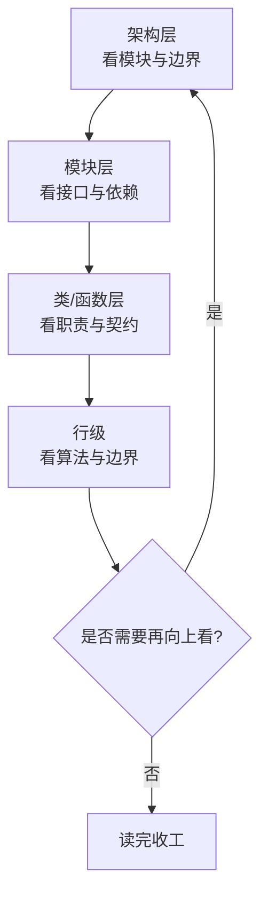
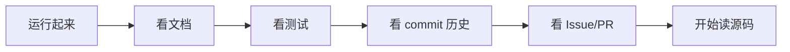
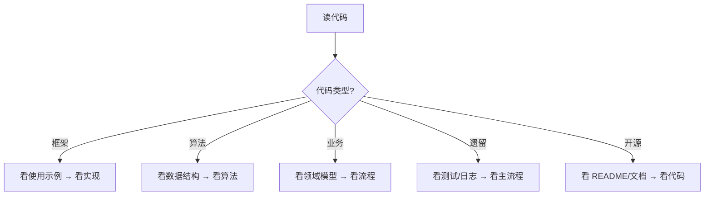
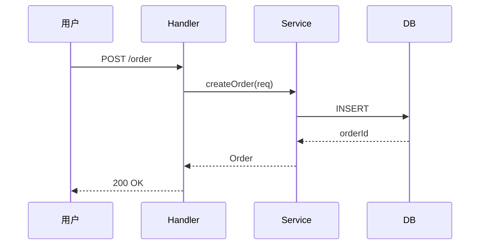
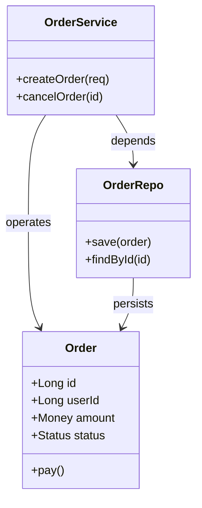

# 读代码能力

> 读代码能力是工程师 80% 工作时间真正在做的事——维护、扩展、排查问题都依赖读懂既有代码。本文系统讲解读代码的模式、层次、方法、工具与成长路径。

**关键词**：扫读跳读精读、入口追踪、调用图、问题驱动、自顶向下

## 抽象类比

读代码像"陌生人到一座城市找路"。城市不是一片空白，它已经有街道、地铁、商铺。你不会一上来就把每条街走一遍，而是先看地图摸清主路（架构），再看地铁线（模块依赖），最后聚焦到你要去的那条小巷（具体函数）。

读代码的难处不在"看懂语法"，而在"知道看哪、不看哪、为什么看"。新手逐行读完整本《Linux 内核》会读疯，高手能在两小时内定位关键路径——差距就在"读的方法"。

## 一、读代码为什么重要

软件工程有个统计：工程师**约 80% 的时间在读代码**而非写代码。原因有四：

- **维护**：bug 修复、性能优化，都得先看懂才能改
- **扩展**：新功能要嵌入既有架构，必须先理解架构边界
- **排查**：线上故障往往要在陌生代码中找根因
- **学习**：开源项目、同事代码是最佳学习素材

写代码考察"表达能力"，读代码考察"理解能力"。前者靠练习积累，后者靠方法训练。工程师的资历越深，读代码占比越高——架构师、Tech Lead 几乎每天在评审、分析、设计。

读不懂代码的代价：

- 改坏既有逻辑，引入新 bug
- 重复造轮子，浪费工时
- 误解架构边界，写出违反约定的代码
- 排查问题方向错误，浪费团队时间

具体场景举例：

- **修 bug**：用户反馈"下单偶尔失败"，要在订单服务、库存服务、支付服务间读出一条完整调用链，定位失败分支
- **加功能**：要在已有用户系统加"软删除"标志，必须先读懂 User 实体的所有读写点，避免遗漏
- **优化性能**：接口耗时从 200ms 降到 50ms，需要读懂从 Controller 到 DB 的每一层耗时来源
- **重构迁移**：把单体拆成微服务，要先读懂原有的领域边界与跨模块调用

## 二、读代码的三种模式

不同目的对应不同读法，混用最浪费时间。

- **扫读 Surveying**：快速浏览，目的是"建立全局地图"。看 README、目录结构、模块清单，5-10 分钟过一遍，不抠细节。典型场景：刚 clone 仓库
- **跳读 Skimming**：有明确目标，沿着线索快速跳跃。如"找出登录入口在哪定义""这个错误码从哪抛出"。典型场景：定位 bug
- **精读 Studying**：逐行读完一个模块或函数，理解每行意图。典型场景：学习经典项目、要改写核心算法

三种模式的对比维度：

- **关注粒度**：扫读看目录与文件名；跳读看函数签名与调用关系；精读看每一行实现
- **关注速度**：扫读每分钟可过数百行；跳读每分钟数十行；精读每小时可能只读 50-100 行
- **关注产出**：扫读产出"模块清单与依赖图"；跳读产出"调用链与定位结论"；精读产出"逐行注释与设计理解"

三者关系：扫读构建地图 → 跳读找线索 → 精读啃关键。不扫读就跳读会迷路，不跳读就精读会沉没在细节里。建议比例 1:3:6——花 10% 时间扫读，30% 时间跳读，60% 时间精读关键模块。

## 三、读代码的层次

代码有"宏观"和"微观"之分，读法应自顶向下分层：

- **架构层**：系统由哪些模块组成？模块间如何通信？数据流走向？
- **模块层**：模块的职责是什么？对外接口？内部子模块划分？
- **类/函数层**：类的角色与不变式？函数的输入输出与副作用？
- **行级**：具体算法实现、边界条件、错误处理

每层对应的关键问题：

- 架构层问"为什么这样切分"——为什么订单与库存要分开？为什么用消息队列？
- 模块层问"职责与边界"——这个模块对外暴露什么？内部有哪些子模块？
- 类/函数层问"契约与不变式"——这个函数调用前后系统状态如何变化？
- 行级问"算法与边界"——异常路径如何处理？并发场景怎么保证正确？

两种推进方向：

- **自顶向下**（推荐主流）：先架构后细节，先接口后实现。适合新项目、规模较大项目
- **自底向上**：先看叶子函数，逐步拼出上层调用。适合项目小、或要理解底层算法

实践中常交替使用：自顶向下建立地图，遇到难懂模块再自底向上逐函数啃。

层次切换的信号：

- 读架构层时遇到"看不懂的接口"——下沉到模块/类层
- 读行级时"忘了为什么这么写"——上浮到架构层看大局
- 上下都不通时——切换工具（如调试器、git blame），或问同事

## 四、读代码前的准备

直接打开 IDE 开始读是低效的。先做五件准备：

- **运行起来**：把项目跑起来，能跑通基本流程。"跑得起来"是最低门槛，跑不通的代码读起来只能猜
- **看文档**：README、架构文档、Wiki、API 文档，5-30 分钟扫一遍建立全局认知
- **看测试**：测试用例是最准确的"代码使用说明书"，看测试知道每个函数的预期行为
- **看 commit 历史**：`git log -- <file>` 看某文件改动史，了解为什么改、谁改的、何时改的
- **看 Issue 与 PR**：GitHub Issue、PR discussion 记录了大量"为什么这样设计"的讨论，是设计意图的宝库

跑不起来怎么办？用容器化、虚拟机、远程调试等手段逐步逼近。实在跑不起来的项目，读代码价值会大打折扣。

## 五、读代码的方法

不同的方法对应不同问题，掌握多种方法才能灵活组合。

- **入口追踪法**：从 main、HTTP handler、命令入口开始，沿调用链一路追下去。适合"想搞懂整个功能怎么跑起来"
- **调用图法**：先用工具生成调用图，再按图索骥。适合大型项目、想快速建立模块认知
- **数据流法**：跟踪一个数据对象从输入到输出的变换过程。适合数据处理、编译器、ETL 类项目
- **问题驱动法**：带着具体问题读，如"为什么这里要加锁""这个 if 分支什么场景触发"。问题越具体，读得越快
- **对比法**：对比两个版本、两个分支、两个相似模块的差异。适合理解"为什么这样改"

实例：要理解 Spring 的 Bean 加载

1. 入口：`ClassPathXmlApplicationContext#refresh`
2. 调用图：refresh 调用 obtainBeanFactory、registerBeanPostProcessors
3. 数据流：XML → BeanDefinition → Bean 实例
4. 问题驱动：为什么单例要双重检查锁？
5. 对比法：Spring 5 与 Spring 6 的 Bean 加载差异

方法选择的判断标准：

- 想理解"功能怎么跑" → 入口追踪法
- 想建立"模块地图" → 调用图法
- 想搞懂"数据怎么变" → 数据流法
- 想回答"为什么这样写" → 问题驱动法
- 想理解"改了什么" → 对比法

实操小贴士：

- 入口追踪到第 5 层仍没看到关键逻辑——可能入口选错了，回到上层重新挑
- 调用图太复杂看不过来——先抓主干路径，分支后续再补
- 数据流法遇到状态隐藏在数据库/缓存里——补一份"DB 状态追踪笔记"
- 问题驱动找不到答案——把问题写下来贴在屏幕上，避免读着读着跑偏
- 对比法用 `git log -p` 看具体差异，比看 commit message 更直观

## 六、借助工具读代码

工具能让读代码效率提升数倍。常备工具：

- **IDE 跳转**：Go to Definition、Go to Implementation、Find Usages、Call Hierarchy。JetBrains、VS Code 内置
- **Sourcegraph**：浏览器版代码搜索，支持跨仓库、正则、引用查找。开源代码必备
- **ctags/universal-ctags**：生成符号索引，Vim/Emacs 经典方案
- **Code Map**：IDE 中的"结构视图"插件，按类/函数列表展示
- **依赖图工具**：`mvn dependency:tree`、`pip show`、`go mod graph`，理清第三方依赖
- **调用图工具**：`cflow`、`doxygen`、`pyreverse`，自动生成调用关系图
- **git blame/log**：查看每行最后修改人、时间、原因
- **Grep/SearchCodebase**：跨文件搜索关键字与符号
- **AI 助手**：Trae、Cursor、Copilot 等 AI 工具可对选定代码段提问"这段在做什么"

常用命令速查：

- `git log --oneline -- <file>`：看某文件提交历史
- `git blame -L 10,20 <file>`：看指定行的修改记录
- `git log -p -S "关键字"`：搜索"哪次提交引入或删除了某关键字"
- `git log --diff-filter=D -- <file>`：找被删除文件的历史
- `grep -rn "TODO\|FIXME" src/`：找待办与已知问题

工具组合使用：

- 看 IDE 结构图快速建立模块认知
- 用 Find Usages 追踪某函数的所有调用方
- 用 git blame 看可疑代码的修改背景
- 用 Sourcegraph 跨仓库搜索同类实现
- 用 AI 助手对陌生框架快速给出"这段代码的意图"的初步解释，再人工验证

## 七、读不同类型代码的策略

不同类型代码读法差异巨大，策略要因地制宜。

- **框架代码**：先看使用示例再读实现。先弄清"用户怎么用"，再看"框架如何实现"。例如读 React，先写一个简单组件，再看 Fiber 调和
- **算法代码**：先看数据结构再看算法。算法依赖数据结构，不理解红黑树就读 Linux CFS 是徒劳
- **业务代码**：先看领域模型再看流程。先弄清核心实体（订单、用户、商品），再看下单、支付流程
- **遗留代码**：先看测试和日志再看主流程。无测试的代码靠日志倒推行为，靠 commit 还原历史
- **开源代码**：先看 README、贡献指南、架构文档。开源项目的 docs/ 目录是宝藏，先读文档再读代码可省 70% 时间

每种类型的具体读法：

- **框架代码**：读源码前先读完官方文档与至少 5 个示例；从最简示例入口切入；先看"扩展点"再看"内部实现"
- **算法代码**：先画数据结构图，再用一个最小测试用例手工模拟一遍；遇到复杂分支用 if/else 树状笔记
- **业务代码**：先建"领域术语表"（订单、商品、SKU、库存、优惠券等定义）；再画"主流程时序图"和"状态机图"
- **遗留代码**：跑起来后用日志/链路追踪（如 SkyWalking、Pinpoint）看真实调用关系；对无注释函数，写一个最小测试用例反向验证行为
- **开源代码**：先读 docs/architecture 与 CONTRIBUTING；再看 release notes 了解功能演进；用 issue 标签 "good first issue" 找入门级代码

读不同规模代码的时间预算参考：

- 单文件几百行：1-2 小时
- 单模块几千行：半天到一天
- 中型框架几万行：一周到一个月
- 大型系统十万行以上：分阶段精读，每阶段一个子主题

## 八、边读边记

读代码不记笔记，相当于没读。读大型项目时建立"读代码笔记"习惯：

- **画时序图**：模块间交互用 Mermaid sequenceDiagram 画下来
- **画类图**：核心类关系用 Mermaid classDiagram 画下来
- **画调用图**：函数调用关系用 flowchart 画下来
- **记笔记**：每个模块用一两句话总结职责，避免下次重读
- **写注释**：在自己 fork 的副本上加注释，标注自己理解的逻辑
- **提 PR**：发现文档错误、代码 typo、注释缺失时提 PR 反馈

时序图示例（用 Mermaid）：

类图示例（用 Mermaid）：

笔记模板建议：

- 模块名 / 路径
- 一句话职责
- 对外接口
- 内部子模块
- 关键算法 / 设计模式
- 已发现的坑

笔记建议保存在 [[Obsidian]] 知识库中，每个项目建一个文件夹，每个模块一个文件，便于后续检索与升级。

## 九、读代码常见陷阱

新手读代码常掉进的坑：

- **陷入细节**：一上来逐行读 main，结果三小时没走出第一个文件。对策：先扫读建立地图，再决定精读哪一段
- **缺乏目的**：没有具体问题，纯"读读看"。结果读了半天啥都没记住。对策：每次读前定一个小目标，如"今天搞懂登录流程"
- **忽视测试**：跳过测试直接读实现。结果不理解函数预期行为，读到一半猜不到分支意图。对策：先读测试，把测试当文档
- **不画图**：纯靠脑子记调用关系。结果读到第五层忘了第一层。对策：随时画时序图、调用图，外脑代替内脑
- **过度依赖调试器**：单步调试看一遍就以为自己懂了。实际是"懂流程不懂设计"。对策：调试器用于定位，画图与文档用于理解
- **不读 commit 历史**：把当前代码当成"一开始就这样"。结果不理解某段奇怪代码为何存在。对策：`git blame` 看可疑代码的来龙去脉

## 十、读代码能力的成长路径

读代码能力是渐进的，按主题精读经典项目是最有效的训练。

成长阶梯：

- **入门**：能读懂自己写的、单文件、几百行规模的项目。常见于初级工程师
- **熟练**：能读懂团队项目、跨多文件、几千行规模，能在 1-2 小时定位 bug
- **进阶**：能读懂开源框架、几万行规模，能画清架构与数据流
- **专家**：能读懂 Linux Kernel、数据库引擎、编译器等大型系统，能在数天内建立完整心智模型

按主题精读经典项目：

- **网络**：Redis（单线程事件循环）、Nginx（多进程模型）
- **操作系统**：Linux Kernel（C、宏内核）、xv6（教学版 OS）
- **编译器**：LLVM、GCC、TypeScript Compiler
- **框架**：Spring、React、Vue、Django
- **数据库**：SQLite（单文件可读）、PostgreSQL
- **分布式**：etcd（Raft 实现）、ZooKeeper

精读路线建议（以 Redis 为例）：

- 第一周：读 README 与官方文档，跑通一次本地启动
- 第二周：读事件循环主流程（ae.c、ae_epoll.c）
- 第三周：读网络协议层（networking.c）
- 第四周：读数据结构层（dict.c、ziplist.c、t_string.c）
- 第五周：读持久化（rdb.c、aof.c）
- 第六周：读复制与集群（replication.c、cluster.c）

精读方法：

- 选定一个项目，每周投入固定时间
- 每次定一个小目标（如"今天看懂事件循环主循环"）
- 边读边画图、写笔记
- 阅读项目作者的论文、博客、技术分享
- 加入项目社区，看 issue 与 PR 讨论

读代码与写代码结合：

- 读到精彩实现就动手仿写一遍
- 读到有疑问的代码就动手写测试验证
- 读完整模块后尝试自己复刻一个简化版
- 把读到的设计模式应用到自己的项目中

## 面试速答

**Q1：怎么读一个完全陌生的项目？**
A：分三步走——先扫读：看 README、目录结构、文档，5-10 分钟建立全局地图；再跳读：找到入口函数，沿调用链跳到关键模块；最后精读：选定核心模块逐行理解，边读边画时序图与调用图。读前先跑起来。

**Q2：读不懂的代码怎么办？**
A：四个手段——看测试用例了解预期行为；看 commit 历史看改动背景；用调试器单步执行看变量变化；问作者或同事。永远不要硬刚超过 30 分钟，跳出问题求助比自己死磕效率高。

**Q3：读代码和写代码哪个更重要？**
A：同等重要但侧重不同。写代码培养表达与设计能力，读代码培养理解与鉴赏能力。工程师约 80% 时间在读代码，但训练中往往只练写。建议刻意训练读代码：每周精读一段开源代码，建立"读"的肌肉记忆。

**Q4：怎么快速读懂一个大型框架？**
A：先看官方文档与使用示例，理解"怎么用"；再看架构图与目录结构，理解"模块划分"；再找一个最简单的入口走一遍调用链；最后挑一个核心模块精读。永远从"使用示例"切入而非从源码切入。

**Q5：读代码用什么工具？**
A：IDE 跳转与查找引用是基础；Sourcegraph 跨仓库搜索；ctags 给 Vim/Emacs；Code Map 看结构；Mermaid 画时序图与调用图。工具组合使用：IDE 找定义，Sourcegraph 找跨仓库引用，git blame 看修改背景。

---

参考资源：

- [Sourcegraph](https://sourcegraph.com)
- 相关笔记：[[调试能力]]、[[软件工程]]、[[软件工程#UML 建模]]、[[设计模式]]、[[C]]、[[Java]]、[[Python]]