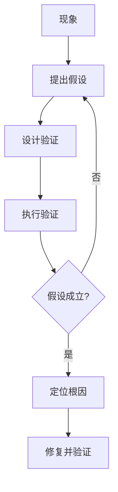
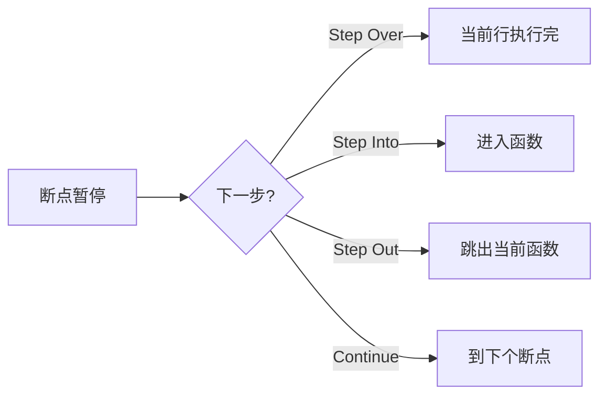
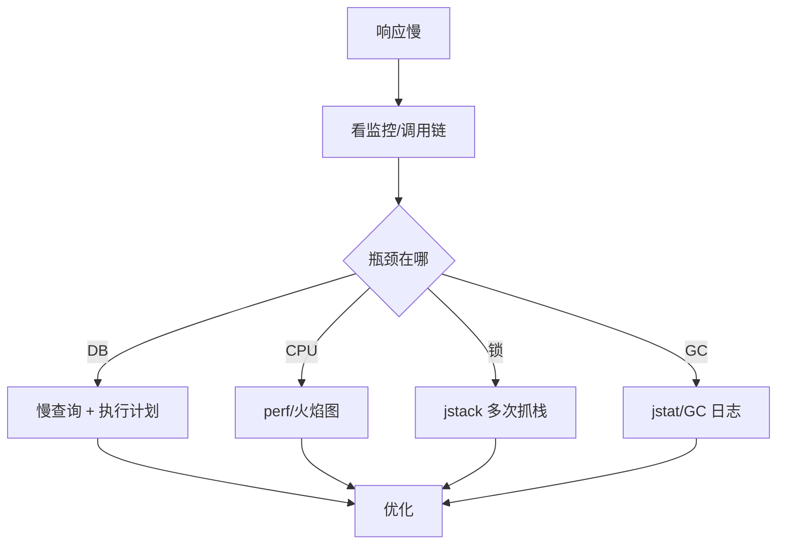

# 调试能力

> 调试（Debugging）是从"现象"反推"根因"的过程：测试告诉你"有 bug"，调试告诉你"bug 在哪、为什么发生"。它是工程师最被低估、却每天都要用的核心能力。

**关键词**：调试、断点、GDB、堆栈、Core Dump、二分法、火焰图、内存泄漏、橡皮鸭

## 抽象类比

调试像"破案"：现场（报错信息、日志、堆栈）是线索，嫌疑人（每一段可疑代码）需要逐一排除。你不能凭直觉抓人，得有证据链——假设、验证、排除，直到锁定真凶。

也像"医生问诊"：病人说"头疼"（程序崩了），医生不能直接开止痛药（改了表象），得先做检查（看日志、看堆栈、看监控），找到病因（根因），再对症下药（修复）。

## 一、调试是什么

### 定义

- 调试是定位并修复程序缺陷（bug）根因的过程
- 包含两个阶段：定位（找原因）+ 修复（改代码）
- 难点永远在"定位"，修复往往只是几行代码

### 调试与测试的区别

- 测试：发现"有 bug"——回答"对不对"
- 调试：定位"为什么有 bug"——回答"为什么错"
- 测试是"找茬"，调试是"破案"
- 没有 [[软件测试]] 提供的可复现用例，调试就成了无源之水

### 调试的难度来源

- 现象与根因可能跨多层调用、跨多台机器
- 并发 / 异步 / 时序问题难以稳定复现
- 内存问题表现"飘忽"，换个环境就消失
- 第三方依赖的"黑盒"放大不确定性

## 二、调试的思维方式

### 假设 - 验证 - 排除

- 看到现象后先提出"可能的原因清单"
- 按可能性排序，从最可能的开始验证
- 每次只验证一个变量，避免混淆
- 验证不成立就划掉，逐步缩小范围

### 二分法

- 程序在哪一步出问题？从中间切入
- 二分注释代码、二分 git 提交（`git bisect`）、二分输入数据
- 把 O(n) 的排查变成 O(log n)

### 最小复现

- 把 bug 简化到最小的可复现场景
- 删掉无关代码、无关输入、无关环境
- 一旦能稳定复现，定位就完成了一半

### 分而治之

- 大系统按模块切：先确定是前端、后端、还是数据库
- 单模块按层切：是路由层、业务层、还是存储层
- 每一层都有可观测点（日志、断点、监控）

### Don't guess, verify

- 别凭感觉改代码"试试看"——这是赌博不是调试
- 任何假设都要有证据支撑
- 改完之后必须能解释"为什么这样改会好"



## 三、调试方法分类

### 打印日志（printf debugging）

- 最朴素也最通用：在关键路径打印变量值
- 优点：跨语言、跨环境、无侵入
- 缺点：需要重新部署、信息有限、影响性能
- 适合：简单问题、生产环境无法 attach 的场景

### 断点调试

- 在代码某行设"暂停点"，程序运行到这里停下来
- 可以查看变量、调用栈、表达式
- 适合：本地开发、逻辑复杂但能复现的问题

### 堆栈分析

- 程序崩溃时打印的调用栈是"案发现场照片"
- 从栈顶往下读：哪一行抛了异常、谁调用了它
- 适合：崩溃类问题（NullPointerException、Segfault）

### Core Dump 分析

- 程序崩溃时把内存快照落盘成 core 文件
- 事后用调试器加载 core 文件回溯现场
- 适合：C/C++ 段错误、生产环境无法实时调试

### 远程调试

- 调试器连到远端进程，像本地一样下断点
- 适合：bug 只在测试 / 生产环境复现

### 二分回溯

- `git bisect` 自动二分提交，定位"哪一次提交引入了 bug"
- 把"几百次提交里找坏提交"变成 log2(N) 次操作

## 四、断点调试深入

### 断点类型

- 普通断点：执行到该行即停
- 条件断点：满足条件才停（如 `i == 1000`）
- 日志断点：不停下，只打印一行日志
- 函数断点：进入某函数即停
- 异常断点：抛出指定异常时停

### 监视 Watch

- 持续观察某个变量或表达式的值
- 可以在断点处修改变量值，验证假设

### 调用栈 Call Stack

- 显示当前函数是被谁一层层调用的
- 点击栈帧可跳到对应代码上下文
- 是定位"为什么会走到这里"的核心工具

### 单步执行

- Step Into（F11）：进入函数内部
- Step Over（F10）：把函数当作一步执行完
- Step Out（Shift+F11）：执行完当前函数，回到调用处
- Continue（F5）：运行到下一个断点



## 五、GDB 调试实战

GDB 是 [[Linux]] 下 C/C++ 最经典的调试器，详见 [[C]] 程序的调试场景。

### 启动与附加

- `gdb ./program`：启动并加载程序
- `gdb -p <pid>`：附加到已运行的进程
- `gdb ./program core`：分析 core dump 文件
- 编译时需要加 `-g` 保留调试信息

### 断点命令

- `break main`：在函数处下断点
- `break file.c:42`：在指定文件行下断点
- `break 42 if x > 10`：条件断点
- `info breakpoints`：查看所有断点
- `delete <num>`：删除断点

### 执行控制

- `run`：从开始运行
- `continue`：继续执行到下一个断点
- `next`（n）：单步步过
- `step`（s）：单步步入
- `finish`：执行完当前函数

### 查看变量

- `print x`：打印变量值
- `print *arr@10`：打印数组前 10 个元素
- `display x`：每次停下自动打印
- `info locals`：查看所有局部变量
- `info args`：查看函数参数

### 调用栈

- `backtrace`（bt）：打印调用栈
- `frame 2`：切换到第 2 层栈帧
- `up` / `down`：在栈帧间上下移动

### 线程相关

- `info threads`：列出所有线程
- `thread 3`：切换到 3 号线程
- `thread apply all bt`：打印所有线程的调用栈

### 内存检查

- 与 Valgrind 配合分析内存泄漏
- `watch *0x601000`：监视内存地址变化
- `x/10xw 0x601000`：以十六进制查看 10 个 word

### Core Dump 分析

- `ulimit -c unlimited`：开启 core 文件生成
- 程序崩溃后用 `gdb ./program core` 加载
- `bt` 看崩溃栈，定位段错误行号
- 适合事后分析生产环境的崩溃

## 六、IDE 调试器

### VS Code

- 通过 `launch.json` 配置调试任务
- 支持多语言：Python（debugpy）、Java（Java 扩展）、JS（Chrome / Node）
- 支持远程调试：SSH、容器、WSL
- 图形化的断点、Watch、调用栈面板

### IntelliJ IDEA / PyCharm

- 右键行号即可下断点
- 强大的"条件断点""求值表达式"
- 支持"Drop Frame"回退到调用者重新执行
- 远程调试通过 JVM Debug 端口 attach

### Xcode

- Apple 平台首选，支持 Swift / ObjC
- LLDB 调试器，命令与 GDB 类似
- 集成 UI 树查看、网络请求监控

### 远程调试配置要点

- 服务端开启调试端口（如 Java 的 `-agentlib:jdwp=...`）
- 客户端 IDE 配置 host / port attach
- 注意防火墙和安全：调试端口绝不应对公网开放

## 七、不同语言 / 场景的调试

### C / C++：GDB / LLDB

- 详见 [[C]] 调试章节
- 内存问题多：用 Valgrind、AddressSanitizer 辅助
- 编译期保留 `-g -O0`，避免优化干扰

### Java：JDB / jstack / jmap

- JDB：命令行调试器，GDB 的 Java 版
- `jstack <pid>`：打印线程堆栈，定位死锁、卡顿
- `jmap -dump`：导出堆内存，分析 OOM
- `jstat`：监控 GC 情况
- 详见 [[Java]] 性能诊断章节

### Python：pdb / ipdb

- `import pdb; pdb.set_trace()` 在代码中下断点
- 或运行 `python -m pdb script.py`
- 命令与 GDB 类似：`n`、`s`、`c`、`p`、`l`
- `ipdb` 提供语法高亮和补全，体验更好
- 详见 [[Python]] 调试章节

### JavaScript：Chrome DevTools

- Sources 面板下断点、查看调用栈、Watch
- 支持条件断点、日志断点、DOM 断点
- Network 面板看请求、Performance 面板看性能
- Node.js 用 `--inspect` 接入 Chrome DevTools

### Go：Delve（dlv）

- Go 官方推荐的调试器
- `dlv debug`、`dlv attach <pid>`
- 支持协程级调试：`goroutines`、`goroutine <n>`
- 配合 `go test -race` 检测数据竞争

## 八、调试并发与异步问题

### 常见并发问题

- 竞态条件（Race Condition）：结果依赖线程调度顺序
- 死锁（Deadlock）：线程互相等待对方释放锁
- 活锁（Livelock）：线程不停"让路"但谁都无法前进
- 内存可见性：一个线程的修改对另一个线程不可见

### 调试难点

- 难以稳定复现：跑一万次才出现一次
- 加日志可能"治好了"——因为时序被改变
- 多线程堆栈混乱，看不出因果

### 工具辅助

- Thread Sanitizer（TSan）：检测数据竞争，C/C++/Rust 可用
- Go Race Detector：`go run -race`、`go test -race`
- Helgrind：Valgrind 的线程检查工具
- Java：`jstack` 多次抓栈对比，找持锁线程

### 死锁排查思路

1. `jstack` / `pstack` 抓所有线程堆栈
2. 找 `BLOCKED` / 等待锁的线程
3. 查看它们各自持有什么锁、等什么锁
4. 画出"等锁图"，找环就是死锁


## 九、调试内存问题

### 常见内存问题

- 内存泄漏（Memory Leak）：分配了不释放，长期占用增长
- Use-After-Free：访问已释放的内存
- Double Free：同一块内存被释放两次
- Buffer Overflow：数组越界写
- 空指针 / 悬垂指针：访问无效地址

### Valgrind

- Linux 下最经典的内存检查工具
- `valgrind --leak-check=full ./program`
- 报告泄漏位置、非法访问、未初始化读
- 优点：检测全面；缺点：慢 10-50 倍

### AddressSanitizer（ASan）

- 编译器内置（`-fsanitize=address`），开销小
- 检测越界、Use-After-Free、Double Free
- 适合日常开发和 CI 流水线
- Clang / GCC 都支持

### Memory Leak 排查

- 长跑进程定期抓内存快照对比
- Java 用 `jmap` + MAT 分析对象引用链
- Python 用 `tracemalloc` 跟踪分配点
- C/C++ 用 Valgrind / ASan

### Use-After-Free 案例

```c
char *p = malloc(10);
free(p);
printf("%s", p);   // 危险：访问已释放内存
```

- 现象：可能"看起来正常"，也可能崩在不同位置
- ASan 一抓一个准，能精确报告释放点和访问点

## 十、调试性能问题

### 性能问题分类

- 慢：单个请求响应时间长
- 卡：偶尔卡顿，可能 GC、锁竞争
- 高 CPU：CPU 跑满但吞吐量上不去
- 高内存：内存涨不停，最终 OOM

### 火焰图（Flame Graph）

- 把 CPU 采样数据可视化成"火焰"
- 横轴：调用栈占比，纵轴：调用深度
- 宽的"平台"就是热点函数
- 工具：`perf` + FlameGraph 脚本、async-profiler、py-spy

### Linux perf

- `perf record -F 99 -p <pid> -g`：采样
- `perf report`：交互查看
- `perf stat`：看 IPC、cache miss 等硬件指标
- 需要 root 或内核开启 `perf_event_paranoid`

### Chrome Performance

- 前端性能分析首选
- 录制用户操作，看主线程时间线
- 找长任务（Long Task）、布局抖动、强制回流

### 慢查询定位

- 数据库：开慢查询日志，看执行计划
- 后端：APM 工具（SkyWalking、Pinpoint）看调用链耗时
- 先看哪一段最慢，再深入该段

### 热点定位流程



## 十一、调试心理学

### 保持冷静

- bug 越急越调不出来——焦虑让人跳过验证
- 先离开工位倒杯水，比盯着屏幕更有效
- 把"为什么会这样"换成"我假设它是这样，怎么证明"

### 跳出来看

- 别钻牛角尖："这一行明明没问题啊"
- 退一步看：是不是这个模块一开始就跑错了？
- 是不是配置 / 环境 / 依赖版本的问题？

### 橡皮鸭调试

- 对着一只橡皮鸭（或同事）逐行讲解代码
- 讲的过程会强迫你重新组织思路
- 经常讲到一半自己就发现"哦原来这里错了"
- 不需要对方懂，只需要"被迫完整复述"

### 20 分钟规则

- 一个方向试 20 分钟还不行，立刻换方向
- 别死磕：同一个假设验证 5 次失败就说明假设错了
- 换方法、换人、换环境，都比硬刚强

### 求助同事

- 求助不是无能，是工程效率
- 求助前先整理：现象、复现步骤、已尝试什么、目前怀疑什么
- 整理的过程本身就是 80% 的解决
- 详见 [[软件测试]] 中"用例协作"的思路：描述清楚比解决更难

## 面试速答

**Q1：你怎么排查一个线上接口偶尔变慢的问题？**

- 先看监控和 APM 调用链，定位是接口本身慢还是下游慢
- 排除 GC：看 JVM 监控，是否有 Full GC
- 排除数据库：看慢查询日志、连接池等待
- 排除锁竞争：多次 `jstack` 抓栈，找 BLOCKED 线程
- 排除网络 / 依赖：看下游服务 RT、自身机器负载
- 必要时压测复现，用火焰图找热点

**Q2：GDB 常用命令有哪些？怎么分析 core dump？**

- 启动：`gdb ./program core`
- 看栈：`bt` 看崩溃调用栈，`frame N` 切换栈帧
- 看变量：`print var`、`info locals`
- 切线程：`info threads`、`thread N`
- 编译时需加 `-g`，core 文件需 `ulimit -c unlimited` 开启

**Q3：怎么调试一个"加日志就不复现"的并发 bug？**

- 这是典型的"观察者效应"，加日志改变了时序
- 改用低侵入工具：Thread Sanitizer、Go race detector
- 用 `jstack` / `pstack` 在外部多次抓快照，不打断程序
- 复盘代码：找临界区、找共享变量、找锁顺序
- 必要时用压力测试 + 模型检查工具（如 Loom）辅助

**Q4：内存泄漏怎么排查？**

- 先确认是泄漏还是高负载：内存是否持续单调增长
- Java：`jmap -dump` 导堆，用 MAT 找支配树和 GC Root 引用链
- C/C++：Valgrind `--leak-check=full` 或 ASan
- Python：`tracemalloc` 抓快照对比分配点
- 找到"谁在持有不该持有的引用"就找到了根因

**Q5：你用过哪些调试思路？**

- 假设-验证-排除：列出可能原因，逐一验证
- 二分法：`git bisect` 找坏提交、二分注释找问题代码
- 最小复现：简化输入和环境
- 橡皮鸭调试：对着同事或鸭子讲一遍代码
- 20 分钟规则：一个方向不行就换，不死磕