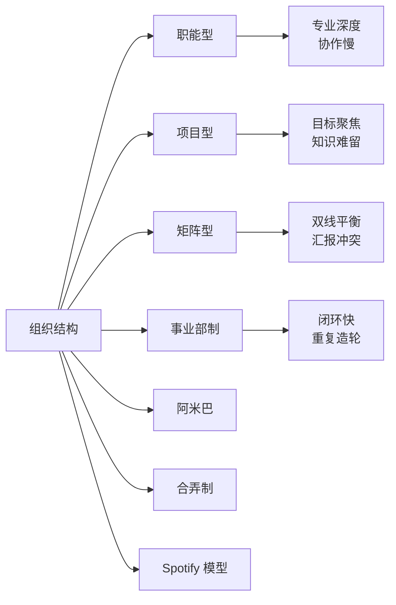
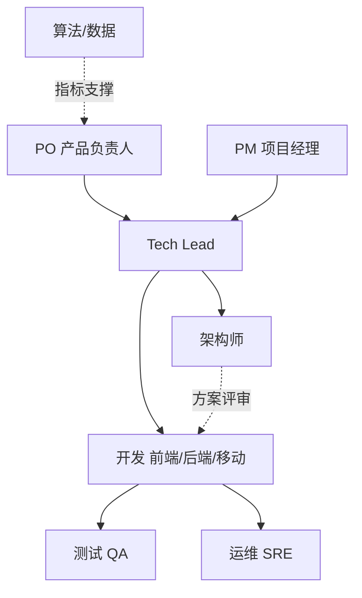
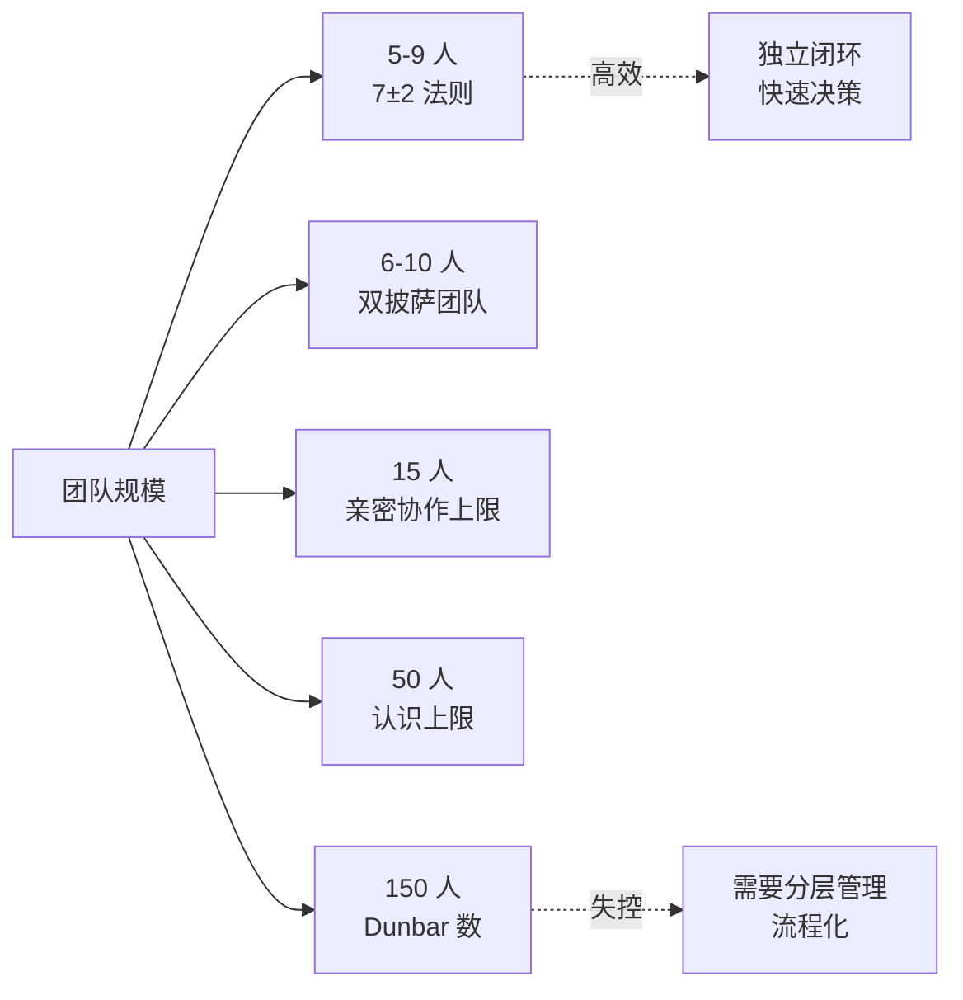
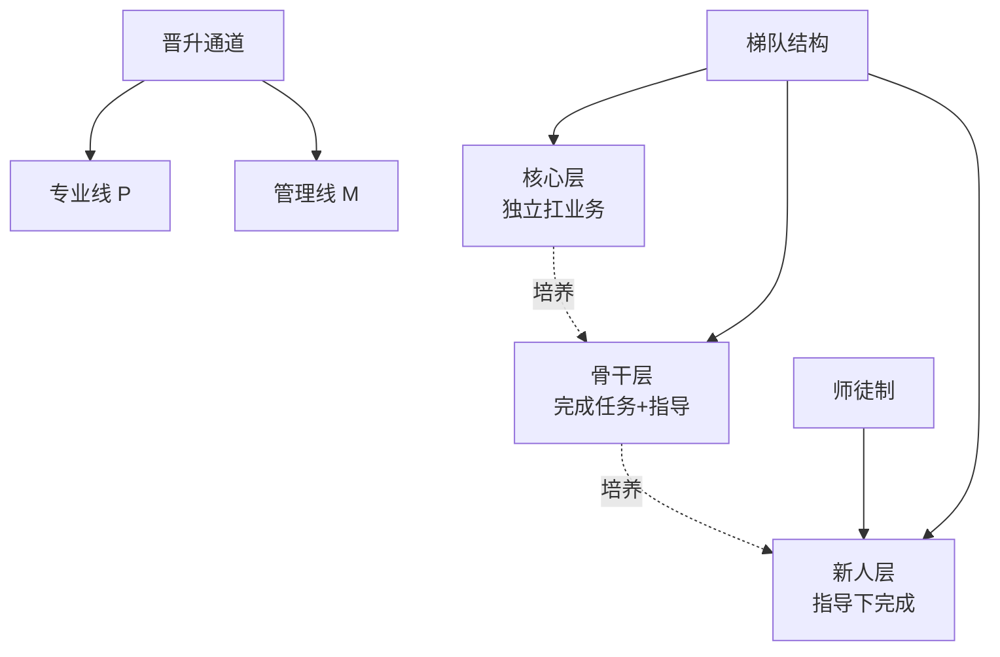
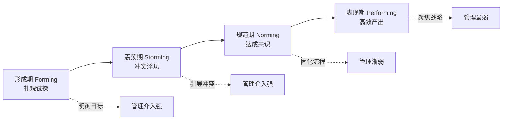

# 团队管理与分工

> 团队管理（Team Management）研究的是"如何把一群人组织成一支能持续打胜仗的队伍"，关注团队结构、角色分工、协作机制与文化土壤，而非单个管理者的个人修炼。

**关键词**：团队结构、角色分工、协作机制、梯队建设、组织文化

## 抽象类比

团队管理可以用"搭建一支球队"来类比：教练再强也不能上场踢球，真正决定胜负的是阵型（结构）、位置（分工）、配合套路（协作机制）和更衣室氛围（文化）。同样的球员，换个阵型可能判若两队；同样的阵型，没有默契配合也打不出战术。

如果说《技术管理入门》讲的是"教练本人怎么当"，本文讲的就是"球队怎么搭、怎么练、怎么打比赛"。一支成熟的球队不仅要有明星球员，更要有清晰的站位、明确的战术、稳定的轮换和健康的更衣室——这正是团队管理的核心命题。

## 一、常见团队组织结构

团队结构决定了信息和权力的流向，选错结构再优秀的人也发挥不出来。

- 职能型
  - 按专业分组：前端组、后端组、测试组
  - 优点：专业深度强，技术沉淀好
  - 缺点：跨职能协作成本高，响应慢
  - 适用：技术壁垒高、业务变化慢的传统企业
- 项目型
  - 围绕项目临时组建跨职能小队
  - 优点：目标聚焦，决策快
  - 缺点：项目结束团队解散，知识难沉淀
  - 适用：项目制交付的外包、集成商
- 矩阵型
  - 业务线 + 职能线双重汇报
  - 优点：兼顾专业深度与业务响应
  - 缺点：双重汇报易冲突，需要成熟的管理机制
  - 适用：中大型互联网公司常见的折中方案
- 事业部制（BU）
  - 按业务线划分独立单元，自带产研测
  - 优点：决策自主、闭环快
  - 缺点：重复造轮子，资源复用差
  - 适用：业务多元、规模较大的集团
- 阿米巴
  - 把组织拆成独立核算的小单元
  - 优点：人人都是经营者，成本意识强
  - 缺点：可能内卷、短期主义
  - 适用：制造业、强调成本控制的场景
- 合弄制（Holacracy）
  - 以"角色"而非"岗位"为核心，通过章程自治
  - 优点：去中心化、灵活性高
  - 缺点：学习成本高，落地困难
  - 适用：高度自驱的扁平化组织实验
- Spotify 模型
  - Squad（小队）、Chapter（专业线）、Tribe（部落）、Guild（兴趣社区）
  - 优点：兼顾小队敏捷与专业沉淀
  - 缺点：只是 Spotify 实践的总结，不可照搬
  - 适用：作为思想启发，按自身情况裁剪

## 二、研发团队的核心角色与分工

角色边界不清是协作冲突的主要来源。下面列出常见角色的职责边界与协作点。

- PM（项目经理）
  - 职责：进度跟踪、风险预警、资源协调
  - 边界：不决定"做什么"，只决定"怎么推进"
  - 协作点：与 PO 对齐优先级，与 Tech Lead 对齐排期
- PO（产品负责人）
  - 职责：需求优先级、产品决策、用户价值
  - 边界：不直接干预技术实现
  - 协作点：向开发解释 Why，向用户传递 What
- Tech Lead
  - 职责：技术决策、架构把控、Code Review
  - 边界：不替代架构师做深度设计，也不替代 PM 排期
  - 协作点：向上对齐 PO，向下指导开发
- 架构师
  - 职责：系统设计、技术选型、跨模块边界
  - 边界：偏"设计"而非"执行"
  - 协作点：与 Tech Lead 共同评审方案，与开发对齐接口
- 前端 / 后端 / 移动端
  - 职责：业务实现、单元测试、Bug 修复
  - 边界：按架构约定实现，不擅自改接口
  - 协作点：与上下游对齐 API 契约
- 测试（QA）
  - 职责：质量保障、测试用例、自动化
  - 边界：不替开发背质量锅，但要把关
  - 协作点：需求评审时介入，提前发现边界问题
- 运维 / SRE
  - 职责：稳定性、监控、发布、容量规划
  - 边界：不背业务 Bug，但负责平台可靠
  - 协作点：与开发共建可观测性、On-Call 体系
- 算法 / 数据
  - 职责：模型、数据管道、指标体系
  - 边界：偏"数据驱动"的专项角色
  - 协作点：与业务对齐指标定义，与后端对齐数据接口

## 三、团队规模与协作

团队规模不是越大越好，超过一定规模后协作成本会指数级上升。

- 7±2 法则
  - 一个高效协作的小队规模在 5-9 人
  - 超过后沟通链条复杂、决策变慢
  - 是 Squad、敏捷小组的常用参考
- 双披萨团队（Two-Pizza Team）
  - 亚马逊 Bezos 提出：两个披萨喂不饱的团队太大
  - 一般对应 6-10 人
  - 强调"小而全、可闭环"
- 康威定律（Conway's Law）
  - 系统的架构会镜像组织的沟通结构
  - 想要微服务架构，就要先有跨职能小队
  - 组织设计先行，技术架构跟随
- Dunbar 数
  - 一个人能维持的稳定社交关系约 150 人
  - 15 人是"亲密协作"上限，50 人是"认识"上限
  - 团队扩张到不同阈值需要不同的协作机制
- 沟通成本公式
  - n 个人的团队，沟通渠道数为 n(n-1)/2
  - 10 人团队 45 条，20 人团队 190 条
  - 扩张带来的不是线性成本，而是平方级成本

## 四、跨团队协作机制

团队内部协作靠默契，跨团队协作必须靠机制。

- 接口约定
  - 提前定义 API 契约、数据格式、错误码
  - 用 Swagger / Protobuf 等文档化
  - 契约变更走评审，避免单方面改接口
- 定期对齐
  - 周会同步进展与阻塞
  - 月会同步规划与依赖
  - 季度会同步战略与路线图
- 联合复盘
  - 跨团队事故复盘，避免互相甩锅
  - 聚焦流程改进而非个人追责
  - 输出 Action Item 并跟踪闭环
- On-Call 轮值
  - 明确值班人员、升级路径、响应 SLA
  - 跨团队故障先恢复再定责
  - 值班表公开透明，避免"找不到人"
- 需求评审会
  - 上游提需求，下游提前评估
  - 拒绝"临时插队"，保护开发节奏
  - 评审输出排期、风险、依赖项
- 协作文档
  - 决策记录（ADR）留痕
  - 会议纪要公开存档
  - 关键流程图、架构图统一管理

## 五、远程与混合办公的协作

远程办公不是"在家上班"，而是"以异步为主的另一种工作方式"。

- 异步沟通优先
  - 默认文档/工单沟通，会议是补充
  - 决策落到书面，避免口头失真
  - 时区差异下，留出"异步响应窗口"
- 文档文化
  - 一切可文档化的内容都写下来
  - RFC 机制：重大决策先写文档再讨论
  - 文档有owner、有版本、有更新机制
- 线上仪式
  - 每日站会：异步文字 + 同步简短
  - 周会：视频开启、聚焦阻塞
  - 虚拟茶水间：非工作交流防止孤立
- 结果导向
  - 用产出衡量而非工时
  - 目标清晰、可验收
  - 信任替代监督，否则远程必然失败
- 远程的反面
  - 沟通延迟带来的决策卡顿
  - 新人融入慢、文化传承难
  - "永远在线"导致的隐性过劳

## 六、团队梯队建设

梯队是团队的"备份系统"，没有梯队的关键人离职就是灾难。

- 梯队结构
  - 核心层：能独立扛起一块业务
  - 骨干层：能完成明确任务并指导他人
  - 新人层：在指导下完成任务
  - 保持"1-2-3"左右的金字塔结构
- 骨干培养
  - 给挑战性任务，超出当前能力 20%
  - 允许犯错，复盘而非追责
  - 创造对外曝光机会（分享、跨团队牵头）
- 新人落地
  - 入职第一周：环境、文档、Meet & Greet
  - 第一个月：第一个小任务端到端跑通
  - 第三个月：能独立承担模块
  - 半年内：融入团队、有稳定产出
- 师徒制
  - 一对一指定 Mentor
  - Mentor 负责答疑、Review、成长辅导
  - Mentor 的绩效与 Mentee 成长挂钩
- 晋升通道
  - 专业线（P 线）：技术专家路线
  - 管理线（M 线）：团队管理路线
  - 双通道等价，避免"只有管理才晋升"
  - 晋升标准透明、可预期

## 七、团队绩效与激励

绩效不是"分蛋糕的工具"，而是"引导行为的信号"。

- OKR vs KPI
  - OKR：目标 + 关键结果，强调挑战和方向，鼓励 stretch
  - KPI：指标导向，强调达成和考核
  - 选择：探索型业务用 OKR，成熟业务用 KPI
  - 误区：把 OKR 当 KPI 用，反而失去激励意义
- 360 度评估
  - 上级、平级、下级、自评多视角
  - 避免单一视角的盲区
  - 注意：平级评分容易"互相抬轿"，需校准
- 强制分布
  - 把团队按比例分档（如 2-7-1）
  - 优点：避免打分趋中、强制区分
  - 缺点：小团队失真、破坏协作
  - 适用：大组织强制区分，小团队慎用
- 激励的非物质手段
  - 认可：公开表扬、命名权
  - 成长：挑战性项目、对外分享机会
  - 自主：选技术栈、定方案的自由
  - 意义：让成员看到自己工作的价值
  - 晋升：清晰可见的上升通道
- 激励的常见误区
  - 只用钱激励：边际效用递减
  - 一刀切：忽视个体差异
  - 暗箱操作：标准不透明，失去公信力

## 八、团队文化建设

文化是"没有人看着时团队怎么做事情"的默认设定。

- 价值观落地
  - 价值观不是墙上的字，是决策依据
  - 招聘、晋升、解雇都以价值观为标尺
  - Leader 以身作则，否则一切都是空话
- 复盘文化
  - 不追责、不甩锅、聚焦改进
  - 5 Whys 追问根因
  - 输出可执行的 Action Item
  - 定期回顾 Action 落地情况
- 技术分享
  - 每周或每两周一次内部分享
  - 鼓励"小而美"的分享，不必宏大
  - 录像存档，新人和缺席者可回看
  - 分享计入绩效，给予正向激励
- Code Review 文化
  - 不仅是查 Bug，更是知识传递
  - 对事不对人，用建议而非命令
  - Leader 也要被 Review，不能搞特殊
- 容错与心理安全
  - Google 亚里士多德项目：心理安全是高效团队的第一要素
  - 允许"安全的失败"：试错不追责
  - 鼓励提出异议，避免"沉默的共识"
  - Leader 主动承认错误，树立榜样

## 九、团队成长阶段（Tuckman 模型）

团队不是一天成熟的，会经历可预测的阶段。Bruce Tuckman 提出四阶段模型。

- 形成期（Forming）
  - 成员互相试探，礼貌但疏离
  - 目标和角色不清晰
  - 管理要点：明确目标、制定规则、强化方向感
- 震荡期（Storming）
  - 冲突浮现，争权夺利
  - 对目标、分工、方法产生分歧
  - 管理要点：不回避冲突、引导建设性讨论、确立决策机制
- 规范期（Norming）
  - 达成共识，规则内化
  - 出现"我们"的归属感
  - 管理要点：固化流程、授权骨干、开始放手
- 表现期（Performing）
  - 自主协作、高效产出
  - Leader 退到幕后，团队自我驱动
  - 管理要点：聚焦战略与人才，避免过度干预

补充说明：Tuckman 后来补充了第五阶段"解散期（Adjourning）"，项目结束或团队重组时需要做好知识沉淀和情绪管理。

## 面试速答

### Q1：你如何设计一个 30 人的研发团队的组织结构？

回答思路：先看业务形态再定结构。如果是单一产品线，倾向按 Squad 拆分——3-4 个跨职能小队（前端+后端+测试+PM），每个 6-8 人，闭环交付；同时设 Chapter（专业线）做技术沉淀，避免小队之间技术栈分裂。Tech Lead 管小队，架构师跨小队做横向把控。如果是多业务线，则按 BU 拆分，每个 BU 自带产研测。关键原则是遵循康威定律——想要什么样的架构，就先搭什么样的组织。

### Q2：康威定律在团队管理中怎么应用？

回答思路：康威定律说"系统架构会镜像组织的沟通结构"。应用上有两个方向：正向应用是"想拆微服务，就先拆跨职能小队"，让每个小队对自己的服务闭环负责；反向应用是"组织不变，光想做微服务改造，必然失败"，因为沟通结构会强行把架构拉回单体。落地时还要注意"逆康威定律"——主动设计组织来引导架构演进，而不是被动等待架构适配现有组织。

### Q3：如何处理跨团队协作中的"甩锅"问题？

回答思路：甩锅的本质是责任边界不清 + 追责文化过重。三步走：第一，事前明确边界——接口契约、SLA、Owner 都落到文档，谁负责什么一目了然；第二，事中先恢复后定责——线上故障先一起救火，不在线上复盘时吵架；第三，事后做联合复盘——聚焦流程改进而非个人追责，问"流程哪里出问题"而不是"谁搞砸的"。长期看要建立心理安全的文化，让团队相信"承认问题不会被惩罚"。

### Q4：远程团队和线下团队管理上最大的区别是什么？

回答思路：最大的区别是"沟通模式"从同步为主切换到异步为主。线下团队靠口头沟通和走廊偶遇传递信息，远程团队必须把信息文档化。具体差异：一是文档文化变为核心——决策、会议、方案都要落到书面；二是结果导向取代工时导向——只看产出而非在线时长；三是仪式感更重要——站会、周会、1v1 不能省，否则团队会"失联"；四是新人融入更难——要主动设计 Onboarding 流程，否则半年都融入不了。远程不是"在家上班"，而是另一种工作方式。

### Q5：团队从 10 人扩张到 30 人，管理上要做哪些调整？

回答思路：10 人到 30 人是质变，不是量变。一是结构上要分层——10 人可以扁平，30 人必须拆小队并设中层 Tech Lead；二是流程要显性化——10 人靠默契，30 人靠文档和机制，否则信息必然失真；三是文化要主动建设——10 人的文化是"长出来的"，30 人的文化必须"主动塑造"否则会异化；四是要警惕沟通成本平方级上升——通过拆小队、明确边界、减少全员会议来控制；五是 Leader 的角色从"带人做事"变成"带 Leader 带人做事"，自己要退到幕后做机制设计。