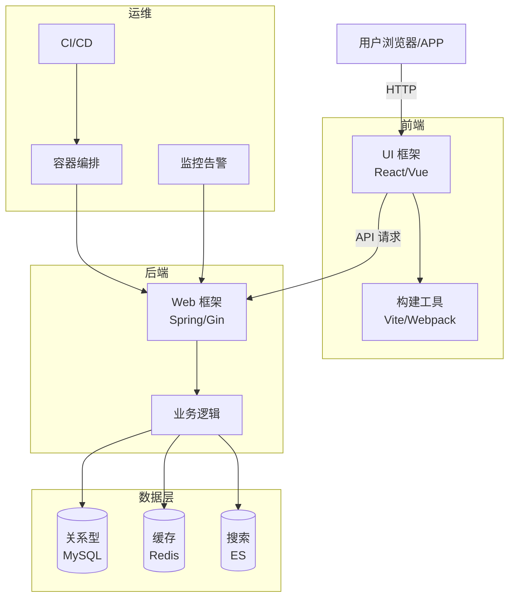
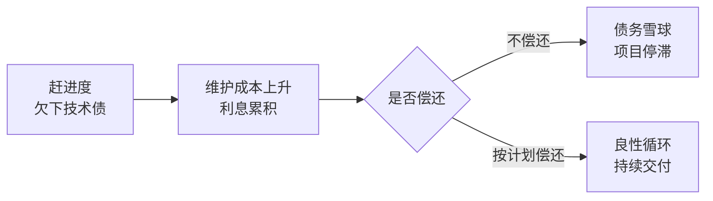

# 技术栈与选型

> 技术栈（Technology Stack）是指一组协同工作的技术的集合，从前端的用户界面，到后端的业务逻辑，再到数据库、中间件、部署运维，共同构成一个完整可运行的软件系统。技术栈的选择，决定了产品能不能做出来、做得快不快、扛不扛得住流量、好不好维护。

**关键词**：技术栈、选型、架构、前端、后端、运维

## 抽象类比

技术栈可以用"厨房的整套厨具"来类比：灶台、炒锅、刀具、调料、洗碗机各司其职，缺一不可，搭配得当才能做出一桌好菜。前端像前厅的点单和摆盘，后端像后厨的灶台和厨师，数据库像仓库里的食材，中间件像传菜电梯，运维像水电煤和清洁系统——任何一环掉链子，整桌菜都端不出来。

选技术栈就像装修厨房：要根据菜系（业务）、预算（成本）、厨师人数（团队能力）来定，不是越贵越好，而是合适最好。

一个典型 Web 应用的技术栈全景大致如下：

## 一、前端技术栈

前端负责用户直接看到和交互的部分，是"厨房的前厅"。

- 基础三件套
  - HTML：页面结构骨架
  - CSS：样式与布局
  - JavaScript：交互逻辑
- 框架
  - React：Facebook 出品，组件化、生态最丰富
  - Vue：上手快、中文社区友好
  - Angular：大而全，适合企业级应用
  - Svelte：编译时优化，运行时轻量
- 语言
  - TypeScript：JavaScript 的超集，加了静态类型，大型项目几乎标配
- 构建工具
  - Webpack：老牌打包工具，配置灵活但繁琐
  - Vite：新一代极速构建工具，开发体验好
- 状态管理
  - Redux：React 生态经典方案，单向数据流
  - Pinia：Vue 官方推荐，轻量易用
  - Zustand：极简风格，API 友好
- UI 组件库
  - Ant Design：蚂蚁出品，中后台首选
  - Material UI：Google 设计规范实现
  - Element：饿了么出品，Vue 生态常用

## 二、后端技术栈

后端负责业务逻辑、数据处理，是"厨房的后厨"。

- Java 体系
  - Spring Boot：快速构建独立应用
  - Spring Cloud：微服务全家桶
  - MyBatis：半自动 ORM，SQL 灵活
- Go 体系
  - Gin：轻量高性能 Web 框架
  - Echo：简洁易用
  - Kratos：B 站开源的微服务框架
- Python 体系
  - Django：大而全，自带后台
  - Flask：轻量灵活
  - FastAPI：异步高性能，自带文档
- Node.js 体系
  - Express：最经典的 Web 框架
  - NestJS：借鉴 Angular，结构化强
  - Koa：Express 原班人马出品，更现代
- Rust 体系
  - Actix：性能榜单常客
  - Axum：Tokio 团队出品，设计现代

## 三、数据库技术栈

数据库是"厨房的仓库"，存储和管理数据。

- 关系型数据库
  - MySQL：互联网公司最常用
  - PostgreSQL：功能强大，支持复杂查询
  - Oracle：传统企业级首选，收费贵
- NoSQL 数据库
  - MongoDB：文档型，灵活 schema
  - Redis：内存键值存储，速度极快
  - Elasticsearch：搜索引擎，擅长全文检索
- NewSQL 数据库
  - TiDB：兼容 MySQL 协议，水平扩展
  - CockroachDB：强一致性分布式数据库
- 向量数据库（AI 时代新宠）
  - Milvus：开源向量数据库
  - Pinecone：托管型 SaaS 服务

## 四、中间件技术栈

中间件是连接各组件的"管道"，详细内容见 `中间件.md`。

- 消息队列：Kafka（高吞吐）、RabbitMQ（灵活路由）
- 缓存：Redis（几乎垄断）
- 网关：Nginx（经典）、Kong（API 网关）
- 注册中心：Nacos（阿里开源）、Consul（HashiCorp 出品）

## 五、DevOps 技术栈

DevOps 是"厨房的运营管理"，让开发与运维高效协作。

- 容器化：Docker，把应用和环境打包成标准单元
- 容器编排：Kubernetes（K8s），管理大规模容器集群
- CI/CD 持续集成与部署
  - Jenkins：老牌流水线工具
  - GitHub Actions：与 GitHub 深度集成
  - GitLab CI：GitLab 内置方案
- 监控：Prometheus 采集 + Grafana 展示
- 日志：ELK（Elasticsearch + Logstash + Kibana）或 EFK（Filebeat 替代 Logstash）

## 六、移动端技术栈

- 原生开发
  - iOS：Swift 语言 + SwiftUI/UIKit
  - Android：Kotlin 语言 + Jetpack Compose
- 跨平台开发
  - Flutter：Google 出品，一套代码多端运行
  - React Native：Facebook 出品，使用 React 语法
  - 新趋势：Kotlin Multiplatform、鸿蒙 ArkTS

## 七、技术选型原则

技术选型不是"选最热的"，而是"选最合适的"。

- 业务匹配：技术要服务于业务，避免杀鸡用牛刀
- 团队熟悉度：降低学习成本，避免项目成为团队的"试验田"
- 生态成熟度：看社区活跃度、文档完整性、生产案例数量
- 性能与扩展性：能否支撑未来 1-2 年的业务增长
- 可维护性：代码好不好读、好不好招人、好不好交接
- 避免"简历驱动开发"：不要为了简历好看而引入新技术
- 关注长期成本：上手快不等于维护省，要看全生命周期成本

## 八、典型技术栈组合

历史上有些经典组合，被广泛使用并形成了缩写。

- LAMP：Linux + Apache + MySQL + PHP，Web 早期经典组合
- MEAN：MongoDB + Express + Angular + Node.js，全 JS 技术栈
- MERN：MongoDB + Express + React + Node.js，React 版本的 MEAN
- JAMstack：JavaScript + APIs + Markup，现代静态站点方案
- Spring 全家桶：Spring Boot + Spring Cloud + MyBatis + MySQL + Redis + Nginx，国内中大型企业常见
- Serverless：FaaS（如 AWS Lambda）+ BaaS，按需付费、免运维

## 九、技术债（Technical Debt）

### 什么是技术债

技术债是为了快速交付而做出的"次优技术选择"，类比"信用卡透支"：现在先用了未来的钱（速度），未来就要还本付息（维护成本）。如果只借不还，利息越滚越大，最终压垮项目。

### 技术债的分类

- 有意为之：为了赶上线，明知有妥协
- 无意产生：能力不足或经验不够留下的隐患
- 环境漂移：技术升级、需求变化导致老代码变"债"

### 如何管理技术债

- 可视化：在任务看板上单独标注"技术债"卡片
- 量化：评估每笔债的"利息"和"本金"
- 计划偿还：每个迭代留 10%-20% 时间还债
- 防新增：Code Review、架构评审把好关

## 面试速答

### Q1：你如何做技术选型？

回答思路：从业务、团队、生态、成本四个维度评估。先明确业务场景和约束（流量、数据量、响应时间），再候选 2-3 个技术方案对比；团队熟悉度是重要加分项；优先选生态成熟、文档完善、有生产案例的方案；最后看长期维护成本，避免追求时髦引入冷门技术。一句话总结：选最合适的，不选最热的。

### Q2：什么是技术债？怎么管理？

回答思路：技术债是为了快速交付做的次优选择，类似信用卡透支。管理方法包括：把技术债显性化（看板卡片）、评估优先级、每个迭代固定比例时间偿还、通过 Code Review 和架构评审控制新增。关键是在"速度"和"质量"之间找到平衡，而不是追求零债务。

### Q3：前后端分离的好处是什么？

回答思路：前后端分离让前后端可以并行开发、独立部署、独立演进。前端专注交互体验，后端专注业务逻辑和数据；通过 API 解耦，前端可以同时适配 Web、App、小程序多端；团队分工更清晰，招聘和培养更聚焦。代价是接口约定和联调成本上升，需要做好 API 文档和契约管理。