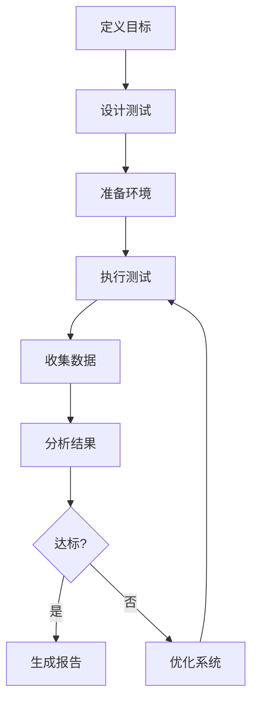

# Benchmark：性能评估的"标准秤"

> 小白先读：Benchmark 不是“跑个分好看”，而是用统一方法回答“到底快了多少、慢在哪里、改动有没有效果”。
>
> 学这篇时先抓 3 个问题：测什么？怎么测才公平？结果怎么指导下一步优化？

**关键词**：Benchmark、基准测试、性能评估、量化指标、对比分析、优化验证

## 抽象类比

凭感觉说“这个系统很快”没有说服力。Benchmark 就像体检报告：不是医生看你脸色说“挺健康”，而是测心率、血压、血糖，用数字判断问题。

性能优化也一样：

- 没有 Benchmark，就像闭眼修车。
- 有 Benchmark，才能知道问题在发动机、轮胎、刹车，还是驾驶方式。

## 什么是Benchmark？

想象一下，你要评估一辆车的性能：
- **直觉判断**："这车看起来跑得挺快的"
- **Benchmark方式**：在标准赛道上，用专业设备测量加速时间、最高时速、刹车距离、油耗等指标，得出客观、可比较的数据

**简单说**：Benchmark（基准测试）是一种**标准化的性能评估方法**，通过定义明确的测试条件、指标和流程，对系统、软件或硬件的性能进行量化测量和对比。

---

## 为什么需要Benchmark？

**类比**：就像考试有标准答案才能评分，性能评估需要统一的"尺子"才能对比。

| 没有Benchmark的问题 | Benchmark的价值 |
| :--- | :--- |
| 无法客观比较不同方案的优劣 | 提供统一的评估标准 |
| 性能优化缺乏量化依据 | 量化性能指标 |
| 难以发现性能瓶颈 | 指导优化方向 |
| 无法预测系统容量 | 预测系统行为 |

---

## Benchmark的组成要素

**类比**：就像一场运动会需要运动员、裁判、规则和计分方式。

| 要素 | 说明 | 类比 |
| :--- | :--- | :--- |
| **工作负载（Workload）** | 测试输入数据 | 运动员 |
| **指标（Metrics）** | 性能衡量标准 | 计时器 |
| **测量方法** | 如何收集数据 | 裁判规则 |
| **分析工具** | 数据处理方式 | 计分系统 |
| **对比基准** | 参考标准 | 历史记录 |

---

## 设计哲学

Benchmark 的设计不是单纯为了"跑出一个数字"，而是为了解决一个根本问题：**性能好坏无法靠感觉判断，必须靠可重复、可比较的量化数据**。

### 核心问题：性能的"不可感知性"

性能和功能不同——功能有没有，看一眼就知道；性能好不好，靠感觉会骗人：
- "感觉变快了"可能只是心理作用
- "这次比上次慢"可能只是后台有其他程序在跑
- "优化有效果"可能只是数据量太小没测出来

Benchmark 的答案：**用标准化的测量替代主观感受**。把"快不快"这个模糊问题，变成"在 X 工作负载下，P99 延迟是多少毫秒"这个精确问题。

### 关键设计取舍

| 取舍点 | Benchmark 的选择 | 放弃了什么 |
| :--- | :--- | :--- |
| **真实 vs 可控** | 测试环境高度可控，便于对比 | 放弃了"100% 还原生产环境"的真实性 |
| **简单 vs 全面** | 指标聚焦、场景有限 | 放弃了"测遍所有情况"的全面性 |
| **单次 vs 可重复** | 强调多次运行、统计分布 | 放弃了"一次测出结论"的便捷 |
| **微观 vs 宏观** | 微基准和宏基准分开测 | 放弃了"一个测试说明一切"的简单结论 |

### 类比说明

把 Benchmark 想象成**体检中心**：
- 体检有标准流程（标准化），不是医生看脸色判断
- 每项指标有正常范围（对比基准），超了才算异常
- 同一个人多次体检结果应该接近（可重复性）
- 体检报告看的不只是"平均血压"，还有最高、最低、波动情况（百分位数）
- 体检不能代替治病，但能告诉你问题在哪（指导优化）

这套设计的本质是：**不追求一个漂亮的分数，而追求一个可信、可比、能指导决策的数字**。

---

## 常见性能指标

### 时间类指标

| 指标 | 说明 | 类比 |
| :--- | :--- | :--- |
| **响应时间（Response Time）** | 从请求到完成的总时间 | 从点菜到上菜的时间 |
| **延迟（Latency）** | 单次操作的处理时间 | 厨房炒一道菜的时间 |
| **启动时间（Startup Time）** | 系统从启动到可用 | 餐厅从开门到能接客的时间 |
| **恢复时间（Recovery Time）** | 故障后恢复正常 | 停电后发电机启动时间 |

### 吞吐类指标

| 指标 | 说明 | 类比 |
| :--- | :--- | :--- |
| **吞吐量（Throughput）** | 单位时间处理任务数 | 一小时能出多少道菜 |
| **带宽（Bandwidth）** | 数据传输速率 | 传菜通道的宽度 |
| **并发数（Concurrency）** | 同时处理的请求数 | 同时能服务多少桌客人 |

### 资源类指标

| 指标 | 说明 | 类比 |
| :--- | :--- | :--- |
| **CPU使用率** | 处理器占用比例 | 厨师有多忙 |
| **内存占用** | 运行时的内存使用 | 冰箱用了多少空间 |
| **磁盘I/O** | 读写速度和次数 | 进出仓库的频率 |

---

## Benchmark类型

### 1. 微基准测试（Micro-Benchmark）

**类比**：就像测试运动员的单个动作——百米冲刺、引体向上、深蹲，而不是整场比赛。

**特点**：
- 测试单一组件或函数
- 隔离其他影响因素
- 适合定位具体瓶颈

**适用场景**：优化具体函数、对比不同算法、评估代码改动影响

### 2. 宏基准测试（Macro-Benchmark）

**类比**：就像完整的马拉松比赛，测试运动员的综合能力。

**特点**：
- 测试完整系统
- 模拟真实场景
- 评估整体性能

**适用场景**：评估整体系统能力、容量规划、SLA达标验证

### 两种测试对比

| 类型 | 优点 | 缺点 | 类比 |
| :--- | :--- | :--- | :--- |
| **微基准** | 精确、隔离性好 | 不反映真实场景 | 测试发动机马力 |
| **宏基准** | 真实、全面 | 复杂度高 | 测试整车赛道表现 |

---

## Benchmark工作流程

| 步骤 | 说明 | 关键产出 |
| :--- | :--- | :--- |
| **定义目标** | 明确测试目的和范围 | 测试计划 |
| **设计测试** | 选择工作负载和指标 | 测试用例 |
| **准备环境** | 配置硬件和网络 | 隔离环境 |
| **执行测试** | 运行测试并监控 | 原始数据 |
| **收集数据** | 采集指标和日志 | 测试结果 |
| **分析结果** | 统计分析和可视化 | 性能报告 |

---

## Benchmark设计原则

### 1. 可重复性（Repeatability）

**类比**：就像科学实验需要可重复验证，测试结果也需要稳定可靠。相同条件下多次跑，结果应该一致。

### 2. 可比性（Comparability）

**类比**：就像用同一个尺子量身高才能对比，不同测试也需要统一标准。

### 3. 真实性（Realism）

**类比**：模拟考试越接近真实考试，预测越准确。测试场景要尽量贴近实际使用。

### 4. 可测量性（Measurability）

**类比**：就像能量化的成绩比模糊的评价更有说服力。指标定义要清晰，结果必须能量化。

---

## 结果分析方法

**统计指标**：
- **平均值（Mean）**：整体水平
- **中位数（Median）**：典型值，不受极端值影响
- **百分位数（P50/P90/P99）**：关键——P99延迟告诉你"99%的用户有多快"
- **标准差（StdDev）**：稳定性，越小越稳定

**类比**：
- 平均值就像"中国人均收入"——被马云拉高了
- 中位数就像"大多数人的收入"——更真实
- P99就像"最慢的那1%的用户体验"——最有参考价值

---

## 常见Benchmark类型

| 类型 | 测试内容 | 类比 |
| :--- | :--- | :--- |
| **CPU Benchmark** | 整数/浮点运算、缓存性能 | 测量运动员的肌肉力量 |
| **内存 Benchmark** | 读写速度、带宽、延迟 | 测量运动员的爆发力和耐力 |
| **存储 Benchmark** | 顺序/随机读写、IOPS | 测量仓库的吞吐能力 |
| **网络 Benchmark** | 带宽、延迟、并发连接数 | 测量道路的通行能力 |
| **应用程序 Benchmark** | Web服务器、数据库性能 | 测量运动员的实际比赛成绩 |

---

## Benchmark常见误区

### 1. 测试环境不统一

**问题**：对比不同系统时环境差异大
**类比**：一个人穿跑鞋、一个人穿拖鞋，比出来的成绩没意义
**解决**：标准化测试环境配置

### 2. 测试时间太短

**问题**：没有充分预热，结果不稳定
**类比**：只跑了10米就判定这辆车能跑多快
**解决**：延长测试时间，多次运行

### 3. 忽略预热阶段

**问题**：缓存未生效，第一次结果特别慢
**类比**：发动机还没热起来就测百公里加速
**解决**：添加预热阶段，让系统进入稳定状态

### 4. 只看平均值

**问题**：平均值可能掩盖问题
**类比**：一个人头在火里、脚在冰里，"平均来说"温度刚刚好
**解决**：关注百分位数分布，特别是P99

### 5. 忽略系统资源

**问题**：测试工具本身消耗资源影响结果
**类比**：秤上站了两个人，却说只有一个人的重量
**解决**：监控资源使用，排除干扰

---

## 总结

### 三句话讲清楚 Benchmark

1. Benchmark 是标准化的性能评估方法，用统一的测试条件和指标量化测量系统性能
2. 它让不同系统有可比性，能发现问题、指导优化、验证效果
3. 核心不是跑出一个漂亮数字，而是跑出一个可重复、可比较、有参考价值的数字

### 核心类比

> 凭感觉说“这个系统很快”没有说服力，Benchmark 像体检报告——不是医生看你脸色说挺健康，而是测心率血压血糖，用数字判断问题。

### 关键词

**Benchmark、基准测试、性能评估、量化指标、对比分析、优化验证**

---

## 面试速答

### Q: 什么是 Benchmark？为什么需要它？

A: Benchmark 是标准化的性能评估方法，用统一的测试条件、工作负载和指标，对系统性能进行量化测量和对比。需要它的原因是：性能好坏靠感觉会骗人，只有标准化、可重复的测量才能客观比较不同方案的优劣，并指导优化方向。

### Q: 微基准和宏基准有什么区别？各适合什么场景？

A: 微基准测试单一组件或函数，隔离其他因素，适合定位具体瓶颈、对比算法；宏基准测试完整系统、模拟真实场景，适合评估整体能力、容量规划。前者像测发动机马力，后者像测整车赛道表现，两者互补不能替代。

### Q: 为什么性能测试不能只看平均值？

A: 平均值会被极端值拉偏，掩盖真实问题。比如 99 个请求 10ms、1 个请求 10s，平均下来"看起来还行"，但那 1 个用户的体验已经崩了。所以要关注百分位数（P50/P90/P99），P99 才能反映"最慢的那部分用户"的真实体验。

### Q: 做性能测试时为什么要预热？

A: 预热是为了让系统进入稳定状态——缓存生效、JIT 编译完成、连接池预热等。不预热的话，前几次测试结果会特别慢，不能反映系统真实性能。就像发动机没热起来就测百公里加速，数据不准。

### Q: 如何保证 Benchmark 结果可信？

A: 三点：一是环境标准化（同样硬件、同样配置、无其他干扰进程）；二是多次运行取统计分布（不只看单次结果）；三是关注稳定性（标准差小），结果波动大说明测量不可信。核心原则是可重复——别人按同样方法能复现你的结果。
