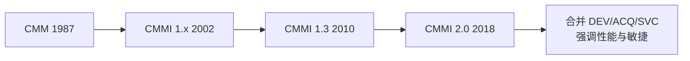
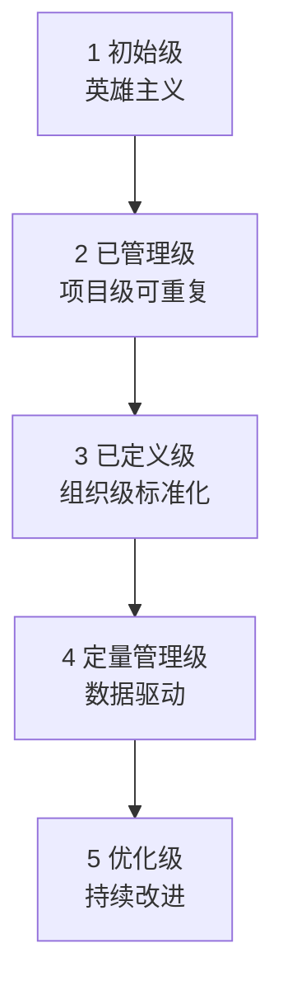
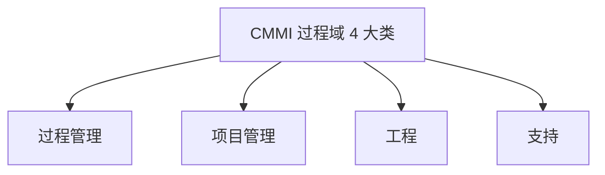
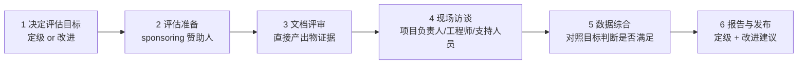
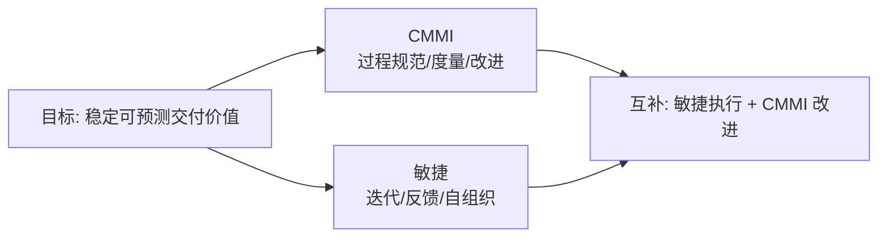
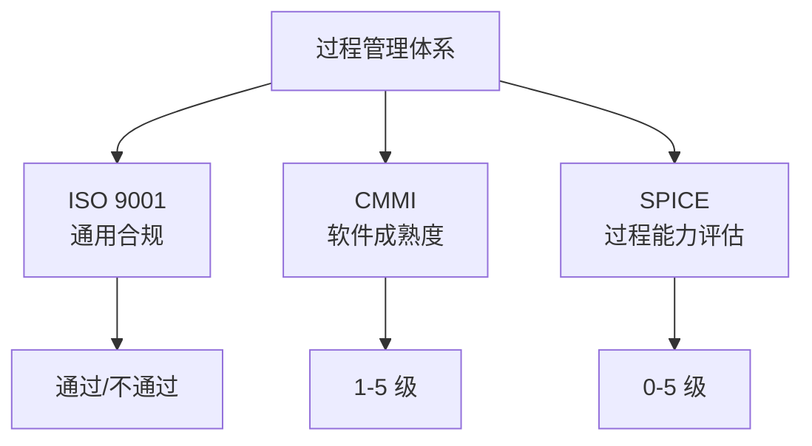

# CMMI：能力成熟度模型集成

> 一句话说明：CMMI 是一套"过程改进框架"，用成熟度等级衡量一个组织"做软件的过程有多规范、多可重复、多可优化"，本文讲清它的等级、过程域、评估方法、与敏捷的关系及在中国的实践。

**关键词**：CMMI、成熟度等级、过程域、SCAMPI 评估、过程改进、过程资产

## 抽象类比

把做软件比作"开饭店"：刚开始只有 1 个厨师，靠天赋和状态发挥，今天好吃明天翻车——这是 CMMI 1 级；后来定了几道菜的配方和流程，谁来炒都差不太多——这是 2 级；再后来整个连锁店都用同一套标准化的菜谱、采购、出品流程——这是 3 级；再往后用数据监控每桌出菜时间、客户满意度，按数据调流程——这是 4 级；最后形成"人人都在想怎么改进"的文化，持续优化——这是 5 级。

CMMI 关心的不是"代码写得好不好"，而是"做代码的过程稳不稳定、可不可复制、能不能持续变好"。

## 适合人群

- 在传统行业、外包、政府项目里听到过 CMMI 但不了解的开发或项目经理
- 准备面试中大型软件企业项目管理岗位的工程师
- 需要参与 CMMI 评估或推行过程改进的 EPG（过程改进组）成员
- 想搞清楚"为什么 CMMI 和敏捷看起来对立却能并存"的人

## 预备知识

- 软件生命周期与 [[项目管理]] 基础概念
- [[敏捷开发]] 的基本理念，便于对比理解
- 至少参与过一次正式的需求评审、立项或验收

## 一、CMMI 是什么

### 1.1 起源与定位

CMMI（Capability Maturity Model Integration，能力成熟度模型集成）由美国卡内基梅隆大学软件工程研究所（SEI）开发，最早源自 1987 年的 CMM（软件能力成熟度模型），2000 年整合为 CMMI，2010 年后由 CMMI Institute 运营。它的定位是：

- 一套"过程改进"的参考模型，不是标准、不是认证、不是质量体系
- 关注组织"做事情的过程"是否成熟，而非单次产品质量
- 提供目标与实践的清单，由组织自选如何实现

### 1.2 版本演进

- CMMI-DEV：面向开发组织（最常用）
- CMMI-ACQ：面向采购组织（甲方管理供应商）
- CMMI-SVC：面向服务组织（运维、IT 服务）
- CMMI 1.x ~ 1.3：早期模型，按"阶段式"和"连续式"两种表示
- CMMI 2.0（2018 年发布）：合并三大模型为单一模型，按"能力域"组织，强调性能、敏捷、价值导向，降低文档负担

### 1.3 两种表示方式

- 阶段式（Staged）：按"成熟度等级 1-5"评估整个组织，回答"组织整体成熟到几级"
- 连续式（Continuous）：按"能力等级 0-3"评估单个过程域，回答"某个过程强到几级"
- CMMI 2.0 统一用"能力等级"为主，但仍可换算成熟度等级

## 二、CMMI 的五个成熟度等级

五个等级是 CMMI 最被熟知的部分，每级回答"过程稳不稳、可不可复制、能不能优化"。

### 2.1 等级 1：初始级（Initial）

- 特征：过程不可预测、被动反应、靠个人英雄
- 关键实践：无强制要求，能交付就行
- 典型表现：工期靠加班、质量靠运气、文档看心情
- 评价：1 级组织也能交付成功项目，但不可重复、不可预期

### 2.2 等级 2：已管理级（Managed）

- 特征：项目级有过程，能按计划执行并受控
- 关键实践：需求管理、项目计划、项目监控、配置管理、质量保证、度量分析
- 典型表现：每个项目有自己的流程和文档，但跨项目不统一
- 评价：本项目的经验难复制到下个项目

### 2.3 等级 3：已定义级（Defined）

- 特征：组织级有一套标准过程，项目按需裁剪使用
- 关键实践：组织过程定义、组织过程焦点、培训、集成项目管理、风险、决策分析
- 典型表现：组织级过程资产库（PAL）存在，新人能照着上手
- 评价：从"项目级规范"升级到"组织级规范"，是大多数企业认证的目标等级

### 2.4 等级 4：定量管理级（Quantitatively Managed）

- 特征：用统计数据管理过程和产品质量
- 关键实践：组织过程性能、定量项目管理
- 典型表现：知道"缺陷率分布""评审有效性"等指标，能预测项目结果
- 评价：从"凭经验"到"凭数据"，过程是可预测的

### 2.5 等级 5：优化级（Optimizing）

- 特征：基于数据持续改进过程，关注创新和变革
- 关键实践：组织性能管理、原因分析与解决
- 典型表现：发现问题不只能修复，还会找根因、改过程防止再发
- 评价：改进成为日常习惯，不再是"运动式优化"

## 三、CMMI 的过程域分类

CMMI 1.3 有 22 个过程域（PA，Process Area），按四大类组织。CMMI 2.0 改为"能力域"，但分类思路类似。

### 3.1 过程管理类（Process Management）

关注"组织级的过程怎么定义、推广、改进"。

- OPF（Organizational Process Focus，组织过程焦点）：定期识别过程改进机会
- OPD（Organizational Process Definition，组织过程定义）：建立组织级标准过程和资产库
- OT（Organizational Training，组织培训）：识别培训需求并组织培训
- OPP（Organizational Process Performance，组织过程性能，4 级）：建立过程性能基线
- OPM（Organizational Performance Management，组织性能管理，5 级：对照业务目标管理性能

### 3.2 项目管理类（Project Management）

关注"单个项目怎么管"。

- PP（Project Planning，项目计划）：估算、计划、资源
- PMC（Project Monitoring and Control，项目监控）：跟踪进展、纠正偏差
- SAM（Supplier Agreement Management，供应商协议管理）：管理外包供应商
- IPM（Integrated Project Management，集成项目管理，3 级）：用组织级过程裁剪后管项目
- RSKM（Risk Management，风险管理，3 级）：识别、分析、缓解风险
- QPM（Quantitative Project Management，4 级）：用统计方法管项目

### 3.3 工程类（Engineering）

关注"做产品的工程活动"。

- REQM（Requirements Management，需求管理）：维护需求的双向可追溯
- RD（Requirements Development，需求开发）：把客户需要转成产品需求
- TS（Technical Solution，技术解决方案）：设计、实现
- PI（Product Integration，产品集成）：组件集成与接口
- VER（Verification，验证）：是否做对了（按规格）
- VAL（Validation，确认）：是否做了对的东西（按用户）

### 3.4 支持类（Support）

关注"支撑前面三类活动的基础实践"。

- CM（Configuration Management，配置管理）：版本、基线、变更
- PPQA（Process and Product Quality Assurance，过程与产品质量保证）
- MA（Measurement and Analysis，度量与分析）
- DAR（Decision Analysis and Resolution，决策分析与解决，3 级）：用结构化方法做决策
- CAR（Causal Analysis and Resolution，原因分析与解决，5 级）：根因分析

## 四、CMMI 评估方法

### 4.1 SCAMPI 评估概述

SCAMPI（Standard CMMI Appraisal Method for Process Improvement）是 CMMI 1.x/1.3 的官方评估方法，分三档：

- SCAMPI A：最严格，可正式定级，用于对外证明等级
- SCAMPI B：中等，可用于改进诊断，不定级
- SCAMPI C：快速，用于自查或初步摸底

CMMI 2.0 改用新的评估方法 Benchmark Appraisal（取代 SCAMPI A）和 Appraisal for Improvement，思路类似但更强调持续改进。

### 4.2 评估等级与有效期

- 评估结果分 1-5 级，对应成熟度等级
- 评估结果有效期 3 年（CMMI 2.0 改为 3 年内需做维持评估）
- 评估结果由 CMMI Institute 公示，可查询

### 4.3 评估流程

评估的关键是"证据三角"：

- 直接产出物：文档、代码、记录、报告
- 访谈：与不同角色面对面确认实际做法
- 演示：系统、工具实际运行情况

三者互相印证，避免"文档写得好但实际不做"。

## 五、CMMI 与敏捷的关系

CMMI 与敏捷看似对立：CMMI 强调"过程、文档、规范"，敏捷强调"个体、可工作软件、响应变化"。实际上两者目标一致——都是为了稳定、可预测、持续改进地交付价值。

### 5.1 互补而非对立

- CMMI 管"过程规范"：让过程可定义、可重复、可度量、可改进
- 敏捷管"快速响应"：用短迭代、反馈、自组织对抗不确定性
- 两者结合：敏捷提供"怎么做"，CMMI 提供"怎么管和怎么改进"

### 5.2 SEI 官方观点

SEI 在 2008 年发布报告《CMMI or Agile? Why not Embrace Both!》，明确指出：

- 敏捷实践的"回顾会"对应 CMMI 的 OPF/CAR
- 敏捷的"Definition of Done"对应 CMMI 的"标准过程裁剪"
- 敏捷的"迭代计划"对应 CMMI 的 PP/PMC
- CMMI 2.0 更显式地纳入了敏捷实践作为参考

### 5.3 实践中的冲突与协调

- 文档负担：CMMI 要求证据，敏捷嫌文档多余
  - 协调：用工具自动生成证据（Jira 看板、CI 日志、Git 提交），不另写文档
- 流程裁剪：CMMI 要求"按标准过程裁剪"，敏捷嫌约束多
  - 协调：组织级过程只定"目标和原则"，团队自选具体敏捷实践
- 度量：CMMI 重过程性能数据，敏捷重交付价值
  - 协调：合并度量体系，既看 Cycle Time、缺陷率，也看 Velocity、客户满意度

## 六、CMMI 落地的常见问题

- 文档负担过重
  - 症状：每个项目写几百页过程文档，没人看
  - 原因：把"过程证据"等同于"长文档"
  - 处理：用工具自动留痕，文档只记关键决策和裁剪说明
- 形式主义
  - 症状：评估前补文档，评估后回原样
  - 原因：评估变成目的而非手段
  - 处理：把评估当成改进诊断，不追求"为评级而评级"
- 过度流程
  - 症状：小项目也走全套流程，效率低下
  - 原因：组织级过程没有裁剪机制
  - 处理：按项目规模、复杂度、风险分级裁剪
- 与敏捷冲突
  - 症状：敏捷团队抗拒 CMMI，认为"又被套上流程枷锁"
  - 原因：CMMI 推行者不懂敏捷，强制传统文档
  - 处理：EPG 与敏捷教练共建过程，敏捷实践作为合规方式
- 改进不闭环
  - 症状：发现问题改不了，CAR 流于形式
  - 原因：缺乏组织级改进责任人和资源
  - 处理：设立 EPG 与改进 Owner，把改进项当项目管

## 七、CMMI 在中国企业的实践

### 7.1 认证驱动的现实

中国大量软件企业做 CMMI 评估的动因是"商务门槛"：

- 外包接单：欧美、日韩客户常要求供应商 CMMI 3 级以上
- 政府项目：部分招标明确要求 CMMI 3 级或 5 级资质
- 企业形象：作为公司实力的对外宣传
- 资质补贴：部分地区对通过 CMMI 评估的企业给予财政补贴

### 7.2 实践的两极分化

- 形式派：评估前突击补文档，评估后回到原样，CMMI 形同虚设
- 实干派：把 CMMI 作为改进框架，长期投入 EPG 和度量体系，确实提升交付能力

### 7.3 落地建议

- 先诊断后改进：评估前先做一次内部诊断，找出真问题
- 重过程而非文档：以"过程能跑通、能度量、能改进"为目标，不为文档而文档
- 选准试点：从一个业务线试点跑通再推广，不要一刀切
- 与业务对齐：改进目标必须对齐业务痛点（交付慢、缺陷高、客户投诉），否则无人支持
- 长期投入：CMMI 不是一次性项目，需要 EPG、度量体系、培训机制持续运营

## 八、CMMI 与 ISO 9001、ISO/IEC 15504 的比较

三者都是"过程管理"相关体系，但定位和侧重不同。

### 8.1 三者定位对比

- ISO 9001：质量管理体系通用标准，适用所有行业，强调"满足客户要求 + 持续改进"
- CMMI：软件/系统工程的专门过程改进模型，分等级、有具体实践清单
- ISO/IEC 15504（SPICE）：过程评估标准，是 CMMI 思路的国际化版本，分过程能力等级

### 8.2 主要差异点

- 范围
  - ISO 9001：所有行业（制造、服务、软件）
  - CMMI：软件开发、采购、服务
  - SPICE：软件过程评估，汽车、医疗等领域有变体（如 Automotive SPICE）
- 等级
  - ISO 9001：通过/不通过，不分等级
  - CMMI：5 个成熟度等级
  - SPICE：6 个能力等级（0-5）
- 评估
  - ISO 9001：第三方认证机构审核
  - CMMI：CMMI Institute 授权的主任评估师带队
  - SPICE：按 ISO/IEC 15504 标准的合格评估师执行
- 强调
  - ISO 9001：合规与持续改进
  - CMMI：过程成熟度阶梯式提升
  - SPICE：过程能力分级评估

### 8.3 实践中的关系

- ISO 9001 是"底线"，多数软件企业都有
- CMMI 是"加分项"，体现软件过程成熟度
- SPICE 在汽车、医疗等特定行业是"硬门槛"（如车企要求供应商 ASPICE 3 级）
- 三者有大量共性要求（文档控制、内审、纠正预防），可整合建立一套过程体系应对多个评估

## 面试速答

**Q1：CMMI 五个成熟度等级分别是什么？**

A：1 初始级（英雄主义，过程不可预测）；2 已管理级（项目级有过程，可重复）；3 已定义级（组织级标准过程，项目裁剪使用）；4 定量管理级（用统计数据管理过程和产品质量）；5 优化级（基于数据持续改进、根因分析、防止问题再发）。3 级是大多数企业认证的目标，5 级是最高，强调持续改进文化。

**Q2：CMMI 和敏捷是冲突的吗？**

A：不冲突，目标一致。CMMI 管"过程规范、可重复、可改进"，敏捷管"快速响应、持续反馈、自组织"。SEI 官方报告《CMMI or Agile? Why not Embrace Both!》明确支持两者结合。实践上的冲突往往源于"重文档的 CMMI 落地方式"，而非 CMMI 本身。协调方法：用工具自动留痕替代长文档，组织级过程定目标原则、团队自选敏捷实践，度量体系合并。

**Q3：SCAMPI 评估的"证据三角"是什么？**

A：直接产出物、访谈、演示三者互相印证。直接产出物是文档、代码、记录等书面证据；访谈是与项目负责人、工程师、支持人员面对面确认实际做法；演示是看系统和工具的实际运行。三者缺一不可，目的是防止"文档写得好但实际没做"的形式主义。

**Q4：CMMI 在中国企业里常见的落地问题是什么？**

A：常见三类问题。一是形式主义，评估前补文档、评估后回原样，CMMI 形同虚设；二是文档负担过重，每个项目写几百页文档没人看，把"过程证据"等同于"长文档"；三是与敏捷冲突，CMMI 推行者不懂敏捷，强制传统文档引发团队抗拒。处理思路是用工具自动留痕、组织级过程定目标不定细节、改进与业务痛点对齐、长期投入 EPG。

**Q5：CMMI、ISO 9001、SPICE 有什么区别？**

A：ISO 9001 是通用质量管理体系，所有行业适用，通过/不通过不分等级；CMMI 是软件工程的专门过程改进模型，分 1-5 级成熟度；SPICE（ISO/IEC 15504）是过程评估标准的国际版本，分 0-5 级能力等级，在汽车（ASPICE）、医疗等特定行业是硬门槛。三者有大量共性要求，企业可整合一套过程体系应对多个评估。
