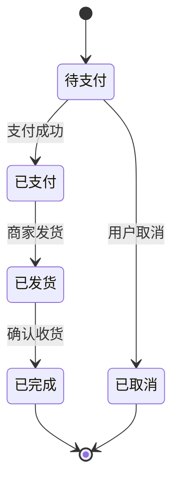
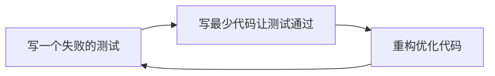
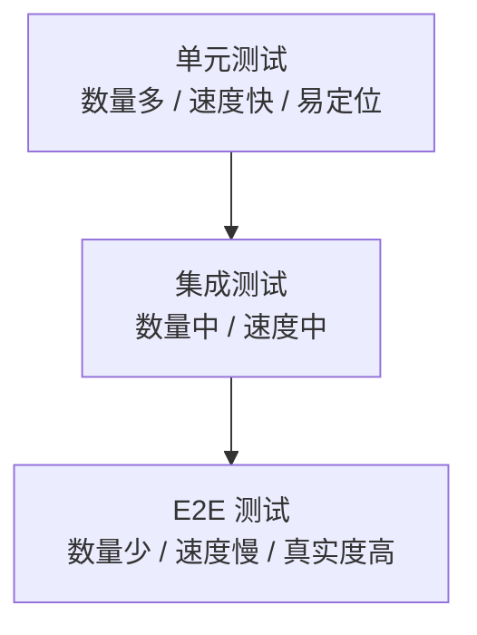

# 软件测试

> 先读：软件测试不是"找茬"，而是用系统的方法验证软件是否做了该做的事、不做不该做的事，给用户一份"能用"的承诺。

**关键词**：软件测试、测试用例、黑盒白盒、单元测试、测试覆盖率、TDD

## 抽象类比

买手机前你会试用：打电话、拍照、充电。软件测试就是替用户提前"试用"一遍，发现的问题在出厂前修掉，而不是让用户在生产环境里"开盲盒"。

软件测试（Software Testing）是在规定条件下运行软件，发现缺陷、评估质量、降低风险的过程。它不能证明软件"零 bug"，但能在交付前把已知问题暴露出来，避免小问题变成大事故。

---

## 适合人群 / 预备知识

- 软件工程专业学生，想了解测试在整个研发流程中的位置
- 刚入行的开发或测试新人，需要建立系统化的测试思维
- 了解一门编程语言基础（能看懂简单函数）
- 听说过"bug"和"测试用例"这两个词即可

---

## 一、测试的分类

测试可以从不同角度划分，理解分类有助于知道"我做的属于哪一层"。

**按阶段分（自下而上）**：
- 单元测试（Unit）：测最小单元，如一个函数
- 集成测试（Integration）：测模块间协作
- 系统测试（System）：测整个系统作为整体
- 验收测试（Acceptance）：用户视角确认满足需求

**按方法分（看得到多少内部）**：
- 黑盒测试：只看输入输出，不管内部实现
- 白盒测试：基于内部代码结构设计用例
- 灰盒测试：介于两者之间，部分了解内部

**按目的分（想验证什么）**：
- 功能测试：软件"做没做对"
- 性能测试：软件"做得快不快、扛不扛得住"
- 安全测试：软件"会不会被攻破"
- 兼容测试：软件"在不同环境下能不能跑"

---

## 二、黑盒测试与测试用例设计方法

**类比**：买冰箱不看压缩机原理，只看"通电能不能制冷、门关上灯会不会灭"。黑盒测试把软件当黑盒子，只关心输入和输出。

**黑盒测试核心思想**：
- 不读代码，从用户视角验证功能
- 关注"给什么输入、得到什么输出"
- 适合需求验证、回归测试
- 无法保证逻辑分支全覆盖

输入组合无穷无尽，不可能穷举，所以需要方法挑出"最有代表性"的用例。

**测试用例设计方法**：

- **等价类划分**：把输入分成有效/无效等价类，每类取一个代表值，假设同类输入行为一致。例：年龄输入 0-150，测 -1（无效）、75（有效）、200（无效）三个代表值即可，不用每个数都测。
- **边界值分析**：bug 往往出现在边界，重点测边界及附近值。例：数组长度为 0、1、最大值-1、最大值；输入框限 10 字符，测 9、10、11 三个长度。
- **因果图法**：分析输入条件之间的因果关系，画出因果图再转用例，适合多输入互相约束的场景。例："会员 + 余额充足"才能下单，否则报错。
- **判定表法**：把多条件组合穷举成一张判定表，每列对应一种组合和预期动作，适合规则密集的业务。例：促销规则"是否会员 × 是否满减 × 是否有券"共 8 种组合，每种明确结果。
- **状态迁移法**：测对象在不同状态间的转换是否合法。例：订单状态 待支付 → 已支付 → 已发货 → 已完成，跳过"已支付"直接"已发货"应被拒绝。
- **场景法**：模拟用户完整业务流程，覆盖基本流和备选流。例：用户登录→浏览商品→加购物车→下单→支付→收货，每个环节都可能分支。
- **错误推测法**：凭经验猜测容易出错的地方，如空值、特殊字符、并发提交、断网重试，作为前几种方法的补充。

**状态迁移示例图**：

---

## 三、白盒测试与覆盖标准

**类比**：检修电路不仅要看"开关按下灯亮不亮"，还要打开面板检查每根线、每个接头是否通电。白盒测试基于代码结构设计用例。

**白盒测试核心思想**：
- 看得见代码，针对语句、分支、路径设计用例
- 关注"内部逻辑是否被走到"
- 适合单元测试、底层模块验证
- 难以发现"需求遗漏"类问题

**覆盖标准（从弱到强）**：

- **语句覆盖**：让每一行代码至少执行一次。最弱，连 if 判断的真假都不一定都走到。
- **判定覆盖（分支覆盖）**：每个 if/while 的"真"和"假"分支都至少走一次。
- **条件覆盖**：每个布尔子条件（如 `a > 0 && b > 0` 中的 `a > 0`、`b > 0`）取到真和假。
- **判定/条件覆盖**：同时满足判定覆盖和条件覆盖。
- **条件组合覆盖**：每个判定中所有子条件的真假组合都覆盖一遍，组合数随条件数指数增长。
- **路径覆盖**：覆盖函数中所有可能的执行路径，最强但路径数可能爆炸，循环场景下几乎不可达。

**强弱差异举例**：函数 `if (a > 0 && b > 0) { doX(); } else { doY(); }`，仅语句覆盖可能用 `a=1, b=1` 就够了；判定覆盖要再补 `a=0` 让条件为假；条件覆盖要分别让 `a>0`、`b>0` 各取真和假；条件组合覆盖则要四个组合全测到。覆盖标准越强，发现潜在 bug 的能力越强，但用例数也越多。

---

## 四、单元测试详解

**类比**：造一辆车前，先检查每个螺丝、每个齿轮合不合格。如果一个零件就是坏的，组装起来再查问题就难定位了。

**什么是单元**：单元是可独立测试的最小代码单位，通常是一个函数或一个类。单元测试由开发人员自己写，运行快、数量多，是测试金字塔的底座。

**测试替身 Test Double**：

**类比**：拍电影用替身演员代替主角完成危险动作。测试中也用"替身"代替真实依赖，让被测对象在隔离环境中运行。

- **Mock 模拟对象**：假装的依赖，预先设定"被调用时返回什么"，并能验证是否被调用、调用了几次、参数对不对。例：测订单服务时 Mock 支付接口，验证"下单后是否调用了支付"。
- **Stub 桩**：只返回固定值，不关心是否被调用。例：Stub 数据库查询，永远返回一个固定用户。
- **Fake 假实现**：用简化但可工作的实现替代真实依赖。例：用内存数据库代替真实 MySQL，行为像但更快更轻。
- **Dummy 占位**：仅用于填充参数列表，从不被真正使用。例：某些接口要求传一个 logger 对象，测试时塞个空对象进去。
- **Spy 间谍**：在真实对象外包一层，记录调用信息（参数、次数、返回值），既调用真实逻辑又留痕。例：Spy 一个邮件发送器，记录"发了什么给谁"但不真的发。

**常见工具**：
- Java：JUnit
- Python：pytest
- JavaScript/TypeScript：Jest
- Go：testing 标准库 + testify 断言库
- C++：Google Test（gtest）

**TDD（测试驱动开发）流程**：

三步循环：红（失败）→ 绿（通过）→ 重构。先写测试逼自己想清楚"这个函数到底要做什么"，再写实现。

---

## 五、集成测试

**类比**：零件都合格了，但组装在一起会不会出问题？发动机和变速箱能不能配合好？这就是集成测试要回答的。

集成测试关注模块之间的接口、数据流、协作。典型场景：
- 数据库层 + 业务逻辑层能否正确传递数据
- 两个微服务之间的 API 调用是否对齐
- 前端组件和后端接口的字段是否匹配

**集成策略**：

- **大爆炸集成**：所有模块一次性组装后统一测试。优点是快；缺点是出错时难以定位是哪个接口的问题，适合小型系统。
- **增量集成 - 自顶向下**：从顶层主模块开始，逐层接入下层，下层未完成时用 Stub 顶替。优点是能尽早验证主流程；缺点是底层问题暴露晚。
- **增量集成 - 自底向上**：从底层模块开始，逐层向上集成，上层未完成时用 Driver（驱动模块）调用。优点是底层问题早发现；缺点是主流程验证晚。

集成测试比单元测试慢、数量少，但能发现"接口对不上"这类单元测试抓不到的问题。

---

## 六、端到端测试（E2E）：整车路试

**类比**：车造好了，要真正开上路跑一圈——加速、刹车、转弯、上坡，验证整车的真实表现。

端到端测试从用户视角模拟完整操作流程，例如"用户登录→下单→支付→收到订单"。它覆盖了前端、后端、数据库、网络等所有环节。

**常见工具**：
- Selenium：老牌方案，支持多浏览器
- Cypress：现代前端友好，调试体验好
- Playwright：微软出品，跨浏览器能力强大

E2E 测试最接近真实用户，但代价也最高：
- 运行慢（一个用例可能要几十秒）
- 容易因为环境波动"时好时坏"（Flaky）
- 数量不宜多，只覆盖核心路径

---

## 七、测试金字塔：数量该多少

**测试金字塔**建议测试数量按层级递减：底层多、顶层少。

- 底层单元测试多：覆盖各种边界，秒级跑完
- 中层集成测试适量：覆盖关键接口
- 顶层 E2E 少：只覆盖核心业务流程

**反金字塔的问题**：如果 E2E 多、单元少，会出现"测试慢、定位难、改一个 bug 触发一片红"，团队最后会害怕改测试。

**测试冰激凌反模式**：另一种常见错误是顶层 E2E 极多、中间层几乎空、底层单元少，形似倒置的冰激凌。通常源于团队只会写 UI 自动化、不写单元测试，结果是测试又慢又脆、维护成本极高，最终被放弃。

---

## 八、性能测试详解

**类比**：电梯额定载 10 人，那 11 人会怎样？12 人会卡住吗？连续运行 24 小时会不会过热？性能测试就是给系统"加压"。

**关键指标**：

- **响应时间 RT**：从发出请求到收到响应的耗时，用户最直接的感受。常说"P95 < 200ms"指 95% 的请求在 200ms 内完成。
- **吞吐量 TPS / QPS**：每秒处理的事务数（TPS）或查询数（QPS），反映系统的"产能"。
- **并发数**：系统同时处理的请求数，并发数 × 平均 RT ≈ 系统并发承载力。
- **资源利用率**：CPU、内存、磁盘 IO、网络带宽的使用比例，定位瓶颈靠它。例：CPU 90%+ 但 IO 闲置，说明是计算瓶颈。
- **错误率**：失败请求占比，压测中常以"错误率突增"作为系统崩溃的临界点。

**性能测试类型**：

- **负载测试（Load）**：在预期负载下能否正常工作，验证"够不够用"。例：双 11 预计 1 万 QPS，持续 30 分钟看是否达标。
- **压力测试（Stress）**：持续加压直到系统崩溃，看"极限在哪、如何恢复"。例：从 1 万 QPS 不断加到 5 万，观察何时开始报错、恢复后能否自愈。
- **稳定性测试（Soak）**：长时间（数小时到数天）恒定负载运行，发现内存泄漏、连接泄漏等慢性问题。
- **并发测试（Concurrency）**：多用户同时操作同一资源是否出问题，重点测并发冲突、锁、数据一致性。

**常见工具**：
- JMeter：老牌 GUI 工具，协议支持广，适合传统压测
- Locust：Python 写脚本，分布式友好，灵活度高
- k6：Go 实现，脚本即代码，性能强，云原生友好
- wrk：轻量命令行工具，适合快速压 HTTP 接口

**与 Benchmark 的关系**：Benchmark 是"用统一方法量化性能"，性能测试是"验证系统在压力下能否达标"。前者是尺子，后者是用尺子去量是否合格——Benchmark 测"多快"，性能测试问"够不够快"。

---

## 九、TDD 与 BDD

**TDD（测试驱动开发）**：先写单元测试，再写实现。关注"代码对不对"。

**BDD（行为驱动开发）**：用自然语言描述行为，例如 "Given... When... Then..."，让产品、测试、开发都能看懂。关注"行为符不符合预期"。

**类比**：TDD 像"先写考卷再写答案"——逼你想清楚要做什么；BDD 像"先写剧本再拍电影"——让所有人共识"这一幕应该怎么演"。

**BDD 常见工具**：
- Cucumber：JVM 生态主流方案，支持 Gherkin 语法
- SpecFlow：.NET 生态对应方案

两者并不互斥，TDD 偏底层实现，BDD 偏业务表达。

---

## 十、测试覆盖率

覆盖率衡量"测试覆盖了多少代码"，常见维度：
- 行覆盖率：被执行到的代码行比例
- 分支覆盖率：if/else 各分支被覆盖的比例
- 函数覆盖率：被调用过的函数比例

**常见工具**：
- JaCoCo：Java 生态主流方案
- coverage.py：Python 标配
- Istanbul / nyc：JavaScript/Node.js 生态

**多少合适**：
- 不是越高越好，80% 左右是常见目标
- 100% 覆盖率不等于"没 bug"——可能漏了边界条件
- 关键路径（支付、登录）应追求高覆盖，工具类函数可以低一些

---

## 十一、测试最佳实践

**AAA 模式**：
- Arrange：准备测试数据和环境
- Act：执行被测动作
- Assert：断言结果是否符合预期

**FIRST 原则**：
- Fast：测试要快
- Isolated：测试之间互不影响
- Repeatable：可重复，结果稳定
- Self-validating：自动判断通过/失败，不需人工看
- Timely：及时写，最好在写实现之前

**测试独立性**：
- 一个测试不应该依赖另一个测试的结果
- 每个测试自己准备、自己清理
- 失败时能精确定位是哪个用例出问题

---

## 面试速答

**Q1：什么是 TDD？为什么要先写测试？**

A：TDD（测试驱动开发）是"先写一个失败的测试，再写最少代码让它通过，最后重构"的循环。先写测试逼开发者明确"这个函数到底要做什么、输入输出是什么"，避免写完代码才发现需求理解错了。它把需求澄清前置，减少返工。

**Q2：测试金字塔为什么底大顶小？**

A：底层单元测试又快又便宜，能覆盖大量边界情况，定位问题精确；顶层 E2E 测试慢、易波动，但真实度最高。底大顶小能保证"快速反馈 + 真实覆盖"的平衡。如果反过来（E2E 多、单元少），会出现测试慢、改一处触发一片红、问题难定位的恶性循环。

**Q3：黑盒测试和白盒测试的区别？**

A：黑盒测试把软件当黑盒，只看输入和输出，不关心内部实现，适合验证功能是否符合需求；白盒测试基于内部代码结构设计用例，覆盖分支、路径，适合发现逻辑漏洞。两者互补：黑盒从用户视角，白盒从开发者视角，实战中常常结合使用。

**Q4：什么是 Mock，和 Stub 有什么区别？**

A：两者都是测试替身。Stub 桩只负责"返回固定值"，让被测代码能跑下去，不关心是否被调用；Mock 模拟对象除了预设返回值，还会"记录并验证调用"，能断言"是否被调用、调用了几次、参数是什么"。一句话：Stub 用来"喂"数据，Mock 用来"验"行为。

**Q5：白盒测试的覆盖标准从弱到强怎么排序？**

A：从弱到强依次是：语句覆盖 < 判定覆盖（分支覆盖）< 条件覆盖 < 判定/条件覆盖 < 条件组合覆盖 < 路径覆盖。语句覆盖只保证每行被执行到；路径覆盖要求所有执行路径都被走一遍，最强但路径数容易爆炸。实际工程中常用判定覆盖或条件覆盖作为基线，关键模块再提高要求。
