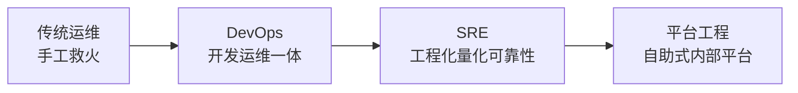
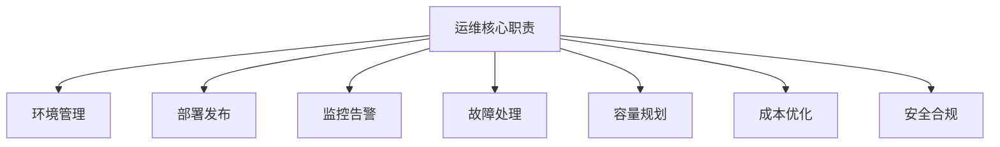
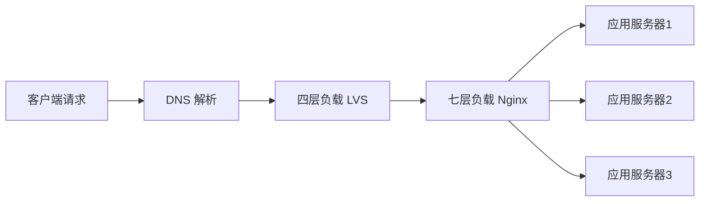
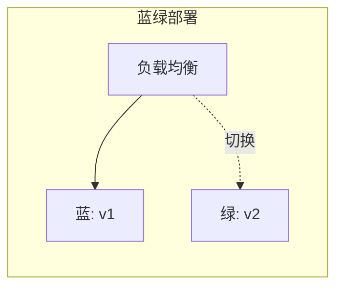
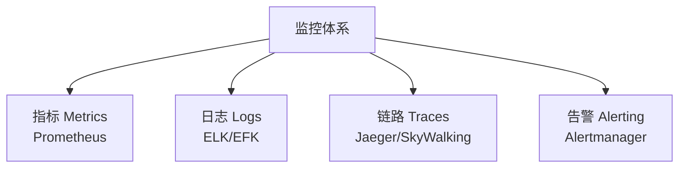
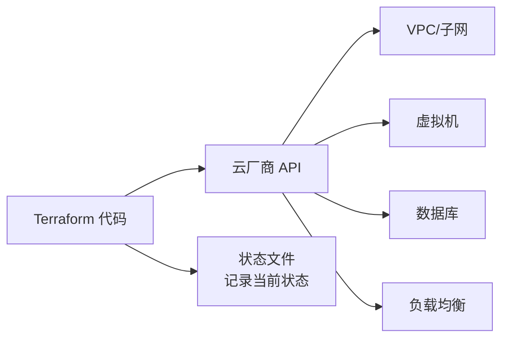
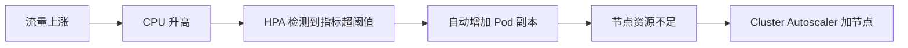
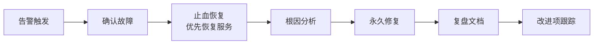

# 运维基础

> 一句话说明：运维是让线上系统"跑得起来、跑得稳、跑得便宜、出事能救"的工程实践，它从手工救火演进到 DevOps、SRE 再到平台工程，本质是用工程化方法管理软件的生产环境。

**关键词**：运维、DevOps、SRE、监控告警、CI/CD、容器与 K8s、故障管理

---

## 抽象类比

把软件研发比作开餐厅：开发是研发菜品的厨师，测试是试吃员，而运维是这家餐厅的"水电物业 + 楼面经理"——保证灶台有气、冰柜不断电、客人来了有座位、高峰期不崩盘、出意外能马上抢修。菜再好吃，如果停电停水，餐厅也开不下去。

运维的演进也像物业升级：最早是"出了问题打电话叫师傅"（传统运维）；后来师傅和厨师坐一起设计厨房流程（DevOps）；再后来请专业工程师用 SLO 数据量化服务质量（SRE）；现在干脆把厨房本身做成自助平台，厨师按按钮就能用（平台工程）。

---

## 适合人群

- 后端开发想理解"代码上线后谁在管、怎么管"
- 想从开发转向 DevOps / SRE 方向的工程师
- 接触过 Linux 命令但没系统学过线上运维的新人
- 想在面试中讲清楚"监控、发布、故障处理"基本概念的求职者

## 预备知识

- 能看懂 Linux 基本命令（`ls`、`cd`、`ps`）
- 了解 HTTP 协议 basics（请求/响应、状态码）
- 知道进程、端口、文件权限这些概念
- 建议先读 [[CICD]] 了解流水线，再读本文会更顺

---

## 一、运维是什么

### 1.1 与传统开发的分工

传统模式下，开发只管"代码跑通"，运维只管"服务器别挂"，两边交付物是代码包和服务器。问题在于：开发不知道生产环境长什么样，运维不知道代码内部逻辑，出问题互相甩锅。

现代运维打破了这道墙：开发也要关心部署、监控、日志；运维也要参与架构设计、容量评估。边界从"职责分工"变成"能力协作"。

### 1.2 运维的演进路线

- **传统运维（IT Ops）**：手工敲命令、写脚本、人肉救火，强调"稳定压倒一切"
- **DevOps**：开发与运维一体化，通过 CI/CD、自动化测试缩短交付周期
- **SRE（Site Reliability Engineering）**：Google 提出，把运维当软件工程来做，用 SLI/SLO 量化可靠性
- **平台工程（Platform Engineering）**：把运维能力沉淀成内部开发者平台（IDP），开发自助式使用，运维回归"造工具"角色



演进的本质是：**把人的经验沉淀成系统，让重复的事交给机器，让运维从"救火队员"变成"消防工程师"**。

---

## 二、运维的核心职责

运维要做的事比想象中多，可以归纳为七类：

- **环境管理**：管理开发、测试、预发、生产多套环境，保证一致性，避免"在我电脑上能跑"
- **部署发布**：把代码安全、可控地推到线上，灰度、回滚、版本管理
- **监控告警**：实时采集指标、日志、链路数据，异常时第一时间通知到人
- **故障处理**：故障发生时止血、定位、修复、复盘全流程
- **容量规划**：根据业务增长预测资源需求，提前扩容避免高峰被打挂
- **成本优化**：识别闲置资源、合理选型（按量/包年/Spot），降本不降质
- **安全合规**：补丁管理、权限审计、数据备份、灾备演练，满足合规要求



这七件事是相互联动的：监控发现容量瓶颈 → 容量规划决定扩容 → 部署发布执行变更 → 故障处理兜底。任何一环缺失，线上都会出问题。

---

## 三、Linux 与 Shell 基础

Linux 是运维的主战场，90% 的生产服务器跑在 Linux 上。

### 3.1 常用命令分类

- **文件与目录**：`ls`、`cd`、`pwd`、`cp`、`mv`、`rm`、`mkdir`、`chmod`、`chown`
- **查看文件**：`cat`、`less`、`head`、`tail`（`tail -f` 实时看日志）
- **查找**：`find /path -name "*.log"`、`locate`、`which`、`whereis`
- **进程管理**：`ps aux`、`top`、`htop`、`kill -9 PID`、`nohup`、`systemctl`
- **网络排查**：`ping`、`telnet`、`nc`、`curl -v`、`ss -tlnp`、`netstat`、`traceroute`
- **磁盘与内存**：`df -h`、`du -sh`、`free -h`、`iostat`、`vmstat`

### 3.2 文件系统与权限

Linux 文件系统是树形结构，从根 `/` 开始。权限模型是 `rwx` 三组，对应属主/属组/其他。

- 查看权限：`ls -l` 显示类似 `-rwxr-xr--`
- 修改权限：`chmod 755 file` 或 `chmod +x file`
- 修改属主：`chown user:group file`

### 3.3 文本处理三剑客

线上排查日志几乎全靠这三个：

- **grep**：按行过滤。`grep -n "ERROR" app.log`，`-i` 忽略大小写，`-v` 反向，`-E` 支持正则
- **awk**：按列处理。`awk '{print $1}' access.log` 取第一列，`-F:` 指定分隔符
- **sed**：流编辑。`sed 's/old/new/g' file` 全局替换，`-i` 直接改文件

组合拳示例：统计访问日志中 IP 出现次数 Top10

```bash
awk '{print $1}' access.log | sort | uniq -c | sort -rn | head -10
```

### 3.4 vim 基本操作

线上改配置文件几乎只能用 vim，至少要掌握：

- `i` 进入插入模式，`Esc` 回到正常模式
- `:wq` 保存退出，`:q!` 不保存退出
- `/keyword` 搜索，`n` 下一个，`N` 上一个
- `dd` 删除整行，`yy` 复制行，`p` 粘贴
- `:%s/old/new/g` 全文替换

---

## 四、网络与负载均衡

运维必须懂网络，否则排查"为什么访问不了"会无从下手。负载均衡的算法理论（轮询 / 最少连接 / 一致性哈希等）与四层/七层架构的系统性介绍详见 [[分布式系统]] 与 [[高可用架构]]，本节聚焦**运维实操视角**：DNS/CDN 接入、Nginx 配置、SSL 证书管理、防火墙规则。

### 4.1 DNS 与 CDN

- **DNS**：域名解析系统，把 `www.example.com` 翻译成 IP `1.2.3.4`。解析过程：浏览器缓存 → 本地 hosts → 本地 DNS → 权威 DNS
- **运维侧关注**：TTL 设置（变更前调短以便快速生效）、解析记录类型（A / CNAME / TXT / MX）、多线路解析（电信/联通/移动）
- **CDN**：内容分发网络，把静态资源缓存到离用户最近的节点，降低源站压力、加速访问
- **CDN 接入要点**：源站回源配置、缓存规则（HTML 短缓存、静态资源长缓存）、刷新预热、防盗链、计费策略（按流量/按带宽）
- 常见厂商：Cloudflare、阿里云 CDN、腾讯云 CDN

### 4.2 负载均衡分层架构

四层（L4）/ 七层（L7）负载均衡的概念、代表实现（LVS / Nginx / HAProxy / Envoy）与选型对比详见 [[高可用架构]]。运维侧需理解的典型部署分层：



实际部署中常按"DNS → LVS（四层） → Nginx（七层） → 应用"分层：四层扛流量、七层做业务路由，逐层卸载。

### 4.3 反向代理与 Nginx

反向代理：客户端不直接访问后端，而是先打到 Nginx，由 Nginx 转发。好处是隐藏后端、统一加 SSL、统一限流、统一日志。

Nginx 典型配置结构：

- `http` 块定义全局参数
- `upstream` 定义后端服务器池
- `server` 定义虚拟主机
- `location` 定义 URL 路由规则

运维侧常做的配置：健康检查（`max_fails` / `fail_timeout`）、会话保持（`ip_hash` 或 Cookie 粘性）、限流（`limit_req` / `limit_conn`）、灰度路由（按 `geo` 或 `map` 分流）、访问日志格式自定义。

### 4.4 SSL/TLS 与 HTTPS

- **SSL/TLS**：加密传输协议，防止中间人窃听和篡改
- **HTTPS = HTTP + TLS**，默认端口 443
- 证书由 CA 机构签发，运维要负责证书申请、续期（Let's Encrypt 免费 90 天自动续期）、部署
- 现代实践：启用 HTTP/2、HSTS、TLS 1.3，禁用老旧协议
- **证书管理痛点**：多域名证书、泛域名证书、到期监控（用 `certbot` / `acme.sh` 自动化续期，告警系统跟踪证书过期时间）

### 4.5 防火墙

- Linux 自带 `iptables` / `nftables`，云上有安全组
- 原则：默认拒绝，按需放行，只开必要端口（如只开 80/443，SSH 改非默认端口或加 IP 白名单）

---

## 五、部署与发布

部署（Deployment）是把新版本推上去，发布（Release）是让用户能看到新版本。两者可以解耦。

### 5.1 常见发布策略

- **蓝绿部署**：准备两套完全相同的环境（蓝/绿），新版本部署到备用环境，验证后切换流量。回滚快，但资源翻倍
- **金丝雀发布（Canary）**：先让一小部分流量（如 1%）打到新版本，观察指标无异常后逐步放大。风险可控，适合大流量服务
- **滚动发布（Rolling Update）**：分批替换实例，旧版本逐步下线。资源占用少，但滚动期间两版本并存，需考虑兼容性
- **A/B 测试**：按用户特征（地域、设备、用户 ID）分流，对比业务指标，本质是产品决策而非纯技术发布



### 5.2 回滚机制

任何发布都必须有回滚预案：

- **代码回滚**：重新部署上一个版本镜像/包
- **数据回滚**：数据库变更要可逆，DDL 要先写好回滚 SQL
- **配置回滚**：配置中心支持版本快照，一键回退
- **灰度期间发现异常**：立即切流量回旧版本，不要试图在故障中修复

**经验法则**：回滚要快，定位要慢。先恢复服务，再分析根因。

---

## 六、监控与告警

没有监控的系统等于蒙眼狂奔，出问题你永远是最后一个知道的。

### 6.1 监控三层模型

- **基础设施层**：CPU、内存、磁盘、网络。对象是机器/虚拟机
- **中间件层**：MySQL 连接数、Redis 命中率、MQ 堆积量。对象是依赖组件
- **业务层**：QPS、错误率、下单成功率、支付金额。对象是业务指标

越往下越通用，越往上越能直接反映用户体验。业务监控往往比基础设施监控更早发现问题。

### 6.2 监控工具选型

可观测性三支柱（Metrics / Logs / Traces）的概念与 Prometheus、Grafana、Jaeger、Loki 等工具的详细介绍详见 [[云原生架构]] 的可观测性章节。运维侧的选型与落地关注点：

- **Prometheus + Grafana**：云原生事实标准，Pull 模型，适合指标监控。运维需关注 Scrape 配置、保留期（retention）、远程存储（Thanos / Mimir）扩展长留存
- **Zabbix**：传统 IDC 老牌选择，Agent 模型，告警规则丰富，适合物理机与网络设备
- **ELK / EFK**：日志检索利器。运维需关注索引生命周期管理（ILM）、冷热分离、成本控制（日志量极易失控）
- **链路追踪**：Jaeger、SkyWalking、Zipkin。注意采样率与存储成本



### 6.3 告警分级与 On-Call

告警不是越多越好，告警泛滥会让值班人员麻木。常见分级：

- **P0 致命**：核心服务宕机、数据丢失，立即电话叫醒
- **P1 严重**：核心功能不可用、错误率飙升，10 分钟内响应
- **P2 一般**：非核心功能异常、单实例故障，工作时间处理
- **P3 提醒**：容量预警、慢查询增多，纳入周报跟踪

**On-Call 原则**：轮值制、明确升级路径、告警必须可执行（收到告警知道该干啥）、虚假告警必须优化掉。

---

## 七、配置管理与自动化

### 7.1 配置管理工具

手动登 100 台机器改配置是运维噩梦，配置管理工具解决这个问题：

- **Ansible**：Agentless，基于 SSH，YAML 描述任务，学习曲线低，目前最主流
- **SaltStack**：基于 ZeroMQ，速度快，适合大规模集群
- **Puppet**：DSL 描述状态，企业级，老牌
- **Chef**：Ruby 写 Recipe，灵活但学习成本高

### 7.2 IaC 基础设施即代码

IaC（Infrastructure as Code）核心思想：**用代码声明基础设施的期望状态，由工具自动收敛到这个状态**。好处是可版本化、可 Review、可复用、可销毁重建。

- **Terraform**：HashiCorp 出品，多云资源编排事实标准，HCL 语法，声明式
- **Pulumi**：用真实编程语言（Python/TS/Go）写基础设施，对开发友好
- **Ansible**：偏配置管理，也能做基础设施编排



IaC 的关键收益：环境可一键重建。测试环境和生产环境用同一份代码、不同参数，天然保证一致性。

---

## 八、容器与 K8s 运维

容器改变了软件交付方式：从"交付代码 + 文档说明依赖"变成"交付镜像，里面啥都有"。容器原理、Docker 镜像分层、K8s 核心对象模型（Pod / Deployment / Service / Ingress / ConfigMap / Secret / StatefulSet / DaemonSet 等）详见 [[云原生架构]]，本节聚焦**运维视角**：镜像治理、调度、扩缩容、包管理。

### 8.1 镜像治理要点

镜像与仓库的基础概念不再赘述（详见 [[云原生架构]]），运维侧需关注：

- **多阶段构建**减小镜像体积，移除编译工具链
- **`.dockerignore`** 排除无关文件，避免构建上下文膨胀
- **不要把密钥打进镜像**：用 Secret 或外部密钥管理（Vault、云 KMS）
- **固定基础镜像版本**（避免 `:latest` 隐式升级带来不可控变更）
- **私有仓库治理**：Harbor 开启漏洞扫描、镜像签名、按需清理策略

### 8.2 集群运维要点

K8s 对象模型的完整介绍详见 [[云原生架构]]，运维侧更关心集群本身的可用性：

- **版本与升级**：跟随社区 LTS，主版本升级前先在测试集群验证，注意 API 弃用（如 `networking.k8s.io/v1` 替换 `extensions/v1beta1`）
- **节点运维**：节点维护时先 `kubectl drain` 驱逐 Pod，结束后 `kubectl uncordon` 恢复调度
- **资源配额**：每个 Namespace 设置 ResourceQuota 与 LimitRange，防止个别应用吃光集群资源
- **健康巡检**：定期检查节点 NotReady、Pod 重启次数、PV 容量、etcd 延迟
- **备份**：etcd 是集群大脑，必须定期快照备份并验证可恢复

### 8.3 Pod 调度与 HPA

- **调度**：K8s 调度器根据资源请求、节点亲和性、污点容忍、标签选择器决定 Pod 落到哪个节点
- **HPA（Horizontal Pod Autoscaler）**：根据 CPU/内存或自定义指标自动扩缩 Pod 副本数
- **VPA**：垂直扩缩（调资源 limit），用得少
- **CA（Cluster Autoscaler）**：节点不够时自动扩容 Node



### 8.4 Helm

Helm 是 K8s 的包管理器，相当于 K8s 的 apt/yum：

- **Chart**：一个应用的所有 K8s 资源模板打包
- **Release**：Chart 的一次部署实例
- **Repository**：Chart 仓库
- 用途：把一套复杂应用的 YAML 模板化、参数化，一键安装升级

---

## 九、DevOps 与 SRE 实践

### 9.1 CI/CD 流水线

DevOps 的核心抓手是 CI/CD（详见 [[CICD]]），把"代码→构建→测试→部署"全流程自动化：

- **CI**：每次提交自动构建 + 测试，保证主干健康
- **CD**：自动打包成可发布制品，按策略发布到生产
- **GitOps**：用 Git 作为单一事实来源，集群状态自动同步 Git 声明（ArgoCD、Flux）

### 9.2 SRE 的可靠性量化

SRE 最核心的贡献是用数据定义"什么叫稳"：

- **SLI（Service Level Indicator）**：服务级别指标，如可用性 = 成功请求数 / 总请求数
- **SLO（Service Level Objective）**：服务级别目标，如月可用性 99.9%
- **SLA（Service Level Agreement）**：服务级别协议，对外承诺，违约赔偿

三者关系：SLI 是测量值，SLO 是内部目标，SLA 是对客户合同。

### 9.3 错误预算 Error Budget

SLO 99.9% 意味着每月允许 0.1% 的不可用时间（约 43 分钟），这就是**错误预算**。

- 预算未用完：鼓励团队快速迭代、上新功能、做风险变更
- 预算耗尽：必须停止高风险变更，专注稳定性建设

这个机制把"稳定性 vs 迭代速度"的矛盾用数字量化，避免了无休止的争论。

### 9.4 Toil 减少

Toil（琐事）指那些重复、自动化价值高、无长期收益的工作。SRE 的原则是：**Toil 占比不超过 50%，剩下时间做工程化**。每发现一个重复任务，就把它自动化掉，否则团队会被琐事淹没。

---

## 十、故障管理

故障不是"会不会发生"的问题，而是"什么时候发生"的问题。故障管理的目标不是零故障，而是**故障可控、影响最小、恢复最快、不重犯**。

### 10.1 故障分级

- **P0 致命**：核心服务全挂、数据丢失、影响大量用户或核心收入
- **P1 严重**：核心功能不可用、单地区故障、影响部分用户
- **P2 一般**：非核心功能异常、性能下降但可用
- **P3 轻微**：单实例故障、自动恢复、用户无感知

分级决定了响应速度和升级路径。P0 必须立即拉群、必要时叫醒高管。

### 10.2 故障处理流程



关键原则：

- **先止血后定位**：能切流就切流、能回滚就回滚，不要在故障现场慢慢 debug
- **同步信息**：故障群每 15 分钟同步一次进展，避免信息黑洞
- **统一指挥**：一个 Incident Commander 指挥，其他人执行，避免乱作一团

### 10.3 根因分析 RCA

故障恢复后必须做 RCA（Root Cause Analysis），常用方法：

- **5 Whys**：连续问 5 个为什么，挖到根本原因而非表面现象
- **鱼骨图**：从人/机/料/法/环/测六个维度分析
- **时间线**：还原故障从触发到恢复的完整时间线，找出哪个环节慢了

RCA 不是为了追责，而是为了找出**系统性的漏洞**。

### 10.4 复盘文化与 Blameless Postmortem

Google 推崇 **Blameless Postmortem（无指责复盘）**：

- 对事不对人，假设每个人在当时信息下都做了合理决策
- 关注流程和系统的漏洞，而不是"谁犯了错"
- 鼓励主动承认错误，否则下次大家会隐瞒

如果复盘变成追责大会，团队会养成"多做多错、少做少错"的保守文化，反而增加风险。

### 10.5 应急预案与容灾演练

- **Runbook**：常见故障的处理手册，包含诊断命令、止血步骤、联系人
- **预案**：数据库挂了怎么办？机房断电怎么办？DNS 被劫持怎么办？提前写好
- **容灾演练**：定期做故障注入（Chaos Engineering），验证预案有效性。Netflix 的 Chaos Monkey 是代表
- **红蓝对抗**：蓝队演练故障响应，红队制造故障，检验真实应急能力

不演练的预案等于没有预案——真出事时你会发现预案写的是理想情况，现实完全不一样。

---

## 面试速答

### Q1：DevOps 和 SRE 有什么区别？

A：DevOps 是一种文化和实践，强调开发与运维协作、自动化交付；SRE 是 Google 提出的具体岗位和方法论，用软件工程方法做运维，核心是用 SLI/SLO 量化可靠性、用错误预算平衡稳定与迭代。可以理解为：DevOps 是理念，SRE 是一种实现 DevOps 的具体范式。SRE 更强调数据驱动和工程化。

### Q2：什么是蓝绿部署和金丝雀发布？区别是什么？

A：蓝绿部署是准备两套完全相同的环境，新版本部署到备用环境后一次性切流量，回滚快但资源翻倍。金丝雀发布是先把小比例流量（如 1%）导到新版本，观察指标无异常后逐步放大，风险可控但发布周期长。蓝绿适合对回滚速度要求高的场景，金丝雀适合对风险敏感的大流量服务。两者也可以组合使用。

### Q3：监控的三大支柱是什么？

A：Metrics（指标）、Logs（日志）、Traces（链路追踪）。Metrics 回答"出了什么问题"，是数值时序数据，用 Prometheus；Logs 回答"具体发生了什么"，是文本事件，用 ELK；Traces 回答"问题出在哪个环节"，是分布式调用链，用 Jaeger/SkyWalking。三者关联起来才能快速定位问题，这就是可观测性 Observability。

### Q4：什么是 SLI/SLO/SLA 和错误预算？

A：SLI 是测量指标（如请求成功率），SLO 是内部目标（如月可用性 99.9%），SLA 是对客户的合同承诺（如 99.5%，违约赔偿）。错误预算 = 1 - SLO，例如 99.9% 可用性意味着每月有约 43 分钟的"故障额度"。预算没用完可以激进迭代，预算耗尽必须停止高风险变更。这个机制把"稳定 vs 速度"的争论变成了数字决策。

### Q5：线上故障处理的正确流程是什么？

A：核心是"先止血后定位"。第一步确认故障范围和影响；第二步优先恢复服务，能切流就切流、能回滚就回滚，不要在故障现场 debug；第三步同步信息，定期在故障群更新进展；第四步故障恢复后做 RCA 根因分析；第五步写复盘文档，blameless 不追责，落实改进项并跟踪闭环。演练是关键——平时多做容灾演练，真出事才能不慌。
