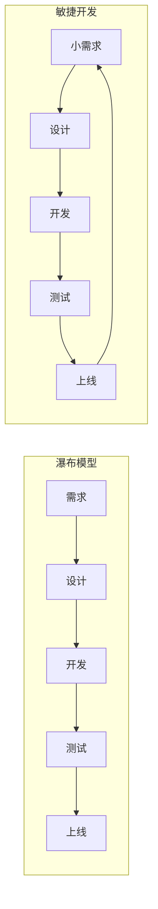
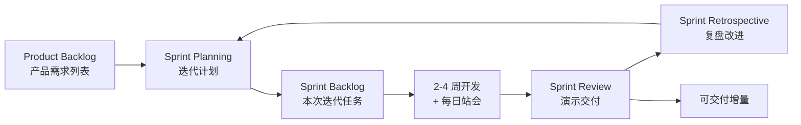
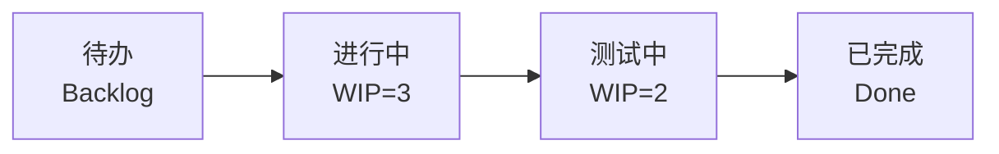

# 软件项目管理：装修式的交付工程

> 先读：软件项目管理不是"开会填表"，而是在有限时间、有限人手、有限预算下，把一个软件从想法变成可用产品的协调过程。

**关键词**：项目管理、敏捷开发、Scrum、看板、需求管理、风险管理

## 抽象类比

装修一套房子，你要定预算、排工期、选材料、盯施工、验收。软件项目管理干的是同样的事：在时间、成本、质量三重约束下，把软件按时、按预算、按质量交付。

软件项目管理（Software Project Management）是为实现项目目标，对范围、进度、成本、质量、风险、人力等进行的计划、组织、监控和调整活动。

---

## 适合人群 / 预备知识

- 软件工程专业学生，想了解"代码之外"的项目运作
- 刚入行的开发，需要理解团队为什么这样开会、这样拆任务
- 听说过"敏捷"、"Scrum"、"需求评审"等词即可
- 最好参与过一次小组协作作业

---

## 一、传统瀑布 vs 敏捷开发

瀑布像"按图纸盖楼"——先定死图纸再一砖一瓦照着盖，改一次图纸代价巨大；敏捷像"边盖边调整"——先搭个雏形住进去，根据居住体验不断调整布局。

瀑布适合需求稳定、变更代价高的项目（如航天、医疗设备）；敏捷适合需求多变、需要快速反馈的项目（如互联网产品）。敏捷的价值观、原则与具体框架详见 [[敏捷开发]]。

---

## 二、敏捷开发（Agile）

敏捷以 4 条价值观和 12 条原则为核心，强调"以人为本、以可工作软件为本、以响应变化为本"，宣言全文与原则细化详见 [[敏捷开发]]。

**Scrum 是敏捷的一种具体框架**，规定了角色、产物、事件，让"敏捷"从口号变成可落地的流程：

---

## 三、Scrum 的三角色 / 三产物 / 三事件

详细执行要点与常见陷阱见 [[敏捷开发]]，本节仅列概要。

**三个角色**：
- Product Owner（产品负责人）：管理需求列表，决定做什么、优先级
- Scrum Master（教练）：保护流程，清除障碍
- Development Team（开发团队）：自组织、跨职能，负责实现

**三个产物（Artifacts）**：
- Product Backlog：所有可能要做的需求，按价值排序
- Sprint Backlog：本次迭代要完成的任务
- Increment：本次迭代产出的、可交付的增量

**四个事件（Events）**：
- Sprint Planning：迭代计划会
- Daily Standup：每日站会，15 分钟同步进展和阻碍
- Sprint Review：迭代演示，向 PO 和用户展示成果
- Sprint Retrospective：复盘会，讨论改进

---

## 四、看板方法（Kanban）

看板不规定迭代周期，核心是**可视化工作流 + 限制在制品（WIP）**。深入实践（六大核心实践、度量、流动管理）见 [[敏捷开发]]。

**WIP 限制**：每列同时最多 N 个任务，超出就不允许再接新活。好处是：
- 防止团队同时做太多事，每件都做不完
- 暴露瓶颈——哪一列堆积就是哪里卡住了
- 流转顺畅，交付更可预测

---

## 五、需求管理

**类比**：去餐厅点菜——你不能把整本菜单都点了，要按预算和胃口选。

**用户故事（User Story）**：用一句话描述需求，模板如 "作为一个 X，我想 Y，以便 Z"。让需求从用户视角表达，而不是技术视角。

**验收标准（Acceptance Criteria）**：这个故事"做完了"的判断条件，比如"用户下单后 3 秒内看到订单号"。

**需求优先级（MoSCoW 法）**：
- Must have：必须有，否则产品没法用
- Should have：应该有，没有也能用但影响体验
- Could have：可以有，锦上添花
- Won't have（this time）：这次不做，以后再说

---

## 六、配置管理

**类比**：装修时不同工人改同一面墙的图纸，怎么保证大家都在最新版本上画？靠版本控制。

**版本控制（Git）** 是配置管理的核心，记录每次改动，支持回退和分支协作。

**常见分支策略**：
- Git Flow：master/develop/feature/release/hotfix 多分支，规范但复杂
- Trunk Based：所有人提交到主干，靠 CI 保证质量，简单但要求纪律

**与 CI/CD 的关系**：
- 配置管理管"代码版本"
- CI/CD 管"把某个版本自动构建、测试、部署"
- 没有 Git 就没有"哪个版本"的概念，CI/CD 也无从谈起

---

## 七、风险管理

**类比**：装修前先想好"如果延期怎么办、如果材料涨价怎么办"，提前备好预案。

风险管理的四步：
- 识别：列出可能出问题的点（人离职、技术不熟、依赖延期）
- 评估：按发生概率和影响程度排序
- 应对：规避、转移、减轻、接受
- 监控：定期跟踪风险变化

**应对策略**：
- 规避：换技术方案绕开风险
- 转移：买保险、外包给专业团队
- 减轻：提前做技术预研降低不确定性
- 接受：小风险直接接受，预留 buffer

---

## 八、项目估算

**类比**：装修工人估工期——不会精确到分钟，但能说"大概 3 天、最坏 5 天"。

**故事点（Story Point）**：不按时间估，按"复杂度"估。相对估算，比绝对小时更稳定。

**燃尽图（Burndown Chart）**：跟踪本次迭代剩余工作量随时间下降的曲线，理想是到迭代结束降为 0。

**速度（Velocity）**：前几个迭代平均完成的故事点，用来预测"下次能做多少"。

**注意**：估算不是承诺。估算用于计划，不是用于考核——把估算当 KPI 会逼团队高估、低报，反而失真。

---

## 九、常见角色

- PM（项目经理 / 产品经理）：管进度、管范围、对外沟通
- Tech Lead（技术负责人）：技术决策、代码质量把关
- 架构师：系统结构设计、技术选型
- 开发：写代码、写测试、参与评审
- 测试：设计测试用例、执行测试、报 bug
- 运维 / DevOps：管环境、管部署、管监控

小公司一人多角色，大公司分工更细。理解角色边界有助于"该找谁"。

---

## 面试速答

**Q1：Scrum 和看板（Kanban）有什么区别？**

A：Scrum 有固定迭代周期（2-4 周），按节奏交付，角色和事件明确；看板没有固定迭代，强调限制 WIP、持续流转。Scrum 适合"周期性交付"的团队，看板适合"任务持续流入"的场景（如运维、客服系统）。两者都属敏捷，可以混合用（Scrumban）。

**Q2：敏捷宣言的核心是什么？**

A：四条价值观——个体互动高于流程工具、可工作软件高于详尽文档、客户合作高于合同谈判、响应变化高于遵循计划。核心是"以人为本、以可工作软件为本、以响应变化为本"，承认计划会变，强调小步快跑和持续反馈。

**Q3：Git Flow 是什么？适合什么场景？**

A：Git Flow 是一种分支模型，包含 master（生产）、develop（开发主干）、feature（功能）、release（发布准备）、hotfix（紧急修复）等多类分支。适合发布周期长、需要严格管理版本的项目（如企业软件）。对互联网产品，Trunk Based + CI/CD 更轻量、更主流。
