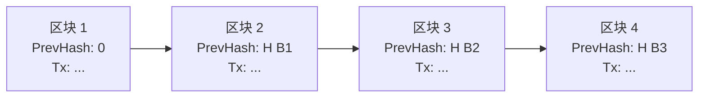
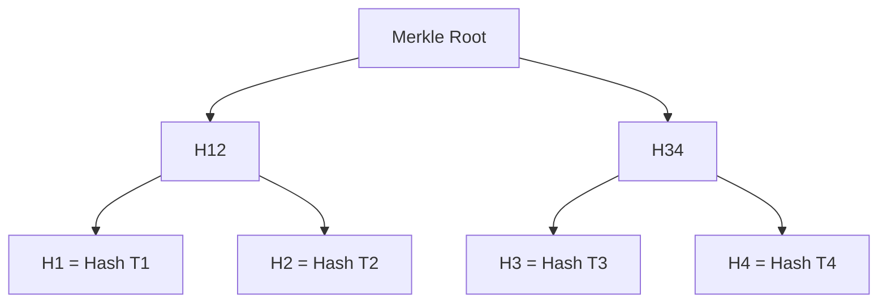

# 区块链

> 区块链是一种通过密码学保证数据不可篡改、由分布式节点共同维护的去中心化账本技术。它让互不信任的节点在没有中心权威的情况下达成一致，最早由中本聪在 2008 年比特币白皮书中提出，是比特币、以太坊等加密货币和 Web3 应用的底层基础设施。

**关键词**：分布式账本、哈希链、共识算法、智能合约、去中心化

## 抽象类比

想象一个村庄里没有银行，村民们共同维护一本公共账本：每次有人交易，就在村口大喇叭喊一声"张三给李四 5 块钱"，所有村民都把这条记录抄到自己的账本上。每个人都保留一份完整副本，任何人想偷偷改账都会被发现，因为与其他人的副本对不上。这本"人人都有副本、人人都能验证"的账本，就是区块链的雏形。

再进一步，为了防止有人乱记账，村民们约定：每页账本写满后，要解出一道数学难题才能把这一页"封存"并接上一页。这道题很难解但很容易验证，解题最快的人可以获得一点奖励，这就是"挖矿"。一页页封存的账本按顺序连成链条，就形成了"区块链"。

## 一、区块链是什么

区块链是一个由多个节点共同维护、数据按区块顺序链接、通过密码学保证不可篡改的分布式账本。它的核心特征可以概括为四点：

- 分布式账本：账本数据不存放在单一中心服务器，而是由网络中所有参与节点各自保存一份完整副本
- 链式结构：每个区块通过保存前一个区块的哈希值，形成一条按时间顺序的链
- 不可篡改：修改任意历史区块都会改变其哈希，导致后续所有区块的哈希失效，从而被网络拒绝
- 去中心化信任：节点之间无需互相信任，依靠算法和规则达成一致，实现"无需信任的信任"

2008 年，中本聪发布《Bitcoin: A Peer-to-Peer Electronic Cash System》白皮书，提出比特币方案；2009 年 1 月，比特币创世区块诞生，区块中写下"The Times 03/Jan/2009 Chancellor on brink of second bailout for banks"，区块链技术正式落地。区块链被誉为继互联网之后又一项可能重塑信任与协作模式的基础设施。

区块链的发展通常被划分为三个阶段：

- 区块链 1.0：以比特币为代表，解决去中心化数字货币与支付问题
- 区块链 2.0：以以太坊为代表，引入智能合约，拓展到金融与合约场景
- 区块链 3.0：面向社会治理、DAO、Web3、跨链互操作等更广泛的应用

参考链接：[比特币白皮书](https://bitcoin.org/bitcoin.pdf)

## 二、核心概念

- 区块 Block：区块链中数据的基本单元，包含区块头和区块体两部分
- 链 Chain：通过哈希指针将区块按顺序连接，前一个区块的哈希存入下一个区块头
- 交易 Transaction：区块链上状态变更的最小单位，例如转账、合约调用、资产发行
- 节点 Node：运行区块链客户端程序的网络参与者，分为全节点、轻节点、矿工节点
- 矿工 Miner：在 PoW 共识下通过计算竞争出块权的节点，成功出块可获得区块奖励
- 共识 Consensus：节点之间就下一个区块内容达成一致的算法规则
- 智能合约 Smart Contract：部署在链上的可执行代码，满足条件时自动执行，无需第三方介入
- 钱包 Wallet：管理用户私钥、签名交易的工具，本身不存储资产，资产在链上
- 地址 Address：由公钥经哈希派生而来，类似银行账号，用于接收资产和调用合约
- 私钥 / 公钥：私钥必须妥善保管，公钥可公开；用私钥签名交易，公钥验证签名
- Gas：以太坊中衡量操作成本的单位，调用者需支付 Gas 费激励矿工/验证者
- 区块高度 Block Height：从创世区块开始计算的区块序号，反映链的当前长度
- 分叉 Fork：链出现多条分支，分为临时分叉（共识解决）和硬分叉（协议不兼容）

## 三、区块链的结构

区块链由一个个区块顺序连接而成，每个区块包含区块头和区块体两部分。

区块头关键字段：

- 前一区块哈希 PrevHash：指向上一区块，是形成"链"的关键
- 时间戳 Timestamp：区块生成时间
- Nonce：随机数，PoW 挖矿时调整它来满足难度目标
- Merkle Root：区块内所有交易的哈希树根，用于快速验证交易是否存在
- 难度目标 Difficulty Target：当前区块哈希需要满足的前导零位数
- 版本号 Version：协议版本号

区块体：

- 交易列表 Transactions：本区块打包的所有交易
- Coinbase 交易：矿工的出块奖励交易，通常是区块中的第一笔交易

哈希链表结构示意：

Merkle 树结构示意：

修改任何一笔交易都会改变其哈希，进而改变 Merkle Root 和区块哈希，使后续所有区块的哈希指针失效，从而实现"不可篡改"。轻节点（SPV）通过 Merkle 路径即可验证交易是否在区块中，无需下载全部数据。

## 四、共识算法

共识算法解决"在没有中心权威的情况下，全网如何就账本内容达成一致"的问题。不同场景下诞生了多种方案。

### PoW 工作量证明

- 代表项目：比特币、早期以太坊
- 机制：矿工通过不断调整 Nonce 计算区块哈希，使其小于难度目标，率先算出者获得出块权
- 特点：算力即话语权，安全性依赖算力门槛
- 最长链原则：网络中常有多个分支，节点选择累积工作量最大的链为主链
- 51% 攻击：掌握全网 50% 以上算力可篡改近期交易，但成本极高
- 优点：成熟稳定、抗女巫攻击
- 缺点：能耗高、TPS 低、出块慢

### PoS 权益证明

- 代表项目：以太坊 2.0（The Merge 后切换为 PoS）
- 机制：节点抵押代币成为验证者，按权益比例随机选派出块人
- Casper 协议：以太坊采用的 PoS 协议，对作恶验证者进行"罚没 Slashing"
- Nothing at Stake 问题：PoS 中作恶几乎无成本，需要通过罚没机制约束
- 优点：能耗降低 99% 以上、终局性更强
- 缺点：富者愈富、对验证人集合分布有要求

### DPoS 委托权益证明

- 代表项目：EOS、TRON
- 机制：代币持有者投票选出若干"超级节点"负责出块
- 特点：TPS 高、性能好，但去中心化程度下降
- 风险：超级节点可能合谋或被收买

### PBFT 实用拜占庭容错

- 代表项目：Hyperledger Fabric、FISCO BCOS 等联盟链
- 机制：节点通过三阶段投票（预准备、准备、提交）达成一致
- 容错能力：可容忍少于 1/3 的恶意节点
- 特点：终局性强（无分叉）、TPS 较高，但节点规模受限

### Raft / Paxos 与区块链共识的区别

- Raft/Paxos：解决崩溃容错（CFT），假设节点不会作恶，常用于传统分布式系统
- 区块链共识：解决拜占庭容错（BFT），需要应对作恶节点
- Raft 不适合公链，因为无法防御女巫攻击和作恶行为
- 公链还需要结合经济激励（代币）来约束参与者

### 共识算法横向对比

- PoW：能耗高，TPS 低，去中心化强，公链首选（比特币）
- PoS：能耗低，TPS 中等，需抵押，公链主流（以太坊 2.0）
- DPoS：能耗低，TPS 高，节点数少，去中心化弱（EOS）
- PBFT：能耗低，TPS 高，终局性强，节点数受限，联盟链常用（Fabric）
- 随着区块链的发展，越来越多公链采用 PoS + BFT 混合方案，兼顾性能与去中心化

## 五、智能合约

智能合约是部署在区块链上的可执行代码，当预设条件满足时自动运行，过程透明且不可篡改。它最早由尼克·萨博于 1994 年提出概念，以太坊首次实现了图灵完备的链上执行环境。

- 以太坊 EVM：以太坊虚拟机，运行智能合约的图灵完备运行时，所有节点本地执行相同字节码
- Solidity：以太坊上最流行的智能合约编程语言，语法类似 JavaScript 和 C++
- Gas 机制：每条指令消耗 Gas，调用者支付 Gas 费，防止无限循环和资源滥用
- 合约部署：将编译后的字节码通过交易发布到链上，获得合约地址
- 合约调用：通过交易触发状态变更（需付费），或通过只读调用查询状态（免费）
- ERC-20：同质化代币标准，定义了 transfer、approve、balanceOf 等接口
- ERC-721：非同质化代币（NFT）标准，每个代币具有唯一 tokenId
- ERC-1155：单一合约同时管理同质化与非同质化代币的改进标准

智能合约的生命周期：

- 编写：使用 Solidity、Vyper 等语言编写合约源码
- 编译：通过 solc 等编译器生成 ABI 和字节码
- 部署：通过一笔特殊交易将字节码发布到链上，获得合约地址
- 调用：通过交易触发写操作（修改状态、需付费），或通过 RPC 进行只读调用
- 升级：合约本身不可修改，通常通过代理合约（Proxy Pattern）实现逻辑升级
- 销毁：通过 selfdestruct 主动销毁合约（新版本 Solidity 已不推荐）

参考：[Solidity 官方文档](https://docs.soliditylang.org/)

## 六、区块链的类型

按参与者的开放程度，区块链可分为三类。

### 公链 Public Blockchain

- 任何人都可以读、写、参与共识
- 代表项目：比特币、以太坊、Solana
- 特点：去中心化程度最高、安全性最强
- 缺点：性能较低、隐私较弱、合规难度大

### 联盟链 Consortium Blockchain

- 由多个机构共同维护，节点需授权加入
- 代表项目：Hyperledger Fabric、FISCO BCOS
- 特点：性能较高、隐私可控、合规友好
- 适用场景：跨境结算、供应链金融、政务存证等 B 端场景

### 私链 Private Blockchain

- 由单一组织控制，写入权限集中
- 代表项目：企业内部链
- 特点：性能高、可控性强
- 适用场景：内部审计、数据存证、流程管理

## 七、区块链的应用场景

### 金融领域

- 加密货币：比特币、莱特币等价值存储与支付
- DeFi 去中心化金融：去中心化交易所、借贷、衍生品
- 稳定币：USDT、USDC、DAI，锚定法币价值
- CBDC 央行数字货币：各国央行探索的数字法币（如数字人民币）

### 数字资产

- NFT 非同质化代币：艺术品、音乐、游戏道具确权
- 数字藏品：国内合规版本的 NFT 应用
- 溯源：奢侈品、农产品从生产到销售的全链路追踪

### 信任与协作

- 供应链金融：基于链上数据为上下游企业提供融资
- 存证：电子合同、版权登记、司法存证
- 版权保护：作品上链确权、链上授权与分润
- DAO 去中心化自治组织：基于代币投票的集体决策组织

### 跨境支付与清结算

- 缩短跨境支付结算时间，从天级降低到分钟级
- 链上清结算减少中介环节，降低手续费
- JPM Coin 等机构间结算币已落地

## 八、区块链的扩展性问题

公链普遍存在性能瓶颈，比特币约 7 TPS、以太坊约 15 TPS，远低于传统支付系统（Visa 数万 TPS）。扩展性方案主要分三层。

常见系统 TPS 对比：

- 比特币：约 7 TPS
- 以太坊主网：约 15-30 TPS
- Solana：理论 6.5 万 TPS（实际受节点硬件限制）
- Polygon PoS：约 7000 TPS
- Visa 支付网络：峰值约 6.5 万 TPS

### Layer 1 链上扩容

- 增大区块容量：如比特币现金（BCH）将区块扩到 8MB
- 改进共识算法：如以太坊从 PoW 切换到 PoS
- 分片 Sharding：将网络/状态/交易切分为多个分片并行处理，以太坊规划路线图的重要部分
- DAG 结构：如 IOTA、Sui 等使用有向无环图替代传统链式结构

### Layer 2 链下扩容

- 闪电网络 Lightning Network：比特币上的支付通道网络，链下高频交易、链上结算
- Rollup：将以太坊交易打包到链下执行，结果上链
  - Optimistic Rollup：假设交易有效，有 7 天挑战期，代表项目 Arbitrum、Optimism
  - ZK Rollup：用零知识证明验证交易有效性，即时有效，代表项目 zkSync、StarkNet
- 侧链 Sidechain：与主链双向锚定的独立链，如 Polygon PoS
- Validium：类似 ZK Rollup，但数据可用性放在链下，TPS 更高但有托管风险

### 状态通道

- 双方在链下进行多次状态更新，最终结果上链
- 适合两方高频交互场景，如雷电网络

## 九、区块链的安全与风险

### 共识层风险

- 51% 攻击：掌握多数算力/权益可重组近期区块
- 双花攻击 Double Spending：同一笔资产被花费两次
- 自私挖矿：矿工通过策略性发布区块获取超额收益

### 智能合约风险

- 重入攻击 Reentrancy：调用外部合约时状态未及时更新，被递归调用盗取资金
- 整数溢出：早期 Solidity 版本常见，需使用 SafeMath，0.8.0 后默认检查溢出
- 闪电贷攻击：利用无抵押借贷操纵价格预言机，典型案例如 bZx、Harvest
- 权限漏洞：合约 owner 权限管理不当，导致资产被卷走
- 预言机操纵：依赖 DEX 价格的合约可能被瞬时价格波动攻击
- 经典案例：The DAO（2016）导致以太坊分叉为 ETH 和 ETC；Parity 多签钱包漏洞（2017）导致 15 万 ETH 被冻结

### 用户层风险

- 私钥丢失：私钥即资产所有权，丢失无法找回
- 钓鱼与签名诈骗：诱导用户签署恶意交易
- 助记词泄露：资产被盗且无法追回

### 合规风险

- 反洗钱 AML 与了解客户 KYC 要求
- 证券法合规：部分代币可能被认定为证券
- 各国监管政策差异较大，部分地区禁止加密货币交易

## 十、区块链 vs 传统数据库

区块链与传统数据库在信任模型、数据特性、性能、透明性等方面差异显著。

- 信任模型：区块链去中心化、节点间无需互信；传统数据库依赖中心化运营方
- 数据修改：区块链不可篡改、只能追加；数据库可任意增删改查
- 性能：区块链因共识开销 TPS 较低；数据库通过单点优化性能很高
- 透明性：区块链公开可验证；数据库由权限控制可见性
- 容错性：区块链多副本天然去中心；数据库依赖主从备份方案
- 隐私性：公链交易完全公开；数据库可细粒度控制
- 治理方式：区块链靠链上提案与社区投票；数据库由 DBA 集中管理

何时该用区块链：

- 多方协作且彼此不完全信任
- 需要可审计、可追溯的历史记录
- 需要无需中心机构的自动化执行（智能合约）
- 价值转移与资产确权场景
- 跨组织的数据共享与流程协同

不适合用区块链的场景：

- 单一组织内部数据管理
- 高频小数据写入
- 强隐私要求且不可公开
- 业务规则频繁变更
- 对性能要求极高的在线系统

## 十一、区块链的开发工具

- Remix：浏览器内 Solidity IDE，适合快速编写、编译和调试合约，零配置上手
- Truffle：早期流行的合约开发框架，提供编译、部署、测试一体流程
- Hardhat：基于 JavaScript 的开发环境，支持 TypeScript，社区活跃，是当前主流
- Foundry：基于 Rust 的高性能合约工具链，测试用 Solidity 编写，速度极快
- Web3.js：以太坊 JavaScript API，前端与链交互的早期选择
- ethers.js：轻量、类型友好的以太坊库，目前前端主流选择
- Ganache：本地以太坊模拟器，便于开发测试，可即时挖矿
- Infura / Alchemy：区块链节点服务提供商，免去自建节点成本
- MetaMask：浏览器钱包插件，开发调试时与 DApp 交互必备

参考：[Hardhat 官方文档](https://hardhat.org/docs)

## 面试速答

**Q1：区块链为什么不可篡改？**
A：每个区块头包含前一个区块的哈希，修改任意历史区块会改变其哈希，导致后续所有区块的哈希指针失效。同时，全网节点都持有完整副本，篡改者需要同时修改大多数节点才能让伪造账本被接受，成本极高。结合 PoW 的算力门槛，使篡改在算力和经济上都不可行。

**Q2：PoW 和 PoS 的区别是什么？**
A：
- PoW 通过算力竞争出块，安全性依赖算力，能耗高
- PoS 通过抵押代币选派出块人，能耗低，但需要罚没机制应对作恶
- PoW 出块周期较长（比特币约 10 分钟），PoS 出块更快（以太坊约 12 秒）
- PoW 是概率最终性，需要多个确认才算安全；PoS 引入"最终性 Finality"概念，更适合大额结算
- 以太坊在 2022 年 9 月完成 The Merge，从 PoW 切换到 PoS

**Q3：什么是 Merkle 树，有什么用？**
A：Merkle 树是一种二叉哈希树，叶子节点是交易哈希，逐层两两哈希得到根。它的作用是让轻节点（SPV）在不下载全部交易的情况下，通过一条 Merkle 路径验证某笔交易是否在区块中，极大降低了验证成本，是区块链可扩展性的重要基础。

**Q4：智能合约的重入攻击是什么？如何防范？**
A：重入攻击是指合约在调用外部合约时，外部合约反过来回调原合约，利用状态尚未更新的窗口期重复提取资金。经典案例是 2016 年 The DAO 事件，导致以太坊硬分叉。防范方法：
- 使用 checks-effects-interactions 模式：先校验、再更新状态、最后再外部调用
- 使用 ReentrancyGuard 互斥锁
- 限制 gas 转账额度
- 优先使用 transfer 而非 call.value（注意：新版本 Solidity 中 call 已是推荐方式）

**Q5：Layer 2 的 Rollup 是什么？Optimistic 和 ZK 两种方案有何区别？**
A：Rollup 是将以太坊交易在链下执行、结果上链的扩容方案，可将 TPS 提升数十倍。两类区别：
- Optimistic Rollup：假设交易有效，有任何人在挑战期内提交欺诈证明才回滚，代表项目 Arbitrum、Optimism，提现周期较长（约 7 天）
- ZK Rollup：用零知识证明（如 zk-SNARK）验证每批交易的有效性，上链即终局，代表项目 zkSync、StarkNet，提现快但生成证明计算成本高
- 通用智能合约支持上 Optimistic 更成熟，长期看 ZK 更具优势

---

## 相关笔记

- [[密码学]]：哈希函数、数字签名是区块链的密码学基础
- [[分布式系统]]：共识算法、拜占庭容错的来源
- [[网络安全]]：智能合约安全与攻击防御

## 参考资源

- [比特币白皮书](https://bitcoin.org/bitcoin.pdf)
- [以太坊白皮书](https://ethereum.org/en/whitepaper/)
- [Solidity 官方文档](https://docs.soliditylang.org/)
- [Mastering Bitcoin（开源书）](https://github.com/bitcoinbook/bitcoinbook)
- [Ethereum 文档](https://ethereum.org/en/developers/docs/)

---

## 系统实践与验收

- **最小系统**：实现本地区块、哈希链和签名验证，再用测试篡改任一历史记录。
- **验收方法**：解释共识、执行、数据可用性和最终性分别解决什么问题，并测吞吐、确认延迟与成本。
- **边界与风险**：无需多方互不信任时普通数据库通常更简单；私钥丢失、合约漏洞和预言机仍是系统风险。

实践记录应包含版本、连接或部署拓扑、关键配置、原始现象、测量方法和恢复步骤，使别人能够在不同环境中复现并判断差异。
