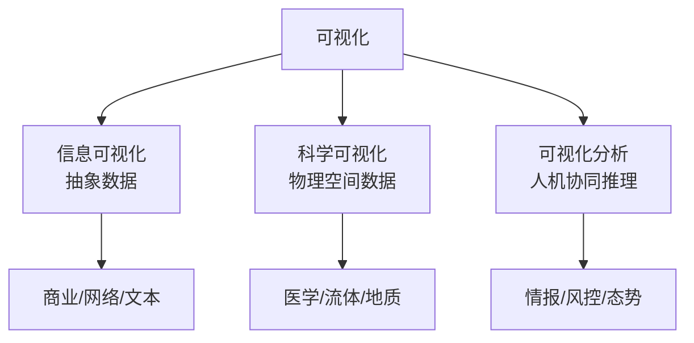
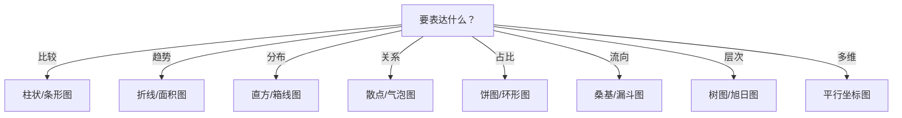
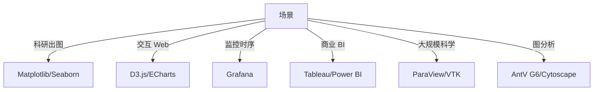

# 可视化

> 可视化是用图形、图像、动画把数据、概念、结构呈现出来的方法，本质是利用人类视觉系统的模式识别能力，让复杂信息一眼可读。

**关键词**：可视化、信息可视化、数据图表、交互式可视化、视觉编码、Dashboard

## 抽象类比

可视化像"翻译"——把数据这种"机器友好但人类难读"的语言，翻译成"图形这种人类一眼能懂"的语言。一张散点图能让机器花几秒算出的相关性，被人在 0.1 秒内捕捉到。

人脑有一半的神经元处理视觉信号，进化让我们对颜色、形状、位置、运动极其敏感。可视化正是把数据"对齐"到这套底层硬件上——把数字变成柱子高度，把趋势变成曲线斜率，把异常变成突兀的颜色，让眼睛直接干原本要大脑苦算的活。

## 一、可视化是什么

可视化（Visualization）是把数据、信息、结构转换成图形或图像的过程，目的是让人眼能高效地"看"出数据中的模式、趋势、异常和关系。

它的核心不是"把数据画出来"，而是"让人能更快、更准地理解数据"。一张好的可视化应当：

- 把数据中的**模式**呈现出来（趋势、周期、聚类）
- 把数据中的**异常**凸显出来（离群点、突变）
- 把数据中的**关系**揭示出来（相关性、层次、流向）
- 让人能在**几秒内**做出判断，而不是去读数字

可视化的本质是**视觉编码（Visual Encoding）**：把数据属性映射到视觉通道（位置、长度、面积、颜色、形状、方向）。不同的通道表达精度不同，经典的 Cleveland & McGill 排序：

- 最精确：**位置**（散点图的坐标）
- 高精度：**长度**（柱状图）、**角度**（饼图）、**斜率**（折线图）
- 中等精度：**面积**（气泡图）、**体积**（3D 柱）
- 低精度：**颜色色相**、**饱和度**、**纹理**

所以柱状图比饼图更易比较大小，散点图比热力图更精确——选择视觉通道就是选择"精确度预算"。

## 二、可视化的三大类型

可视化按数据特点和目标分三大类，工具和方法论差异很大：

### 2.1 信息可视化（Information Visualization）

- 处理对象：抽象数据（数值、关系、文本、网络）
- 典型场景：商业报表、数据分析、社交网络图、知识图谱
- 典型图表：柱状图、折线图、桑基图、网络图、树图
- 工具：D3.js、ECharts、Tableau

### 2.2 科学可视化（Scientific Visualization）

- 处理对象：物理空间数据（三维体、流场、医学影像）
- 典型场景：气象、医学影像（CT/MRI）、流体力学、地震勘探
- 典型方法：体绘制、等值面、流线、矢量场
- 工具：ParaView、VTK、Matplotlib 3D

### 2.3 可视化分析（Visual Analytics）

- 处理对象：复杂数据 + 分析推理
- 典型场景：情报分析、风控调查、安全态势感知
- 核心特点：**人机协同**——可视化 + 自动分析算法 + 交互式推理
- 工具：Superset、Grafana、Palantir

三类对比：

## 三、可视化的设计原则

### 3.1 Tufte 原则

Edward Tufte 是可视化领域的"祖师爷"，其核心思想是**最大化数据墨水比**：

- **数据墨水比**：用于呈现数据的"墨水"占总墨水的比例，越高越好
- **去掉 chartjunk**：3D 效果、渐变填充、阴影、装饰图案——通通删掉
- **诚实展示**：坐标轴不要截断、饼图不要变形、面积不要误导
- **小 multiples**：用一组小图并排对比，比一张大图更有效
- **让数据自己说话**：标签、注释贴在数据旁，不要全靠图例

Tufte 经典反例：3D 饼图。3D 透视会让前端的扇区看起来更大，破坏比例感知。

### 3.2 Munzner 的 What-Why-How 框架

Tamara Munzner 在《Visualization Analysis & Design》中提出三层框架：

- **What（可视化什么）**：数据抽象——是什么类型的数据（表格、网络、时序、空间）
- **Why（为什么可视化）**：任务抽象——用户要做什么（比较、定位、识别、探索、呈现）
- **How（怎么可视化）**：视觉编码 + 交互方法——用什么图表、什么交互

设计一张图要先想清楚 What 和 Why，再选 How，避免"为画图而画图"。

### 3.3 通用设计原则

- **一张图只讲一个故事**：不要堆砌多个不相关的信息
- **从概览到细节**：先给全景，再支持下钻
- **诚实优先**：不扭曲、不误导、不选择性呈现
- **可读性**：字号、颜色对比、标签位置都要让读者不费力
- **无障碍**：色盲友好（避免红绿组合）、提供文字替代

## 四、可视化图表类型

不同图表擅长不同任务，选错图表是最常见的可视化错误：

### 4.1 比较类

- **柱状图（Bar Chart）**：比较分类数据大小，最经典的图
- **条形图**：横向柱状图，适合长标签
- **分组柱状图**：多组数据对比
- **雷达图**：多维度对比（注意：维度多时难读）

### 4.2 趋势类

- **折线图（Line Chart）**：时序趋势，最常用
- **面积图**：折线 + 填充，强调累积
- **瀑布图**：展示增减累积过程（如财报）

### 4.3 分布类

- **直方图**：连续变量分布
- **箱线图**：四分位数 + 异常点，统计标配
- **小提琴图**：箱线 + 密度，信息更丰富
- **热力图**：二维分布密度

### 4.4 关系类

- **散点图**：两个变量的相关性
- **气泡图**：散点 + 第三个维度（大小）
- **网络图**：节点关系拓扑

### 4.5 占比类

- **饼图**：简单占比（不要超过 5 个扇区）
- **环形图**：饼图 + 中心可放总数
- **堆叠柱状图**：占比 + 趋势

### 4.6 流向类

- **桑基图**：流量流向（如能源流转）
- **漏斗图**：转化漏斗
- **和弦图**：环形关系流向

### 4.7 层次类

- **树图（Treemap）**：面积表示占比，适合多层级
- **旭日图**：环形层次
- ** dendrogram**：树状聚类

### 4.8 多维类

- **平行坐标图**：多维数据并行展示
- **雷达图**：少量样本的多维对比
- ** glyphs**：图标 + 多通道

### 4.9 时序类

- **时序折线**：基础趋势
- **Gantt 图**：任务时序安排
- **流图（Stream Graph）**：多类目时序演变

选图思路：

## 五、可视化与数据类型

不同数据类型对应不同的可视化策略：

### 5.1 分类数据（Categorical）

- 特点：离散类别（性别、城市、产品类目）
- 推荐：柱状图、条形图、饼图（少量类目）
- 避免：折线图（类别没有顺序）

### 5.2 时序数据（Temporal）

- 特点：按时间排列的序列（股价、监控指标）
- 推荐：折线图、面积图、热力图（按小时×天的日历）
- 进阶：季节性分解图、时序异常标注

### 5.3 空间数据（Spatial）

- 特点：地理位置（地图数据、LBS）
- 推荐：地图（choropleth 着色、点密度、热力地图）
- 工具：Mapbox、Leaflet、ECharts 地图

### 5.4 层级数据（Hierarchical）

- 特点：树形结构（组织架构、文件目录、分类体系）
- 推荐：Treemap、Sunburst、Dendrogram
- 应用：磁盘占用分析、组织结构展示

### 5.5 网络数据（Network）

- 特点：节点 + 边（社交网络、依赖关系）
- 推荐：力导向图、矩阵图、和弦图
- 挑战：节点多了会"毛球"，需要聚类、过滤、布局算法

### 5.6 多维数据（Multivariate）

- 特点：每条记录有多个数值维度（Iris 数据集、用户画像）
- 推荐：散点矩阵、平行坐标、雷达图、PCA 降维后散点
- 进阶：t-SNE、UMAP 降维可视化

## 六、可视化工具与库

### 6.1 Python 生态

- **Matplotlib**：最基础，灵活但代码冗长，适合科研出图
- **Seaborn**：基于 Matplotlib，统计图表开箱即用，配色漂亮
- **Plotly**：交互式图表，支持 Web 输出，Dash 配套做 Dashboard
- **Bokeh**：交互式 + 大数据流，专注浏览器渲染
- **Pyecharts**：ECharts 的 Python 封装，中文图表友好
- **Altair**：声明式语法，基于 Vega-Lite

### 6.2 JavaScript 生态

- **D3.js**：可视化"瑞士军刀"，灵活度最高，学习曲线陡
- **ECharts**：百度开源，中文文档好，开箱即用，国内最流行
- **Chart.js**：轻量，简单图表快速上手
- **AntV G2/G6**：蚂蚁开源，G2 通用图表，G6 专注图分析
- **Three.js**：3D 可视化，WebGL 封装

### 6.3 工具型（无代码/低代码）

- **Tableau**：商业 BI 标杆，拖拽式分析
- **Power BI**：微软出品，Office 集成好
- **Grafana**：时序监控首选，详见 [[运维基础]]
- **Superset**：Airbnb 开源 BI，Python 友好
- **Metabase**：开源 BI，简单易用

### 6.4 科学型

- **ParaView**：大规模科学数据可视化，并行渲染
- **VTK**：科学可视化底层库，C++/Python 绑定
- **Matplotlib 3D**：简单 3D 散点、曲面

工具选型思路：

## 七、交互式可视化

静态图能"看"，交互图能"探"。交互式可视化让用户主动探索数据，是现代 Dashboard 的核心。

### 7.1 核心交互模式

- **缩放（Zoom）**：在时间轴或数值轴上拉近拉远
- **平移（Pan）**：拖动视图查看不同区域
- **过滤（Filter）**：按条件筛选显示数据
- **钻取（Drill-down）**：从概览下钻到明细（年 → 月 → 日）
- **悬停（Hover/Tooltip）**：鼠标悬停显示详情
- **选择（Select/Brush）**：框选区域高亮数据
- **联动（Linking）**：多图之间高亮联动

### 7.2 经典模式

- **Brushing and Linking**：在一张图框选，其他图同步高亮对应数据，多维探索神器
- **Overview + Detail**：上图给概览，下图给细节，导航 + 焦点
- **Focus + Context**：焦点区域放大，周边缩小但保留上下文（鱼眼、双曲树）
- **Small Multiples**：一组小图并排，比单张大图更易对比
- **Animated Transition**：状态切换用动画过渡，保持心智连续性

### 7.3 交互原则

- **响应快**：交互延迟低于 100ms 才流畅
- **可逆**：能 undo，避免误操作卡死
- **渐进披露**：先简后繁，避免一上来信息过载
- **一致性**：相同操作有相同反馈

典型交互流程：用户在散点图框选 → 前端发起明细查询 → 数据源返回数据 → 其他图表联动高亮并显示 Tooltip → 用户进一步钻取下钻视图。Brushing and Linking 的核心价值就是让这个流程闭环。

## 八、可视化的常见陷阱

可视化做错比不做更糟，常见陷阱：

### 8.1 误导性坐标轴

- **截断 Y 轴**：Y 轴不从 0 开始，让小差异看起来巨大（夸张增长率）
- **不一致刻度**：双 Y 轴用不同比例，制造虚假相关性
- **时间轴不均**：等间距标不等的时间，扭曲趋势

### 8.2 3D 陷阱

- **3D 饼图**：透视让前端扇区看起来更大，破坏比例感知
- **3D 柱状图**：遮挡、深度扭曲，无信息增量
- **3D 折线图**：旋转角度影响趋势判断

经验：除非数据本身是三维空间数据，否则不要用 3D。

### 8.3 配色陷阱

- **红绿组合**：色盲不友好，8% 男性红绿色盲
- **彩虹色板**：感知不均匀，会让中间值看起来"突出"
- **过度配色**：用 10 种颜色却没分类需要，纯装饰
- 推荐：色盲友好色板（Viridis、ColorBrewer）、最多 5-6 种主色

### 8.4 信息过载与感知陷阱

- **堆叠太多系列**：一张折线图 20 条线变成"意大利面"
- **饼图超 7 块**：扇区大小难比较
- **过度装饰**：渐变、阴影、纹理盖过数据本身
- **面积误用**：用半径表示数量时，面积会平方放大差异（应该用面积）
- **饱和度过载**：高饱和颜色会让数据看起来更"严重"

### 8.5 选择性呈现

- **樱桃挑选时间窗**：选对作者有利的时间段
- **隐藏基数**：增长率 100% 但基数是 2 例
- **倒置坐标轴**：让"下降"看起来像"上升"

规避原则：让读者能复原原始数据，不要用图形特征掩盖数据特征。

## 九、可视化在工程实践中的应用

工程场景下可视化无处不在，几乎覆盖了系统的全生命周期：

### 9.1 监控大屏（Grafana）

- 时序指标可视化（QPS、延迟、错误率、资源使用率）
- 多面板组合形成 Dashboard，详见 [[高可用架构]]
- 告警阈值可视化标注
- 经典图：时序折线、热力图（按小时分布）、单值面板 + 阈值色

### 9.2 性能火焰图（Flame Graph）

- CPU 采样可视化：横轴调用栈宽度 = 占用时间
- 一眼看出热点函数
- 变体：内存火焰图、Off-CPU 火焰图
- 工具：perf、async-profiler、Brendan Gregg 的 FlameGraph 工具

### 9.3 APM 拓扑图

- 微服务调用拓扑，节点是服务，边是调用关系
- 节点颜色标识健康状态，边宽度标识调用量
- 下钻到链路追踪详情
- 工具：SkyWalking、Jaeger、Zipkin

### 9.4 日志时序图

- 错误日志按时间分布，发现突发异常
- 关键字频率热力图
- 工具：Kibana、Loki + Grafana

### 9.5 架构图

- 系统组件关系可视化
- 工具：Draw.io、PlantUML（文本驱动）、Mermaid、Excalidraw
- 详见 [[软件工程#UML 建模]]

### 9.6 数据探索

- 探索性数据分析（EDA）：分布、相关性、异常
- 特征工程：缺失率、重要性可视化
- 模型结果：ROC 曲线、混淆矩阵、特征重要度
- 详见 [[数据挖掘]]

工程可视化覆盖监控大屏（Grafana）、性能火焰图、APM 拓扑（SkyWalking）、日志时序（Kibana）、架构图（PlantUML/Mermaid）、数据探索（Jupyter/Seaborn）等场景，贯穿系统的全生命周期。

## 十、可视化与故事叙述

可视化不仅是"展示数据"，更是"用数据讲故事"。**Data Storytelling** 是数据分析师的高阶能力。

### 10.1 Data Storytelling 三要素

- **数据**：准确的数字和图表
- **叙事**：清晰的故事线，引导读者得出结论
- **视觉**：合适的图表和设计，强化叙事

三者缺一不可：只有数据是数字堆砌，只有叙事是空谈，只有视觉是花架子。

### 10.2 故事结构

经典数据故事结构：

1. **背景**：这是什么问题？为什么要看？
2. **现状**：数据揭示了什么现状？
3. **冲突**：发现了什么异常或问题？
4. **原因**：为什么会这样？
5. **行动**：下一步该做什么？

每一步配一张关键图表，图表为故事服务，不是相反。

### 10.3 Dashboard 设计

Dashboard 是"一站式监控视图"，设计原则：

- **5 秒原则**：5 秒内能看出有没有问题
- **从上到下、从左到右**：最重要的放左上
- **分层**：顶层指标 → 中层维度 → 底层明细
- **统一色板**：红色 = 异常，绿色 = 正常，全站一致
- **避免过度装饰**：监控大屏不是艺术展

### 10.4 报告中的可视化呈现

- **一图一观点**：每张图有明确结论，标题写结论而非描述
  - 差：2024 年销售额
  - 好：2024 年 Q3 销售额环比增长 35%
- **图表 + 文字配合**：图说明 What，文字解释 Why 和 So What
- **适当注释**：在关键数据点旁标注，减少读者认知负担
- **打印友好**：考虑黑白打印效果，避免依赖颜色传达关键信息

### 10.5 可视化伦理

- **不误导**：不为强调观点而扭曲比例
- **不选择性呈现**：完整时间窗、完整分类
- **标注不确定性**：置信区间、样本量
- **数据来源透明**：注明数据来源和处理方式

---

## 面试速答

### Q: 什么是可视化？为什么需要可视化？

A: 可视化是把数据转换成图形图像的过程，本质是利用人类视觉系统的模式识别能力，让复杂信息一眼可读。需要可视化的原因有三：一是人脑处理视觉信号的速度远快于数字（0.1 秒 vs 几秒）；二是视觉能直接呈现趋势、分布、异常、关系等模式，这些用统计指标难以完整表达；三是可视化支持交互探索，让分析师能快速形成和验证假设。核心是"视觉编码"——把数据属性映射到位置、长度、颜色、形状等视觉通道，不同通道的感知精度不同，选对通道是可视化的关键。

### Q: 柱状图和饼图分别在什么场景下使用？为什么 Tufte 反对饼图？

A: 柱状图适合比较分类大小，饼图适合展示各部分占整体的占比。但饼图有几个问题：一是人眼对角度的判断精度低于长度，相邻扇区大小接近时难比较；二是扇区多了变得难读，超过 5-6 个就混乱；三是 3D 饼图的透视会破坏比例感知。Tufte 反对饼图的核心是"数据墨水比"——饼图用大量墨水表达少量信息。建议：占比少于 5 类用饼图，需要精确比较用柱状图，占比 + 趋势用堆叠柱状图。

### Q: 什么是 Brushing and Linking？

A: Brushing and Linking 是多维数据探索的经典交互模式：在一张图上框选（Brush）一部分数据点，其他联动图（Link）会同步高亮这些点的对应记录。比如散点图框选异常点，平行坐标图会高亮这些点在各维度的分布，立刻能看出异常点在哪个维度上偏离。它解决了"高维数据看不清"的问题——通过多张低维图的联动交互，让人能跨维度探索同一批数据。这是现代可视化分析工具（如 Tableau、Plotly Dash）的标配能力。

### Q: 监控大屏设计有哪些原则？

A: 监控大屏设计的核心原则是"5 秒原则"——5 秒内能判断系统是否健康。具体原则：一是信息分层，顶层放关键指标（SLI/SLO），中层放维度拆解，底层放明细查询；二是统一色板，红黄绿含义全站一致，避免色彩噪音；三是从上到下、从左到右排列重要度递减；四是图表选型匹配任务，时序用折线、分布用热力图、单值用大数字面板 + 阈值色；五是告警要突出，异常状态要视觉上"跳"出来；六是避免装饰过度，3D 效果、动画、过度配色都会分散注意力。详见 [[高可用架构]] 中的监控体系。

### Q: 可视化有哪些常见陷阱？

A: 常见陷阱分几类：一是误导性坐标轴，截断 Y 轴让小差异看起来巨大、双 Y 轴制造虚假相关性、时间轴不均扭曲趋势；二是 3D 滥用，3D 饼图透视破坏比例、3D 柱状图遮挡扭曲；三是配色问题，红绿组合对色盲不友好、彩虹色板感知不均匀、过度配色变装饰；四是信息过载，一张折线图 20 条线变成"意大利面"、饼图超过 7 块难比较；五是感知非线性，用半径表示数量时面积平方放大差异；六是选择性呈现，樱桃挑选时间窗、隐藏基数。规避原则：让读者能从图复原原始数据，不要用图形特征掩盖数据特征。

---

## 延伸阅读

- Edward Tufte, *The Visual Display of Quantitative Information*（可视化圣经）
- Tamara Munzner, *Visualization Analysis & Design*（What-Why-How 框架）
- Cole Nussbaumer Knaflic, *Storytelling with Data*（数据讲故事实战）
- Stephen Few, *Information Dashboard Design*（Dashboard 设计）
- 在线资源：[D3 Gallery](https://observablehq.com/@d3/gallery)、[ECharts 官网](https://echarts.apache.org/)、[The Data Visualisation Catalogue](https://datavizcatalogue.com/)

---

## 系统实践与验收

- **最小系统**：把同一数据分别做成探索图与汇报图，先提出问题再选择编码。
- **验收方法**：检查尺度、单位、基线、颜色、排序、不确定性、可访问性和数据来源。
- **边界与风险**：避免 3D 装饰、截断坐标轴和双轴误导；图表必须能回答明确问题。

实践记录应包含版本、连接或部署拓扑、关键配置、原始现象、测量方法和恢复步骤，使别人能够在不同环境中复现并判断差异。
