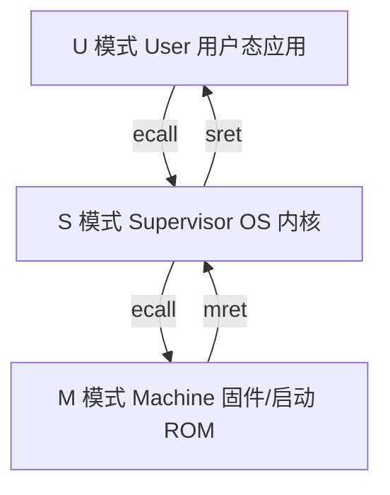
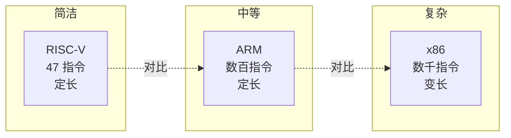
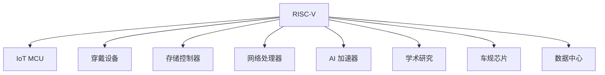
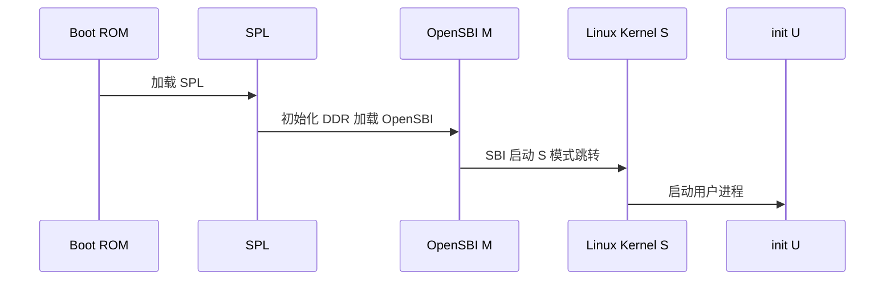

# RISC-V

> 一种开源、模块化、可自由扩展的精简指令集架构，正在重塑芯片产业格局。

**关键词**：RISC-V、ISA、模块化、开源指令集、特权架构、向量扩展

## 抽象类比

指令集架构（ISA）就像是 CPU 的"母语"。x86 是英语，ARM 是普通话，过去这两门语言都要交学费——ARM 授权费动辄千万，x86 几乎不对外开放。RISC-V 像是一门公开发布、人人可用的"世界语"，谁都可以拿去教自己的芯片，还能加自己的方言（扩展），不交授权费，也不怕被卡脖子。

RISC-V 的设计哲学是"小而美"：基础指令只有 47 条，相当于只规定最基础的语法，复杂的数学运算、浮点、向量、压缩指令都做成可选"扩展包"。芯片厂商按需取用，做 IoT 就只保留基础整数指令，做 AI 加速器就加上向量扩展，做服务器就全套上。这种"乐高积木"式的设计让 RISC-V 极度灵活。

## 一、RISC-V 是什么

RISC-V 是一种开放标准指令集架构（ISA），2010 年由加州大学伯克利分校的 Krste Asanović 团队设计，初衷是为教学和研究提供一个干净、免费、可定制的 ISA。2015 年 RISC-V International 基金会成立，正式推向工业界。

核心特征：

- 开源免费：规范以 BSD 许可发布，任何人可设计兼容 CPU
- 模块化：基础整数指令 + 可选扩展
- 精简：基础指令集仅 47 条（RV32I）
- 可扩展：可加入自定义指令，不影响标准兼容性
- 32/64/128 位三种基础位宽（RV32/RV64/RV128）
- 完整的特权级规范，支持 Unix 类操作系统

与封闭 ISA 的本质区别：ISA 规范公开，但具体 CPU 实现既可以是开源的（如 Rocket、BOOM、PicoRV32），也可以是商业闭源的（如 SiFive、平头哥玄铁）。"开源"指的是规范，不是必须开源硬件实现。

## 二、为什么 RISC-V 重要

ARM/x86 时代，ISA 是一种"垄断资源"：

- ARM 收取架构授权费（前期几百万美元）+ 版税（每片芯片 1-2% 售价）
- x86 几乎不对外开放，只有 Intel/AMD/VIA 等少数厂商持有交叉授权
- MIPS/OpenSPARC 虽然开放过，但生态未成

RISC-V 改变了规则：

- 完全免费，无授权费、无版税
- 不受出口管制约束（不属于任何国家公司）
- 可定制扩展，AI、加密、信号处理都能加专用指令
- 学术界大量采用，工业界 SiFive/平头哥/晶心/赛昉等百花齐放
- 车规、工规、消费电子均有落地产品

尤其在国产替代背景下，RISC-V 是少数"无卡脖子风险"的 ISA，国内企业可主导扩展规范，避免重蹈 ARM 断供覆辙。

## 三、指令集基础

RISC-V 基础整数指令集（RV32I / RV64I）只有 47-51 条指令，分为几类：

- 整数算术：add、sub、and、or、xor、sll、srl、sra、slt
- 内存访问：lw、lh、lb、sw、sh、sb（仅 Load/Store，不走 ALU）
- 控制流：beq、bne、jal、jalr
- 系统指令：ecall、ebreak、fence、csrrw、csrrs

寄存器组：

- 32 个通用寄存器 x0-x31（RV32 为 32 位，RV64 为 64 位）
- x0 永远是 0（零寄存器，简化常量处理）
- x1 是 ra（返回地址），x2 是 sp（栈指针）
- x10-x17 是 a0-a7（参数/返回值），x8-x9、x18-x27 是 s0-s11（callee-saved）

Load/Store 架构：内存只能用 lw/sw 访问，运算只在寄存器之间进行。这种设计简化了流水线，访存和运算可以并行。

指令长度：

- 标准 32 位定长（基础指令）
- 压缩指令 16 位（C 扩展，提升代码密度）
- 扩展指令可变长 48/64/80+ 位（V 扩展、自定义指令）


寄存器使用约定（调用规约 ABI）：

- x0（zero）：恒为 0
- x1（ra）：返回地址
- x2（sp）：栈指针
- x3（gp）：全局指针
- x4（tp）：线程指针
- x5-x7（t0-t2）：临时寄存器，caller-saved
- x8（s0/fp）：帧指针，callee-saved
- x9（s1）：callee-saved
- x10-x17（a0-a7）：参数与返回值，caller-saved
- x18-x27（s2-s11）：callee-saved
- x28-x31（t3-t6）：临时寄存器，caller-saved

汇编示例：一个简单的求和函数

```asm
# int sum(int a, int b) { return a + b; }
sum:
    add  a0, a0, a1    # a0 = a0 + a1
    ret                # 等价于 jalr x0, 0(ra)
```

指令编码格式：基础指令按字段位置分为 6 种格式：

- R 型：opcode + rd + funct3 + rs1 + rs2 + funct7（寄存器-寄存器运算）
- I 型：opcode + rd + funct3 + rs1 + imm（立即数运算、Load）
- S 型：opcode + imm + funct3 + rs1 + rs2（Store）
- B 型：opcode + imm + funct3 + rs1 + rs2（分支）
- U 型：opcode + rd + imm（lui、auipc）
- J 型：opcode + rd + imm（jal）

定长 32 位编码让译码器极简，流水线前端可以做得很深，这是 RISC-V 高效能的关键。

## 四、模块化扩展

RISC-V 的命名规则类似 `RV64IMafdc`，字母代表包含的扩展：

- I：基础整数（必选）
- M：乘除法指令（mul、div、rem）
- A：原子指令（lr、sc、amoadd），用于多核同步
- F：单精度浮点（32 个 f0-f31 浮点寄存器）
- D：双精度浮点
- Q：四精度浮点
- C：压缩指令（16 位编码，常见指令变体）
- V：向量扩展（可变长向量，类似 ARM SVE）
- B：位操作扩展
- K：密码学扩展
- P：DSP/SIMD 扩展
- Zicsr：CSR 读写指令
- Zifencei：指令缓存同步
- Zba/Zbb/Zbc：位操作子扩展

G 是常用组合：IMAFD（基础 + 乘除 + 原子 + 浮点），多数 Linux 系统 CPU 都是 RV64GC。

向量扩展 V 是 RISC-V 的亮点：寄存器长度由实现决定（VLEN），软件通过 CSR 查询并按向量长度无关方式编程。一份代码能在 VLEN=128 的 MCU 和 VLEN=4096 的服务器 CPU 上跑，无需重新编译。

向量编程核心概念：

- VLEN：向量寄存器总位宽，由实现决定
- ELEN：单个元素最大位宽（如 64 位 double）
- SLEN：条带宽度，决定元素在寄存器内布局
- LMUL：向量寄存器分组，可一次用 1-8 个寄存器
- AVL：应用传入的元素数，硬件返回实际处理数 vsetvl

典型向量代码模式：

```c
// C 语言伪代码示意
size_t vl = vsetvl_e32m1(n);     // 设置 32 位元素，LMUL=1
for (size_t i = 0; i < n; i += vl) {
    vfloat32m1_t a = vle32_v_f32m1(&A[i], vl);
    vfloat32m1_t b = vle32_v_f32m1(&B[i], vl);
    vfloat32m1_t c = vfadd_vv_f32m1(a, b, vl);
    vse32_v_f32m1(&C[i], c, vl);
    vl = vsetvl_e32m1(n - i);
}
```

原子指令 A 扩展用于多核同步：

- LR（Load-Reserved）：保留加载
- SC（Store-Conditional）：条件存储
- AMO（Atomic Memory Operation）：amoadd/amoswap/amomin/amomax 等
- 可用于实现自旋锁、信号量、无锁数据结构

压缩指令 C 扩展：将常用 32 位指令编码为 16 位，常见指令（addi、lw、sw、jal、ret）有压缩变体，代码密度提升约 25-30%，对嵌入式 Flash 受限场景极有价值。

## 五、特权架构

RISC-V 定义了三个特权模式：

- M 模式（Machine）：最高权限，必选，硬件直接管理
- S 模式（Supervisor）：操作系统运行模式，可选
- U 模式（User）：用户态，可选



CSR（Control and Status Register）：特权寄存器，每个 CSR 有 12 位地址。常用：

- mstatus/sstatus/ustatus：状态寄存器
- mtvec/stvec/utvec：中断向量基址
- mepc/sepc/uepc：异常返回 PC
- mcause/scause/ucause：异常原因
- mie/sie/uie：中断使能
- mip/sip/uip：中断挂起

中断与异常：

- 同步异常：缺页、非法指令、地址未对齐、ecall 调用
- 异步中断：定时器、外部设备、软件中断
- 中断控制器：CLINT（本地定时器+软中断）、PLIC（外部中断）
- 新规范：高级中断控制器 AIA，支持 MSI、虚拟化

PMP（Physical Memory Protection）：物理内存保护，M 模式可定义若干区域，限制 U/S 模式访问权限。RV64 常配合 S 模式分页实现虚拟内存（Sv39/Sv48/Sv57）。

虚拟内存分页模式：

- Sv32：32 位虚拟地址，两级页表，4GB 虚拟空间
- Sv39：39 位虚拟地址，三级页表，512GB 虚拟空间
- Sv48：48 位虚拟地址，四级页表，256TB 虚拟空间
- Sv57：57 位虚拟地址，五级页表
- 页大小固定 4KB，巨型页 4MB/2MB/1GB

页表项（PTE）包含物理页号、权限位（R/W/X）、用户位 U、全局位 G、脏位 D、访问位 A 等。S 模式通过 satp 寄存器切换页表基址，类似于 ARM 的 TTBR0/1 或 x86 的 CR3。

异常处理流程：

1. 硬件保存当前 PC 到 mepc/sepc/uepc
2. 保存异常原因到 mcause/scause/ucause
3. 切换到对应特权模式
4. 跳转到 mtvec/stvec/utvec 指向的异常向量
5. 异常处理完成后用 mret/sret/uret 返回

异常处理与 ARM/x86 类似，但 RISC-V 的 CSR 设计更简洁，模式切换开销小。H 扩展（Hypervisor）在 S 之上加了 HS 模式，支持虚拟化，2-stage 页表（VS-stage）让客户机隔离。

## 六、与 ARM/x86 对比

RISC-V 与主流 ISA 的差异：

- 指令数：RV32I 47 条 vs ARMv7 约 200 条 vs x86 数千条
- 寄存器：RISC-V 32 个 vs ARM 16 个 vs x86 16 个（部分专用）
- 解码：RISC-V 定长 32 位（C 扩展 16 位）vs ARM Thumb/ARM/AArch64 vs x86 变长 1-15 字节
- 商业模式：RISC-V 免费开放 vs ARM 授权收费 vs x86 几乎封闭
- 生态：RISC-V 起步中 vs ARM 移动霸主 vs x86 桌面服务器霸主
- 扩展性：RISC-V 可加自定义指令 vs ARM/x86 厂商基本无法扩展



ARM 的优势是生态成熟、性能优化久、移动端份额高；x86 优势是桌面/服务器生态绝对统治；RISC-V 优势是免费、可定制、新场景（IoT、AI、定制加速器）落地灵活。

## 七、RISC-V 生态

国外厂商：

- SiFive：伯克利团队创立，商业 RISC-V IP 供应商
- Western Digital：硬盘控制器自研 RISC-V
- Google：Android 支持 RISC-V
- Tenstorrent：Jim Keller 主导的高性能 RISC-V

国内厂商：

- 平头哥（阿里）：玄铁 C 系列（C906/C910/C920），开源部分 RTL
- 赛昉科技：昉·惊鸿 JH7110（应用于 VisionFive 开发板）
- 沁恒微电子：青稞系列 RISC-V MCU
- 乐鑫 ESP32-C3/C6：RISC-V 替代原有 Xtensa
- 晶心科技：AndeStar 系列
- 希姆计算：AI 推理 RISC-V
- 北京开源芯片研究院（BORA）：高性能开源 RISC-V

软件生态：

- QEMU 模拟器，可跑 RISC-V 系统，参考 [[Qemu]]
- Spike（ISA Simulator）：官方参考模拟器
- OpenSBI：M 模式固件，类似 ARM TF-A
- Linux 主线已支持 RISC-V（自 5.x 起）
- FreeBSD、OpenBSD 也已支持
- Rust 编译器支持 riscv64gc、riscv32imc
- LLVM/Clang、IAR、SEGGER 也加入支持

## 八、典型应用场景

RISC-V 落地领域：

- IoT 微控制器：乐鑫 ESP32-C3、沁恒 CH32V，挑战 ARM Cortex-M
- 智能手表/穿戴：低功耗、可定制
- 存储控制器：WD 硬盘、SSD 主控
- 网络处理器：用于 5G、路由器
- AI 加速器：特斯拉 Dojo、Tenstorrent、希姆算能
- 学术研究：教学 CPU、流水线实验、自定义指令研究
- 车规芯片：平头哥玄铁、芯来车规 IP
- 数据中心：实验性高性能核（如 Ventana、阿里平头哥）



未来潜力：定制化加速器（DSA）时代，RISC-V 提供了"通用核 + 自定义指令"的最佳载体，许多 AI 推理芯片都基于 RISC-V 加 NPU 扩展。

## 九、开发与学习

工具链：

- GNU Toolchain：riscv64-unknown-elf-gcc（裸机）、riscv64-linux-gnu-gcc（Linux）
- LLVM/Clang：日趋成熟
- Rust：nightly + target riscv64gc-unknown-none-elf
- IAR Embedded Workbench：商业 IDE，支持 RISC-V

模拟器：

- QEMU：可启动 Linux/RTOS，参考 [[Qemu]]
- Spike：官方 ISA 模拟，用于规范验证
- Renode：嵌入式多节点模拟，支持外设仿真

开发板：

- SiFive HiFive1 Rev B（RV32）
- SiFive HiFive Unmatched（RV64，支持 Linux）
- VisionFive 2（赛昉 JH7110，国产 RV64 Linux 开发板）
- BeagleV（StarFive）
- ESP32-C3-DevKit（入门 RISC-V MCU）

学习路径建议：

1. 看 RISC-V 规范卷一（Unprivileged ISA）和卷二（Privileged ISA）
2. 用 QEMU 启动一个 RISC-V Linux
3. 在 RV32 MCU（如 ESP32-C3）上跑裸机程序
4. 学会看反汇编，理解调用约定、栈帧
5. 尝试加入自定义指令（FPGA 上实现）
6. 阅读 Rocket/BOOM 等开源 RTL

QEMU 启动 RISC-V Linux 示例命令：

```bash
# 安装工具链与 QEMU
sudo apt install gcc-riscv64-linux-gnu qemu-system-misc

# 下载内核与 rootfs（OpenSBI + kernel + rootfs）
wget https://.../opensbi-qemu.tar.gz

# 启动
qemu-system-riscv64 -M virt -smp 4 -m 2G \
    -bios fw_payload.bin \
    -kernel Image -append "root=/dev/vda rw console=ttyS0" \
    -drive file=rootfs.ext2,format=raw,id=hd0 \
    -device virtio-blk-device,drive=hd0 \
    -nographic
```

裸机汇编示例（在 QEMU 上跑）：

```bash
# hello.s
cat > hello.s << 'EOF'
.global _start
_start:
    li a7, 64         # write 系统调用号
    la a0, msg
    li a1, 13
    li a2, 0
    ecall
    li a7, 93         # exit
    li a0, 0
    ecall
msg:
    .ascii "hello riscv\n"
EOF

riscv64-linux-gnu-as hello.s -o hello.o
riscv64-linux-gnu-ld hello.o -o hello
qemu-riscv64 ./hello
```

调试反汇编：

- `riscv64-linux-gnu-objdump -d program` 看反汇编
- `riscv64-linux-gnu-gdb` 配合 QEMU 远程调试
- `qemu-system-riscv64 -S -gdb tcp::1234` 等待 gdb 连接

## 十、RISC-V 与操作系统的关系

RISC-V 不绑定任何特定操作系统，但目前主流支持如下：

- Linux on RISC-V：主线支持，发行版如 Debian、Ubuntu、Fedora、openSUSE 都有 RV64 版本
- OpenSBI：M 模式固件，负责启动、SBI 调用、上下文切换，类似 ARM TF-A
- FreeBSD、OpenBSD：均已支持
- Zephyr：嵌入式 RTOS，支持多款 RISC-V 板子
- FreeRTOS：官方支持 RISC-V 端口
- RT-Thread：国产 RTOS，支持 RISC-V
- StarryOS：国产开源 OS，主打 RISC-V
- HarmonyOS LiteOS：支持 RISC-V

启动流程示例：



SBI 调用约定：M 模式向 S 模式提供扩展服务，如定时器、IPI、HSM（Hart State Management）、RFENCE 等，类似 ARM 的 SMC/HVC 调用。

## 面试速答

**Q1：RISC-V 的"开源"到底开源了什么？**

开源的是指令集规范（ISA），不是具体的 CPU 实现。任何人可以按规范设计兼容 CPU，无需授权费。CPU 的 RTL 可以开源（如 Rocket、PicoRV32），也可以商业闭源（如 SiFive、平头哥玄铁）。

**Q2：RISC-V 的模块化扩展怎么命名？**

格式为 RV + 位宽 + 字母组合。如 RV64IMAFDC 表示 64 位 + 整数 + 乘除 + 原子 + 单精度浮点 + 双精度浮点 + 压缩。G 是 IMAFD 的简写，所以 RV64GC 是最常见的 Linux 系统 CPU 配置。

**Q3：RISC-V 三种特权模式是什么？**

M（Machine）最高权限，硬件直接管理，必选；S（Supervisor）运行 OS 内核，可选；U（User）用户态，可选。M→S→U 权限递减。中断可分别路由到不同模式，SBI 调用让 S 模式请求 M 模式服务。

**Q4：RISC-V 为什么是 Load/Store 架构？**

运算只在寄存器间进行，访存只有 Load/Store 指令。这样流水线设计简单：ALU 阶段不依赖内存，访存单元可以独立工作，便于流水并行。代价是常量要先 load 到寄存器才能用，但通过立即数指令和 x0 零寄存器可缓解。

**Q5：RISC-V 的向量扩展和 ARM SVE 有什么区别？**

RISC-V V 扩展是 VLEN 无关编程，软件查询 VLEN 后按向量长度无关方式写循环，同一份二进制可在不同 VLEN 的 CPU 上跑。SVE 也是类似思路（向量长度无关），但 RISC-V V 寄存器固定 32 个，掩码寄存器集成在向量寄存器内，更紧凑。

## 参考与延伸

- 嵌入式系统全景：[[嵌入式系统]]
- 操作系统基础：[[操作系统]]
- 体系结构基础：[[计算机组成原理]]
- 模拟器实践：[[Qemu]]
- RISC-V International 官网：https://riscv.org
- RISC-V 规范卷一/卷二：https://github.com/riscv
- The RISC-V Instruction Set Manual Volume I/II

---

## 系统实践与验收

- **最小系统**：用模拟器运行最小汇编程序，观察指令编码、寄存器、调用约定与异常入口。
- **验收方法**：区分 ISA、ABI、特权规范与具体 SoC 实现，保存反汇编和执行轨迹。
- **边界与风险**：扩展集合并非处理器都支持；裸机、Linux 和不同工具链的启动假设不同。

实践记录应包含版本、连接或部署拓扑、关键配置、原始现象、测量方法和恢复步骤，使别人能够在不同环境中复现并判断差异。
