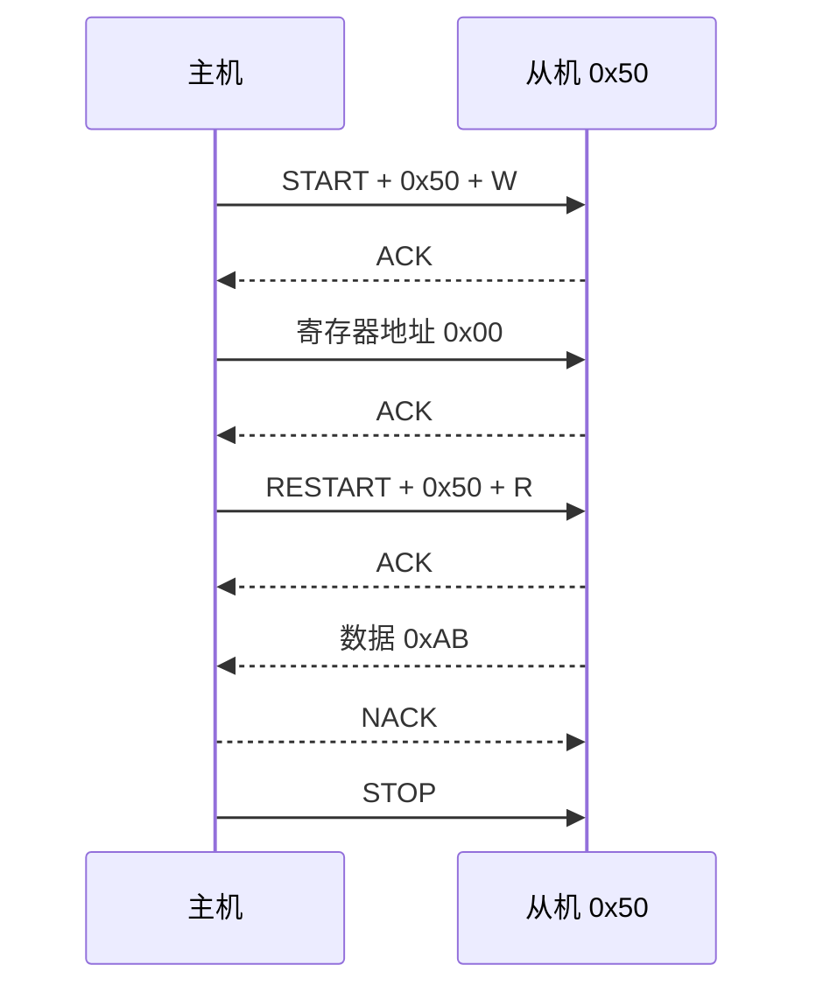
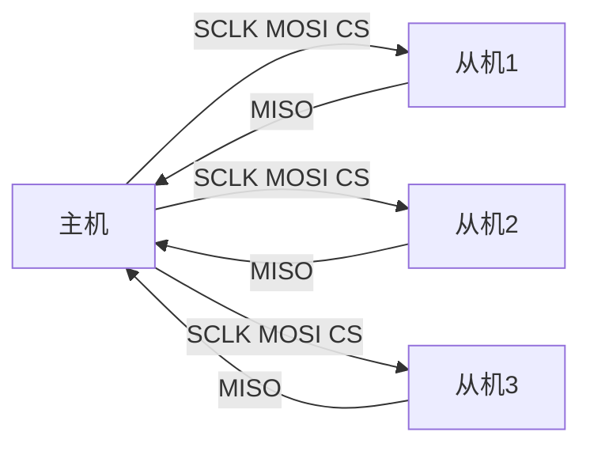
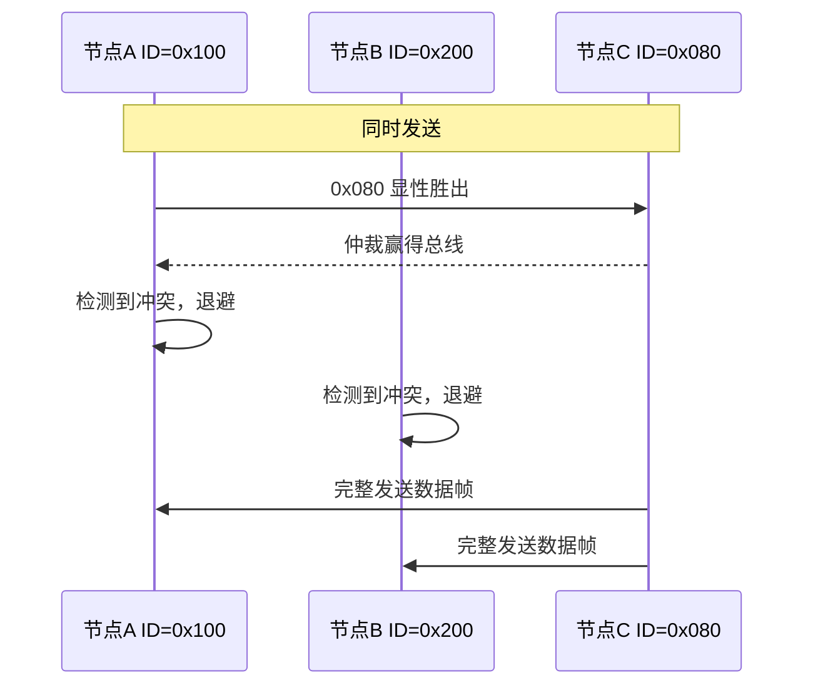
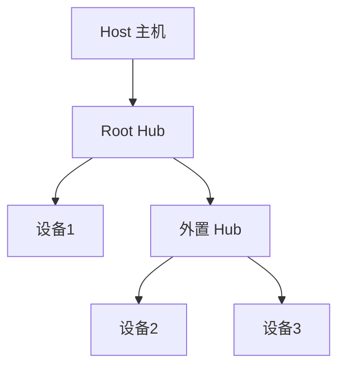
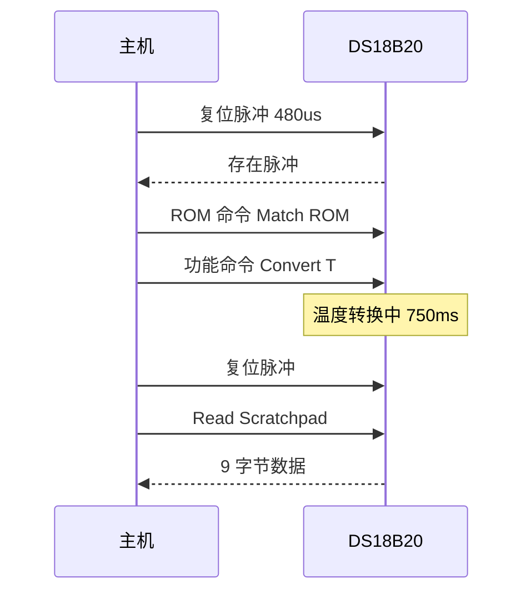

# 通信协议

> 嵌入式系统中芯片与芯片、设备与设备之间交换比特的"通用语言"。

**关键词**：UART、I2C、SPI、CAN、USB、1-Wire

## 抽象类比

把嵌入式系统想象成一座工厂，里面有不同的车间和工人。车间与车间之间需要传递零件和订单，但有的车间离得近（同一块 PCB 上几厘米），有的车间离得远（跨车身、跨房间）。距离、速度、可靠性、线缆成本各不相同，于是工厂发明了不同的"运输方式"：自行车适合短途快递、地铁适合城内通勤、货运火车适合长途大宗、快递柜适合单点取件。

通信协议就是这些"运输方式"的规范。它们规定了线缆数量（几根线）、信号电平（高电平代表什么）、时钟来源（同步还是异步）、寻址方式（点谁说话）、出错怎么办（重传还是丢弃）。每种协议都是在某些维度上做妥协，换另一些维度上的优势，所以嵌入式工程师必须熟悉多种协议，才能在不同场景下选对工具。

## 一、嵌入式通信协议概述

嵌入式系统里没有一种"万能协议"。CPU 要和传感器、存储器、显示器、其他 CPU 通信，需求差异极大：

- 速率：从几 kbps（温湿度传感器）到几 Gbps（USB 3.0、PCIe）
- 距离：芯片内几毫米，到车身几十米，再到工业现场几百米
- 引脚数：MCU 引脚紧张时一根线也要省
- 拓扑：点对点、一主多从、多主、总线型、星型
- 抗干扰：工业现场强电磁干扰，需要差分信号
- 复杂度：UART 几行代码就能跑，USB 协议栈要几万行

工程师在这些维度间权衡，于是诞生了 UART、I2C、SPI、CAN、USB、1-Wire 等不同协议。理解它们的"取舍哲学"比死记参数更重要。

按同步方式可以粗略分类：

- 异步：UART、RS-485（无独立时钟线，靠波特率约定）
- 同步：I2C、SPI、USB、CAN（带时钟或同步机制）

按信号类型分类：

- 单端：UART、I2C、SPI（电平相对地）
- 差分：CAN、USB、RS-485（两根线差值表示信号，抗干扰强）

## 二、UART/USART

UART（Universal Asynchronous Receiver/Transmitter）是最经典的异步串行协议。USART 多了一个"同步"模式，但实际 90% 场景都用异步模式。

基本特征：

- 异步，无独立时钟线
- 两根线：TX（发送）、RX（接收），交叉相连
- 全双工
- 点对点通信（一主一从）
- 波特率双方约定，常见 9600、115200、921600

数据帧格式：

- 起始位：1 位低电平，标志一帧开始
- 数据位：5/6/7/8/9 位，常用 8 位
- 校验位：奇校验、偶校验、无校验
- 停止位：1、1.5、2 位高电平

电平标准：

- TTL/CMOS：3.3V 或 5V，距离短，板内通信
- RS-232：±12V，距离约 15 米，老式串口
- RS-485：差分信号，距离可达 1200 米，多点总线，工业主流
- RS-422：差分 RS-485 的"全双工版"

调试要点：

- TX/RX 必须交叉，地必须共地
- 波特率两边必须一致，误差一般不超过 2-3%
- 偶尔出现乱码多半是波特率、电平、地线问题

参考 [[串口]] 了解更深入的实践细节。

## 三、I2C

I2C（Inter-Integrated Circuit）是 Philips（现 NXP）在 1980 年代设计的两线同步总线，专为板内低速外设设计。

基本特征：

- 同步，带时钟线
- 两根线：SDA（数据）、SCL（时钟）
- 开漏输出 + 上拉电阻（线与逻辑）
- 半双工
- 多主多从架构
- 7 位地址（10 位地址扩展），理论 128/1024 个设备

通信流程：

1. 主机发起起始条件（SCL 高时 SDA 由高变低）
2. 主机发送 7 位地址 + 1 位读写标志
3. 从机匹配地址后回 ACK（拉低 SDA）
4. 按读写方向收发数据，每字节后 ACK/NACK
5. 主机发起停止条件（SCL 高时 SDA 由低变高）

速度等级：

- 标准模式：100 kbps
- 快速模式：400 kbps
- 快速模式 Plus：1 Mbps
- 高速模式：3.4 Mbps
- 超快模式：5 Mbps（单向）

调试要点：

- 上拉电阻阻值要看总线电容，4.7kΩ 是经验值
- 地址冲突：同一条总线上两个相同地址设备会打架
- 多主时需要仲裁，SDA 被拉低的一方让出总线

## 四、SPI

SPI（Serial Peripheral Interface）是 Motorola 设计的四线同步总线，速率比 I2C 高得多，常用在 Flash、SD 卡、LCD 屏、ADC 上。

基本特征：

- 同步，主设备输出时钟
- 四根线：SCLK（时钟）、MOSI（主出从入）、MISO（主入从出）、CS（片选）
- 全双工
- 一主多从，每个从机一根 CS 线
- 无固定寻址，靠 CS 选中
- 速率可达几十 Mbps

时钟极性与相位（CPOL/CPHA）组合出 4 种模式：

- Mode 0：CPOL=0, CPHA=0，空闲低，第一个沿采样
- Mode 1：CPOL=0, CPHA=1，空闲低，第二个沿采样
- Mode 2：CPOL=1, CPHA=0，空闲高，第一个沿采样
- Mode 3：CPOL=1, CPHA=1，空闲高，第二个沿采样

主从设备必须配置相同模式，否则数据错位。

菊花链模式：多个从机共享一根 CS，数据串行穿过每个设备，常用于级联 LED 驱动或移位寄存器。

调试要点：

- MISO/MOSI 不要接反
- 模式不对会读出全 0 或全 FF
- 长线高速时要注意信号完整性，加端接电阻

## 五、CAN

CAN（Controller Area Network）是 Bosch 在 1986 年为汽车设计的串行总线，如今是车载和工业控制的事实标准。

基本特征：

- 差分信号，两根线 CANH、CANL
- 半双工，多主架构
- 显性电平（逻辑 0）差分电压约 2V，隐性电平（逻辑 1）差分约 0V
- 速率与距离相关：1 Mbps 约 40 米，125 kbps 可达 500 米
- 高可靠性，内置 CRC、ACK、错误帧

报文帧类型：

- 数据帧：携带数据，最常用
- 远程帧：请求某 ID 发数据
- 错误帧：节点检测到错误时发
- 过载帧：延长帧间间隔

标准数据帧结构：

- 帧起始：1 位显性
- 仲裁段：11 位 ID（标准帧）或 29 位（扩展帧）+ RTR
- 控制段：IDE、r0、DLC（数据长度）
- 数据段：0-8 字节（CAN FD 可达 64 字节）
- CRC 段：15 位 CRC + 界定符
- ACK 段：发送方等接收方回显性
- 帧结束：7 个隐性位

仲裁机制：ID 越小优先级越高，多个节点同时发送时，显性电平（0）会覆盖隐性电平（1），优先级低的节点自动退出。

CAN FD（Flexible Data-rate）：波特率可达 5-8 Mbps，数据段最长 64 字节，是新车型主流。

应用：发动机控制、ABS、车身控制、OBD-II 诊断、工业自动化。

## 六、USB

USB（Universal Serial Bus）是 1996 年由 USB-IF 发布的总线，现在几乎所有外设都用 USB。

基本特征：

- 差分信号 D+/D-
- 主从架构，主机轮询设备
- 集线器扩展星型拓扑，最多 127 个设备
- 内置枚举、供电（VBUS 5V）、热插拔
- 复杂度极高，协议栈分多层

设备类型：

- 主机（Host）：PC、手机 OTG
- 设备（Device）：U 盘、键鼠、摄像头
- 集线器（Hub）：扩展端口

端点（Endpoint）：每个设备最多 32 个端点（16 入 16 出），端点 0 是控制端点。

传输类型：

- 控制传输：枚举、配置命令
- 批量传输：U 盘大文件，保证可靠但不保证时间
- 中断传输：键鼠，周期性小数据
- 同步传输：音视频，保证带宽不保证可靠

版本对比：

- USB 1.1：低速 1.5 Mbps、全速 12 Mbps
- USB 2.0：高速 480 Mbps
- USB 3.0/3.1/3.2：超高速 5/10/20 Gbps，增加 SS 差分对
- USB Type-C：可正反插，可承载 USB PD 供电（最高 240W）

嵌入式实现：MCU 内置 USB 控制器，常用 TinyUSB、STM32 USB 库实现 CDC（虚拟串口）、HID（键鼠）、MSC（U 盘）等设备类。

## 七、1-Wire

1-Wire 是 Dallas Semiconductor（现 Maxim，已被 AD 收购）设计的单线协议，最著名的产品是 DS18B20 温度传感器。

基本特征：

- 单根数据线（DQ），既传时钟又传数据
- 寄生供电：从数据线"偷电"，省一根 VCC
- 半双工
- 一主多从
- 速率约 15 kbps（标准）到 142 kbps（overdrive）

寻址：每个 1-Wire 设备有 64 位唯一 ROM 码（8 位家族码 + 48 位序列号 + 8 位 CRC），可挂多个设备在同一根线上。

时序：

- 复位脉冲：主机拉低 480us，从机回 60-240us 的存在脉冲
- 写 0：主机拉低 60-120us
- 写 1：主机拉低 1-15us 后释放
- 读位：主机拉低 1us，15us 内采样

典型应用：DS18B20 测温、iButton 电子钥匙、EEPROM、加密认证芯片。

调试要点：寄生供电时电流要够，长线要注意上拉电阻和线缆电容。

## 八、协议对比与选型

各协议横向对比：

- 引脚数：1-Wire 1 根 < UART 2 根 ≈ I2C 2 根 < CAN 2 根 ≈ USB 2 根 < SPI 4+ 根
- 速率：UART < I2C < 1-Wire < CAN < SPI < USB（粗略）
- 距离：1-Wire < I2C < SPI < UART < CAN < RS-485
- 拓扑：UART/I2C/SPI 单板内，CAN/RS-485 跨设备，USB 集线器星型
- 抗干扰：差分（CAN/USB/RS-485）远胜单端

选型经验：

- 板内低速传感器（温湿度、EEPROM）：I2C
- 板内高速器件（Flash、LCD、ADC）：SPI
- 简单调试口、与 PC 通信：UART 转 USB
- 车载、工业现场总线：CAN 或 RS-485
- 单线测温、电子钥匙：1-Wire
- 与 PC 高速外设：USB

## 九、调试方法

常用工具：

- 逻辑分析仪：抓多路数字信号，看时序、解码协议
- 示波器：看模拟波形、电平幅值、上升沿
- 协议分析仪：专门解码 CAN、USB 等复杂协议
- USB 转 UART/I2C/SPI 小板：电脑直接和总线对话

调试流程：

1. 先确认物理层：电平、接线、电源、地
2. 抓波形看时序：时钟频率、电平幅值
3. 协议解码：用软件自动解析字节
4. 对照数据手册看寄存器值
5. 单步代码检查发送/接收缓冲

常见错误：

- 接线接反（TX/RX、MOSI/MISO、SDA/SCL）
- 波特率不匹配
- 共地缺失
- 上拉电阻缺失（I2C、1-Wire）
- 中断优先级配置错误导致丢字节
- 电平不匹配（3.3V/5V 混用没加电平转换）

参考 [[调试能力]] 了解更系统的调试方法论。

## 十、与高层协议的关系

物理层协议本身只负责"搬运字节"，上层协议定义"字节代表什么"：

- Modbus over UART/RS-485：工业控制经典，主从轮询寄存器
- Modbus over TCP：以太网版本
- CANopen：基于 CAN 的工业上层协议，对象字典、PDO/SDO
- J1939：商用车辆 CAN 上层协议
- OBD-II：汽车诊断标准，跑在 CAN/K-line 上
- HID over USB：键鼠标准设备类
- CDC over USB：虚拟串口
- DFU over USB：设备固件升级

理解这种分层关系后，换底层协议不影响上层应用逻辑，这也是协议栈设计的核心思想。

## 面试速答

**Q1：I2C 和 SPI 最核心的区别？**

I2C 是两线、半双工、寻址式（7 位地址），适合多设备低速场景；SPI 是四线、全双工、片选式（CS），适合少设备高速场景。I2C 节省引脚但速率受限，SPI 速率高但引脚消耗多。

**Q2：CAN 仲裁机制是怎么工作的？**

CAN 是线与逻辑，显性电平（0）会覆盖隐性电平（1）。多个节点同时发送时，按 ID 逐位仲裁，ID 小的优先级高。发送 1 但读到 0 的节点检测到冲突，立即停止发送，等总线空闲重试。这种非破坏性仲裁保证了高优先级报文无延迟传输。

**Q3：SPI 的四种模式怎么选？**

看从设备数据手册的时序图。CPOL 决定时钟空闲电平，CPHA 决定在第一个还是第二个时钟沿采样。主从必须一致。常见器件：Flash 多为 Mode 0 或 Mode 3，SD 卡默认 Mode 0。

**Q4：UART 波特率误差为什么不能太大？**

UART 异步无时钟线，接收方按约定波特率在每个数据位中点采样。如果双方波特率有偏差，采样点会逐位漂移，到第 8 位时可能采到相邻位导致数据错。一般要求累计误差不超过 ±2-3%。

**Q5：1-Wire 怎么实现寄生供电？**

设备内部有电容和二极管，数据线高电平时给电容充电，低电平时靠电容维持供电。所以长时操作（如 DS18B20 温度转换 750ms）期间主机必须保持数据线高电平，或额外提供强上拉，否则设备会掉电复位。

## 参考与延伸

- 嵌入式系统全景：[[嵌入式系统]]
- 串口实践细节：[[串口]]
- 系统调试方法论：[[调试能力]]
- NXP UM10204 I2C-bus Specification
- Bosch CAN Specification 2.0
- USB 2.0 / USB 3.2 规范，USB-IF 官网
- Maxim 1-Wire Application Note

---

## 系统实践与验收

- **最小系统**：为一个传感器定义帧格式、状态机、超时、重试、序号、校验和版本字段。
- **验收方法**：用正常、边界、丢包、乱序、重复、损坏和慢端点测试互操作。
- **边界与风险**：重试必须配合幂等；协议要明确字节序、长度、单位、时间和未知字段处理。

实践记录应包含版本、连接或部署拓扑、关键配置、原始现象、测量方法和恢复步骤，使别人能够在不同环境中复现并判断差异。
