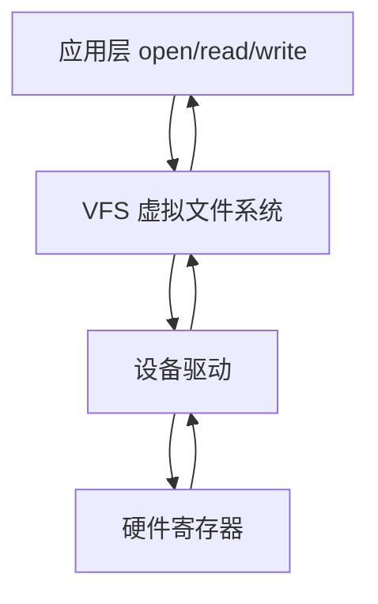
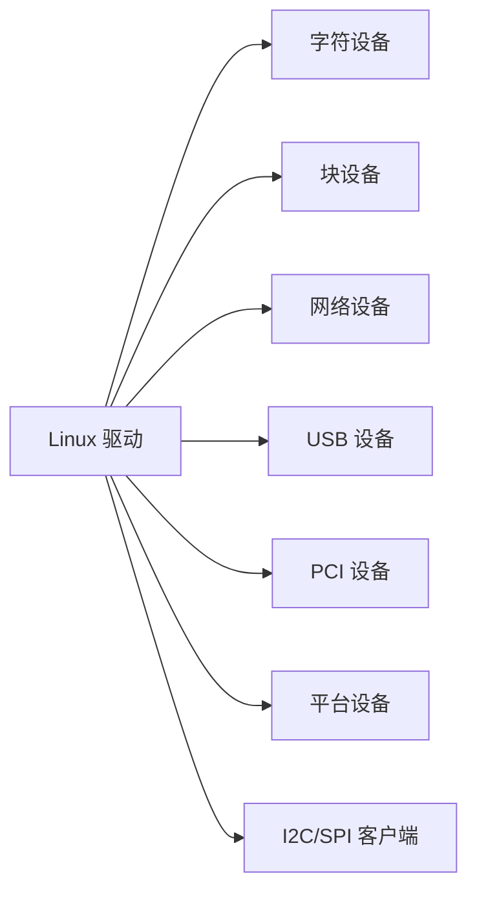
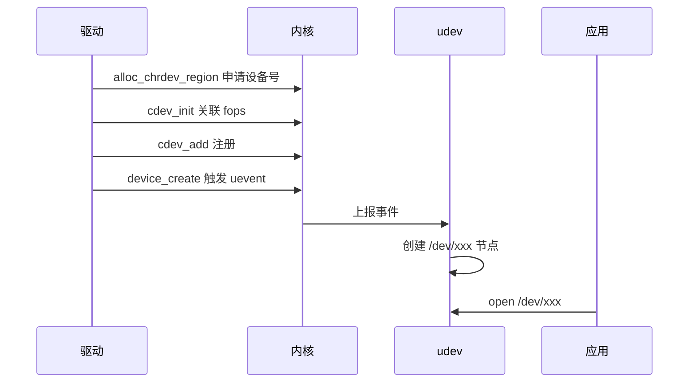
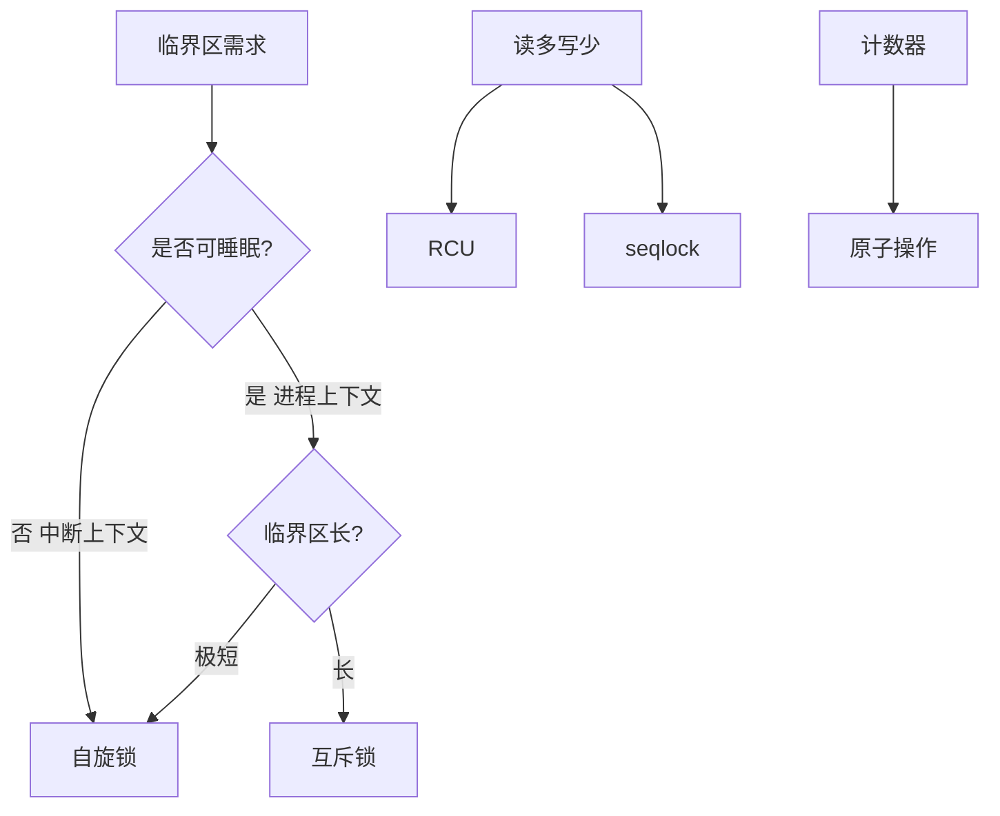
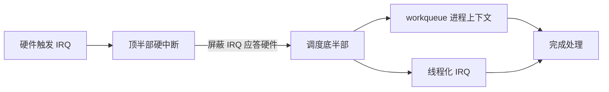
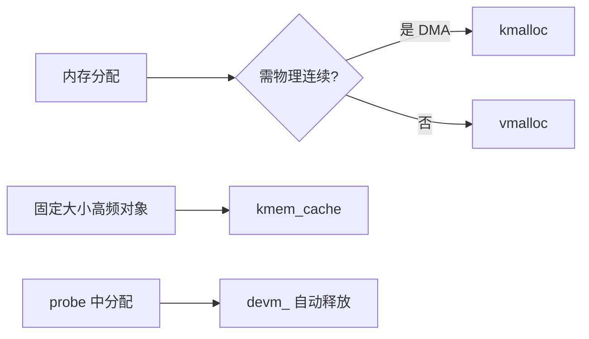
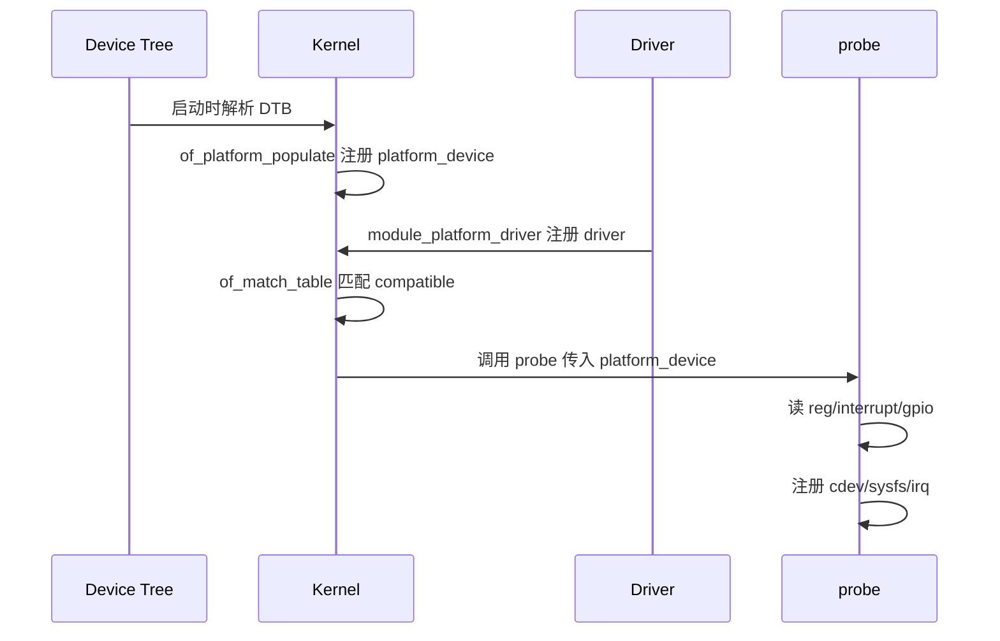
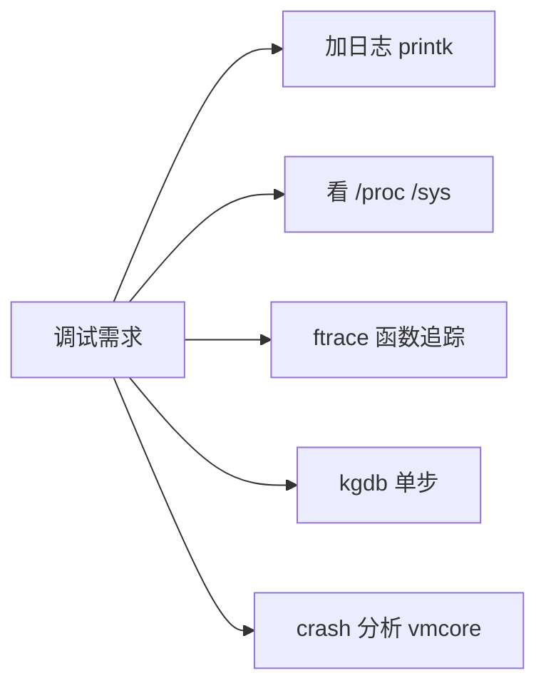

# 驱动开发

> Linux 设备驱动是连接硬件与操作系统的"翻译官"，让应用程序通过统一接口操作五花八门的硬件。

**关键词**：Linux驱动、内核模块、字符设备、平台驱动、中断、设备树

## 抽象类比

想象硬件是一群只懂"方言"的外国人——传感器说 I2C，屏幕说 SPI，网卡说 PCIe。Linux 内核是中央政府，不会每种方言，于是雇佣"翻译官"（驱动）专门和某种硬件沟通，对上则统一说"普通话"（VFS、文件描述符、socket）。这样应用层只管 open/read/write/ioctl，不用关心底层细节。

驱动开发本质是写"双语翻译层"：向下读写寄存器、配置 DMA、处理中断，向上实现 file_operations、net_device_ops 等标准接口。难点不在于写代码，而在于理解硬件手册、并发同步、内存管理、内核执行模型。

## 一、驱动开发是什么

Linux 设备驱动是内核的一段代码，负责：

- 探测硬件：发现并初始化设备
- 配置硬件：设置寄存器、时钟、电源
- 提供接口：向上层应用提供 open/read/write/ioctl 等统一接口
- 处理事件：响应中断、定时器、异步通知
- 管理资源：内存、DMA、IRQ、电源

驱动运行在内核态，与内核共享地址空间，一旦出错整个系统崩溃。所以驱动开发对正确性、稳定性要求极高。



为什么需要驱动层：

- 抽象：应用不关心硬件细节
- 安全：用户态不能直接碰硬件
- 复用：同一应用能在不同硬件上跑
- 权限：内核控制谁能访问什么设备

## 二、Linux 驱动分类

按访问方式分类：

- 字符设备：按字节流访问，最常见。串口、GPIO、I2C、SPI、 framebuffer、输入设备
- 块设备：按块（512B/4KB）访问，支持随机寻址。磁盘、Flash、ramdisk
- 网络设备：包接口，无文件节点，通过 socket 访问。以太网、Wi-Fi、CAN

按总线分类：

- USB 设备：通过 USB 总线枚举
- PCI/PCIe 设备：通过 PCI 总线枚举
- 平台设备：SoC 内部设备，无总线枚举，靠设备树匹配
- I2C/SPI 客户端设备：通过对应子系统注册



每个子系统有自己的注册接口和框架，但底层都是 module + probe/remove 模式。

## 三、内核模块基础

驱动通常以内核模块（ko）形式存在，可动态加载/卸载：

- module_init：加载时调用
- module_exit：卸载时调用
- MODULE_LICENSE/MODULE_AUTHOR/MODULE_DESCRIPTION：元信息

最小模块示例：

```c
#include <linux/module.h>
#include <linux/init.h>

static int __init hello_init(void) {
    printk(KERN_INFO "hello init\n");
    return 0;
}

static void __exit hello_exit(void) {
    printk(KERN_INFO "hello exit\n");
}

module_init(hello_init);
module_exit(hello_exit);
MODULE_LICENSE("GPL");
```

加载卸载命令：

- insmod hello.ko：直接加载
- rmmod hello：卸载
- modprobe hello：自动处理依赖加载
- modprobe -r hello：自动处理依赖卸载
- lsmod：查看已加载模块
- dmesg：查看 printk 输出

模块参数：通过 module_param 宏声明，加载时可传 `insmod hello.ko rate=100`。

模块依赖：模块可调用其他模块的符号（EXPORT_SYMBOL 导出），modprobe 通过 modules.dep 自动加载依赖。

Makefile 编译：

```makefile
obj-m := hello.o
KDIR := /lib/modules/$(shell uname -r)/build
all:
    make -C $(KDIR) M=$(PWD) modules
```

## 四、字符设备驱动

字符设备是最常见的驱动类型。核心是 file_operations 结构体：

```c
struct file_operations {
    int (*open)(struct inode *, struct file *);
    ssize_t (*read)(struct file *, char __user *, size_t, loff_t *);
    ssize_t (*write)(struct file *, const char __user *, size_t, loff_t *);
    long (*ioctl)(struct file *, unsigned int, unsigned long);
    int (*release)(struct inode *, struct file *);
    int (*mmap)(struct file *, struct vm_area_struct *);
    unsigned int (*poll)(struct file *, struct poll_table_struct *);
};
```

注册流程：

1. 申请设备号：alloc_chrdev_region 或 register_chrdev_region
2. 初始化 cdev：cdev_init 关联 file_operations
3. 添加 cdev：cdev_add 注册到内核
4. 创建设备节点：class_create + device_create（udev 自动创建 /dev 节点）
5. 卸载时反向操作：device_destroy、class_destroy、cdev_del、unregister_chrdev_region



读写示例核心思路：

- read：从硬件读数据到内核缓冲，再用 copy_to_user 拷给用户
- write：用 copy_from_user 从用户拷到内核，再写硬件
- ioctl：传递控制命令（设置波特率、配置模式等）

注意事项：

- 用户态指针不能直接解引用，必须用 copy_to/from_user
- read/write 返回非负值表示成功字节数，负值表示错误码
- 并发访问需要锁保护

## 五、并发与同步

内核代码随时可能被中断、被其他 CPU 抢占，共享资源必须保护。

主要同步原语：

- 自旋锁 spinlock：忙等，临界区极短，不能睡眠时用
- 信号量 semaphore：可睡眠，临界区长
- 互斥锁 mutex：二值信号量的简化版，可睡眠
- 原子操作 atomic_t：对计数器加减
- 顺序锁 seqlock：读多写少场景
- RCU Read-Copy-Update：读极多写极少场景，读无锁
- 完成量 completion：等待某事件完成



使用原则：

- 自旋锁临界区不能睡眠、不能调度
- 持锁时不能调用可能睡眠的函数（kmalloc GFP_KERNEL、copy_from_user）
- 多 CPU 同时持不同锁时注意锁顺序，避免死锁
- 中断中持自旋锁要加 irqsave 变体禁用本地中断

死锁典型场景：

- 递归持同一自旋锁
- 持锁时调用同样持该锁的函数
- 两个 CPU 以相反顺序持有两个锁

## 六、中断与延迟处理

硬件中断（IRQ）打断 CPU 当前执行，处理必须快速。Linux 把中断分为两部分：

- 顶半部（Top Half）：硬中断，注册时回调，做最少工作（应答硬件、调度底半部）
- 底半部（Bottom Half）：延后处理，做大部分工作

底半部实现方式：

- 软中断 softirq：内核预留 32 个，网络/块设备用，不能睡眠
- tasklet：基于软中断，动态注册，不能睡眠，已逐渐废弃
- 工作队列 workqueue：进程上下文，可睡眠，最常用
- 线程化 IRQ：把整个 IRQ 处理放到内核线程，可睡眠，优先级可控



注册中断：

```c
request_irq(unsigned int irq, irq_handler_t handler,
            unsigned long flags, const char *name, void *dev);
```

flags 常用：

- IRQF_SHARED：多个设备共享同一 IRQ
- IRQF_TRIGGER_RISING/FALLING/EDGE/HIGH/LOW：触发方式

中断号概念：

- 硬件 IRQ 号：芯片手册定义
- Linux IRQ 号：内核虚拟中断号（virq）
- 设备树 interrupts 属性经过 irq_domain 映射成 virq

注意事项：

- 中断处理函数不能睡眠
- 共享中断必须能区分自己设备是否触发了
- 处理时间过长会被内核告警并迁移到线程化

## 七、内存管理

内核中分配内存有多种 API，适用场景不同：

- kmalloc/kfree：物理连续，最小 32 字节，最大约 4MB，常用于 DMA
- vmalloc/vfree：虚拟连续但物理可离散，适合大块不要求物理连续
- kzalloc：kmalloc + 清零
- kmem_cache：固定大小对象池，性能高
- alloc_pages/__get_free_page：按页分配
- devm_*：资源管理版本，probe 失败或 remove 时自动释放



DMA（Direct Memory Access）：硬件直接读写内存，不走 CPU。要求：

- 内存物理连续（部分硬件支持散列表 scatter-gather）
- 内存地址在 DMA 掩码范围内（32 位设备只能访问 4GB 以下）
- 缓冲不能在高端内存（highmem）
- CPU 与 DMA 访问需同步 cache（dma_sync_single_for_cpu）

mmap：把内核内存映射到用户空间，避免 copy_to_user，零拷贝高效。

用户态与内核态数据拷贝：

- copy_to_user(to, from, n)：内核 → 用户
- copy_from_user(to, from, n)：用户 → 内核
- 不能直接 memcpy，因为用户态指针可能无效、可能被换出

注意事项：

- GFP_KERNEL 可睡眠，进程上下文用
- GFP_ATOMIC 不睡眠，中断上下文用
- 不能在中断中用 GFP_KERNEL

## 八、设备树与平台驱动

SoC 上很多设备不在标准总线上（USB/PCI 有自动枚举），靠设备树描述硬件信息。

设备树节点：

```
&i2c1 {
    status = "okay";
    sensor@50 {
        compatible = "vendor,xyz-sensor";
        reg = <0x50>;
        interrupt-parent = <&gpio0>;
        interrupts = <5 IRQ_TYPE_EDGE_FALLING>;
        vcc-supply = <&regulator_3v3>;
    };
};
```

平台驱动核心结构：

```c
static const struct of_device_id xyz_match[] = {
    { .compatible = "vendor,xyz-sensor" },
    { }
};
MODULE_DEVICE_TABLE(of, xyz_match);

static struct platform_driver xyz_driver = {
    .probe  = xyz_probe,
    .remove = xyz_remove,
    .driver = {
        .name = "xyz-sensor",
        .of_match_table = xyz_match,
    },
};
module_platform_driver(xyz_driver);
```



probe 函数职责：

- 从 of_node 读取 reg、interrupt、gpio、clock、regulator
- 申请并 ioremap 寄存器地址
- request_irq 注册中断
- clk_prepare_enable 开时钟
- regulator_enable 开电源
- 注册到对应子系统（cdev、input、netdev、hwmon）

remove 函数职责：

- 反向释放所有资源
- 取消注册
- 关闭时钟电源

I2C/SPI 客户端驱动类似，只是用 i2c_driver/spi_driver 结构，probe 时拿到 i2c_client/spi_device 用于收发数据。

## 九、调试方法

内核调试比应用调试难，工具集也不同：

- printk：最常用的日志，分级别 KERN_DEBUG/INFO/WARNING/ERR
- dmesg：查看 printk 输出
- /proc：进程、内存、中断等运行时信息
- /sys：设备模型导出
- /proc/sys/kernel/printk：调整日志级别
- ftrace：函数调用追踪，性能开销小
- kprobe：动态插入断点/探针
- kdb/kgdb：内核调试器，可单步、看变量
- debugfs：驱动自定义调试接口
- crash dump：内核崩溃后分析 vmcore



调试经验：

- 加 printk 时注意级别，发布版本关掉 DEBUG
- 出现 oops/panic 时抓完整 backtrace，addr2line 定位源码行
- 复现困难的问题用 ftrace 记录函数调用序列
- 怀疑竞态用 KASAN/KCSAN 检测器
- 内存越界用 KASAN，内存泄漏用 kmemleak

常用命令：

- `cat /proc/interrupts`：看中断计数
- `cat /proc/iomem`：看内存映射
- `ls /sys/class/`：看设备类
- `udevadm info`：看设备属性
- `lsof /dev/xxx`：看谁打开了设备

参考 [[调试能力]] 了解更系统的调试方法论。

## 十、用户态驱动与替代方案

不是所有硬件交互都必须写内核驱动，有些场景用户态方案更合适：

- UIO（Userspace I/O）：内核提供最小框架，应用 mmap 寄存器、读 IRQ
- VFIO：比 UIO 更安全，支持 IOMMU 隔离，常用于 PCIe 设备直通
- libgpiod：通过 chardev GPIO 接口操作 GPIO
- sysfs GPIO：旧式 GPIO sysfs 接口（已弃用）
- spidev/i2c-dev：用户态访问 SPI/I2C 设备
- /dev/mem：直接 mmap 物理内存（危险，生产不推荐）

```mermaid
flowchart LR
    H[硬件] --> K[内核驱动 完整框架]
    H --> U[UIO 内核小框架 用户态逻辑]
    H --> V[VFIO IOMMU 隔离]
    H --> L[libgpiod/spidev/i2c-dev]
    H --> M[/dev/mem 危险]
```

内核驱动 vs 用户态驱动取舍：

- 内核驱动：性能高、可被多应用复用、可融入子系统、但开发难、出错崩系统
- 用户态驱动：开发简单、崩溃不致命、易调试、但性能差、不能利用子系统集成

选型建议：

- 通用外设（网卡、USB、显示）：必须内核驱动
- 公司专有 FPGA/加速器：UIO 或 VFIO 足够
- GPIO 简单控制：libgpiod
- 原型验证：用户态快速验证后再写内核驱动

## 面试速答

**Q1：自旋锁和信号量有什么区别？**

自旋锁忙等不睡眠，临界区极短，适用于中断上下文或不能睡眠的场景；信号量可睡眠，临界区长或需要睡眠时用。自旋锁持锁时不能调用可能睡眠的函数，否则会死锁或崩溃。

**Q2：中断为什么要分顶半部和底半部？**

硬中断会屏蔽其他中断，处理时间过长会导致系统响应变慢甚至丢中断。顶半部只做最少工作（应答硬件、调度底半部），底半部在工作队列或线程化 IRQ 中处理大部分逻辑，可睡眠、可被抢占，不影响系统实时性。

**Q3：copy_to_user 和直接 memcpy 有什么区别？**

用户态指针不能直接解引用：可能指向无效地址、可能被换出到 swap、可能跨用户进程地址空间。copy_to_user 会做页错误处理、地址校验、安全检查，失败时返回未拷贝字节数。直接 memcpy 可能触发 oops 或安全问题。

**Q4：平台驱动的 probe 函数怎么被调用的？**

启动时内核解析 DTB，对每个带 compatible 的节点调用 of_platform_populate 创建 platform_device；驱动注册 platform_driver 时内核匹配 of_match_table 中的 compatible 字符串；匹配成功后调用驱动的 probe 函数，传入对应的 platform_device 指针。

**Q5：UIO 和传统内核驱动相比有什么优势？**

UIO 内核只做最小工作（映射寄存器、通知 IRQ），大部分驱动逻辑在用户态进程实现。优势：开发简单、崩溃不致命、可用 gdb 调试、易移植；劣势：性能略差（中断要走内核通知用户态）、不能利用内核子系统（如网络栈、VFS）。适合专用 FPGA、加速器、原型验证场景。

## 参考与延伸

- 嵌入式系统整体架构：[[嵌入式系统]]
- Linux 基础：[[Linux]]
- 操作系统原理：[[操作系统]]
- 调试方法论：[[调试能力]]
- C 语言基础：[[C]]
- Linux Device Drivers, 3rd Edition（LDD3）
- Linux 内核源码：https://kernel.org
- Linux 内核文档：Documentation/ 目录
-蜗窝科技、内核月谈等中文社区博客

---

## 系统实践与验收

- **最小系统**：为一个简单设备完成初始化、读写、中断、并发保护、错误恢复和卸载。
- **验收方法**：验证正常路径、超时、断连、重复初始化、压力、休眠唤醒和资源释放。
- **边界与风险**：驱动运行在高权限边界；所有外部长度与状态都不可信，ISR 中只做最少工作。

实践记录应包含版本、连接或部署拓扑、关键配置、原始现象、测量方法和恢复步骤，使别人能够在不同环境中复现并判断差异。
