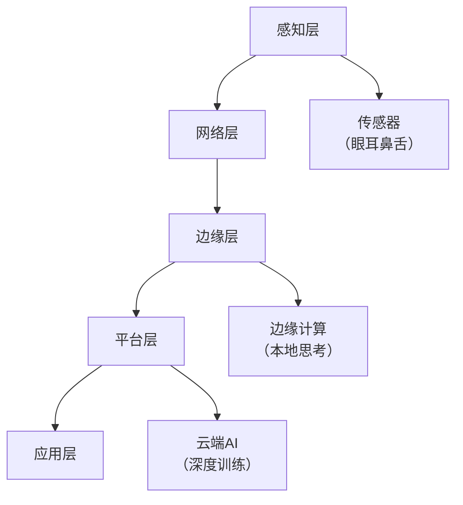
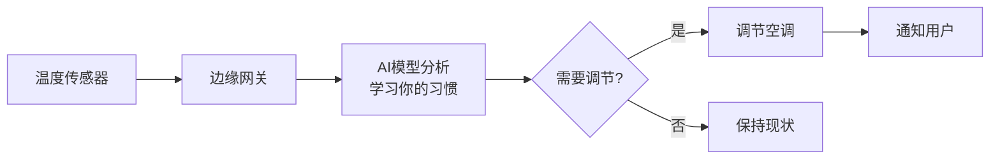
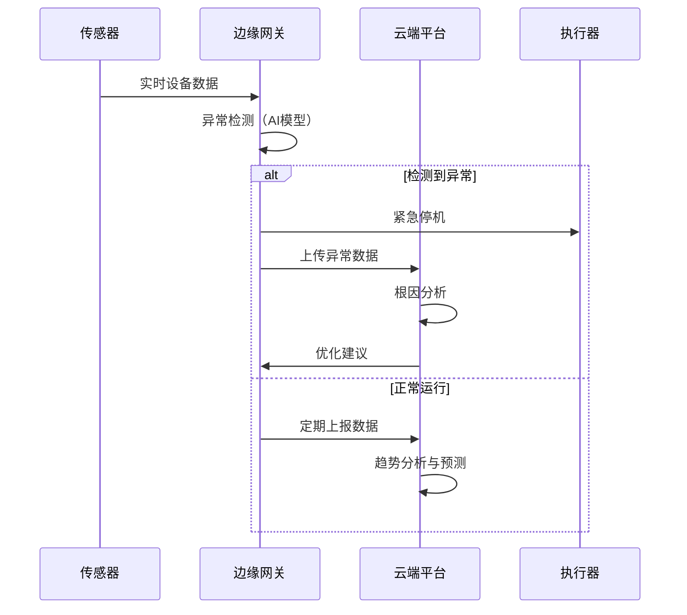
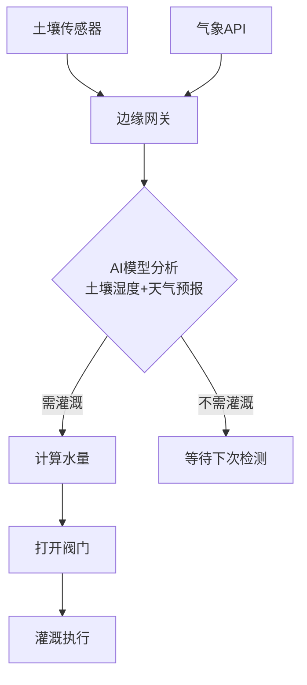
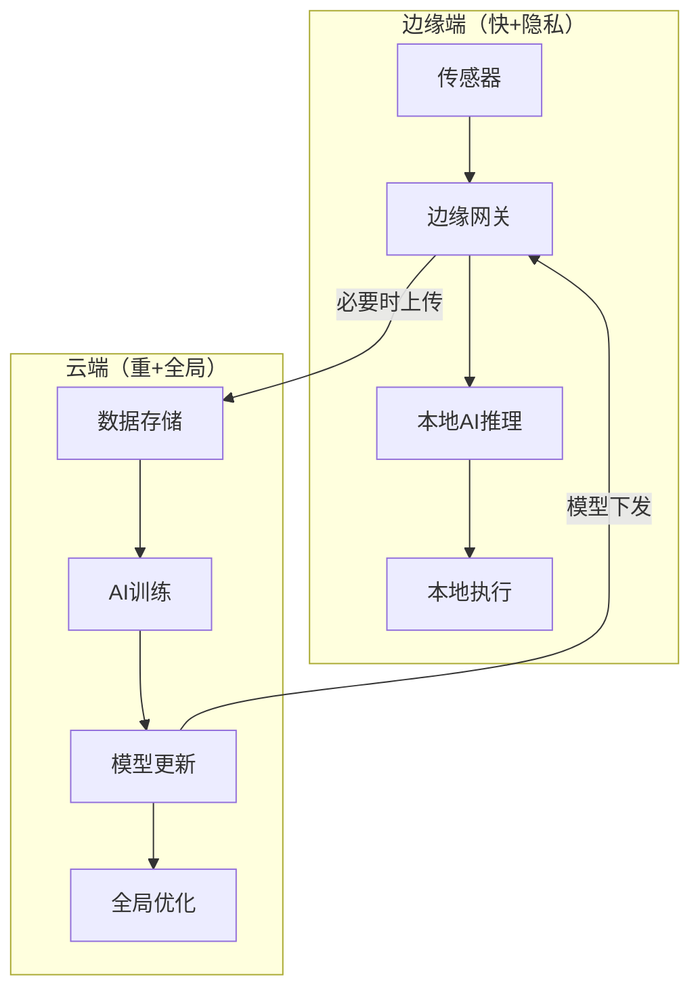

# AIoT：人工智能与物联网融合

> AIoT 是人工智能与物联网的深度融合，让设备不仅能感知和连接，还能思考和决策。它解决了“物联网设备产生海量数据但光有数据没用”的问题——要从数据中提炼出决策。本文讲清楚 AIoT 的架构层次、关键技术和典型应用场景。

**关键词**：AIoT、边缘计算、智能决策、感知、物联网、云协同

## 抽象类比

普通 IoT 像温度计，只告诉你“现在 30 度”。AIoT 像有经验的管家：它知道你怕热、知道下午太阳会晒进来，于是提前把空调调好。

AIoT 的关键不是把 AI 和 IoT 两个词放一起，而是让设备从“上报数据”升级为“产生判断”。

## 什么是AIoT？

想象一下，你拥有一个智能家园：
- **传统物联网**：家里的传感器只能简单地上报温度、湿度数据，需要你手动查看和处理
- **AIoT**：传感器不仅能感知环境，还能自动分析数据——温度过高时，智能空调自动开启；检测到异常声音时，摄像头自动录像并通知你

**简单说**：AIoT（Artificial Intelligence of Things）是**人工智能（AI）与物联网（IoT）的深度融合**，让物联网设备不仅能"感知"和"连接"，还能"思考"和"决策"。

---

## AIoT的设计哲学

传统物联网的三个段位：

| 段位 | 能力 | 例子 |
| :--- | :--- | :--- |
| **青铜** | 采集数据 | 温度传感器上报"当前28度" |
| **白银** | 按规则联动 | "温度>26度 → 开空调" |
| **黄金（AIoT）** | 智能决策 | "根据你的习惯、天气、时间，自动调节到最舒适的温度" |

**AIoT 要解决的问题**：物联网设备产生了海量数据，但光有数据没用，关键是要从数据中**提炼出决策**。就像你有十万本书但从来不看——AIoT 就是给每本书配了个"读后总结"。

---

## AIoT vs 传统IoT

| 特性 | 传统IoT | AIoT |
| :--- | :--- | :--- |
| **数据处理** | 简单采集和传输 | 边缘智能分析 + 云端深度学习 |
| **决策方式** | 预设规则触发（"如果…就…"） | 智能模型自主决策 |
| **响应速度** | 依赖云端延迟 | 边缘实时响应 |
| **个性化** | 统一模式 | 自适应用户习惯 |
| **学习能力** | 固定逻辑 | 持续学习优化 |

**类比**：
- **传统IoT** 像一个**听话的仆人**——你说"开灯"，它开灯。但你不说，它什么都不做。
- **AIoT** 像一个**聪明的管家**——它观察你的习惯，你还没开口，它已经把灯调到最舒适的亮度。

---

## AIoT架构层次

| 层次 | 功能 | 类比 |
| :--- | :--- | :--- |
| **感知层** | 数据采集与控制 | 人的五官——看、听、闻 |
| **网络层** | 数据传输 | 人的神经系统——传递信号 |
| **边缘层** | 本地智能处理 | 人的条件反射——快速反应 |
| **平台层** | AI训练与全局管理 | 人的大脑皮层——深度思考 |
| **应用层** | 智能应用服务 | 人的行为——实际做事 |

---

## AIoT关键技术

### 1. 边缘计算
- **原理**：将计算任务从云端下沉到设备端或边缘节点
- **优势**：低延迟、省带宽、隐私保护
- **类比**：就像便利店（边缘）解决日常购物，大超市（云端）解决批量采购

### 2. 轻量化AI模型
- **原理**：将大型AI模型压缩，使其能在资源受限的设备上运行
- **类比**：就像把一本百科全书缩编成一本口袋书

### 3. 联邦学习
- **原理**：在不共享原始数据的情况下进行分布式模型训练
- **类比**：就像多个厨师各自在自己的厨房改进同一道菜谱，只分享"改进心得"，不分享"独家秘方"

### 4. 数字孪生
- **原理**：构建物理设备的虚拟副本，实现模拟和预测
- **类比**：就像给真实工厂建一个一模一样的虚拟工厂，先在虚拟世界里试错

---

## AIoT典型应用场景

### 1. 智能家居

**场景**：智能温控系统

**核心能力**：
- 学习用户习惯模式——"你一般晚上10点把空调调到26度"
- 预测最佳温度设置——"今天降温了，提前把暖气打开"
- 异常情况实时通知——"家里温度异常升高，可能着火了！"

### 2. 智慧工厂

### 3. 智慧城市

| 应用领域 | 功能描述 |
| :--- | :--- |
| **智能交通** | 交通流量预测、信号灯智能调度 |
| **智慧安防** | 异常行为检测、人脸识别 |
| **智慧能源** | 能耗监测、智能电网调度 |
| **智慧医疗** | 远程健康监测、疾病预测 |

### 4. 智能农业

**场景**：智能灌溉系统

**核心能力**：
- 实时监测土壤湿度——知道什么时候"渴了"
- 结合天气预报预测需水量——"明天要下雨，今天少浇点"
- 智能调度灌溉时机和水量——不多不少刚刚好

---

## 边缘-云协同架构

| 做什么 | 在哪做 | 为什么 |
| :--- | :--- | :--- |
| **实时推理** | 边缘端 | 低延迟、保护隐私 |
| **模型训练** | 云端 | 需要大量算力和数据 |
| **模型更新** | 云端→边缘 | 云端训练好，下发到设备 |
| **全局分析** | 云端 | 需要汇总所有设备数据 |

---

## AIoT常见挑战

### 1. 设备多样性
- **问题**：不同设备使用不同协议和接口
- **类比**：联合国的翻译要同时处理几百种语言
- **解决**：使用标准化协议（MQTT、CoAP）和边缘网关

### 2. 网络不稳定
- **问题**：物联网设备可能处于网络不稳定环境
- **类比**：在隧道里打电话
- **解决**：边缘计算+本地缓存+断点续传

### 3. 数据隐私安全
- **问题**：大量敏感数据采集和传输
- **类比**：你家每个房间都有摄像头对着外面直播
- **解决**：端到端加密、联邦学习、数据脱敏

### 4. 模型部署困难
- **问题**：边缘设备资源受限，模型部署复杂
- **类比**：想把大象装进冰箱
- **解决**：模型压缩、容器化部署、自动化工具链

### 5. 能耗管理
- **问题**：电池供电设备需要优化能耗
- **类比**：手机开了所有后台应用，半天没电
- **解决**：智能休眠、按需唤醒、低功耗通信

---

## 深入理解（进阶）

> 💡 如果只想了解 AIoT 的概念，读到这里就够了。下面是技术细节。

---

## 总结

### 三句话讲清楚 AIoT

1. AIoT 是人工智能与物联网的融合，让设备不仅能感知和连接，还能思考和决策
2. 传统 IoT 只上报数据，AIoT 能从数据中提炼决策并自动执行
3. 通过边缘计算和云端协同，实现实时响应和持续学习

### 核心类比

> 传统 IoT 像温度计只告诉你"现在 30 度"，AIoT 像有经验的管家——知道你怕热、知道下午太阳会晒进来，提前把空调调好。

### 与比赛项目的关系

网球拾取机器人是 AIoT 的高阶应用：摄像头和机械臂是"物"，YOLO 和 RKNN 是"智能"，StarryOS 是系统底座。项目展示了在边缘设备上把感知、推理、控制连成完整系统的能力。

## 面试速答

### Q: AIoT 和传统 IoT 有什么区别？
A: 传统 IoT 只负责采集和传输数据，决策靠预设规则（"如果温度>26 就开空调"），是"听话的仆人"。AIoT 融合了 AI，能从数据中提炼决策、自适应用户习惯、持续学习优化，是"聪明的管家"。核心区别是：传统 IoT 只"上报数据"，AIoT 能"产生判断"。

### Q: AIoT 的架构分几层？各层的作用是什么？
A: 分五层：感知层（传感器采集数据，像五官）、网络层（传输数据，像神经系统）、边缘层（本地智能处理，像条件反射）、平台层（云端 AI 训练和全局管理，像大脑皮层）、应用层（提供智能服务，像人的行为）。关键设计是边缘层做实时推理、平台层做深度训练，两者协同。

### Q: 为什么 AIoT 需要边缘-云协同？
A: 因为不同任务适合在不同位置处理：实时推理在边缘端（低延迟、保护隐私），模型训练在云端（需要大量算力和数据），模型更新从云端下发到边缘，全局分析在云端汇总。这种分工让系统既快又强——边缘负责"快和隐私"，云端负责"重和全局"。

### Q: 什么是联邦学习？为什么在 AIoT 中有用？
A: 联邦学习是**在不共享原始数据的情况下进行分布式模型训练**——各设备在本地训练，只上传模型参数更新，不上传原始数据。在 AIoT 中有用是因为很多设备数据涉及隐私（家庭摄像头、健康数据），不能上传云端。联邦学习让设备"学到经验"但"不泄露秘密"，类比多个厨师各自改进菜谱，只分享心得不分享秘方。

### Q: AIoT 部署面临的最大挑战是什么？
A: 最大挑战是**在资源受限的边缘设备上部署 AI 模型**。边缘设备算力小、内存少、功耗敏感，但 AI 模型通常又大又重。解决方案包括：模型压缩（轻量化）、模型量化（降低精度换算力）、容器化部署、自动化工具链。此外，设备多样性、网络不稳定、数据隐私和能耗管理也是重要挑战。