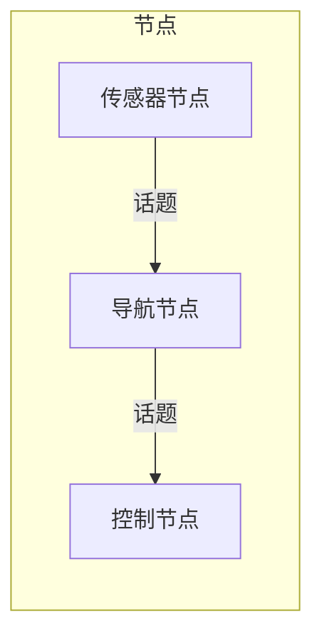
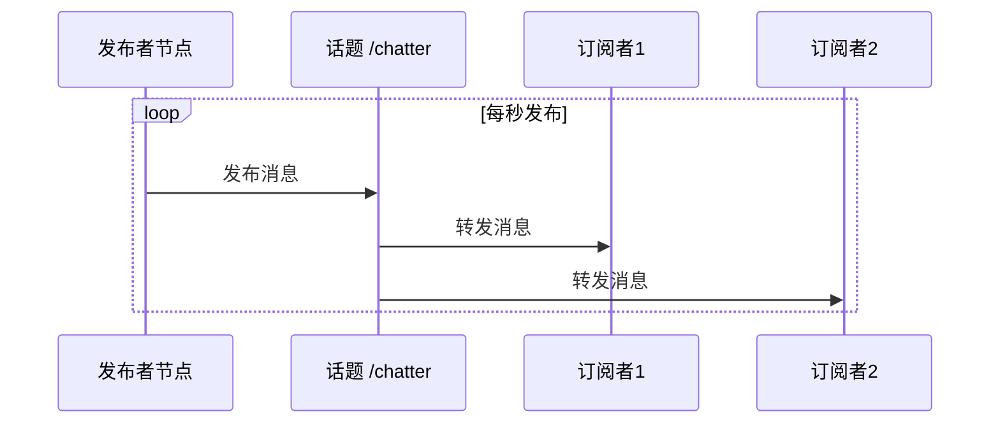
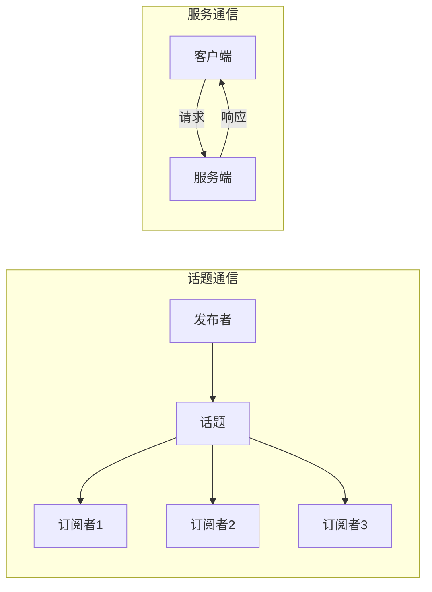
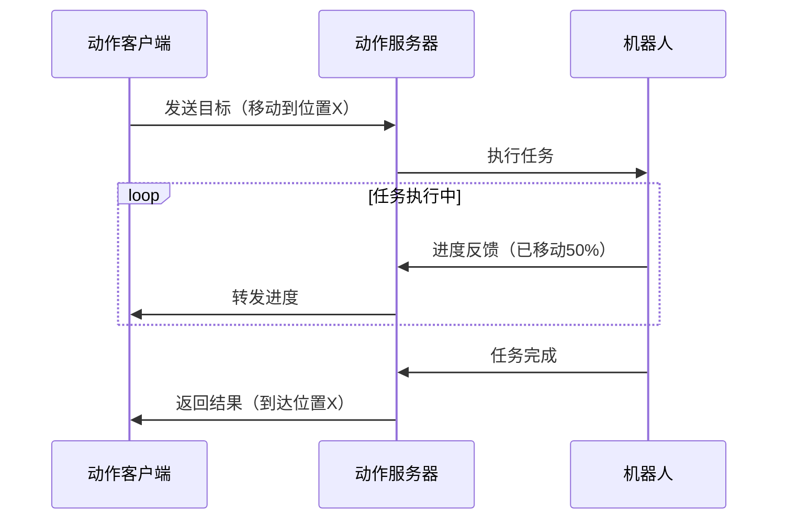
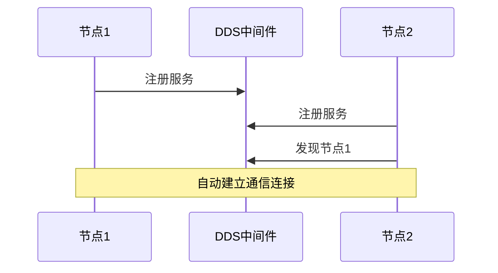

# ROS2：机器人操作系统

> ROS2 不是传统意义上的操作系统，而是一套机器人软件协作框架，帮传感器、算法、控制器等模块互相通信。它解决了机器人开发中模块化、通信和复用三大难题。本文讲清楚 ROS2 的核心概念、三种通信方式和工具链。

**关键词**：ROS2、节点、Topic、Service、Action、机器人框架

## 抽象类比

一个机器人团队里有很多“岗位”：摄像头负责看，识别算法负责判断，路径规划负责想路线，电机控制负责行动。ROS2 像团队的对讲系统和协作规范，让大家知道该听谁、该向谁汇报。

ROS2 的核心不是“写一大坨程序”，而是**把机器人拆成可协作的小模块**。

## 什么是ROS2？

想象一下，你要建一个机器人团队来完成复杂任务：
- **传统方式**：每个机器人各自为政，自己处理所有事情，团队协作困难
- **ROS2方式**：给每个机器人分配专门的角色（传感器采集员、路径规划师、动作执行者），它们通过对讲机（话题）高效沟通，形成一个有机整体

**简单说**：ROS2（Robot Operating System 2）是一个**用于构建机器人应用的灵活框架**，它提供了进程间通信、工具链和生态系统，让机器人开发变得像搭积木一样简单。

> 注意：虽然名字叫"操作系统"，但ROS2实际上是一个**中间件框架**，运行在 Linux/Windows 等真正的操作系统之上。

---

## ROS2 的设计哲学

机器人开发有三个核心难题：
1. **模块化**：一个机器人有摄像头、雷达、电机、导航……怎么让它们独立开发还能协作？
2. **通信**：各模块之间怎么高效地传递数据？
3. **复用**：一个团队写的导航算法，另一个团队的机器人能不能直接拿来用？

ROS2 的答案：**把机器人拆成一群独立的小程序（节点），它们通过标准化的"话题"来通信**。

**类比**：就像一个公司的不同部门——市场部、研发部、财务部各司其职，通过邮件系统（话题）交流，一个部门换了人（升级节点），其他部门不受影响。

---

## 核心概念

### 1. 节点（Node）：机器人团队中的成员

**类比**：就像一个公司里的不同部门，每个部门负责特定任务。

- **传感器节点**：负责读取摄像头、激光雷达数据
- **导航节点**：负责路径规划和避障
- **控制节点**：负责控制电机运动
- **决策节点**：负责高级决策逻辑

**特点**：
- 节点之间相互独立，一个节点崩溃不影响其他节点
- 通过话题、服务等方式通信
- 可动态启动和停止

---

### 2. 话题（Topic）：团队的广播频道

**类比**：就像公司里的公共广播系统，任何人都可以收听，也可以发布消息。

**工作方式**：
- **发布者（Publisher）**：向话题发送消息
- **订阅者（Subscriber）**：监听话题并接收消息

**特点**：
- **一对多通信**：一个发布者可以被多个订阅者接收
- **异步通信**：发布者不等待订阅者确认
- **松耦合**：发布者和订阅者不需要知道彼此的存在——就像广播电台不需要知道谁在收听

---

### 3. 服务（Service）：团队的客服热线

**类比**：就像打客服电话，你提出请求，对方处理后给出响应。

| 特性 | 话题（Topic） | 服务（Service） |
| :--- | :--- | :--- |
| 通信模式 | 单向广播 | 请求-响应 |
| 同步性 | 异步 | 同步（阻塞等待） |
| 适用场景 | 持续数据流（如传感器数据） | 一次性查询/命令（如"拍一张照片"） |
| 通信频率 | 高频率、周期性 | 低频率、按需 |

---

### 4. 动作（Action）：团队的长期任务协作

**类比**：就像给团队成员分配一个需要时间完成的任务，他会告诉你进展，完成后给你结果。

**工作方式**：
- **目标（Goal）**：客户端发送任务目标
- **反馈（Feedback）**：服务端定期发送任务进度
- **结果（Result）**：任务完成后返回最终结果
- **取消（Cancel）**：客户端可以取消正在执行的任务

**适用场景**：
- 移动机器人导航到目标位置（"去那个点"，途中汇报"走了30%"）
- 机械臂执行抓取动作

---

### 5. 三种通信方式对比

| 特性 | 话题 Topic | 服务 Service | 动作 Action |
| :--- | :--- | :--- | :--- |
| **通信模式** | 发布-订阅（广播） | 请求-响应（打电话） | 目标-反馈-结果（长期任务） |
| **频率** | 高频持续 | 低频按需 | 中频 |
| **方向** | 单向 | 双向（一问一答） | 双向（带进度反馈） |
| **典型场景** | 摄像头实时画面 | 查询电池电量 | 导航到目标点 |
| **类比** | 广播电台 | 客服电话 | 装修监理汇报进度 |

---

### 6. 服务发现（Discovery）：团队的通讯录

**类比**：就像公司的内部通讯录，自动发现新加入的成员。

ROS2使用**DDS（Data Distribution Service）**实现服务发现——节点启动时自动注册到系统，其他节点可以发现并通信。**去中心化**：不需要一个"总控制器"，所有节点平等地互相发现。

---

## ROS2与ROS1对比

| 特性 | ROS1 | ROS2 |
| :--- | :--- | :--- |
| **中间件** | ROS自定义协议 | DDS标准协议 |
| **实时性** | 软实时 | 支持硬实时 |
| **多机器人** | 复杂 | 原生支持 |
| **跨平台** | 主要Linux | Linux、Windows、macOS |
| **服务发现** | 主从架构（需要一个Master） | 分布式发现（去中心化） |
| **网络安全** | 基本无 | 支持加密和认证 |

**一句话总结升级原因**：ROS1 是实验室里诞生的，ROS2 是为真实产品和工业环境重新设计的。

---

## ROS2工具链

| 工具 | 功能 | 类比 |
| :--- | :--- | :--- |
| **RViz** | 3D可视化 | 看机器人"眼中的世界" |
| **Gazebo** | 物理仿真环境 | 虚拟的"试车场" |
| **rqt** | 图形化工具集合 | 仪表盘 |
| **rosbag** | 数据记录与回放 | 行车记录仪 |

**设计思想**：ROS2 不只给你通信框架，还给你一整套"看"和"测"机器人的工具——就像买车不光给你发动机，还给你仪表盘。

---

## ROS2常见误区

### 1. 忽略QoS设置
- **问题**：默认通信质量策略可能不适合实时场景
- **类比**：默认寄普通快递，但你是要寄"当日达"的
- **解决**：根据需求配置可靠性、持久性等策略

### 2. 话题命名冲突
- **问题**：多个节点使用相同话题名导致数据混乱
- **类比**：两个部门用了同一个广播频道
- **解决**：使用命名空间隔离

### 3. 阻塞式调用影响实时性
- **问题**：在回调函数中执行耗时操作
- **类比**：接电话的人处理每个来电都要查半小时资料
- **解决**：将耗时操作放到单独的线程

### 4. 未考虑网络延迟
- **问题**：分布式系统中数据传输延迟影响控制性能
- **类比**：远程操控机器人，指令传到一半卡了
- **解决**：使用合适的QoS、优化网络配置

---

## 深入理解（进阶）

> 💡 如果只想了解 ROS2 的概念，读到这里就够了。下面是技术细节。

---

## 总结

### 三句话讲清楚 ROS2

1. ROS2 是机器人软件协作框架，让传感器、算法、控制器等模块通过消息通信协同工作
2. 它提供三种通信方式：Topic（广播）、Service（请求-响应）、Action（长时间任务）
3. ROS2 不是真正的操作系统，而是运行在 Linux 等 OS 之上的中间件框架

### 核心类比

> ROS2 像团队的对讲系统和协作规范——摄像头负责看，识别算法负责判断，路径规划负责想路线，电机控制负责行动，ROS2 让大家知道该听谁、该向谁汇报。

---

## 面试速答

### Q: ROS2 是操作系统吗？它和 Linux 什么关系？

A: 不是。虽然名字里有"OS"，但 ROS2 实际上是一个机器人软件协作框架（中间件），运行在 Linux/Windows 等真正的操作系统之上。它提供的是进程间通信、工具链和生态系统，让传感器、算法、控制器等模块能协同工作，而不是管理硬件资源。

### Q: Topic、Service、Action 三种通信方式分别适合什么场景？

A: Topic 是单向广播，适合持续数据流（如摄像头画面、雷达数据）；Service 是请求-响应，适合一次性查询或命令（如"拍一张照片""查电池电量"）；Action 是带进度反馈的长期任务，适合需要中途汇报的任务（如"导航到目标点"，途中报告"走了30%"）。

### Q: ROS2 相比 ROS1 的核心改进是什么？

A: 最核心的是从主从架构（需要 Master）变成基于 DDS 的分布式去中心化架构，节点能自动发现彼此。此外还支持硬实时、多机器人协作、跨平台（Linux/Windows/macOS）和网络安全加密。一句话：ROS1 是实验室产物，ROS2 是为真实产品重新设计的。

### Q: 什么是服务发现？为什么 ROS2 不需要 Master？

A: 服务发现是节点启动时自动注册、互相发现并建立连接的机制。ROS2 用 DDS 标准协议实现，所有节点平等地互相发现，不需要一个"总控制器"。好处是单点故障消失了——任何一个节点挂掉，其他节点仍能通信。

### Q: ROS2 为什么要用"节点"把机器人拆成很多小模块？

A: 三个原因：一是模块独立开发，一个节点崩溃不影响其他节点；二是可复用，导航算法节点可以拿到另一个机器人上直接用；三是松耦合，通过 Topic 通信的节点不需要知道彼此存在，升级替换都不影响其他模块。这是机器人复杂度的必然要求。

---

## 系统实践与验收

- **最小系统**：建立 publisher/subscriber、service/action 和 launch 的最小机器人包。
- **验收方法**：用 rosbag 复现数据，检查 QoS、时间戳、坐标系、延迟和节点故障恢复。
- **边界与风险**：消息能收到不代表语义正确；TF、时钟、QoS 不匹配和阻塞回调常造成隐蔽故障。

实践记录应包含版本、连接或部署拓扑、关键配置、原始现象、测量方法和恢复步骤，使别人能够在不同环境中复现并判断差异。
