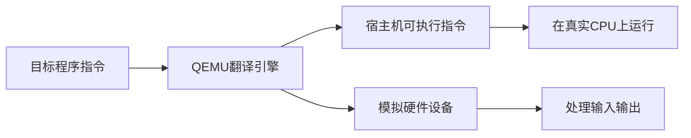

# QEMU：软件里的虚拟电脑

> QEMU 可以理解成"电脑里的假开发板"。它不能完全替代真硬件，但能让你在没有板子、或者不方便反复烧录时，先把系统启动和基本逻辑跑起来。本文讲解 QEMU 的工作原理、使用模式以及在嵌入式开发中的应用。

**关键词**：虚拟化、模拟器、系统模式、动态翻译、嵌入式

## 抽象类比

QEMU 像驾校里的模拟驾驶舱。你可以练换挡、看仪表、熟悉路线，不用真的开上马路。它能帮你提前发现很多问题，但轮胎抓地、刹车手感、真实路况，最终还得上真车验证。

放到嵌入式里：

- QEMU 适合验证启动流程、内核逻辑、脚本自动化。
- 真板子适合验证 NPU、摄像头、电机、功耗、真实时序。

## 什么是QEMU？

**一句话定义**：QEMU是一个**通用的、开源的机器仿真器**，能模拟包括处理器、内存和其他硬件组件在内的完整计算机系统，让你在一台电脑上运行为其他架构编译的操作系统和程序。

**简单来说**：QEMU 可以"骗过"你编写的操作系统或软件，让它以为自己正运行在真实的硬件上，实际上它是在一个由软件模拟出来的虚拟环境中运行。

**生动比喻**：QEMU就像一个**魔法盒子**——你把一个为手机设计的程序放进去，它会模拟出一部虚拟的手机，让程序以为自己真的在手机上运行。

---

## QEMU 工作模式

| 模式 | 功能 | 就像…… |
| :--- | :--- | :--- |
| **用户模式模拟**（User Mode） | 在一个架构的 CPU 上运行为另一种架构编译的**单个程序**。 | 在 Windows 电脑上通过翻译软件运行一个外文程序 |
| **系统模式模拟**（System Mode） | 模拟**一整套完整的计算机系统**，包括 CPU、内存、硬盘、网卡、显卡等，可运行一个完整的操作系统。 | 在你自己电脑里建了一个虚拟房间，里面有一台完整的独立电脑 |

**类比**：
- **用户模式**就像**在你的电脑上安装一个翻译软件**，让你能看懂外文文章（单个程序）
- **系统模式**就像**在你的电脑里建了一个虚拟房间**，房间里有独立的电脑、显示器、键盘，你可以在里面运行另一个完整的操作系统

---

## QEMU 如何工作

QEMU的核心原理是**动态代码翻译**：它把目标（Guest）CPU的指令，实时翻译成宿主机（Host）CPU能够执行的指令，并在虚拟的硬件环境中完成输入输出。

**生动比喻**：QEMU就像一个**超级翻译官**——一边听着外国CPU说的话（目标指令），一边翻译成宿主机CPU能听懂的话（宿主机指令），同时还模拟出各种虚拟硬件，让程序感觉就像在真实的机器上运行。

---

## QEMU 在嵌入式开发中的应用

对嵌入式开发，QEMU 的价值在于 **"软件先于硬件"** 的模式：

### 1. 加速开发流程
- **硬件就绪前开发**：开发者可在硬件就绪前，使用 QEMU 搭建虚拟开发板，提前开始编写和测试代码
- **类比**：就像在盖房子之前，先用电脑设计好图纸并进行虚拟装修，等房子建好就可以直接入住

### 2. 降低入门成本
- **无需昂贵硬件**：初学者无需购买昂贵的开发板，即可学习操作系统内核、驱动开发等知识
- **类比**：就像不用买真飞机就能学习开飞机的模拟器

### 3. 简化调试过程
- QEMU 支持 GDB 调试，允许设置断点、查看内存和寄存器
- 在模拟环境中调试比在物理硬件上调试容易得多
- **类比**：就像在游戏中使用"上帝模式"，可以随时暂停、查看状态、修改数据

### 4. 持续集成（CI）
- QEMU 可无缝集成到 CI 流程中，每次代码提交后自动运行测试
- **类比**：就像工厂里的自动质检线，每一件产品都要经过严格检查

---

## QEMU 的核心功能

### 1. 全系统模拟
- 模拟完整的计算机系统，包括 CPU、内存、存储、外设等
- 支持多种架构：x86、ARM、MIPS、PowerPC 等

### 2. 设备模拟
- 模拟各种硬件设备：串口、网卡、磁盘、显示器等
- 支持自定义设备模型

### 3. 虚拟化加速
- 配合 KVM（Kernel-based Virtual Machine）实现硬件加速
- 接近原生性能的虚拟化体验

### 4. 快照功能
- 保存和恢复虚拟机状态
- 就像玩游戏时的"存档/读档"，方便测试和调试

### 5. 网络模拟
- 模拟网络环境，支持桥接、NAT、虚拟局域网等多种网络模式

---

## 设计哲学

QEMU 的设计不是追求"最快的虚拟化"，而是为了解决一个根本问题：**如何让一套软件，模拟出尽可能多种类的硬件环境**。

### 核心问题：硬件的"不可获得性"

开发和测试中经常遇到硬件障碍：
- 目标硬件还没造出来（芯片流片前要开发软件）
- 硬件太贵买不起（开发板、特殊架构服务器）
- 硬件不方便反复烧录（嵌入式每次刷机很慢）
- 需要测试多种架构但只有一台机器

QEMU 的答案：**用软件模拟一切**。放弃性能极致，换取"任何架构都能跑"的通用性。

### 关键设计取舍

| 取舍点 | QEMU 的选择 | 放弃了什么 |
| :--- | :--- | :--- |
| **通用 vs 性能** | 模拟尽可能多的架构 | 放弃了原生性能（纯模拟有翻译开销） |
| **完整 vs 轻量** | 模拟完整硬件系统（CPU+外设） | 放弃了容器的轻量级 |
| **灵活 vs 简单** | 配置项极多，可精细控制 | 放弃了"开箱即用"的简单 |
| **模拟 vs 虚拟化** | 默认纯软件模拟（可配 KVM 加速） | 放弃了"必须用相同架构"的限制 |

### 类比说明

把 QEMU 想象成**驾校的模拟驾驶舱**：
- 它能模拟各种车型（轿车、卡车、巴士）——通用性
- 它不能完全还原真实路感（轮胎抓地、刹车手感）——放弃真实性
- 但它能让你在没有真车时先练起来——解决"硬件不可获得"
- 真正上路前，模拟舱能帮你发现大部分操作问题——提前验证

QEMU 和 KVM 的关系也值得理解：QEMU 负责模拟硬件，KVM 负责加速执行。两者搭配时，QEMU 是"车身"，KVM 是"发动机"——车身决定能模拟什么，发动机决定跑多快。

这套设计的本质是：**不追求跑得最快，而追求能跑在任何地方、模拟任何东西**。

---

## QEMU 与其他虚拟化工具的对比

| 工具 | 类型 | 特点 | 类比 |
| :--- | :--- | :--- | :--- |
| **QEMU** | 全系统模拟器 | 支持多种架构，可模拟完整硬件 | 就像一个**万能工匠**，能造出各种类型的虚拟机器 |
| **VMware/VirtualBox** | 虚拟机 | 性能好，支持图形界面 | 就像一个**豪华酒店**，提供舒适的虚拟环境 |
| **KVM** | 虚拟化加速 | 基于内核的虚拟化，性能接近原生 | 就像一个**超级加速器**，让虚拟化跑得更快 |
| **Docker** | 容器 | 轻量级，共享内核 | 就像一个**集装箱**，把应用打包好方便运输 |

---

## QEMU 的优缺点

### 优点
✅ **跨平台支持**：支持多种 CPU 架构，从 x86 到 ARM、MIPS 等
✅ **全系统模拟**：可以模拟完整的计算机系统，包括各种外设
✅ **调试友好**：支持 GDB 调试，方便开发和调试
✅ **开源免费**：完全开源，免费使用
✅ **灵活配置**：可以根据需求配置各种硬件参数

### 缺点
❌ **性能开销**：全系统模拟性能不如原生或硬件加速虚拟化
❌ **内存占用**：模拟整个系统需要较多内存
❌ **学习曲线**：配置选项较多，需要一定时间学习

---

## QEMU 的应用场景

### 1. 嵌入式系统开发
- 模拟开发板，提前进行软件测试
- 学习操作系统内核开发
- 驱动程序测试

### 2. 操作系统研究
- 研究不同架构的操作系统
- 测试操作系统移植
- 安全研究和漏洞分析

### 3. 教学和培训
- 教授计算机体系结构
- 操作系统原理教学
- 嵌入式系统入门学习

### 4. 持续集成和测试
- 自动化测试嵌入式系统
- 代码质量保障
- 回归测试

---

## 和当前比赛项目的关系

你的 StarryOS RK3588 项目里，QEMU 是前期验证的关键工具：

- 没有真实硬件时，先验证 aarch64 启动链路。
- 每次修改内核后，用 QEMU 做冒烟测试。
- BootSupervisor 可以自动检查 QEMU 输出、启动阶段、shell 是否可用。

但答辩时要讲清楚边界：**QEMU 能证明系统逻辑和启动流程较可靠，不能证明真实 NPU 推理性能和机器人运动效果。**

## 总结

QEMU 是一个功能强大的机器仿真器，它就像一个**魔法盒子**，能模拟各种硬件架构和完整的计算机系统。

**设计哲学**：QEMU 不追求最快的速度，而是追求最灵活的兼容性——它选择"模拟一切"而不是"加速运行"，这让它成为跨架构开发的首选。

在嵌入式开发中，QEMU 的价值在于实现了"软件先于硬件"的开发模式，让开发者可以在没有物理硬件的情况下进行开发和测试，大大降低了入门成本，加速了开发流程。

> **最后一句话**：QEMU 不是最快的虚拟化工具，但它是最灵活、最全面的仿真器，是嵌入式开发者的必备工具！

---

## 面试速答

### Q: QEMU 是什么？它的核心原理是什么？

A: QEMU 是一个通用的开源机器仿真器，能模拟 CPU、内存和各种硬件设备，让你在一台电脑上运行为其他架构编译的操作系统和程序。核心原理是**动态代码翻译**——把目标 CPU 的指令实时翻译成宿主机 CPU 能执行的指令，同时模拟出虚拟硬件环境。

### Q: QEMU 和 VMware/Docker 有什么区别？

A: QEMU 是全系统模拟器，能模拟不同架构（如 x86 上跑 ARM），但性能有翻译开销；VMware 是同架构虚拟机，性能好但只能虚拟化相同架构；Docker 是容器，共享宿主内核，最轻量但不是模拟硬件。一句话：QEMU 胜在跨架构通用性，Docker 胜在轻量，VMware 胜在性能和体验。

### Q: QEMU 和 KVM 是什么关系？

A: QEMU 负责模拟硬件（设备模型），KVM 负责加速 CPU 指令执行（基于硬件虚拟化）。单独用 QEMU 是纯软件模拟，慢但通用；QEMU + KVM 配合时，能接近原生性能，但要求宿主和目标架构相同。类比：QEMU 是车身，KVM 是发动机。

### Q: 用户模式和系统模式有什么区别？

A: 用户模式只模拟单个程序的运行，在一种架构的 CPU 上运行为另一种架构编译的单个程序（如 x86 上跑 ARM 的命令行工具）；系统模式模拟一整套完整计算机（CPU+内存+硬盘+网卡），可以运行一个完整的操作系统。前者轻量适合跑单个程序，后者完整适合开发调试整个系统。

### Q: 嵌入式开发为什么特别爱用 QEMU？
A: 因为嵌入式开发常面临"硬件还没到位"或"反复烧录太慢"的问题。QEMU 实现了"软件先于硬件"的开发模式——硬件就绪前就能用虚拟开发板验证启动流程、内核逻辑、脚本自动化，还能用 GDB 方便调试。但它不能替代真硬件验证 NPU 推理、真实时序、功耗等物理特性。

---

## 可执行实践闭环

1. **练习任务**：启动最小 Linux 镜像并配置串口、磁盘和端口转发。
2. **完成标准**：明确 system/ user mode、机器型号、固件、设备模型与加速方式。
3. **排错顺序**：保留完整命令行；从串口日志、镜像格式、设备参数和权限逐项缩小。
4. **沉淀结果**：保留最小示例、关键命令、失败现象与解决依据；过一周不看原文重新完成一次。
