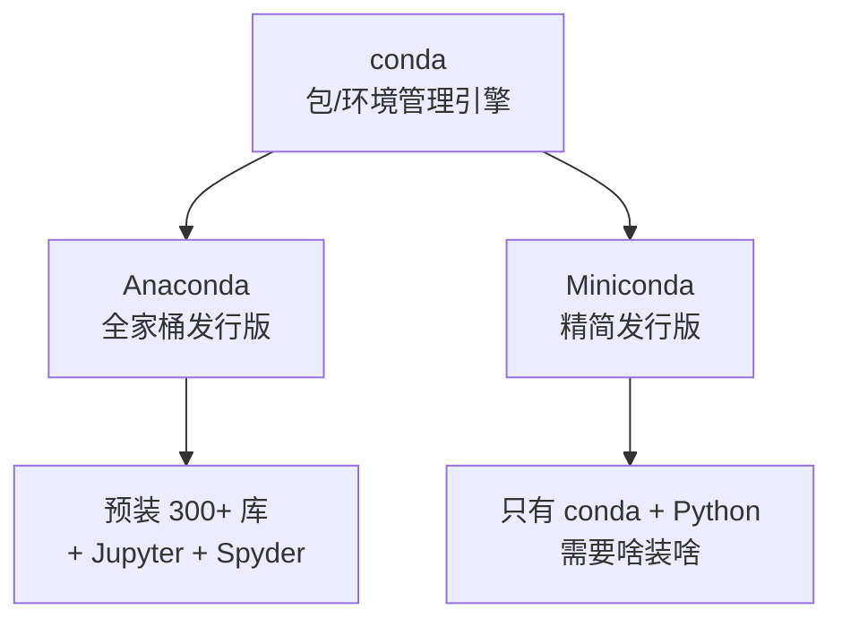

# conda

> conda 是 Python 数据科学的包与环境管理引擎，Anaconda 和 Miniconda 是基于它的两种发行版。本文讲清 conda 用法、Anaconda/Miniconda/Spyder/Jupyter 的关系与区别。

**关键词**：conda、Anaconda、Miniconda、Jupyter、Spyder、包管理、虚拟环境

## 抽象类比

conda 像一个装备齐全的厨房总管——不仅有灶台（Python），还能管各种调料（库）和收纳柜（环境），开箱即用。

如果说 pip 是"去超市买菜自己配"，conda 就是"直接买了一套精装厨房"——灶台、锅碗、常用调料全配好，连水电煤（系统依赖）都接好了。

---

## 一、conda 是什么

conda 是一个**包管理器 + 环境管理器**，最初为 Python 数据科学而生，但能管理任意语言的软件（包括 R、C 库、CUDA 等系统级组件）。

它解决了一个核心痛点：很多 Python 库不只依赖 Python 包，还依赖系统级组件（如 CUDA、C/Fortran 库）。pip 只管 Python 包，管不了这些；conda 连系统依赖一起管理。

**conda 不是"更好的 pip"，而是"Python 开发的一站式解决方案"。**

---

## 二、Anaconda vs Miniconda vs conda

三者经常被混用，其实是不同层次的东西：



| 名称 | 是什么 | 大小 | 推荐使用者 |
| :--- | :--- | :--- | :--- |
| **conda** | 包与环境管理引擎（核心） | — | 所有场景的底层工具 |
| **Anaconda** | 基于 conda 的全家桶发行版 | 约 3GB | 新手，开箱即用 |
| **Miniconda** | 基于 conda 的精简发行版 | 约 50MB | 有经验者，干净轻量 |

- **conda** 是引擎，本身不单独发布，随 Anaconda/Miniconda 一起安装
- **Anaconda** = conda + 几百个预装库 + Jupyter + Spyder，装完就能做数据科学
- **Miniconda** = conda + 一个 Python，需要什么自己装

**新手推荐 Miniconda**——干净、轻量、不臃肿。装完 Miniconda 后，用 `conda install` 按需补库即可。

### 常见误解

- **"Anaconda 太臃肿"**：确实，全家桶 3GB。不想臃肿用 Miniconda（50MB）
- **"conda 和 pip 冲突"**：可以共存，但建议在一个环境里只用一种，避免混乱
- **"Anaconda 收费"**：Anaconda 个人版免费，企业版 2024 年起收费。企业用 Miniconda 或 conda-forge 频道规避授权问题

---

## 三、安装

- **Anaconda**：[anaconda.com/download](https://www.anaconda.com/download)
- **Miniconda**：[docs.conda.io/en/latest/miniconda](https://docs.conda.io/en/latest/miniconda.html)
- 安装时建议勾选"Add to PATH"（Windows）

```bash
conda --version                 # 验证安装
```

---

## 四、环境管理

conda 自带虚拟环境管理，不用单独用 venv。

```bash
conda create -n myenv           # 创建环境（默认最新 Python）
conda create -n myenv python=3.10  # 指定 Python 版本
conda activate myenv            # 激活环境
conda deactivate                # 退出环境
conda env list                  # 查看所有环境
conda env remove -n myenv       # 删除环境
conda env export > env.yml      # 导出环境配置
conda env create -f env.yml     # 根据配置文件还原环境
```

环境隔离的好处：项目 A 用 Python 3.10 + NumPy 1.24，项目 B 用 Python 3.12 + NumPy 2.0，互不干扰。分享环境用 `env export`，别人一条命令还原。

---

## 五、包管理

```bash
conda install numpy             # 安装包
conda install numpy=1.24        # 指定版本
conda install -c conda-forge pandas  # 从指定频道安装
conda remove numpy              # 卸载包
conda update numpy              # 更新包
conda update --all              # 更新所有包
conda list                      # 查看已安装的包
conda search flask              # 搜索可用版本
```

---

## 六、conda vs pip

| 维度 | conda | pip |
| :--- | :--- | :--- |
| **管理范围** | Python 包 + 系统库 | 只管理 Python 包 |
| **虚拟环境** | 自带环境管理 | 需要 venv |
| **非 Python 依赖** | 支持（CUDA、C 库等） | 不支持 |
| **包数量** | 较少（约 8000+） | 极多（PyPI 40 万+） |
| **版本兼容性** | 优先保证兼容，版本可能较旧 | 最新但可能冲突 |
| **适合场景** | 数据科学、机器学习 | 纯 Python 项目 |

pip 装不上或装上跑不了，经常是系统依赖的问题。conda 连系统依赖一起管理，一条命令装好且版本兼容。

---

## 七、Jupyter Notebook

Jupyter 是交互式编程环境，写代码、看结果、写笔记一体化，数据科学标配。Anaconda 自带，Miniconda 用 `conda install jupyter` 安装。

```bash
jupyter notebook                # 启动（自动打开浏览器）
jupyter notebook --port=8888    # 指定端口
jupyter lab                     # 启动 JupyterLab（升级版界面）
```

### 核心概念

- **单元格（Cell）**：代码和文字的基本单元，可单独运行
- **内核（Kernel）**：运行代码的进程，每个 notebook 绑定一个内核（如 Python 3、R）
- **两种模式**：命令模式（按 Esc，操作单元格）与编辑模式（按 Enter，写代码）

### 适用场景

- 数据探索：边写边看图表，适合数据分析、可视化
- 教学演示：代码 + 文字 + 输出一体化
- 笔记记录：Markdown 写说明，代码块跑结果
- 不适合：大型工程代码、需要部署的生产系统

---

## 八、Spyder

Spyder 是 Anaconda 自带的科学计算 IDE，定位类似 MATLAB/RStudio，面向数据分析师和科研人员。

```bash
spyder                          # 启动 Spyder（Anaconda 自带）
conda install spyder            # Miniconda 安装
```

### 界面组成


- **编辑器**：多标签代码编辑，支持语法高亮、调试
- **变量浏览器**：实时查看所有变量的值、类型、形状，DataFrame 可视化表格
- **IPython 控制台**：交互式执行，可逐行运行代码
- **绘图面板**：图表单独窗口展示，可缩放导出

### Spyder vs Jupyter vs VS Code

| 维度 | Spyder | Jupyter | VS Code |
| :--- | :--- | :--- | :--- |
| **定位** | 科学计算 IDE | 交互笔记本 | 通用编辑器 |
| **变量浏览** | 内置，实时查看 | 需插件 | 需插件 |
| **适合** | 数据分析、科研脚本 | 探索、教学、笔记 | 工程、多文件项目 |
| **调试** | 内置图形调试 | 弱 | 强 |

### 适用场景

- 需要像 MATLAB 一样实时看变量值
- 写中长脚本做数据清洗、建模
- 不需要多文件协作，单文件即可完成分析

---

## 九、频道与 conda-forge

conda 包来自"频道"（channel），默认是 `defaults`（Anaconda 公司维护）。

**conda-forge** 是社区维护的频道，包更多、更新更快，且完全免费：

```bash
conda install -c conda-forge 包名      # 从 conda-forge 安装
conda config --add channels conda-forge  # 设为默认频道
```

为什么要用 conda-forge：
- 包数量比默认频道多、版本更新
- 默认频道企业商用 2024 年起要收费，conda-forge 完全免费
- 社区维护，质量有保障

---

## 十、预装库速查（Anaconda）

| 库 | 用途 |
| :--- | :--- |
| `numpy` | 数值计算 |
| `pandas` | 数据分析 |
| `matplotlib` | 数据可视化 |
| `scikit-learn` | 机器学习 |
| `scipy` | 科学计算 |
| `jupyter` | 交互式笔记本 |
| `spyder` | 科学计算 IDE |

Miniconda 不预装这些，需 `conda install numpy pandas matplotlib ...` 按需安装。

---

## 面试速答

### Q: conda 和 pip 的区别？

A: conda 能管理 Python 包和非 Python 依赖（如 CUDA、C 库），自带虚拟环境管理，适合数据科学。pip 只管 Python 包，需要 venv 做环境隔离。conda 包少但兼容性好，pip 包多但可能冲突。

### Q: Anaconda 和 Miniconda 怎么选？

A: Anaconda 是全家桶（3GB），自带几百个库和 Jupyter、Spyder，适合新手开箱即用。Miniconda 是精简版（50MB），只有 conda 和 Python，需要啥装啥，适合有经验的人。两者底层都是 conda 引擎。推荐 Miniconda，干净不臃肿。

### Q: 为什么数据科学用 conda 不用 pip？

A: 数据科学库（如 NumPy、PyTorch）依赖 C 库、CUDA 等系统组件，pip 装不了这些。conda 连系统依赖一起管理，一条命令装好且版本兼容。pip 装 Python 包可以，但系统依赖要自己搞定。

### Q: conda 创建和分享虚拟环境怎么做？

A: `conda create -n myenv python=3.10` 创建，`conda activate myenv` 激活，`conda deactivate` 退出。分享环境用 `conda env export > env.yml` 导出，别人用 `conda env create -f env.yml` 还原。好处是 conda 自带环境管理，不用单独用 venv。

### Q: conda-forge 是什么？为什么要用它？

A: conda-forge 是社区维护的 conda 包频道，包数量比默认频道多、更新更快。默认频道由 Anaconda 公司维护，企业商用要收费（2024 年起）；conda-forge 完全免费，所以企业用 conda-forge 规避授权问题。用 `conda install -c conda-forge 包名` 指定频道安装。

### Q: Jupyter 和 Spyder 各自适合什么场景？

A: Jupyter 是交互式笔记本，代码、图表、文字一体，适合数据探索、教学、笔记，单文件流式组织。Spyder 是科学计算 IDE，有变量浏览器实时查看变量值、图形调试，适合写中长脚本做数据清洗建模，像 MATLAB 的体验。工程级多文件项目两者都不如 VS Code。