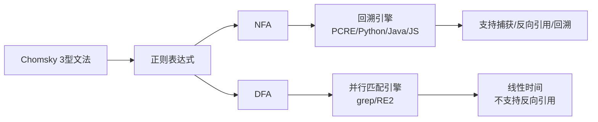
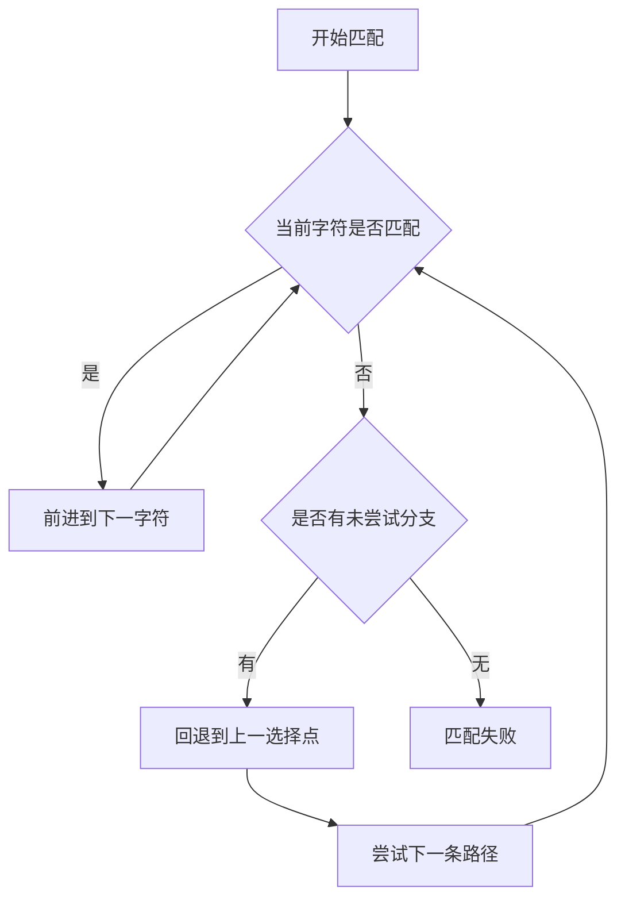

# 正则表达式

> 正则表达式是一种用简洁符号描述字符串模式的小型语言，源于 Chomsky 文法与有限自动机理论，是文本处理、数据校验、日志分析的基石工具。

**关键词**：正则语法、元字符、捕获分组、零宽断言、回溯引擎

## 抽象类比

把字符串比作一长串珍珠，正则表达式就是"挑珠子的漏斗模具"——你描述模具的形状（模式），所有匹配形状的珠子都会被筛出来。比如模具写"三个数字接一个横杠接四个数字"，就能从一长串文字里挑出所有"010-1234"这样的电话号码。

它和"全文搜索"的关键区别在于：全文搜索要你写出完整原文，正则只要写"模式"。模式可以表达"以什么开头""重复几次""在 A 或 B 之间"这类抽象规则，相当于把搜索从"找具体句子"升级成"找符合某类特征的句子"。

## 一、正则表达式是什么

正则表达式（Regular Expression，常缩写 regex 或 regexp）是一种用来描述"字符串集合"的形式语言。给定一个正则模式 R 与一段文本 T，引擎能告诉你 T 中哪些子串属于 R 所描述的集合。

它的理论源头可以追溯到 1956 年 Kleene 提出的"正则集合"概念，与 Chomsky 文法体系中**3 型文法（正则文法）**等价，识别工具是**有限自动机**：

- **DFA**（确定性有限自动机）：每个状态对每个输入只有一条出边，匹配速度快但不便扩展
- **NFA**（非确定性有限自动机）：允许 ε 转移和多条出边，可加入捕获、回溯等特性

现代绝大多数编程语言（PCRE、Python `re`、Java、JS、Go）实现的是**基于 NFA 的回溯引擎**，少数工具如 `grep -E` 默认走 DFA 路线或混合实现。这一差异直接决定了"贪婪"和"回溯"的存在——理解这一点是后续章节的钥匙。



## 二、基础语法

正则由"字面字符"与"元字符"两类符号构成。字面字符匹配自身，元字符具有特殊含义。

常用元字符速查：

- `.`：匹配除换行外的任意一个字符（DOTALL 模式下也匹配换行）
- `^`：字符串起始位置（多行模式下匹配每行起始）
- `$`：字符串结束位置（多行模式下匹配每行结束）
- `*`：前置元素出现 0 次或多次
- `+`：前置元素出现 1 次或多次
- `?`：前置元素出现 0 次或 1 次
- `{n,m}`：前置元素出现 n 到 m 次
- `|`：或（alternation）
- `[]`：字符集
- `()`：分组
- `\`：转义，将元字符变为字面字符，或将普通字符变为特殊指令

匹配 `a.c` 时，`a`、`c` 是字面字符，`.` 是元字符，能匹配 `abc`、`a1c`、`a c` 等。如要匹配字面意义的点，应写 `a\.c`。

## 三、字符类与速记符

字符类用方括号圈出一组允许的字符，速记符则是常用字符类的简写。

字符集：

- `[abc]`：a 或 b 或 c
- `[a-z]`：a 到 z 的任意小写字母
- `[^abc]`：除 a、b、c 之外的任意字符（`^` 在 `[]` 内首位表示取反）
- `[A-Za-z0-9_]`：字母、数字、下划线

速记符：

- `\d`：数字，等价于 `[0-9]`
- `\w`：字母数字下划线，等价于 `[A-Za-z0-9_]`
- `\s`：空白字符（空格、制表符、换行等）
- `\D`、`\W`、`\S`：分别是上述三者取反

POSIX 字符类（部分工具支持，如 grep、Vim）：

- `[[:alpha:]]`：字母
- `[[:digit:]]`：数字
- `[[:space:]]`：空白
- `[[:alnum:]]`：字母或数字

Unicode 属性（PCRE、Java、Python `regex` 模块支持）：

- `\p{L}`：任意语言的字母（letter）
- `\p{N}`：任意语言的数字
- `\p{Han}`：汉字
- `\P{L}`：非字母

注意：`\w` 默认只匹配 ASCII 字母数字；处理中文、日文等多语言文本时优先使用 `\p{L}`。

## 四、量词与贪婪

量词控制前置元素重复多少次。同样的量词在匹配行为上有三种模式：

- **贪婪**（greedy）：`*` `+` `?` `{n,m}`，尽量多匹配，匹配失败再回退
- **懒惰**（lazy）：在量词后加 `?`，即 `*?` `+?` `??` `{n,m}?`，尽量少匹配
- **占有**（possessive）：在量词后加 `+`，即 `*+` `++` `?+` `{n,m}+`，尽量多匹配但不回退

经典示例对比：对字符串 `<a><b><c>` 匹配 `<.*>`

- 贪婪 `<.*>`：一次匹配到 `<a><b><c>`（`.*` 贪到末尾再回退到最后一个 `>`）
- 懒惰 `<.*?>`：分三次匹配 `<a>`、`<b>`、`<c>`
- 占有 `<.*+>`：不回退，匹配失败

回溯陷阱示例：用 `^(a+)+$` 匹配 `aaaaaaaaaaaaaaaaaaaaaaaaaaaaaa!`，由于两层量词叠加，匹配会进入指数级回溯，导致 CPU 飙升。这是 ReDoS（Regular Expression Denial of Service）攻击的根源。

避免技巧：

- 减少嵌套量词，如 `(a+)+` 改为 `a+`
- 用占有量词或原子组 `(?>...)` 切断回溯
- 用具体字符类替代 `.*`，如 `[^<>]*`
- 长文本使用 RE2、Rust `regex` 等线性时间引擎

## 五、分组与捕获

分组用括号圈出一段子表达式，可对其施加量词，也可"记住"匹配内容供后续使用。

- **捕获组** `(...)`：默认行为，按左括号顺序编号 1、2、3...
- **非捕获组** `(?:...)`：仅分组不捕获，省内存、提升可读性
- **命名组**：`(?P<name>...)`（Python/PCRE）、`(?<name>...)`（.NET/JS 2018+）、`(?'name'...)`（Java）
- **反向引用**：`\1`、`\2` 引用对应捕获组当前匹配的内容；命名引用用 `(?P=name)` 或 `\k<name>`
- **原子组** `(?>...)`：匹配后内部不再回溯，常用于性能优化

示例：匹配成对的 HTML 标签

```text
<([a-z]+)>.*?</\1>
```

`\1` 表示开头捕获的标签名必须与结尾的标签名一致，避免 `<b>xxx</i>` 误匹配。

注意：捕获组数量上限通常为 99，过多会影响可读性；能非捕获就非捕获。

## 六、零宽断言

零宽断言（look-around）匹配"位置"而非"字符"，本身不消耗字符，常用于"在某模式前后取内容"。

- **正向先行** `(?=...)`：右边必须出现某模式
- **负向先行** `(?!...)`：右边必须不出现某模式
- **正向后行** `(?<=...)`：左边必须出现某模式
- **负向后行** `(?<!...)`：左边必须不出现某模式

典型用例：

- 取金额数字：`(?<=￥)\d+` 匹配 `￥100` 中的 `100`
- 排除关键字：`\b(?!if|else|while)\w+\b` 匹配标识符但排除关键字
- 在版本号中匹配：`(?<=v)\d+\.\d+\.\d+`

注意点：

- 后行断言在很多老引擎中要求"固定长度"（如 Java、Python 3.7 之前），Python 3.8+、.NET、新版 PCRE 已支持变长
- 零宽断言不消耗字符，多个断言可叠加在同一个位置
- 断言内部仍是完整子表达式，可含捕获组

## 七、锚点与边界

锚点也是"零宽"匹配，用来定位而非取字符。

- `^`：字符串（或多行模式下每行）开头
- `$`：字符串（或多行模式下每行）结尾
- `\A`：字符串绝对开头（不受多行模式影响）
- `\Z`：字符串绝对结尾
- `\z`：字符串绝对结尾（更严格的 `\Z`）
- `\b`：单词边界（一侧是 `\w`，另一侧不是）
- `\B`：非单词边界

常用模式标志：

- `m`：多行模式，`^` `$` 匹配每行
- `s`：DOTALL，让 `.` 匹配换行
- `i`：忽略大小写
- `x`：Verbose，允许在模式中加空格与注释

`\b` 的常见坑：默认按 ASCII `\w` 判定边界，对中文不生效。要在中文中划词边界，需用 `\p{L}` 或显式写出允许字符集。

## 八、正则引擎与回溯

理解引擎类型是写出"不卡死"正则的前提。

NFA 引擎（回溯型）：

- 匹配过程像"走迷宫"——优先尝试某条路径，走不通就回退换路
- 支持捕获、反向引用、零宽断言等高级特性
- 最坏情况指数时间，可能被 ReDoS 攻击
- 代表：PCRE、Python `re`、Java `java.util.regex`、JavaScript `RegExp`、.NET

DFA 引擎（自动机型）：

- 同时维护所有可能状态，无需回溯
- 线性时间，但**不支持**反向引用、捕获组（部分实现可扩展）
- 代表：RE2（Google）、Rust `regex`、Go `regexp`、`grep -E` 部分实现

混合引擎：部分工具在编译时分析，能用 DFA 用 DFA，必须用 NFA 时回退 NFA，兼顾性能与功能。

回溯算法核心：



灾难性回溯（Catastrophic Backtracking）常见诱因：

- 嵌套量词 `(a+)+`
- 重叠分支 `(a|a)*`
- 长串末尾放无法匹配的字符

排查工具：

- Python：`re.debug` 输出编译结果
- 在线工具 regex101.com 可视化回溯步骤
- 静态检测：Python `reScDFA`、Node `safe-regex`

## 九、各语言与工具中的正则

各语言与工具的正则语法大体相同，但默认行为、API 风格差异明显。

- **Python `re`**：`re.match`、`re.search`、`re.findall`、`re.sub`、`re.compile`；命名组用 `(?P<name>)`；不支持变长后行断言（3.7 前），3.8+ 支持
- **JavaScript RegExp**：字面量 `/pattern/flags` 或 `new RegExp()`；ES2018 起支持命名组与后行断言；默认 `.` 不匹配换行
- **Java `java.util.regex`**：`Pattern` + `Matcher`，必须先 `Pattern.compile`；支持 `\p{...}`；后行断言要求固定长度
- **Go `regexp`**：基于 RE2，线性时间，不支持反向引用、零宽断言后行变长；命名组用 `(?P<name>)`
- **Rust `regex` crate**：同样基于 RE2 思路，不支持回溯特性，但极快
- **PCRE**：C 库，nginx、PHP、Apache 配置中常见，功能最全
- **grep/sed/awk**：BRE 默认（`(` `)` `+` `{` 需转义），`-E` 启用 ERE；POSIX 字符类常用
- **Vim**：自有方言，`\(` `\)` 表示分组，`\zs` `\ze` 限定匹配起止

跨语言书写正则的注意：

- 默认是否支持 `\d` `\w` 的 Unicode 行为不同
- 命名组语法差异最大，迁移时务必测试
- 性能特征不同，同一个正则在不同语言表现差异巨大

## 十、常见用例

正则在工程实践中常用于校验、提取、替换三类场景。每个用例都展示"基本能用"与"工程级"两种写法。

### 10.1 邮箱

- 简版：`[\w.+-]+@[\w-]+\.[\w.-]+`
- RFC 5322 严格版极长，工程上一般用简版 + 域名 MX 验证组合

简版会误判 `a@b@c@d.com`，需加锚点 `^...$` 并排除连续点。

### 10.2 URL

- 简版：`https?://[\w.-]+(:\d+)?(/[\w/.\-?=&%#]*)?`
- 完整解析应使用语言自带 `urllib`、`URL` API，正则只做初筛

### 10.3 IPv4

- 简版：`\d{1,3}(\.\d{1,3}){3}`
- 严格版：每个字节 0-255，需用 `(25[0-5]|2[0-4]\d|1\d\d|[1-9]?\d)` 拼接

### 10.4 手机号（中国大陆）

- 简版：`1[3-9]\d{9}`
- 工程上要考虑号段动态变化，正则只做格式校验，真实性靠短信验证码

### 10.5 身份证（18 位）

- 简版：`\d{17}[\dXx]`
- 严格版包含出生日期校验与末位校验码算法，正则只做格式

### 10.6 HTML 解析

- 经典坑：用 `<.*?>` 匹配标签，遇到嵌套标签会错乱
- 嵌套结构正则无法完整处理，应使用 HTML 解析器如 `lxml`、`cheerio`、`jsdom`

总结：正则擅长"线性模式"，不擅长"嵌套结构"。Zalgo 警告——"有些人面对问题会想：我用正则吧。现在他们有两个问题。"

## 十一、正则调优与可读性

正则一经写下就容易变成"天书"，可读性是工程级正则的核心质量指标。

注释与格式化：

- Python `re.VERBOSE`（即 `re.X`）：允许在模式中加空格与 `#` 注释
- PCRE `(?#注释)`：内联注释
- Java 不支持 VERBOSE，但可在拼接字符串时分行注释

```python
pattern = re.compile(r"""
    ^                   # 字符串开头
    (?P<year>\d{4})     # 年
    -                   # 分隔符
    (?P<month>\d{2})    # 月
    -                   
    (?P<day>\d{2})      # 日
    $
""", re.VERBOSE)
```

可读性技巧：

- 用命名组代替 `\1`、`\2`，让意图自解释
- 长模式分多行书写，每行一个语义片段
- 抽取子模式变量拼接，避免单行巨长
- 用 `re.VERBOSE`/`x` 标志忽略空白

性能考量：

- 预编译：循环中匹配时务必先 `re.compile`，避免每次重新编译
- 避免贪婪陷阱：能用 `[^<>]+` 就别用 `.*`
- 减少回溯分支：合并等价 alternation，如 `cat|car` 改为 `ca[tr]`
- 长文本走 RE2 类引擎
- 监控线上正则的执行时长，建立"正则清单"统一管理

工程实践：

- 关键正则必须有单元测试，覆盖正例、反例、边界
- 用户输入直接拼入正则前必须转义，用 `re.escape`
- 用 [[Benchmark]] 工具对比正则执行性能

## 面试速答

**Q1：贪婪、懒惰、占有量词的区别？**
A：贪婪 `*` `+` 默认尽量多匹配，失败时回退；懒惰在量词后加 `?`，尽量少匹配；占有可能在量词后加 `+`，尽量多匹配但不回退。回退差异决定性能与匹配结果。

**Q2：为什么 `(a+)+` 会导致灾难性回溯？**
A：嵌套量词会让引擎在每一层都尝试所有可能路径，匹配失败时层层回退，路径数随字符串长度指数增长。解决方法：用占有量词 `(a++)+`、原子组 `(?>...)`，或换用 RE2 等无回溯引擎。

**Q3：NFA 与 DFA 引擎的核心差异？**
A：NFA 是回溯型，支持捕获、反向引用、零宽断言，最坏指数时间；DFA 状态确定，线性时间但不支持反向引用。PCRE、Python、Java 是 NFA；RE2、Rust、Go 默认 DFA 思路。

**Q4：零宽断言有几种？写法是什么？**
A：四种——正向先行 `(?=)`、负向先行 `(?!)`、正向后行 `(?<=)`、负向后行 `(?<!)`。后行断言在很多老引擎中要求固定长度，Python 3.8+ 与 .NET 支持变长。

**Q5：如何写一个安全的用户输入校验正则？**
A：先用 `re.escape` 转义用户输入；用锚点 `^...$` 限定整串；避免嵌套量词；预编译；增加超时与长度上限；关键校验走专门的解析器（邮箱用 RFC 校验，HTML 用 DOM 解析）。

---

参考资源：

- [regex101](https://regex101.com)：在线可视化调试
- [PCRE 官方文档](https://www.pcre.org/)
- [Python re 文档](https://docs.python.org/3/library/re.html)
- 相关笔记：[[编译原理]]

---

## 可执行实践闭环

1. **练习任务**：为日志、路径或结构化标识编写提取器并加入正反例测试。
2. **完成标准**：先限定输入语言，再写边界、分组和锚点；复杂结构优先解析器。
3. **排错顺序**：警惕灾难性回溯、Unicode 与换行差异，并设置输入长度或超时。
4. **沉淀结果**：保留最小示例、关键命令、失败现象与解决依据；过一周不看原文重新完成一次。
