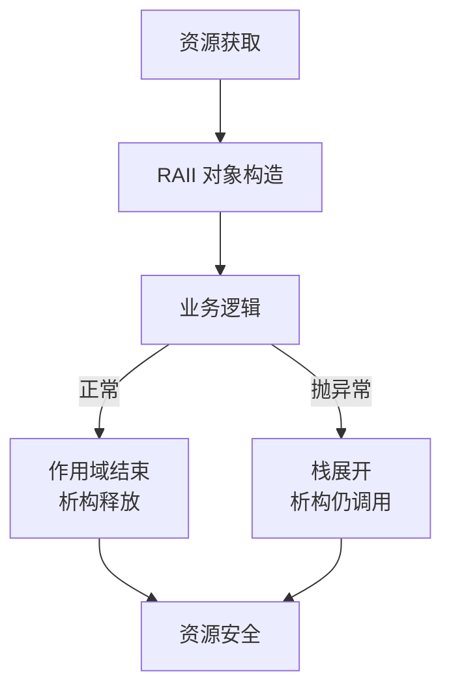
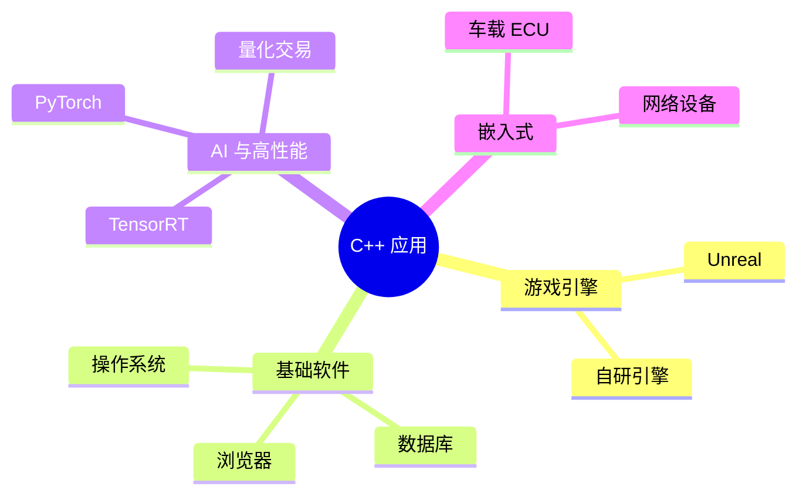
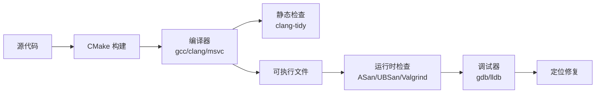

# C++

> C++ 是给 C 装上"对象、模板、异常、智能指针"等一套现代抽象的"加强版"，既保留了 C 直接操作硬件的能力，又能写出大规模面向对象和泛型代码，是游戏引擎、数据库、AI 框架的常用语言。

**关键词**：面向对象、模板泛型、RAII、STL、智能指针、移动语义、零成本抽象

## 抽象类比

C 语言像一把锋利的手术刀，C++ 则像一把"瑞士军刀"——刀刃还是那把刀（兼容 C 的底层能力），但加上了螺丝刀、剪刀、开瓶器（类、模板、异常、智能指针），让你不用再随身带一整套工具。

也像一座"既能让新手住得舒服、又能让老司机改装到极致"的房子：现代 C++（11/14/17/20）给住户配好了智能家居（智能指针、auto、范围 for），但底层仍然开放了一间"地下室"（裸指针、reinterpret_cast、内联汇编），需要的人可以一直走到最底层。

## 一、C++ 是什么

C++ 由 Bjarne Stroustrup 于 1979 年开始设计、1985 年正式发布，最初的名字叫 **"C with Classes"**——给 C 加上"类"的扩展。它的目标是在不放弃 C 性能的前提下，提供更高的抽象能力。

C++ 的核心定位是**多范式编程语言**，它不强加某一种风格：

- 过程式：可以像 C 一样写函数和过程
- 面向对象：可以定义类、继承、多态
- 泛型：可以用模板写"类型无关"的代码
- 函数式：可以用 lambda、`std::function`、`std::bind`
- 元编程：可以用模板在编译期做计算

C++ 的设计哲学是**零成本抽象（zero-overhead abstraction）**：

- 你不用的特性，你不用为它付代价
- 你用的特性，其开销不比你手写更低效

也就是说，C++ 不会"为了优雅"牺牲性能，这正是它和 [[Java]]、[[Python]] 的根本区别。

---

## 二、C++ 与 C 的关系

很多人以为 "C++ 是 C 的超集"，**这是错的**。两者关系更像"同根的兄弟"：

- 大多数 C 代码可以用 C++ 编译器直接编译
- 但有些差异会让同一份代码在 C 和 C++ 中行为不同：
  - `sizeof('a')`：C 中是 `int` 大小，C++ 中是 `char` 大小
  - 函数原型：C 中 `f()` 表示参数未指定，C++ 中表示无参数
  - 关键字冲突：C++ 新增了 `class`、`new`、`delete`、`template` 等关键字，C 代码若用作变量名会编译失败
  - 强类型枚举、命名空间等都是 C++ 独有

C++ 相对 C 的核心增量：

| 维度 | C | C++ |
| :--- | :--- | :--- |
| 抽象 | 函数 + 结构体 | 类、继承、多态 |
| 复用 | 函数库 | 模板、泛型 |
| 资源 | malloc/free | RAII + 智能指针 |
| 错误 | 返回码 | 异常机制 |
| 容器 | 自己写 | STL 标准库 |

学过 [[C]] 再学 C++，不是"重新学一遍语法"，而是"在原有地基上盖楼"。

---

## 三、核心特性：类与面向对象

### 三个支柱

- **封装**：用 `private/protected/public` 控制成员可见性，把数据和操作数据的函数绑在一起
- **继承**：派生类可以复用基类的代码，表达"is-a"关系
- **多态**：通过基类指针/引用调用派生类的方法，运行期分派

### 虚函数与 vtable

```cpp
class Shape {
public:
    virtual double area() const = 0;   // 纯虚函数，定义接口
    virtual ~Shape() = default;        // 虚析构，避免派生类对象被基类指针 delete 时泄漏
};

class Circle : public Shape {
    double r;
public:
    double area() const override { return 3.14159 * r * r; }
};
```

- `virtual` 关键字让函数进入"虚函数表"（vtable）
- 每个有虚函数的对象多一个隐藏指针 `vptr`，指向类的 vtable
- 调用 `shape->area()` 时，通过 `vptr` 查表分派到真正的实现
- 这就是"动态分派"的代价：一次指针解引 + 一次表查询

### 虚析构函数

只要类有虚函数，析构函数就**必须**是虚的，否则 `delete base_ptr` 不会调用派生类析构，造成资源泄漏。

### 多重继承与菱形问题

```cpp
class A { public: int x; };
class B : public A {};
class C : public A {};
class D : public B, public C {};   // D 中有两份 A，访问 x 时歧义
```

- 解决方案：用**虚继承** `class B : virtual public A`
- 虚继承让共享基类只保留一份，但代价是布局更复杂、访问更慢
- 现代 C++ 推荐**接口继承 + 组合**而非深层多继承

---

## 四、核心特性：资源管理

### RAII：C++ 资源管理的基石

RAII（Resource Acquisition Is Initialization）的核心思想：**把资源绑定到对象的生命周期，构造时获取、析构时释放**。

- 申请内存 → 包装到对象构造函数
- 释放内存 → 写到析构函数
- 函数返回、异常抛出、作用域结束时，析构函数**一定**会被调用

这意味着只要资源被 RAII 对象管理，就**不会泄漏**，即使中途抛异常。

### 智能指针

现代 C++ 提供三种智能指针（在 `<memory>` 中）：

- `std::unique_ptr<T>`：独占所有权，不能拷贝、只能移动，零开销抽象
- `std::shared_ptr<T>`：共享所有权，引用计数线程安全，但有循环引用风险
- `std::weak_ptr<T>`：弱引用，不增加引用计数，配合 `shared_ptr` 解决循环引用

```cpp
std::unique_ptr<Shape> p = std::make_unique<Circle>(1.0);
std::shared_ptr<Shape> s = std::make_shared<Circle>(2.0);
std::weak_ptr<Shape>   w = s;        // 不增加引用计数
```

### 移动语义与右值引用

```cpp
std::vector<int> v1 = {1, 2, 3, 4, 5};
std::vector<int> v2 = std::move(v1);  // v1 被掏空，资源整体搬给 v2，O(1)
```

- 左值：有名字、有地址，可以取地址（如变量 `v1`）
- 右值：临时值，不能取地址（如 `1+2`、函数返回的临时对象）
- `T&&` 是右值引用，`std::move` 只是把左值强转为右值引用，本身不搬运任何东西
- 移动构造/移动赋值是真正"偷资源"的地方
- 移动语义让"传值返回大对象"在现代 C++ 中几乎零成本

---

## 五、核心特性：模板与泛型

### 基本模板

```cpp
template <typename T>
T max_of(T a, T b) { return a > b ? a : b; }

max_of(3, 5);          // T = int
max_of(1.0, 2.0);      // T = double
```

模板是**编译期**生成代码，相当于"编译器帮你写函数"。所以它零运行时开销，但代价是编译时间变长、错误信息难读。

### 模板特化

```cpp
template <typename T>
struct Serializer { static std::string to_str(T v); };

template <>
struct Serializer<bool> {                 // 全特化
    static std::string to_str(bool v) { return v ? "true" : "false"; }
};
```

### SFINAE

"替换失败不是错误"——在模板推导时，如果某个候选替换后语法不合法，编译器只是放弃这个候选，不会报错。它常用来"按类型条件选择不同实现"。

### constexpr：编译期求值

```cpp
constexpr int factorial(int n) {
    return n <= 1 ? 1 : n * factorial(n - 1);
}
constexpr int x = factorial(5);   // 120，编译期算好
```

### C++20 Concepts：模板约束

```cpp
template <typename T>
concept Numeric = std::integral<T> || std::floating_point<T>;

template <Numeric T>
T add(T a, T b) { return a + b; }
```

Concepts 让模板的"类型要求"显式化，错误信息从"几千行模板栈"变成"该类型不满足 Numeric 约束"。

---

## 六、标准库 STL

STL（Standard Template Library）是 C++ 的"兵器库"，由六大件组成：

- **容器**：`vector`、`list`、`deque`、`map`、`set`、`unordered_map`、`unordered_set`、`array`
- **算法**：`sort`、`find`、`for_each`、`copy`、`transform`、`accumulate`、`lower_bound`
- **迭代器**：容器与算法之间的"胶水"，提供统一的遍历接口
- **函数对象**：重载 `operator()` 的类，可作为算法的谓词
- **适配器**：`stack`、`queue`、`priority_queue` 等基于底层容器的封装
- **分配器**：自定义内存分配策略（绝大多数场景用默认即可）

```cpp
std::vector<int> v = {3, 1, 4, 1, 5, 9};
std::sort(v.begin(), v.end());
std::for_each(v.begin(), v.end(), [](int x) { std::cout << x; });
auto it = std::find(v.begin(), v.end(), 4);
```

### 容器选型

- 随机访问、尾插：`vector`，O(1) 访问、均摊 O(1) 尾插
- 频繁中间插删：`list` / `forward_list`，O(1) 已知位置插删
- 键值映射、有序：`map` / `set`，O(log n)
- 键值映射、无序：`unordered_map`，均摊 O(1)
- 双端操作：`deque`，O(1) 头尾插删
- 元素唯一且有序：`set`
- 缓存近期访问：自定义 LRU，可用 `list + unordered_map` 组合实现

### 迭代器失效速查

- `vector`：扩容或 `erase` 后，迭代器、指针、引用全部可能失效
- `deque`：任何插删都可能让所有迭代器失效
- `list` / `forward_list`：只有被删节点的迭代器失效，其他保持有效
- `unordered_map`：`erase` 只让被删元素失效；插入可能触发 rehash，使所有迭代器失效但不使引用失效

经验法则：**修改容器后，重新取迭代器**，不要抱有"老迭代器还有效"的幻想。

### Lambda 与函数对象

C++11 引入 lambda，让 STL 算法可用性大增：

```cpp
// 捕获方式
int factor = 3;
auto f1 = [factor](int x) { return x * factor; };       // 值捕获
auto f2 = [&factor](int x) { return x * factor; };       // 引用捕获
auto f3 = [=](int x) { return x * factor; };             // 全部值捕获
auto f4 = [&](int x) { return x * factor; };             // 全部引用捕获
```

注意 lambda 本质是匿名函数对象（functor），编译器为每个 lambda 生成一个唯一类型。`std::function` 可以存"任意可调用对象"，但有类型擦除开销。

---

## 七、现代 C++ 演进

C++ 每 3 年发布一个新标准，每个版本都在"补课"——让代码更安全、更简洁：

- **C++11**（里程碑）：`auto`、`nullptr`、范围 for、lambda、智能指针、右值引用、`constexpr`、`std::thread`
- **C++14**：泛型 lambda、`make_unique`、返回类型推导
- **C++17**：结构化绑定、`optional`、`variant`、`any`、`string_view`、`filesystem`
- **C++20**：Concepts、Modules、Coroutines、Ranges、`std::format`
- **C++23**：`std::expected`、`std::print`、`mdspan`、显式 `this` 参数

```cpp
// C++11 auto + 范围 for
for (auto& x : vec) { x *= 2; }

// C++17 结构化绑定
for (const auto& [key, value] : map) { /* ... */ }

// C++20 Ranges
auto evens = vec | std::views::filter([](int x) { return x % 2 == 0; });
```

---

## 八、异常处理

C++ 异常用 `try / catch / throw`：

```cpp
try {
    if (size == 0) throw std::runtime_error("size is zero");
} catch (const std::exception& e) {
    std::cerr << e.what() << "\n";
}
```

### 异常 vs 错误码

- 异常：让正常流程代码更干净，错误集中处理；但有运行时开销（栈展开），且语义可能被忽略
- 错误码：开销小、显式，但容易忘记检查、污染函数签名
- 现代 C++ 倾向"异常用于真正的异常情况，错误码用于预期内的失败"（如 [[Rust]] 的 `Result` 思路）

### RAII 与异常安全

只要资源被 RAII 对象管理，即使异常发生，析构函数也会被调用，资源不会泄漏。这就是为什么现代 C++ 几乎不手写 `delete`。



---

## 九、并发编程

C++11 把并发纳入标准库，再也不依赖 pthread：

- `std::thread`：创建线程
- `std::mutex` / `std::recursive_mutex`：互斥锁
- `std::lock_guard` / `std::unique_lock`：RAII 风格的锁管理
- `std::atomic<T>`：原子操作，无锁并发
- `std::future` / `std::promise` / `std::async`：异步结果传递
- `std::condition_variable`：线程间等待/通知

C++20 新增：

- `std::jthread`：析构时自动 join，避免忘记 join 导致程序崩溃
- 协程（coroutines）：`co_await`、`co_yield`、`co_return`，让异步代码写起来像同步

```cpp
std::atomic<int> counter{0};
std::vector<std::thread> ts;
for (int i = 0; i < 8; ++i)
    ts.emplace_back([&]{ for (int j = 0; j < 1000; ++j) ++counter; });
for (auto& t : ts) t.join();
// counter 必然是 8000
```

并发是 [[调试能力]] 的硬骨头——竞态、死锁、内存序问题难以复现，更多内容参考相关课程。

---

## 十、C++ 的应用场景

- **游戏引擎**：Unreal Engine、Unity（C# 脚本，但底层是 C++）、自研引擎
- **浏览器**：Chrome / V8、Firefox / SpiderMonkey、Safari / JavaScriptCore
- **数据库**：MySQL、MongoDB、Redis（部分）、TiDB 的 TiKV
- **AI 框架**：PyTorch、TensorFlow、ONNX Runtime、TensorRT
- **嵌入式与系统软件**：汽车 ECU、路由器固件、各种底层驱动
- **金融与高频交易**：纳秒级延迟要求，[[Rust]] 之外的主流选择
- **音视频**：FFmpeg、WebRTC、各类编解码器
- **操作系统**：Windows 内核、部分 [[Linux]] 子系统



---

## 十一、C++ 的常见陷阱

### 未定义行为（UB）

- 越界访问数组、解引用空指针/悬垂指针
- 有符号整数溢出
- 使用未初始化变量
- 多线程下对非 atomic 变量的读写有数据竞争

UB 的可怕之处在于：编译器可以"合法地"做任何事——可能正常、可能崩、可能出错结果、可能在几万行之后才发作。开发时开 `-fsanitize=undefined` 能抓出绝大多数 UB。

### 内存泄漏与悬垂指针

- `new` 后忘了 `delete`
- `delete` 后还使用指针（悬垂指针）
- 容器存裸指针，对象被删后容器仍指向
- 解决：智能指针 + RAII，几乎不手写 `delete`

### 迭代器失效

```cpp
std::vector<int> v = {1, 2, 3, 4};
for (auto it = v.begin(); it != v.end(); ++it) {
    if (*it == 2) v.erase(it);   // it 失效！
}
```

- `vector` 在 `erase` / `push_back` 触发扩容时，所有迭代器、指针、引用都可能失效
- 正确写法：`it = v.erase(it);`

### 对象切片

```cpp
class Base { public: virtual void f() { cout << "B"; } };
class Derived : public Base { public: void f() override { cout << "D"; } };

Derived d;
Base b = d;      // 把 Derived "切"成 Base，多态丢失
b.f();           // 输出 B
```

传值会引发对象切片，应该传引用或指针。

### 模板膨胀

模板实例化会为每种类型生成一份代码，导致编译时间变长、二进制变大。可以借助显式实例化、外部模板来缓解。

---

## 十二、构建与工具链

### 构建系统

- **CMake**：事实标准，跨平台，生成 Makefile / Ninja / VS 工程
- **Bazel**：Google 出品，适合大型 monorepo，构建可复现
- **Ninja**：底层构建工具，速度比 Make 快很多，CMake 可生成

### 编译器

- **GCC**：GNU 编译器套件，[[Linux]] 默认
- **Clang/LLVM**：错误信息更友好、IDE 友好
- **MSVC**：Windows 平台首选

常用编译选项：

- `-O2 / -O3`：优化等级
- `-std=c++20`：指定语言标准
- `-Wall -Wextra`：开启警告
- `-fsanitize=address,undefined`：内存与 UB 检查
- `-g`：生成调试信息

### 静态分析与运行时检查

- **clang-tidy**：静态检查，可发现性能、可读性、现代风格问题
- **cppcheck**：开源静态分析
- **Valgrind**：运行时内存检测，[[Linux]] 下经典
- **ASan / UBSan / TSan**：编译期注入的运行时检查，开销小、效果好

### 调试

- **GDB**：[[Linux]] 下的调试器主力
- **LLDB**：Clang 配套
- **WinDbg / Visual Studio 调试器**：Windows 平台
- 调试方法学可参考 [[调试能力]]



---

## 面试速答

### Q: C++ 的 RAII 是什么？为什么重要？
A: RAII 把资源绑定到对象生命周期——构造时获取、析构时释放。它的重要性在于：只要资源被 RAII 对象管理，作用域结束或异常抛出时析构函数**一定**会调用，资源不会泄漏。智能指针、`lock_guard`、`fstream` 都是 RAII 的体现。RAII 让 C++ 在没有垃圾回收的情况下依然能写出安全的代码。

### Q: unique_ptr 和 shared_ptr 的区别？什么场景用哪个？
A: `unique_ptr` 独占所有权、不能拷贝只能移动、零开销，适合"单一所有者"场景，是默认选择。`shared_ptr` 共享所有权、内部有引用计数、线程安全的计数操作，适合"多个对象共同持有同一资源"的图、缓存、观察者模式。`weak_ptr` 配合 `shared_ptr` 解决循环引用。原则是：能用 `unique_ptr` 就别用 `shared_ptr`。

### Q: 虚函数的实现原理？虚析构函数为什么重要？
A: 有虚函数的类对象内部多一个 `vptr`，指向类的虚函数表（vtable），表里存着虚函数的实际地址。调用 `p->f()` 时通过 `vptr` 查表分派到真正的实现，这就是动态多态的代价（一次解引 + 一次查表）。虚析构函数重要是因为：如果用基类指针 `delete` 派生类对象，没有虚析构就只会调用基类析构，派生类资源泄漏。

### Q: 移动语义解决了什么问题？std::move 做了什么？
A: 移动语义解决了"大对象按值传递/返回时被深拷贝"的性能问题——通过"偷资源"而非"复制资源"实现 O(1) 转移。`std::move` 本身**不搬运任何东西**，它只是把左值强转为右值引用，从而让重载决议选择移动构造/移动赋值。真正"偷资源"的是移动构造函数和移动赋值运算符。

### Q: 什么是未定义行为（UB）？为什么 C++ 容易出 UB？
A: UB 是标准规定"行为未定义"的情况，包括越界访问、解引用空指针、有符号整数溢出、未初始化变量、数据竞争等。C++ 容易出 UB 是因为它继承了 C 的"信任程序员"哲学——不做边界检查、不做空指针检查、没有 GC。UB 的可怕在于编译器可以"合法地"做任何事，开了 `-fsanitize=undefined,address` 能在开发期抓到大部分 UB。