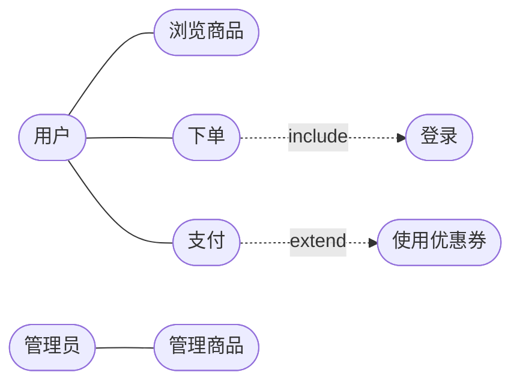
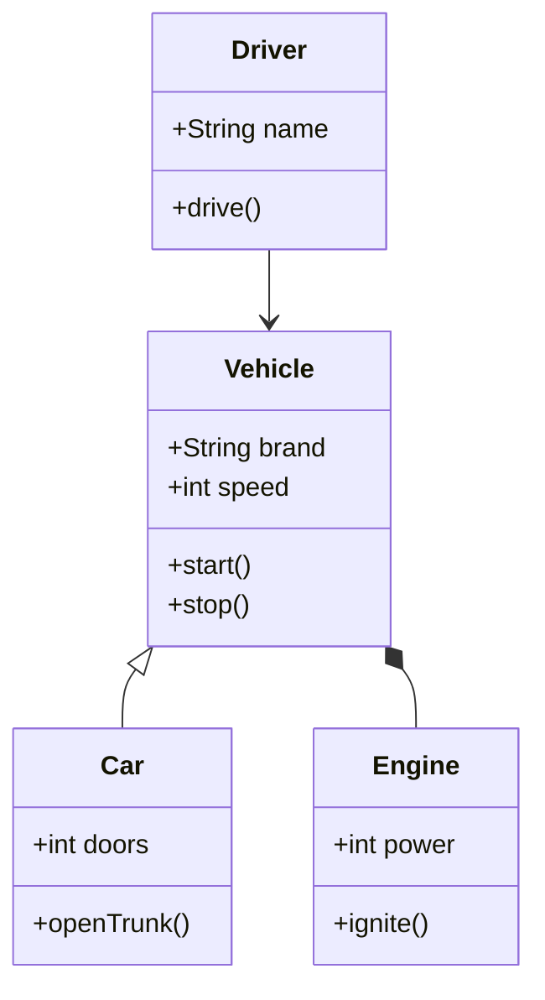
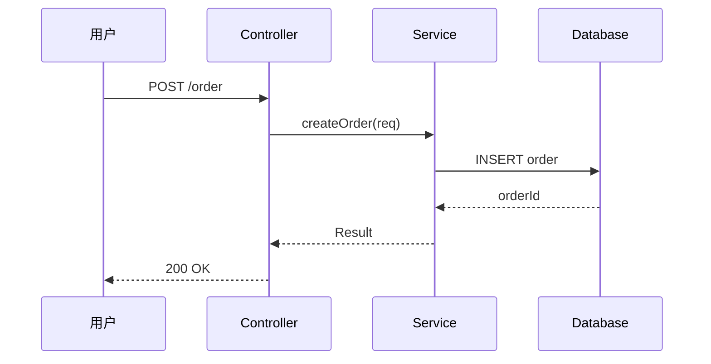
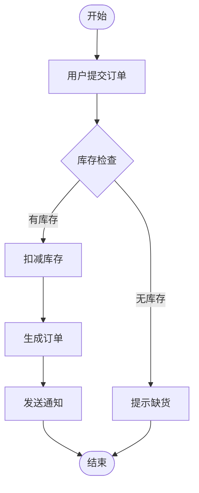
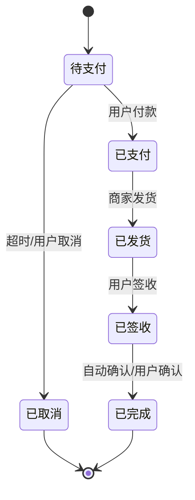
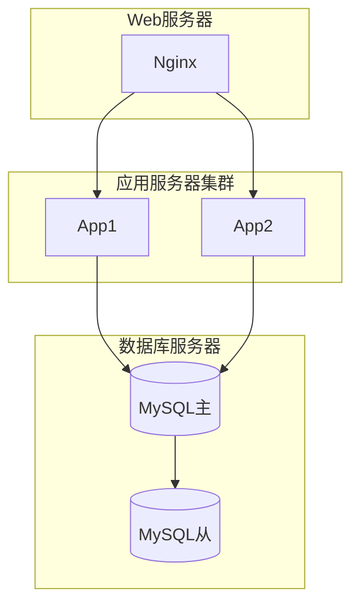

# UML 统一建模语言

> UML（Unified Modeling Language）是软件工程中一套通用的可视化建模语言，用图形把"系统长什么样、怎么运作、各部分关系如何"画出来。它不是编程语言，而是"工程图纸"，让产品、开发、测试、客户在同一个图上对齐认知。

**关键词**：UML、类图、用例图、时序图、活动图、建模

## 抽象类比

UML 就像建筑行业的"工程图纸"——盖一栋楼不能只靠口头描述，要有平面图、立面图、水电图、结构图各司其职。UML 也是同样：用例图说"谁能干什么"，类图说"零件长啥样"，时序图说"谁先动谁后动"，活动图说"流程怎么走"。同一栋楼，不同工种看不同的图，但所有图描述的是同一个建筑。

如果说代码是"成品房"，UML 就是"设计图"——它不一定要落到每根钉子，但能让所有人对结构、流程、边界达成一致。

## 适合人群

- 软件工程专业学生，学过面向对象和软件工程基础
- 即将参与项目协作的开发者
- 需要做需求分析和系统设计的工程师
- 准备技术面试的求职者（UML 是面试常见考点）

## 预备知识

- 了解面向对象基本概念（类、对象、继承、多态）
- 知道软件开发生命周期
- 听过"用例""类图""时序图"等词汇即可

## 一、UML 的定位与价值

UML 是 1997 年 OMG（对象管理组织）发布的统一建模语言，融合了 Booch、OMT、OOSE 三种方法学。

### 为什么需要 UML

- 沟通：让产品、开发、测试、客户用同一套图形语言交流
- 思考：画图过程本身就是理清思路的过程
- 文档：作为设计文档留痕，便于交接和维护
- 评审：通过图进行设计评审，比看代码效率高

### UML 不是什么

- 不是编程语言：不能直接运行，需要翻译为代码
- 不是方法论：它只是"画图规范"，不规定"怎么开发"
- 不是必须：小项目可以不画图，但大型系统协作时几乎必备

### UML 的两大类图

- 静态结构图：描述系统"长什么样"——类图、对象图、组件图、部署图、包图
- 动态行为图：描述系统"怎么运作"——用例图、活动图、状态图、时序图、协作图

## 二、用例图（Use Case Diagram）

用例图描述"谁能用系统做什么"，是需求分析阶段最常用的图。

### 核心元素

- 参与者（Actor）：与系统交互的人或外部系统，用小人表示
- 用例（Use Case）：系统提供的一个完整功能，用椭圆表示
- 关系：参与者和用例之间的关联，用直线
- 系统边界：用矩形框出系统范围

### 参与者之间的关系

- include（包含）：A 用例必定执行 B 用例，比如"下单"包含"登录"
- extend（扩展）：A 用例在特定条件下执行 B 用例，比如"支付"扩展"使用优惠券"
- generalization（泛化）：参与者或用例的继承关系

### Mermaid 图

### 适合场景

- 需求分析阶段，与客户确认功能范围
- 评估系统边界，明确"做什么、不做什么"
- 划分角色权限，理清不同用户的功能

## 三、类图（Class Diagram）

类图是 UML 中最核心、最常用的图，描述类的结构以及类之间的静态关系。

### 类的表示

一个类用矩形表示，分三栏：

- 类名（顶部）
- 属性（中间）：格式 `可见性 名称: 类型`
- 方法（底部）：格式 `可见性 名称(参数): 返回类型`

可见性符号：

- `+` public
- `-` private
- `#` protected
- `~` package

### 类之间的六大关系

按"弱→强"排列：

- 依赖（Dependency）：A 用到 B，但 B 不是 A 的成员。虚线箭头
- 关联（Association）：A 持有 B 的引用作为成员。实线箭头
- 聚合（Aggregation）：弱拥有关系，部分可独立于整体存在。空心菱形
- 组合（Composition）：强拥有关系，部分不能脱离整体存在。实心菱形
- 泛化（Generalization）：继承关系。空心三角箭头
- 实现（Realization）：实现接口。空心三角虚线

### 类比：用家庭关系理解类关系

- 依赖：你"借用"邻居的锤子，用完还回去，关系最弱
- 关联：你"认识"一个朋友，记住他的电话
- 聚合：俱乐部和会员——俱乐部解散了会员还在
- 组合：人和心脏——人没了心脏也没了
- 泛化：父子继承——儿子继承父亲的姓氏
- 实现：演员实现剧本——剧本定义角色，演员照着演

### Mermaid 图

### 适合场景

- 系统设计阶段，定义领域模型
- 代码评审，确认类结构是否合理
- 数据库设计，类图可转化为 ER 图

## 四、时序图（Sequence Diagram）

时序图描述对象之间按时间顺序的交互过程，是"动态行为"中最常用的图。

### 核心元素

- 对象（Object）：参与交互的实例，矩形表示
- 生命线（Lifeline）：对象下方的虚线，表示对象存在的时间
- 激活条（Activation）：生命线上的矩形，表示对象正在执行
- 消息（Message）：对象间的通信，箭头表示
  - 同步消息：实心三角箭头
  - 异步消息：开放箭头
  - 返回消息：虚线箭头

### Mermaid 图

### 适合场景

- 接口设计，理清调用链
- 排查问题，对照时序图定位卡点
- 设计文档，描述关键流程（如登录、支付、下单）

## 五、活动图（Activity Diagram）

活动图描述"工作流"或"业务流程"，类似流程图但更强大，支持并行分支。

### 核心元素

- 起始节点：实心圆
- 结束节点：实心圆外加圆圈
- 活动（Activity）：圆角矩形，表示一个动作
- 决策节点（Decision）：菱形，分支判断
- 合并节点（Merge）：多个分支汇合
- 分叉/汇合（Fork/Join）：粗实线，表示并行
- 泳道（Swimlane）：按角色分栏，标明谁做什么

### Mermaid 图

### 适合场景

- 业务流程梳理，理解"先做什么再做什么"
- 工作流系统设计（如审批流、订单流）
- 用例细化，把一个用例拆成多个步骤

## 六、状态图（State Diagram）

状态图描述一个对象在其生命周期中各种状态及转换条件。

### 核心元素

- 状态（State）：圆角矩形
- 起始状态：实心圆
- 结束状态：实心圆外加圆圈
- 转移（Transition）：箭头，可标注"事件[条件]/动作"

### Mermaid 图

### 适合场景

- 订单、审批等"状态机"类业务
- 协议设计（如 TCP 状态机）
- 复杂对象的边界条件分析

## 七、组件图与部署图

### 组件图（Component Diagram）

描述系统中各组件（模块）及其依赖关系，关注"软件结构"。

- 组件：矩形加两个小凸起
- 接口：圆圈（提供）或半圆（依赖）
- 依赖：虚线箭头

### 部署图（Deployment Diagram）

描述系统在硬件节点上的部署方式，关注"物理结构"。

- 节点：立方体
- 组件：放在节点内
- 通信路径：节点之间的连接

### Mermaid 图（部署图示例）

### 适合场景

- 系统架构文档，说明部署方案
- 运维交付，明确环境拓扑
- 容量规划，评估节点资源

## 八、UML 在工程实践中的取舍

### 必画的图

- 用例图：需求阶段必画
- 类图：设计阶段必画
- 时序图：复杂流程必画
- 活动图：业务流程必画

### 按需画的图

- 状态图：有状态机的业务才画
- 组件图：模块化设计时画
- 部署图：上线部署时画
- 对象图、包图、协作图：少用

### 画图原则

- 简洁优先：一张图只表达一个主题，复杂系统拆多张
- 抽象层次：先粗后细，先高层后底层
- 持续维护：图与代码同步，过期的图比没有图更糟
- 工具选择：PlantUML、draw.io、Mermaid、StarUML、IDEA 自带

### 常见误区

- 过度画图：每个细节都画，浪费成本
- 图代码脱节：图是图，代码是代码，失去价值
- 死抠符号：纠结箭头是空心还是实心，忽略设计本身
- 只画不维护：图过时了不更新，反而误导

## 九、UML 与设计模式、架构的关系

- UML 是"表达工具"，不是"设计方法"
- 设计模式用 UML 描述类关系（如策略模式的类图）
- 架构图用 UML 的组件图、部署图表达
- 时序图是 RPC/接口设计的必备工具

## 面试速答

### Q1：UML 类图中各关系怎么区分？

- 依赖：临时使用，B 作为 A 的方法参数或局部变量。最弱
- 关联：长期持有，B 作为 A 的成员变量
- 聚合：弱拥有，部分可脱离整体。空心菱形，如"俱乐部-会员"
- 组合：强拥有，部分与整体同生共死。实心菱形，如"鸟-翅膀"
- 泛化：继承关系，子类继承父类。空心三角
- 实现：实现接口。空心三角虚线
- 记忆口诀：依赖 < 关联 < 聚合 < 组合 < 泛化/实现

### Q2：什么时候用时序图？什么时候用活动图？

- 时序图：强调"多个对象之间的交互顺序"，适合接口调用、跨服务流程
- 活动图：强调"单一流程的步骤和分支"，适合业务流程、用例细化
- 简单判断：跨对象协作用时序图，单流程梳理用活动图

### Q3：UML 在敏捷开发中还需要吗？

- 需要，但不是"全文档驱动"
- 敏捷中 UML 用于"关键设计"：核心类图、关键时序图、复杂状态图
- 不画全量图，只画"非画不可"的图
- 用白板/PlantUML 快速画，配合简短说明
- 重点是沟通和思考，不是文档厚度

### Q4：画 UML 的工具有哪些推荐？

- PlantUML：文本驱动，可纳入 Git 管理，适合程序员
- Mermaid：Markdown 友好，GitHub/Obsidian 原生支持
- draw.io：图形拖拽，免费好用，适合多种图
- StarUML：专业 UML 工具，适合大型设计
- IDEA/VS Code 插件：编程时直接画类图
