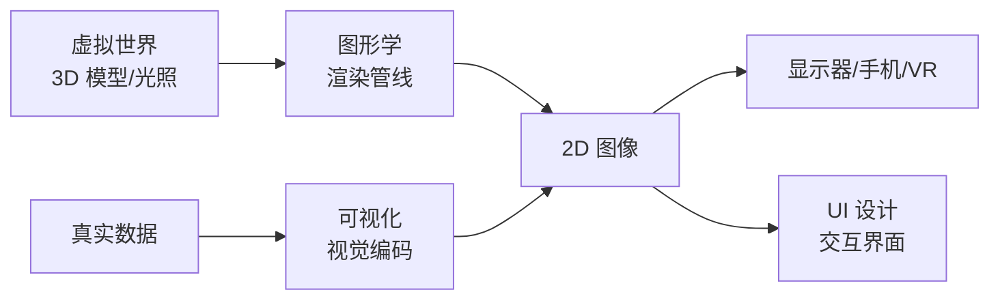
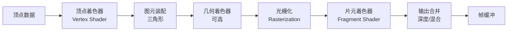
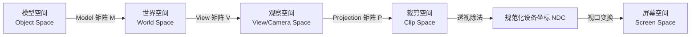
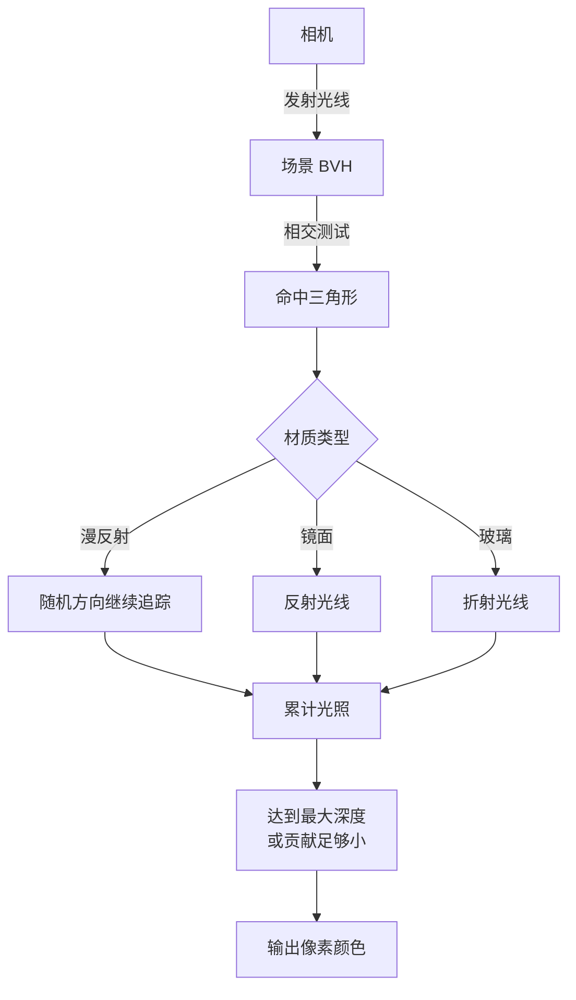
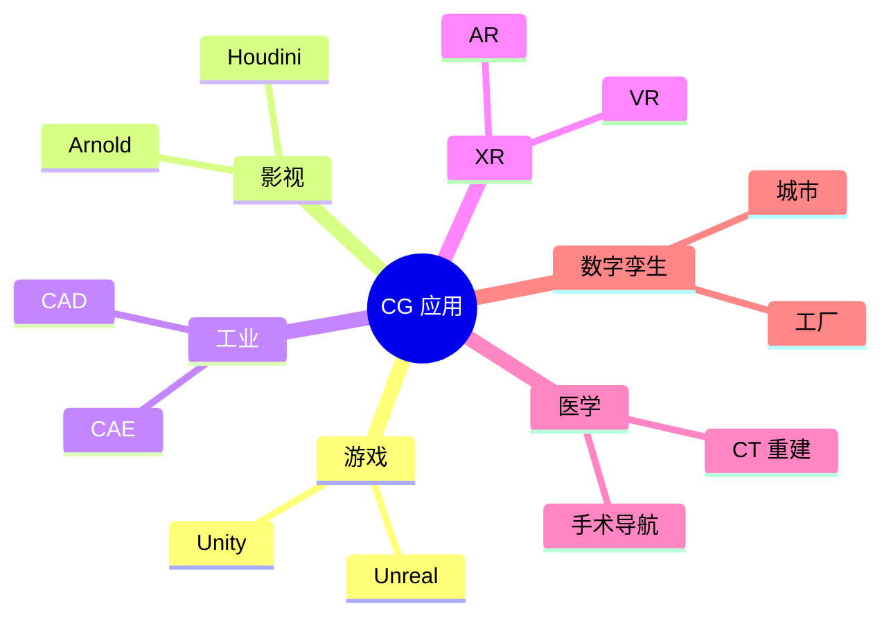

# 计算机图形学

> 计算机图形学（Computer Graphics, CG）研究用计算机生成、处理、显示图像的原理与算法，是游戏、影视特效、CAD、AR/VR、医学成像背后的"地基"，和数据可视化 ([[可视化]]) 不同——它关注的是"如何把虚拟世界画到屏幕上"，而非"如何把数据画成图表"。

**关键词**：渲染管线、光栅化、光线追踪、着色、MVP 矩阵、PBR、着色器

## 抽象类比

计算机图形学像"用数字给虚拟世界照相"：现实中光照到物体上反射进眼睛形成图像，CG 则用数学公式模拟这一过程——先在虚拟空间里建一个物体（建模），再放一盏灯（光照），最后让虚拟相机把光打到屏幕上（渲染）。

也像"虚拟世界的画家"：建模师用三角网格捏出形状（素描），材质师给表面贴上颜色和质感（上色），灯光师布置光位，动画师让物体动起来，渲染师最后按下快门。这些工序合起来就是"图形渲染管线"。

## 一、计算机图形学是什么

计算机图形学（Computer Graphics, CG）是研究"用计算机生成、处理、显示图像"的学科。它的核心问题是：

- 怎么用数字描述一个三维物体？（建模）
- 怎么把三维物体"投影"到二维屏幕？（渲染）
- 怎么让物体看起来像真实的？（光照、材质）
- 怎么让物体动起来？（动画）
- 怎么让用户和虚拟世界交互？（人机交互）

CG 和 [[可视化]] 的关系：

- **可视化**：把"数据"映射成"图形"，关注信息表达（柱状图、热力图）
- **计算机图形学**：把"虚拟世界的物体"画到屏幕上，关注物理真实感
- **[[UI设计]]**：在屏幕上设计交互界面，关注用户体验

三者互补：可视化用图形学的技术（渲染、着色）画图，UI 用可视化和图形学的成果搭界面。



---

## 二、图形学的主要分支

### 建模（Modeling）

- 用点、边、面、体描述三维形状
- 常用表示：三角网格、参数曲面（Bezier、NURBS）、隐式曲面（SDF）
- 工具：Blender、Maya、3ds Max、ZBrush

### 渲染（Rendering）

- 把三维场景"投影"到二维图像
- 两大流派：实时渲染（游戏、VR）、离线渲染（电影特效）
- 核心算法：光栅化、光线追踪

### 动画（Animation）

- 关键帧动画、骨骼蒙皮、运动捕捉
- 物理动画：刚体、布料、流体、毛发
- 角色动画：rigging、skinning、blend shape

### 物理仿真（Simulation）

- 流体、烟雾、火焰、爆炸
- 软体、布料、断裂
- 有限元 FEM、SPH、PIC/FLIP 等数值方法

### 人机交互（HCI）

- VR/AR 头显、空间定位、手势识别
- 触觉反馈、眼动追踪
- 与 [[UI设计]] 交叉

---

## 三、图形渲染管线

渲染管线（Graphics Pipeline）是 GPU 把三维场景变成二维图像的一系列固定步骤。现代 GPU 把其中若干步骤设计成"可编程着色器"。



### 顶点处理

- 顶点着色器对每个顶点独立变换：从模型空间 → 世界空间 → 观察（相机）空间 → 裁剪空间
- 由 MVP 矩阵完成（详见第四节）
- 可在此做顶点动画（水波、风吹草动）

### 图元装配

- 把顶点按指定方式（点、线、三角形）组成图元
- 三角形是 GPU 最基本的工作单元

### 光栅化

- 把三角形"扫描转换"成屏幕上的像素（片元）
- 对顶点属性（颜色、UV、法线）做插值
- 光栅化是光栅化算法相对光线追踪的核心优势：复杂度只随屏幕分辨率线性增长

### 片元着色

- 对每个片元独立计算颜色
- 在此做光照、纹理采样、阴影判断
- 是"画面质感"的关键

### 输出合并

- 深度测试：离相机近的覆盖远的
- 模板测试：用于描边、反射
- 混合：半透明物体合成

### 固定管线 vs 可编程管线

- **固定管线**：早期 OpenGL，参数固定，灵活性低
- **可编程管线**：现代 OpenGL/Vulkan/DirectX，每阶段可写 Shader
- 现代 GPU 完全是可编程管线，固定管线已淘汰

---

## 四、坐标空间变换

渲染的核心是"把虚拟世界的点搬到屏幕上"。这个过程经历多次坐标变换，每次都用一个矩阵乘法实现。

### 空间链路



### MVP 矩阵

- **Model 矩阵 M**：把物体从"自己原点"搬到"世界坐标"
- **View 矩阵 V**：把世界坐标变换到"相机原点"，本质是相机的逆变换
- **Projection 矩阵 P**：把三维投影到二维，有透视投影（近大远小）和正交投影（无失真）两种

合成矩阵 `MVP = P × V × M`，顶点 `v_screen = MVP × v_model`。这部分依赖线性变换与矩阵乘法的基础知识。

### 齐次坐标

- 三维点 `(x, y, z)` 写成 `(x, y, z, w)`，`w=1` 表示点，`w=0` 表示方向
- 透视除法：`(x, y, z, w) → (x/w, y/w, z/w)`
- 齐次坐标让"平移"也能用矩阵乘法表达，统一了所有变换

---

## 五、着色模型

着色（Shading）决定物体表面"看起来像什么材质"。

### Phong 光照模型

经典的局部光照模型，由三部分组成：

- **环境光 Ambient**：模拟全局环境反射，常数项 `ka * Ia`
- **漫反射 Diffuse**：与光线和法线夹角有关，符合 Lambert 定律
- **镜面反射 Specular**：与观察方向和反射方向夹角有关，模拟"高光"

```glsl
// 伪 GLSL
vec3 color = ambient + diffuse * max(dot(N, L), 0) + specular * pow(max(dot(R, V), 0), shininess);
```

### Blinn-Phong

Phong 的改进版：用半角向量 `H = normalize(L + V)` 代替反射向量，计算更省、效果更自然，是早期游戏的标准。

### PBR（物理渲染）

基于物理的渲染，把光照拆成"反射率 albedo""粗糙度 roughness""金属度 metallic"等物理量，遵循能量守恒、微表面理论。PBR 让不同光照下材质表现一致，是现代游戏、电影的标准。

### Cook-Torrance BRDF

PBR 的核心方程：

- 漫反射项：Lambert
- 镜面反射项：Cook-Torrance，包含三项：
  - **D**：法线分布函数（GGX / Trowbridge-Reitz）
  - **F**：菲涅尔项（Schlick 近似）
  - **G**：几何遮蔽项（Smith）

---

## 六、纹理与采样

纹理（Texture）是把二维图像"贴"到三维表面，给表面上色、增加细节的技术。

### 纹理映射

- 每个顶点除了位置，还有 UV 坐标（纹理上的二维坐标）
- 光栅化时对 UV 插值，片元着色器据此采样纹理
- UV 展开是建模的一门手艺

### Mipmap

- 一张纹理预生成多级分辨率版本（1/2、1/4、1/8...）
- 远距离的片元用低分辨率纹理，避免锯齿（aliasing）
- 内存开销增加 1/3，但视觉质量大幅提升

### 各向异性过滤（Anisotropic Filtering）

- Mipmap 在斜视角时模糊，各向异性过滤保留细节
- 适合地面、墙面这类经常斜看的表面

### 法线贴图（Normal Mapping）

- 用一张 RGB 图存"假法线"，扰动光照计算
- 让低面数模型看起来像高面数模型
- 是游戏工业"骗眼睛"的常见手段

### 视差贴图（Parallax / Parallax Occlusion）

- 在法线贴图基础上，根据视角偏移 UV，模拟"高低不平"
- 比法线贴图更立体，但开销更大

---

## 七、光线追踪 Ray Tracing

光栅化擅长"快速画三角形"，但不擅长反射、折射、软阴影、全局光照。光线追踪（Ray Tracing）从相机出发，反向追踪光线，能精确模拟这些物理现象。

### Whitted 光线追踪

- 1980 年 Turner Whitted 提出
- 从相机射出主光线，碰到物体后递归射出反射/折射光线
- 能模拟镜面反射、玻璃折射
- 但阴影是硬阴影、光照是点光源

### 路径追踪 Path Tracing

- 蒙特卡洛方法，随机采样光线方向
- 每像素射出多条光线，求平均
- 能模拟全局光照、软阴影、焦散、Caustics
- 收敛慢，每像素要射几百到几万条光线
- 是电影离线渲染的主流（Arnold、RenderMan）

### BVH 加速结构

- 场景里三角形可能上亿个，逐个测试不可行
- BVH（Bounding Volume Hierarchy）把空间划分成层级包围盒
- 测试光线时先测包围盒，整棵子树可以剪枝
- 类似 [[算法设计与分析]] 中的二分思想，把 O(n) 降到 O(log n)

### 实时光追 RTX

- 2018 年 NVIDIA RTX 显卡引入 RT Core，硬件加速 BVH 遍历
- 每秒可计算几十亿次光线-三角形相交
- 游戏开始用光追做反射、阴影、全局光（Cyberpunk 2077、Control）
- 仍是混合方案：光栅化主画面，光追补关键效果



---

## 八、阴影与全局光照

### Shadow Map 阴影映射

- 经典的两 Pass 算法
- Pass 1：从光源视角渲染深度图
- Pass 2：从相机视角渲染时，把片元变换到光源空间，比较深度
- 比光源处深度大 → 在阴影中
- 优点：兼容光栅化管线，速度快
- 缺点：阴影走样、阴影粉刺（shadow acne）需要 bias

### SSAO（屏幕空间环境光遮蔽）

- 在屏幕空间近似全局光照的"角落变暗"效果
- 每个片元采样周围深度，估算遮蔽程度
- 让场景立体感大幅提升

### 全局光照 GI（Global Illumination）

- 现实中光会多次反射，间接照亮场景
- 直接光照：光源直射物体
- 间接光照：物体反射的光照亮其他物体
- GI 算法：路径追踪（离线）、光子映射 Photon Mapping、 irradiance volume、VXGI

### Lightmap 与 Light Probe

- **Lightmap**：预计算静态物体的光照，烘焙到纹理
- **Light Probe**：动态物体采样预计算的环境光
- 适合静态场景（如游戏关卡），运行时几乎零开销

---

## 九、动画与变形

### 关键帧动画（Keyframe）

- 在时间轴上标定几个关键时刻的姿态
- 中间帧由系统插值生成
- 适合角色动作、相机运动

### 骨骼动画（Skeletal Animation）

- 给角色绑定一套"骨骼"层级（rigging）
- 网格顶点按权重绑定到骨骼（skinning）
- 动画师只动骨骼，网格跟着变形
- 一套骨骼可重用多个角色

### 蒙皮（Skinning）

- 每个顶点受多个骨骼影响，权重之和为 1
- 顶点位置 = 所有影响骨骼的变换加权平均
- 关节处平滑过渡

### 物理动画

- 布料：质点-弹簧模型、Position Based Dynamics
- 流体：SPH、PIC/FLIP、欧拉法
- 毛发：弹簧链、AASTR
- 详见物理仿真相关资料

### Morph Target Animation

- 预存多个"目标形态"，按权重混合
- 适合做面部表情

---

## 十、图形 API

图形 API 是应用程序和 GPU 之间的接口，决定"怎么把渲染指令送进 GPU"。

- **OpenGL**：1992 年发布，跨平台，历史悠久但设计老
- **Vulkan**：2016 年发布，OpenGL 的"继任者"，显式控制、低开销、难写
- **DirectX**：微软出品，Windows / Xbox 专用，D3D12 类似 Vulkan
- **Metal**：苹果出品，iOS / macOS 专用
- **WebGL**：浏览器中的 OpenGL ES 子集，渐被淘汰
- **WebGPU**：新一代 Web 图形 API，对标 Vulkan/Metal/D3D12

### 各 API 对比

- 高层 API（OpenGL、Metal）：简单易用，但开销大
- 低层 API（Vulkan、D3D12、Metal）：显式控制，开销低，适合高性能场景
- 现代 GPU 程序趋向"低开销 + 显式同步"

---

## 十一、着色器编程

着色器（Shader）是运行在 GPU 上的小程序，决定渲染管线中各阶段的行为。

### 着色器语言

- **GLSL**：OpenGL 的着色器语言
- **HLSL**：DirectX 的着色器语言
- **WGSL**：WebGPU 的着色器语言
- **MSL**：Metal 的着色器语言

### 着色器类型

- **Vertex Shader**：每顶点执行，做坐标变换
- **Fragment / Pixel Shader**：每片元执行，计算颜色
- **Geometry Shader**：可选，能增删图元，少用
- **Tessellation Shader**：曲面细分
- **Compute Shader**：通用计算，不参与渲染管线（GPGPU），适合粒子、模糊、流体

### GPGPU

- 把 GPU 当成"并行计算单元"使用
- 代表框架：CUDA、OpenCL、DirectCompute
- 是 AI 训练的硬件基础（PyTorch 在 GPU 上跑的就是 GPGPU）

### 着色器示例

```glsl
// 顶点着色器：把顶点变换到裁剪空间
#version 330 core
in vec3 aPos;        // 顶点位置
uniform mat4 MVP;    // 合成矩阵
void main() {
    gl_Position = MVP * vec4(aPos, 1.0);
}

// 片元着色器：输出固定颜色
#version 330 core
out vec4 FragColor;
void main() {
    FragColor = vec4(1.0, 0.5, 0.2, 1.0);   // 橙色
}
```

---

## 十二、图形学应用

### 游戏

- 实时渲染、低延迟（60 FPS / 90 FPS VR）
- 引擎：Unreal Engine、Unity、自研引擎
- 关键技术：光栅化管线、PBR、LOD、遮挡剔除

### 影视特效

- 离线渲染、追求极致画面
- 工具：Arnold、RenderMan、Houdini、V-Ray
- 关键技术：路径追踪、流体仿真、毛发

### CAD / CAE

- 工业设计、工程仿真
- 精度优先，多边形建模 + NURBS 曲面
- 工具：SolidWorks、CATIA、AutoCAD

### AR / VR

- 头显：Meta Quest、Apple Vision Pro、PICO
- 关键指标：低延迟（< 20 ms 防眩晕）、高分辨率、宽视场
- 需要 SLAM、空间音频、注视点渲染

### 医学成像

- CT、MRI 三维重建
- 体绘制（Volume Rendering）
- 与计算机视觉结合做手术导航

### 数字孪生

- 工厂、城市、设备的虚拟镜像
- 实时数据驱动 3D 可视化
- 与 [[可视化]]、IoT 结合



---

## 面试速答

### Q: 光栅化和光线追踪的区别？各自适合什么场景？
A: 光栅化从"三角形"出发，把每个三角形扫到屏幕像素上，复杂度随三角形数量和屏幕分辨率增长，速度快，适合实时渲染（游戏）。光线追踪从"像素"出发，对每个像素反向射出光线，递归追踪反射/折射，能精确模拟全局光照、软阴影、焦散，但复杂度高、收敛慢，适合离线渲染（电影）。现代游戏用混合方案：光栅化主画面，光追做反射和全局光。

### Q: MVP 矩阵分别是什么？为什么要用齐次坐标？
A: M（Model）把顶点从模型空间变换到世界空间，V（View）从世界空间变换到相机空间，P（Projection）做透视投影到裁剪空间。合成 MVP = P × V × M，一次矩阵乘法完成顶点的全部变换。齐次坐标把三维点写成 `(x, y, z, w)`，让"平移"这种本来不是线性变换的操作也能用矩阵乘法表达，从而统一了所有变换——旋转、缩放、平移、投影都用矩阵乘法完成，GPU 硬件加速。

### Q: Phong 和 PBR 的核心区别？
A: Phong 是经验模型，用 ambient + diffuse + specular 三个项模拟光照，参数（环境光系数、镜面指数）没有物理意义，不同光照下材质表现不一致。PBR 基于物理，遵循能量守恒、微表面理论，参数（albedo、roughness、metallic）有物理意义，同一材质在不同光照下表现一致，艺术家调参更直观。PBR 的镜面项用 Cook-Torrance BRDF，包含 D、F、G 三个子项。现代游戏和电影都用 PBR。

### Q: Shadow Map 的原理和常见问题？
A: Shadow Map 是两 Pass 算法：Pass 1 从光源视角渲染深度图（Shadow Map），Pass 2 从相机视角渲染时，把每个片元变换到光源空间，比较它的深度和 Shadow Map 上对应位置的深度——如果片元深度更大，说明被遮挡，在阴影中。常见问题：阴影走样（远处阴影锯齿，可用 PCF、VSM 缓解）、阴影粉刺（数值精度导致条纹，加 bias 解决）、需要场景渲染两次开销大。

### Q: 为什么需要 Mipmap？
A: 当纹理被远距离观察时，屏幕一个像素覆盖纹理上多个纹素，直接采样会出现摩尔纹、锯齿等走样现象。Mipmap 预生成多级分辨率版本（1/2、1/4、1/8...），根据片元到相机的距离自动选择合适的级别，远处用低分辨率、近处用高分辨率，避免走样同时提升性能（缓存命中率）。内存开销只增加 1/3，是 GPU 文理采样的标配。

---

## 理解与验证闭环

- **关键连接**：几何、采样、光照与可见性是渲染主线；每一步都涉及连续世界到离散像素的近似。
- **最小验证**：实现软件光栅化三角形，依次加入深度测试、插值、纹理与简单光照并保存对比图。
- **取舍边界**：坐标系、矩阵乘法约定、Gamma/线性色彩空间和采样混叠是常见错误源。

复习时先画出核心对象和数据流，再用一个反例解释边界，最后用实验数据或可观察证据校正直觉。
