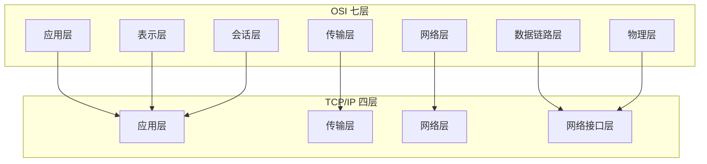
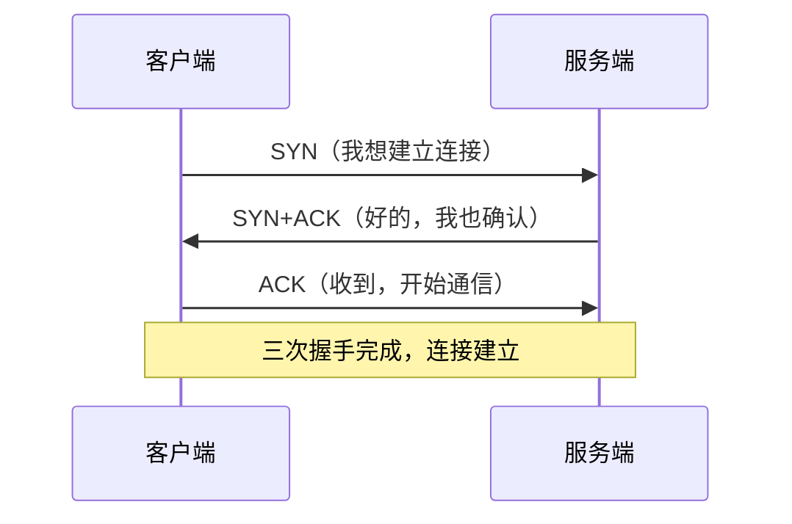
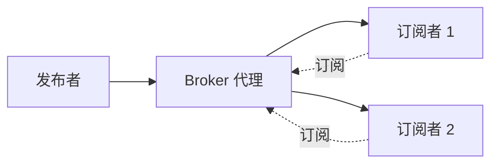

# 计算机网络

> 计算机网络研究的是"两台电脑怎么通信"。从你发一条微信到看一个网页，背后都是网络协议在工作。本文系统梳理网络分层模型、各层核心协议、协议三要素与设计要点，帮助理解互联网如何运转。

**关键词**：网络分层、TCP/IP、HTTP、路由、IP 地址、协议三要素

## 抽象类比

计算机网络像快递系统——你要寄包裹，需要写地址、打包、交给快递公司、经过中转站、最后送达。网络传输也是：数据被打包、经过路由器、最终到达目的地。

协议则像"两个人说话要用同一种语言和礼貌"：你说中文我听中文、你问"你好吗"我答"我很好"、你先说我后答——这种对语言、含义、顺序的共同约定就是协议。换到计算机世界，无非是把"说话"换成了"发数据包"，规则本质不变。

## 一、协议的三要素

任何通信协议都包含三要素，缺一不可：

- 语法（Syntax）：数据的格式长什么样，比如"请求行 + 头部 + 空行 + 正文"
- 语义（Semantics）：每一段字段代表什么含义，比如"200 表示成功，404 表示找不到"
- 时序（Timing）：通信的顺序和节奏，比如"先发请求再回响应""超时多久重传"

只有格式没有含义是乱码，有含义没有顺序会乱套。

## 二、网络协议栈

OSI 七层模型是理论标准，TCP/IP 四层模型是工程实际，二者对应关系如下：

- 应用层（HTTP、FTP、DNS） → 对应 OSI 应用层 + 表示层 + 会话层
- 传输层（TCP、UDP） → 对应 OSI 传输层
- 网络层（IP、ICMP） → 对应 OSI 网络层
- 网络接口层（以太网、Wi-Fi） → 对应 OSI 数据链路层 + 物理层

数据在发送时从上往下逐层"封装"，每层加上自己的头部；接收时从下往上逐层"解封装"，剥掉头部还原出原始数据。这种设计让每一层只关心自己的事，互不干扰。

## 三、应用层协议

应用层协议直接面向用户程序，决定了"用什么姿势通信"。

- HTTP：超文本传输协议，网页浏览的核心，默认端口 80
  - GET 获取数据、POST 提交数据、PUT 更新、DELETE 删除
  - 状态码：200 成功、3xx 重定向、4xx 客户端错误、5xx 服务端错误
- HTTPS：HTTP + TLS 加密，防窃听防篡改，默认端口 443
- WebSocket：在一条 HTTP 连接上实现双向实时通信，适合聊天、推送
- DNS：把域名解析成 IP 地址，默认端口 53
- FTP：文件传输协议，控制连接 21、数据连接 20
- SMTP / POP3 / IMAP：邮件发送 / 接收 / 在服务器管理
  - SMTP 默认 25 / 465（加密）
  - POP3 默认 110 / 995（加密）
  - IMAP 默认 143 / 993（加密）
- SSH：加密远程登录，默认端口 22
- Telnet：远程登录，明文传输，已基本被 SSH 淘汰
- DHCP：自动分配 IP 地址，默认端口 67 / 68
- NTP：网络时间同步，默认端口 123

## 四、传输层协议

传输层负责端到端的数据传递，决定了"可靠还是快"。

### TCP：面向连接的可靠传输

- 三次握手建立连接，四次挥手断开连接
- 保证数据不丢不乱不重，有流量控制和拥塞控制
- 类比"打电话，先确认对方在听，没听清就重说"
- 适合网页、邮件、文件传输

### UDP：无连接的不可靠传输

- 不保证送达，但延迟低、开销小
- 类比"广播喊话，喊出去就不管了，听没听到随缘"
- 适合视频直播、游戏、DNS 查询

### QUIC：基于 UDP 的现代协议

- HTTP/3 的基础
- 把 TLS 加密和连接管理合并，握手更快
- 解决了 TCP 在弱网下队头阻塞的问题

## 五、网络层协议

网络层负责"跨网络把包送到目的地"。

### IP 协议

- IPv4：32 位地址，如 192.168.1.1，已基本耗尽
- IPv6：128 位地址，如 2001:db8::1，几乎用不完

### 其他网络层协议

- ICMP：互联网控制报文协议，ping 命令用的就是它
- ARP：把 IP 地址解析成 MAC 地址，局域网通信必经一步
- 路由协议：路由器之间交换路由信息
  - OSPF：内部网关协议，基于链路状态
  - BGP：外部网关协议，连接不同自治系统，是互联网的骨干
- NAT：网络地址转换，让多台设备共用一个公网 IP

## 六、数据链路层与物理层

这两层负责"在一段链路上把比特搬过去"。

- 以太网：最常见的局域网技术，帧格式为 Ethernet II
- MAC 地址：网卡的物理地址，48 位，局域网内寻址用
- Wi-Fi（IEEE 802.11）：无线局域网标准
- 交换机：工作在数据链路层，按 MAC 地址转发帧
- 集线器 / 中继器：工作在物理层，单纯放大和转发电信号
- CSMA/CD：有线以太网的冲突检测机制
- CSMA/CA：无线 Wi-Fi 的冲突避免机制

## 七、通信协议（非互联网）

不是所有协议都走互联网，很多场景下设备之间也需要约定规则。

- RPC：远程过程调用，让调用远程服务像调用本地函数一样
- gRPC：Google 开源的 RPC 框架，基于 HTTP/2 和 Protobuf
- MQTT：物联网轻量协议，发布订阅模式，适合带宽小、设备多的场景
- CoAP：物联网资源协议，类似"物联网版的 HTTP"，基于 UDP
- Modbus：工业现场总线协议，常用于 PLC 和仪表通信
- CAN：汽车和工业控制总线，抗干扰强
- I2C / SPI / UART：嵌入式常用串行通信协议，详见 [[通信协议]]

上图是 MQTT 的发布订阅模型，发布者和订阅者互不认识，只通过 Broker 中转，这正是它适合海量物联网设备的原因。

## 八、安全与认证协议

安全协议解决"怎么确认你是你、数据不被偷看"的问题，详见 [[网络安全]] 与 [[密码学]]。

- TLS / SSL：在传输层之上加密通信，HTTPS、SMTPS 等都依赖它
- OAuth 2.0：授权框架，"用微信登录 XX 应用"就是它
- JWT：JSON Web Token，把用户信息编码成一段令牌，无状态认证
- SAML：基于 XML 的单点登录协议，企业 SSO 常用
- Kerberos：基于票据的域认证协议，Windows 域环境核心
- mTLS：双向 TLS，客户端和服务端互相验证证书

## 九、常见协议端口速查

背下面这些端口，排查网络问题、写防火墙规则都很快。

- 20 / 21：FTP（数据 / 控制）
- 22：SSH
- 23：Telnet
- 25：SMTP
- 53：DNS
- 67 / 68：DHCP
- 80：HTTP
- 110：POP3
- 123：NTP
- 143：IMAP
- 443：HTTPS
- 465 / 995 / 993：SMTPS / POP3S / IMAPS（加密邮件）
- 3306：MySQL
- 5432：PostgreSQL
- 6379：Redis
- 8080：常见 HTTP 备用端口
- 27017：MongoDB

## 十、网络的应用场景

- 浏览网页：HTTP/HTTPS，浏览器和服务器通信
- 发邮件：SMTP/POP3/IMAP，邮件传输协议
- 视频通话：UDP/WebRTC，实时性要求高
- 文件传输：FTP/TCP，要求完整可靠
- 远程登录：SSH，安全远程控制
- 物联网通信：MQTT/CoAP，轻量带宽小

## 面试速答

### Q1：TCP 三次握手为什么不是两次？

两次握手只能确认"客户端能收到服务端的包"，但服务端无法确认"客户端能收到自己的包"。三次握手让双方都确认了收发能力，同时防止历史连接请求被误当成新连接，造成资源浪费。

### Q2：TCP 和 UDP 有什么区别？分别适用什么场景？

- TCP 面向连接、可靠传输、有序到达，适合网页、文件传输等要求完整的场景
- UDP 无连接、不保证可靠、速度快，适合视频通话、游戏等要求实时的场景
- 类比：TCP 是顺丰快递（保证送达有签收），UDP 是平邮（扔出去就不管）

### Q3：HTTP 和 HTTPS 有什么区别？

HTTPS = HTTP + TLS 加密。HTTP 明文传输，数据可被窃听篡改；HTTPS 在传输层加密，保证机密性、完整性和身份认证，但握手开销略大。现在网站基本都用 HTTPS。

### Q4：为什么 DNS 既要走 TCP 又要走 UDP？

DNS 查询报文通常很短，用 UDP 更快更省资源；但当响应数据超过 512 字节（如区域传输）或 UDP 不稳定时，会切换到 TCP 保证可靠性。

### Q5：OSI 七层模型和 TCP/IP 四层模型有什么关系？

OSI 是理论标准，TCP/IP 是工程实际。TCP/IP 的应用层对应 OSI 的应用+表示+会话三层，传输层、网络层一一对应，TCP/IP 的网络接口层对应 OSI 的数据链路层+物理层。实际开发中常用 TCP/IP 四层模型，因为它更贴近真实协议栈。

### Q6：在浏览器输入 URL 到页面展示，发生了什么？

DNS 解析域名得到 IP → TCP 三次握手建立连接 → 发送 HTTP 请求 → 服务器处理并返回响应 → 浏览器解析 HTML/CSS/JS 渲染页面 → TCP 四次挥手断开。整个过程涉及应用层、传输层、网络层、链路层的协同。

### Q7：为什么网络要分层？

分层让每层只负责一件事，层与层之间通过接口交互，互不干扰。好处是：改一层不影响其他层、便于标准化、便于排错。类比：快递系统改运输工具（飞机换高铁）不影响你写信的方式。