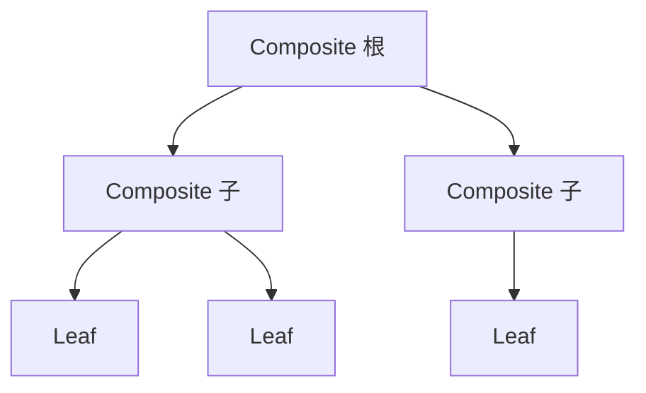
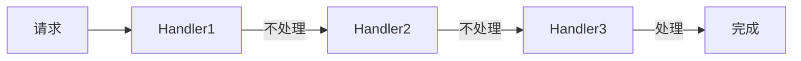
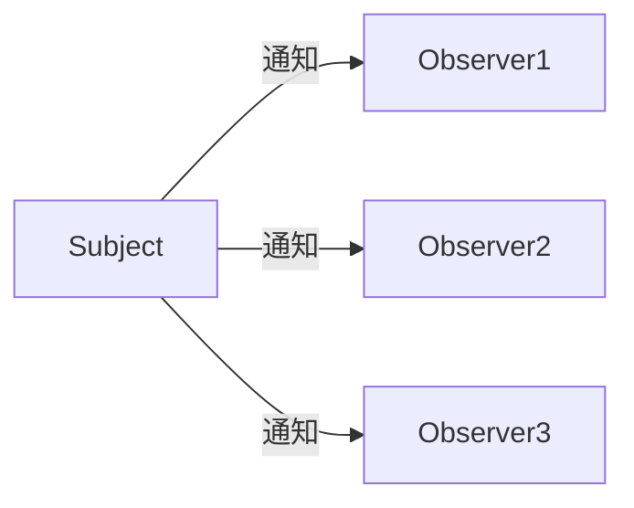

# 设计模式入门

> 设计模式是前人总结的"代码套路"，解决软件开发中反复出现的问题。学会设计模式，代码更易读、易维护、易扩展。本文讲解 GoF 23 种经典模式的意图、场景与角色，也是面试高频考点。

**关键词**：设计模式、面向对象、创建型、结构型、行为型、GoF

## 抽象类比

设计模式像"菜谱模板"——做蛋糕有蛋糕的模板，炒菜有炒菜的模板。不用每次从零开始想怎么做，套用模板就行。写代码也一样：要创建对象有"创建型模式"，要组织代码结构有"结构型模式"，要处理行为有"行为型模式"，共 23 种 GoF 经典套路。

## 什么是设计模式？

想象你要盖房子：
- **没有设计模式**：每次盖房都从头想方案，容易踩坑
- **有设计模式**：前人总结了"地基怎么打""承重墙怎么设""门窗怎么开"，照着来就行

**简单说**：设计模式是**软件开发中常见问题的经典解决方案**，是程序员之间的"通用语言"。

---

## 设计模式的设计哲学

设计模式源自 1994 年"四人帮"（GoF）的书《设计模式》。核心思想：
- **面向接口编程**：不依赖具体实现，依赖抽象
- **组合优于继承**：用组合代替继承，更灵活
- **开闭原则**：对扩展开放，对修改关闭

三大类模式：
- **创建型（5 种）**：怎么创建对象——把对象创建逻辑封装隔离
- **结构型（7 种）**：怎么组织代码结构——把类或对象组合成更大结构
- **行为型（11 种）**：怎么处理对象之间的行为——定义对象间职责分配与通信

---

## 一、创建型模式（5 种）—— 怎么创建对象

### 1. 单例模式 Singleton

- **意图**：保证一个类只有一个实例，并提供全局访问点
- **类比**：像国家主席——全国只能有一个，谁找主席都是同一个人
- **场景**：配置管理器、数据库连接池、日志器、线程池
- **关键角色**：
  - Singleton：唯一实例类，私有构造、静态获取方法

### 2. 工厂方法 Factory Method

- **意图**：定义创建对象的接口，由子类决定实例化哪个类
- **类比**：像披萨分店——总部定流程，各地分店各自做当地口味的披萨
- **场景**：框架提供扩展点、根据参数创建不同实现、日志框架不同输出
- **关键角色**：
  - Product：产品抽象接口
  - ConcreteProduct：具体产品
  - Creator：工厂抽象，声明工厂方法
  - ConcreteCreator：子工厂，返回具体产品

### 3. 抽象工厂 Abstract Factory

- **意图**：创建一族相关或相互依赖的产品，无需指定具体类
- **类比**：像宜家整套风格家具——选"北欧风"就配套出椅子+桌子+沙发，整套风格统一
- **与工厂方法的区别**：工厂方法生产单一产品线，抽象工厂生产产品族（多个相关产品）
- **场景**：跨平台 UI（Windows/Mac 各一套控件）、多数据库驱动套件
- **关键角色**：
  - AbstractFactory：声明创建多种产品的方法
  - ConcreteFactory：实现一族产品的创建
  - AbstractProduct / ConcreteProduct：各产品线接口与实现

### 4. 建造者 Builder

- **意图**：将复杂对象的构造与表示分离，同样的构造过程可创建不同表示
- **类比**：像点套餐——主食、配菜、饮品一步步加，最后凑成一份套餐
- **场景**：SQL 构建器、复杂配置对象、文档生成器、不可变对象分步构造
- **关键角色**：
  - Builder：抽象建造者，定义各部件构造步骤
  - ConcreteBuilder：实现具体构造
  - Director：指挥者，控制构造流程
  - Product：最终产品

### 5. 原型 Prototype

- **意图**：通过克隆已有实例来创建新对象，而非从头 new
- **类比**：像复印文件——已有原件，复印一份改改就能用，不必重新打字
- **场景**：避免重复初始化开销、创建成本高的对象（如加载大配置）、批量生成相似对象
- **关键角色**：
  - Prototype：声明克隆方法的接口
  - ConcretePrototype：实现 clone，深拷贝/浅拷贝需注意

---

## 二、结构型模式（7 种）—— 怎么组织代码

### 6. 适配器 Adapter

- **意图**：将一个类的接口转换成客户端期望的另一个接口
- **类比**：像电源适配器——中国插头插不进欧洲插座，转换器中间转一下就行
- **场景**：旧系统接口复用、第三方 SDK 接口不匹配、统一多个不同接口
- **关键角色**：
  - Target：客户端期望的接口
  - Adaptee：需要被适配的现有接口
  - Adapter：中间转换器，实现 Target 并持有 Adaptee

### 7. 桥接 Bridge

- **意图**：将抽象部分与实现部分分离，使二者可独立变化
- **类比**：像遥控器和电视分离——遥控器（抽象）与电视（实现）独立演进，同一遥控器能配不同电视
- **场景**：跨平台 UI、支持多维度变化的系统（形状×颜色、消息×发送渠道）
- **关键角色**：
  - Abstraction：抽象类，持有 Implementor 引用
  - RefinedAbstraction：扩展抽象
  - Implementor：实现接口
  - ConcreteImplementor：具体实现

### 8. 组合 Composite

- **意图**：将对象组合成树形结构，使单个对象与组合对象使用方式一致
- **类比**：像公司组织架构——部门可含子部门也可含员工，对外都是"组织成员"
- **场景**：文件系统（文件/文件夹）、菜单树、组织架构图、AST 节点
- **关键角色**：
  - Component：统一接口（叶子和容器都用它）
  - Leaf：叶子节点，无子节点
  - Composite：容器节点，可包含子 Component

### 9. 装饰器 Decorator

- **意图**：动态地给对象添加职责，比继承更灵活
- **类比**：像给游戏角色穿装备——基础属性不变，穿盔甲加防御，拿武器加攻击，层层叠加
- **场景**：IO 流包装（缓冲、压缩、加密层层套）、动态加日志/权限/缓存
- **关键角色**：
  - Component：对象接口
  - ConcreteComponent：被装饰的原始对象
  - Decorator：抽象装饰器，持有 Component 引用
  - ConcreteDecorator：具体装饰，添加额外职责

### 10. 外观 Facade

- **意图**：为复杂子系统提供一个统一简化入口
- **类比**：像电脑的"一键开机"按钮——背后 CPU、内存、硬盘依次启动，用户只按一下
- **场景**：复杂子系统封装（给第三方用）、分层架构的服务层、SDK 简化 API
- **关键角色**：
  - Facade：外观类，对外提供简化方法
  - Subsystem Classes：各子系统，外观知道如何调度它们

### 11. 享元 Flyweight

- **意图**：共享细粒度对象，减少内存占用
- **类比**：像共享单车池——一辆车被很多人轮流骑，不必每人买一辆
- **场景**：棋盘游戏大量棋子、字符串常量池、线程池、连接池
- **关键角色**：
  - Flyweight：共享对象接口
  - ConcreteFlyweight：可共享的具体对象（内部状态）
  - FlyweightFactory：工厂管理共享池
  - Client：维护外部状态传入

### 12. 代理 Proxy

- **意图**：为其他对象提供代理以控制访问
- **类比**：像明星的经纪人——找明星办事先经过经纪人，经纪人决定是否放行
- **场景**：延迟加载（虚拟代理）、权限控制（保护代理）、远程调用（远程代理）、缓存
- **关键角色**：
  - Subject：真实对象与代理的共同接口
  - RealSubject：真实对象
  - Proxy：代理，持有 RealSubject 引用并控制访问

---

## 三、行为型模式（11 种）—— 怎么处理行为

### 13. 责任链 Chain of Responsibility

- **意图**：将请求沿处理者链传递，每个处理者决定处理或传给下一个
- **类比**：像报销审批流——金额小组长批，中等经理批，大的总监批，逐级上报
- **场景**：过滤器链、拦截器（Spring HandlerInterceptor）、审批流、异常处理链
- **关键角色**：
  - Handler：抽象处理者，持有下一个 Handler 引用
  - ConcreteHandler：具体处理者，决定处理或下传
  - Client：发起请求

### 14. 命令 Command

- **意图**：将请求封装成对象，从而可参数化、排队、记录日志、撤销
- **类比**：像餐厅点菜——顾客把订单（命令）交给服务员，服务员传给厨师执行，不直接接触
- **场景**：撤销/重做、任务队列、宏命令、事务操作封装
- **关键角色**：
  - Command：命令接口，声明 execute
  - ConcreteCommand：绑定 Receiver 与动作
  - Receiver：实际执行者
  - Invoker：调用者，持有命令
  - Client：创建并装配命令

### 15. 解释器 Interpreter

- **意图**：给定一种语言，定义其文法表示，并定义解释器解释句子
- **类比**：像翻译官——拿到外语按语法规则逐句翻译成本地语言
- **场景**：SQL 解析、规则引擎、表达式求值、配置脚本、正则引擎
- **关键角色**：
  - AbstractExpression：声明 interpret 操作
  - TerminalExpression：终结符解释（如变量、常量）
  - NonterminalExpression：非终结符解释（如运算符组合）
  - Context：上下文，存全局信息
  - Client：构建抽象语法树

### 16. 迭代器 Iterator

- **意图**：提供方法顺序访问聚合对象中的元素，而不暴露其内部结构
- **类比**：像电视遥控器换台——不用知道电视台内部如何排列，按一下下一个就行
- **场景**：集合遍历、自定义容器遍历、流式处理、分页迭代
- **关键角色**：
  - Iterator：迭代接口（hasNext、next）
  - ConcreteIterator：具体实现
  - Aggregate：聚合接口，创建迭代器
  - ConcreteAggregate：具体容器

### 17. 中介者 Mediator

- **意图**：用一个中介对象封装一组对象间的交互，使对象间不直接引用
- **类比**：像机场塔台——飞机之间不直接通信，全通过塔台统一调度，避免混乱
- **场景**：聊天室、事件总线、MVC 中 Controller 充当中介、UI 组件联动
- **关键角色**：
  - Mediator：中介接口，定义同事间通信
  - ConcreteMediator：实现协作逻辑，持有各同事引用
  - Colleague：同事类，通过中介与其他同事通信

### 18. 备忘录 Memento

- **意图**：在不破坏封装的前提下，捕获对象内部状态，以便以后恢复
- **类比**：像游戏存档——打到 Boss 前先存档，挂了就读档回到之前状态
- **场景**：撤销操作、事务回滚、检查点保存、状态快照
- **关键角色**：
  - Originator：原发器，创建并恢复备忘录
  - Memento：备忘录，存储原发器内部状态
  - Caretaker：管理者，仅负责保存备忘录，不读其内容

### 19. 观察者 Observer

- **意图**：定义对象间一对多依赖，当一个对象状态变化时，所有依赖者收到通知
- **类比**：像公众号订阅——你关注了某号，它发新文章你自动收到推送
- **场景**：事件监听、消息推送、数据绑定（MVC 中 View 监听 Model）、响应式编程
- **关键角色**：
  - Subject：被观察者，维护观察者列表，状态变化时通知
  - ConcreteSubject：具体被观察者
  - Observer：观察者接口，定义 update
  - ConcreteObserver：具体观察者

### 20. 状态 State

- **意图**：允许对象在内部状态改变时改变其行为，对象看起来像改了类
- **类比**：像手机的静音/响铃模式——来电时静音模式不响铃，响铃模式响铃，状态决定行为
- **场景**：订单状态机（待支付/已支付/已发货/已完成）、流程引擎、角色状态切换
- **关键角色**：
  - Context：环境类，持有当前 State，委托状态处理
  - State：抽象状态，声明行为接口
  - ConcreteState：具体状态，实现该状态下的行为

### 21. 策略 Strategy

- **意图**：定义一系列算法，把它们封装成可互换的组件，客户端可动态选择
- **类比**：像导航 App 选路线——最快、最短、避高速，选哪种策略走哪条路
- **场景**：多种算法可互换、避免大量 if-else、促销折扣计算、支付方式选择
- **关键角色**：
  - Strategy：策略接口
  - ConcreteStrategy：具体策略实现
  - Context：上下文，持有 Strategy 引用并委托执行

### 22. 模板方法 Template Method

- **意图**：定义算法骨架，将某些步骤延迟到子类实现
- **类比**：像考试流程——所有学生都是"发卷→答题→收卷"，但每个人答题内容不同
- **场景**：框架固定流程、生命周期钩子、Servlet 的 doGet/doPost、Spring 初始化钩子
- **关键角色**：
  - AbstractClass：抽象类，定义模板方法（算法骨架）和基本方法
  - ConcreteClass：子类，实现具体步骤
  - Template Method：通常是 final 方法，防止子类改骨架

### 23. 访问者 Visitor

- **意图**：在不改变各元素类的前提下，定义作用于这些元素的新操作
- **类比**：像质检员巡检不同零件——零件本身不变，质检员按零件类型执行不同检查动作
- **场景**：编译器 AST 遍历、文档导出（PDF/HTML 不同访问者）、报表生成、序列化
- **关键角色**：
  - Visitor：访问者接口，为每种 Element 声明 visit 方法
  - ConcreteVisitor：具体访问者，实现具体操作
  - Element：元素接口，声明 accept(Visitor)
  - ConcreteElement：具体元素，在 accept 中回调 visitor.visit(this)
  - ObjectStructure：对象结构，遍历元素并 accept

---

## 四、设计原则速查

- **单一职责原则（SRP）**：一个类只做一件事，只有一个变化的理由
- **开闭原则（OCP）**：对扩展开放，对修改关闭——加新功能不碰旧代码
- **里氏替换原则（LSP）**：子类必须能替换父类使用，不破坏程序行为
- **接口隔离原则（ISP）**：不强迫客户端依赖它不使用的方法，接口要小而专
- **依赖倒置原则（DIP）**：依赖抽象不依赖具体，高层不依赖低层细节
- **迪米特法则（LoD）**：一个对象只与直接朋友通信，少了解陌生人（最少知识）

---

## 五、模式关系与选型

按场景选模式：
- **全局唯一实例** → 单例
- **根据类型创建对象** → 工厂方法；**创建一族相关产品** → 抽象工厂
- **分步构造复杂对象** → 建造者
- **复制已有对象** → 原型
- **接口不兼容要做转换** → 适配器
- **跨维度独立变化** → 桥接
- **树形结构统一处理** → 组合
- **动态加功能** → 装饰器
- **封装复杂子系统** → 外观
- **大量相似对象共享** → 享元
- **控制对象访问** → 代理
- **请求逐级审批** → 责任链
- **请求需排队/撤销** → 命令
- **规则/语法解释** → 解释器
- **顺序遍历集合** → 迭代器
- **多对象互交互** → 中介者
- **保存恢复状态** → 备忘录
- **一对多通知** → 观察者
- **状态驱动行为** → 状态
- **算法可互换** → 策略
- **固定流程子类填空** → 模板方法
- **对结构元素加新操作** → 访问者

---

## 六、23 种模式记忆口诀

**创建型 5 种（怎么造）**：
- 单例（唯一）、工厂方法（一产品）、抽象工厂（产品族）、建造者（分步拼）、原型（克隆）

**结构型 7 种（怎么搭）**：
- 适配器（转接口）、桥接（分离两维）、组合（树形）、装饰器（加功能）、外观（简化入口）、享元（共享）、代理（控访问）

**行为型 11 种（怎么动）**：
- 责任链（逐级传）、命令（封装请求）、解释器（翻译语法）、迭代器（顺序走）、中介者（中间调度）、备忘录（存档）、观察者（订阅）、状态（换状态换行为）、策略（换算法）、模板方法（填空）、访问者（外挂操作）

口诀顺口溜：
- 创建造单工抽建原
- 结构适桥组装外享代
- 行为责命解迭中备观状策模访

---

## 面试速答

### Q: 单例模式怎么实现？有什么注意点？
A: 单例保证一个类只有一个实例，并提供全局访问点。常见实现：饿汉式（类加载时创建，线程安全但浪费）、懒汉式（首次使用时创建，需加锁防并发）、双重检查锁（兼顾性能和安全）、静态内部类（利用类加载机制保证线程安全且延迟加载）、枚举（天然防反射防序列化）。注意点：多线程安全、防止反射攻击、防止序列化破坏、避免单例被垃圾回收。类比：国家主席全国只能有一个。

### Q: 工厂方法和抽象工厂有什么区别？
A: 工厂方法针对单一产品族，一个工厂创建一种产品（披萨店做披萨，每个分店做一种）；抽象工厂针对产品族，一个工厂创建多种相关产品（披萨店同时做披萨+饮料+甜点，整套配套）。当需要创建一组相关产品时用抽象工厂，单一产品用工厂方法。抽象工厂常用于跨平台 UI（一套工厂出按钮+输入框+对话框）。

### Q: 策略模式和工厂模式有什么区别？
A: 工厂模式关注"创建什么对象"，根据条件生产不同对象，是创建型；策略模式关注"用什么算法"，把不同策略封装成可互换组件，是行为型。工厂是"造东西"，策略是"做事情"。两者常组合：工厂创建策略对象，策略执行具体逻辑。类比：工厂是披萨店选做哪种披萨，策略是导航 App 选哪条路线。

### Q: 观察者模式用在什么场景？
A: 当一个对象状态变化需通知多个依赖对象时用观察者模式。典型场景：事件监听（按钮点击）、消息推送（公众号订阅）、数据绑定（MVC 中 View 监听 Model 变化）、响应式编程（RxJava、Vue 响应式）。被观察者维护观察者列表，状态变化时自动通知。解耦了发布者和订阅者，新增订阅者无需修改被观察者。注意避免循环通知和内存泄漏（及时取消订阅）。

### Q: 开闭原则是什么？为什么重要？
A: 开闭原则指"对扩展开放，对修改关闭"——添加新功能应扩展代码而非修改已有代码。这样既不破坏已有逻辑（避免引入 bug），又能灵活扩展。设计模式大多是为实现开闭原则服务的：策略模式扩展算法、观察者模式扩展监听器、装饰器模式扩展功能、工厂方法扩展新产品。开闭原则是面向对象设计的核心目标，其他原则（单一职责、依赖倒置等）都是为它服务。

---

## 理解与验证闭环

- **关键连接**：模式是对反复出现的设计张力命名，不是类图模板；先识别变化轴，再决定是否引入间接层。
- **最小验证**：对一个含大量条件分支的小程序分别用策略、状态或责任链重构，并比较扩展成本。
- **取舍边界**：模式增加对象与理解成本；如果变化尚未发生，简单函数和数据结构往往更合适。

复习时先画出核心对象和数据流，再用一个反例解释边界，最后用实验数据或可观察证据校正直觉。
