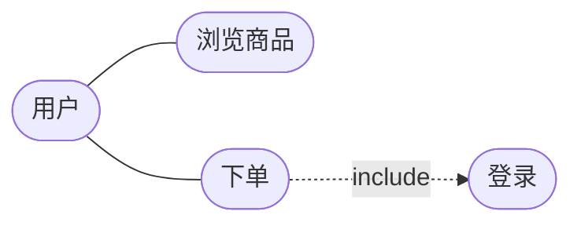
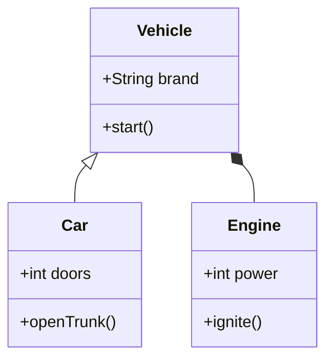
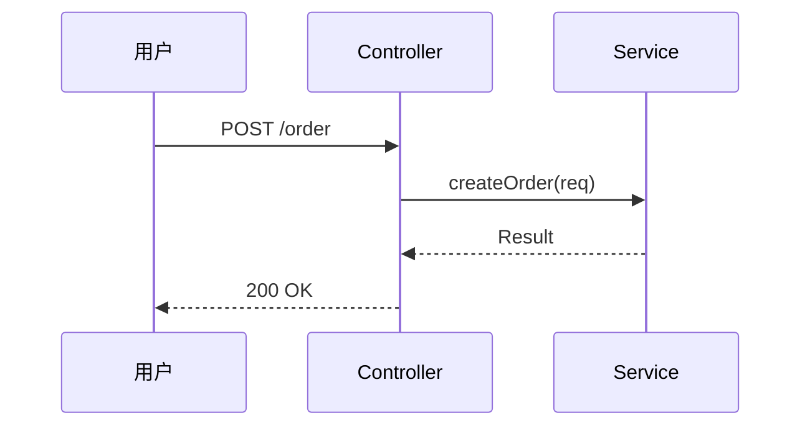
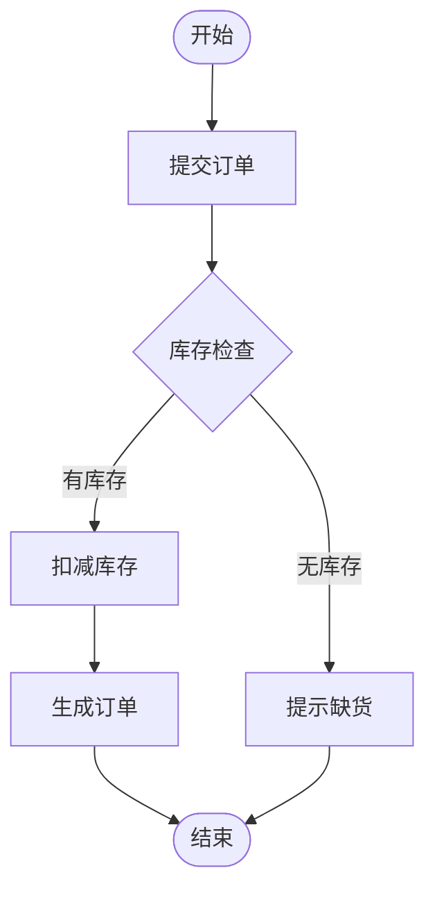
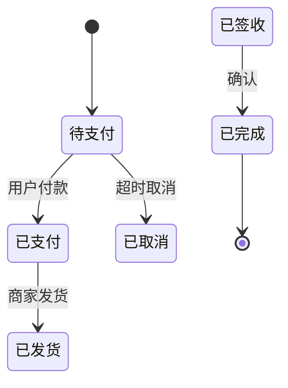

# 软件工程入门

> 软件工程研究的是"怎么开发大型软件项目"。写代码容易，但多人协作、长期维护、保证质量很难。软件工程就是解决这些问题的方法论。本文讲解软件开发生命周期、过程模型与工程化实践。

**关键词**：软件工程、生命周期、瀑布模型、敏捷开发、DevOps、质量保证

## 抽象类比

软件工程像建筑工程管理——一个人盖茅草屋不需要图纸，但盖摩天大楼需要设计、施工、监理、验收全套流程。

写个小脚本不需要软件工程，但开发微信、淘宝这种大型系统，没有工程化管理就会一团糟。

## 什么是软件工程？

想象你要盖一栋楼：
- **自己盖茅草屋**：想怎么盖就怎么盖，不需要规划
- **请施工队盖别墅**：需要图纸、工期、验收
- **开发大型软件**：需要需求分析、设计、编码、测试、维护

**简单说**：软件工程是**用工程化的方法开发和维护软件**的学科。

---

## 软件工程的设计哲学

软件工程的核心问题是：**如何在"质量"、"成本"、"时间"之间取得平衡？**

三种经典模型：
- **瀑布模型**：按部就班，需求 → 设计 → 编码 → 测试 → 维护
- **敏捷开发**：快速迭代，小步快跑，拥抱变化
- **DevOps**：开发和运维一体化，持续交付

选择取决于项目：
- 需求明确、不能变？用瀑布
- 需求不确定、要快速验证？用敏捷
- 要快速交付、持续更新？用 DevOps

---

## 核心概念

### 1. 软件开发生命周期

**类比**：像盖楼的全过程——规划 → 设计 → 施工 → 验收 → 维护。

| 阶段 | 做什么 | 产出 |
| :--- | :--- | :--- |
| **需求分析** | 搞清楚要做什么 | 需求文档 |
| **设计** | 规划怎么做 | 设计文档 |
| **编码** | 写代码实现 | 源代码 |
| **测试** | 检查有没有 bug | 测试报告 |
| **维护** | 修复问题、添加功能 | 更新版本 |

---

### 2. 敏捷开发：小步快跑

**类比**：像做 MVP——先做一个能用的版本，根据反馈快速迭代。

核心思想是"小步快跑、持续反馈、响应变化"：每 1-4 周交付一个可用版本，需求变了就快速调整，通过每日站会同步进度、让客户持续参与反馈。

**代表框架**：Scrum、Kanban、XP

> 深入实践见 [[敏捷开发]]

---

### 3. 版本控制：时光机

**类比**：像游戏的存档功能，随时可以回到之前的版本。

版本控制工具（Git）的核心能力：
- 记录每次修改
- 多人协作不冲突
- 随时回滚到历史版本
- 分叉开发不同功能

> 分支策略与协作见 [[CICD]]

---

### 4. 测试：质量保障

**类比**：像汽车出厂前的质检——每个零件都要检查，整车也要路测。

测试层次：
- **单元测试**：检查单个函数
- **集成测试**：检查模块之间的配合
- **系统测试**：检查整个系统
- **验收测试**：客户确认是否满足需求

> 测试方法与测试替身见 [[软件测试]]

---

## 软件工程的应用场景

| 场景 | 用什么 | 为什么 |
| :--- | :--- | :--- |
| **大型项目** | 瀑布/敏捷 | 多人协作、长期维护 |
| **创业公司** | 敏捷/MVP | 快速验证、拥抱变化 |
| **开源项目** | Git + 敏捷 | 分布式协作 |
| **企业系统** | DevOps | 持续交付、快速迭代 |

---

## UML 建模

UML（Unified Modeling Language）是软件工程的可视化建模语言，用图形把"系统长什么样、怎么运作"画出来。它不是编程语言，而是"工程图纸"，让产品、开发、测试在同一个图上对齐认知。

UML 图分两大类：
- **静态结构图**：描述系统"长什么样"——类图、对象图、组件图、部署图
- **动态行为图**：描述系统"怎么运作"——用例图、活动图、状态图、时序图

### 用例图：谁能做什么

需求分析阶段最常用，描述参与者与系统功能的边界。

### 类图：零件长什么样

UML 中最核心的图，描述类的结构及类之间的静态关系。类用三栏矩形表示：类名、属性、方法。可见性 `+` public、`-` private、`#` protected。

类之间的六大关系（弱→强）：

- **依赖**：临时使用，B 作为 A 的方法参数。虚线箭头
- **关联**：长期持有，B 作为 A 的成员变量。实线箭头
- **聚合**：弱拥有，部分可脱离整体。空心菱形，如"俱乐部-会员"
- **组合**：强拥有，部分与整体同生共死。实心菱形，如"鸟-翅膀"
- **泛化**：继承关系。空心三角箭头
- **实现**：实现接口。空心三角虚线

### 时序图：谁先动谁后动

描述对象之间按时间顺序的交互，是接口设计、排查调用链的必备图。

### 活动图：流程怎么走

描述工作流或业务流程，类似流程图但支持并行分支。

### 状态图：对象的生命周期

描述一个对象在生命周期中各种状态及转换条件，适合订单、审批等"状态机"业务。

### 组件图与部署图

- **组件图**：描述系统各模块及其依赖，关注"软件结构"
- **部署图**：描述系统在硬件节点上的部署方式，关注"物理结构"

上线部署、架构文档时按需画。

### 画图原则与误区

- **简洁优先**：一张图只表达一个主题，复杂系统拆多张
- **先粗后细**：先高层后底层
- **持续维护**：图与代码同步，过期的图比没有图更糟
- 工具：PlantUML（文本驱动）、Mermaid（Markdown 友好）、draw.io（拖拽）
- 误区：过度画图、图代码脱节、死抠符号、只画不维护

---

## 总结

### 三句话讲清楚软件工程

1. 软件工程是用工程化的方法开发和维护软件
2. 核心是平衡质量、成本、时间，选择合适的开发模型
3. 敏捷开发、版本控制、测试是 modern 软件的标配

### 核心类比

> 软件工程像建筑工程管理——一个人盖茅草屋不需要图纸，但盖摩天大楼需要全套流程。

### 关键词

**软件工程、敏捷开发、瀑布模型、版本控制、测试、DevOps**

---

## 面试速答

### Q: 瀑布模型和敏捷开发有什么区别？
A: 瀑布按固定顺序一次性走完需求→设计→编码→测试→维护，文档完整但难以应对变化；敏捷小步快跑，1-4周迭代一次，拥抱变化、快速反馈。需求稳定选瀑布，需求不确定选敏捷。类比：瀑布是按图纸盖楼不能改，敏捷是装修边住边调。

### Q: 什么是DevOps？
A: DevOps把开发（Dev）和运维（Ops）一体化，通过自动化工具链实现持续集成、持续交付（CI/CD），让代码从提交到上线又快又稳。核心是打破开发和运维的壁垒，提高交付效率和质量。

### Q: 为什么要做单元测试？
A: 单元测试检查单个函数/模块的正确性，能在开发早期发现bug，修复成本低。它是测试金字塔的底层，数量最多、运行最快。有了单元测试，重构时不怕改坏，回归测试自动化。类比：汽车零件出厂前逐个检测，比整车装好再查问题省事。

### Q: Git和传统版本控制有什么区别？
A: Git是分布式版本控制，每个开发者本地有完整仓库，离线可提交、分支轻量、合并灵活；传统（如SVN）是集中式，依赖中央服务器，分支重、离线受限。Git特别适合开源和团队协作。

### Q: 什么是代码重构？什么时候做？
A: 重构是在不改变外部行为的前提下改善代码内部结构，让代码更易读、易维护。时机：添加功能前、修复bug后、代码review时。原则是"小步快跑、每次可验证"，避免大规模重写。类比：整理房间——东西摆放更合理，但不扔掉有用的东西。

### Q: UML 类图中各关系怎么区分？
A: 按弱→强排列：依赖（临时用，方法参数）、关联（长期持有，成员变量）、聚合（弱拥有，部分可脱离，空心菱形，如俱乐部-会员）、组合（强拥有，同生共死，实心菱形，如鸟-翅膀）、泛化（继承，空心三角）、实现（接口，空心三角虚线）。记忆口诀：依赖 < 关联 < 聚合 < 组合 < 泛化/实现。

### Q: 什么时候用时序图？什么时候用活动图？
A: 时序图强调"多个对象之间的交互顺序"，适合接口调用、跨服务流程；活动图强调"单一流程的步骤和分支"，适合业务流程、用例细化。简单判断：跨对象协作用时序图，单流程梳理用活动图。

---

## 理解与验证闭环

- **关键连接**：需求、设计、实现、验证、交付与反馈是闭环；每个工件都应能追溯到用户价值和风险。
- **最小验证**：完成一个小需求：写验收标准、拆任务、提交代码、自动测试、发布说明并复盘。
- **取舍边界**：流程服务于反馈与质量，不以文档数量或仪式完整度代替可工作的软件。

复习时先画出核心对象和数据流，再用一个反例解释边界，最后用实验数据或可观察证据校正直觉。
