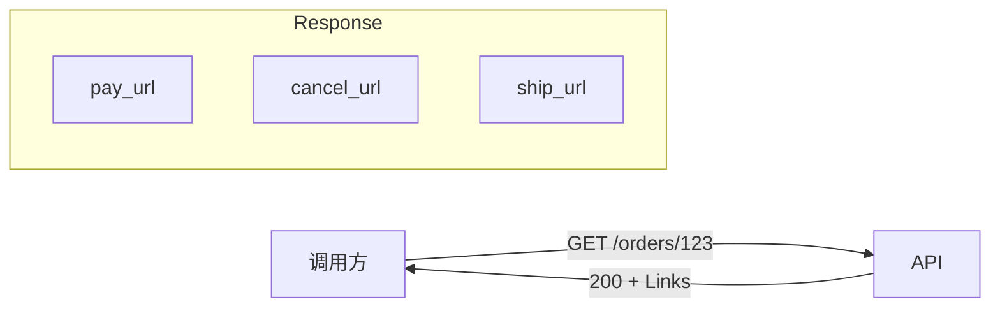
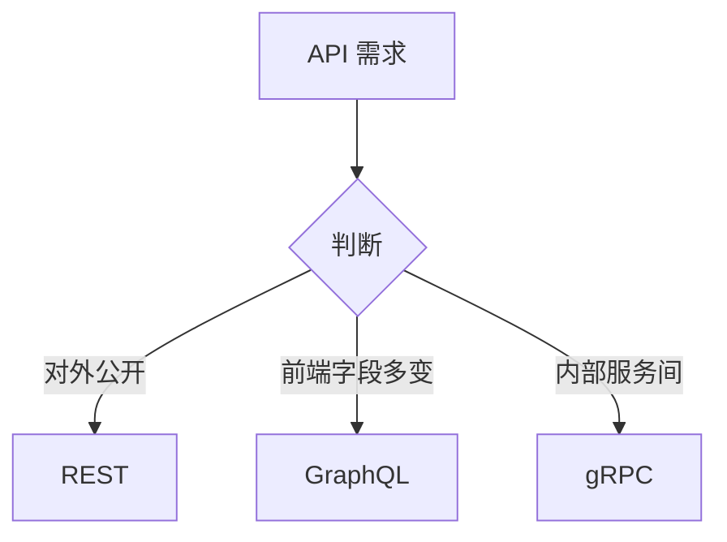

# API设计

> API 设计是定义"软件之间如何对话"的契约设计活动：好的 API 让调用方用得舒服、维护方改得安心、演进方扩得从容，坏的 API 会成为系统十年都还不完的债务。

**关键词**：API设计、RESTful、OpenAPI、版本管理、契约、HATEOAS、限流、文档

## 抽象类比

API 就像餐厅的"菜单"：菜单上写清楚有什么菜、怎么点、价格多少、要不要辣。顾客（调用方）不需要知道后厨怎么炒，服务员（API 层）按菜单接单并把结果端出来。菜单设计得好，点单流畅、出错少、回头客多；设计得差，顾客一头雾水、服务员跑断腿、后厨还要返工。

进一步说，API 也是"合同"。一旦发布出去被外部使用，它就具有了契约性质——你不能随便改菜价、改菜名，否则老主顾就会"砸场子"。所以 API 设计不只是技术活，更是一种长期承诺。

## 适合人群

- 后端开发入门到进阶者
- 准备系统设计面试的求职者
- 想做技术负责人 / 架构师的人
- 经常对接前后端、第三方 SDK 的工程师

## 预备知识

- 了解 HTTP 协议（方法、状态码、Header）
- 知道 JSON / XML 等数据格式
- 用过一两个公开 API（如 GitHub API、微信开放平台）
- 听过"REST""GraphQL""微服务"等术语

## 一、API 是什么

### 定义

- API（Application Programming Interface，应用程序编程接口）是软件组件之间交互的约定
- 它规定了：调用什么、传什么、返回什么、出错怎么办
- 本质是一份"接口契约"，屏蔽实现细节，只暴露能力

### API 设计的三大目标

- 可用（Usable）：调用方能方便地完成任务，不需要猜测
- 可维护（Maintainable）：实现方修改内部逻辑不会破坏调用方
- 可演进（Evolvable）：能在不破坏老调用方的前提下持续迭代

### 接口即契约

契约一旦签订就不能单方面撕毁——这是 API 设计最重要的心智模型。发布即承诺，破坏即代价。

## 二、API 设计的核心原则

### 一致性

- 命名风格统一（如全用复数名词 `users`、`orders`）
- 错误结构统一（同样的 `code/message/details` 三段式）
- 分页/排序/过滤参数统一（如全用 `page/size` 或 `cursor`）
- 时间格式统一（推荐 ISO 8601 + UTC）

### 简洁性

- 一个接口只做一件事
- 参数不要超过 5-7 个，超了就拆子资源或批量接口
- 返回字段按需暴露，避免"全量吐库"

### 可预测性

- 命名顾名思义，调用方看一眼就知道行为
- 行为符合惯例：`GET` 不改数据，`DELETE` 是幂等
- 相似资源遵循相似模式，避免"每个接口都是新世界"

### 容错性

- 输入校验在前，业务在后
- 错误信息对机器友好（错误码）也对人友好（描述）
- 不暴露内部异常堆栈给外部

### 最小惊讶原则（Principle of Least Astonishment）

- 让 API 的行为符合调用方的直觉
- 反例：`deleteUser()` 实际是"标记删除"且会触发邮件通知——令人惊讶
- 一个反直觉的 API，文档再详细也救不回来

## 三、RESTful API 设计

REST（Representational State Transfer）是 Roy Fielding 在 2000 年博士论文中提出的架构风格，核心思想是"资源 + 统一接口"。

### 资源建模

- 把业务实体抽象为资源（名词）：`users`、`orders`、`products`
- 资源之间有层级关系：`/users/{id}/orders`
- 资源建模可借鉴 [[领域驱动设计]] 中的聚合根与限界上下文

### HTTP 方法语义

- `GET`：查询，幂等，无副作用
- `POST`：创建，非幂等
- `PUT`：整体替换，幂等
- `PATCH`：局部更新，幂等性看实现
- `DELETE`：删除，幂等

### 状态码

- `2xx`：成功（200 OK、201 Created、204 No Content）
- `3xx`：重定向（301、304 Not Modified）
- `4xx`：客户端错误（400、401、403、404、409、422、429）
- `5xx`：服务端错误（500、502、503、504）

### URI 命名规范

- 用复数名词：`/orders` 而非 `/order`
- 小写 + 连字符：`/order-items` 而非 `/orderItems` 或 `/order_items`
- 资源 ID 放路径，过滤参数放 query：`/orders?status=paid&page=2`
- 避免动词：`/orders/{id}/cancel` 可接受，但 `/createOrder` 不推荐

### 分页 / 过滤 / 排序

- 偏移分页：`?page=2&size=20`（简单，深翻页性能差）
- 游标分页：`?cursor=abc&size=20`（适合大数据量、流式）
- 过滤：`?status=paid&min_amount=100`
- 排序：`?sort=-created_at,amount`（`-` 表示降序）

### HATEOAS

- Hypermedia As The Engine Of Application State
- 响应里带上"下一步可以做什么"的链接
- 让客户端不需要硬编码 URL，能动态发现接口
- 举例：返回订单时同时给出 `pay_url`、`cancel_url`、`ship_url`
- 实践中严格 HATEOAS 较少，多见于成熟开放平台



## 四、GraphQL vs REST vs gRPC

### 三种风格对比

- REST：资源导向，HTTP 语义清晰，缓存友好，最通用
- GraphQL：调用方按需取字段，避免 Over-fetch / Under-fetch，适合复杂前端
- gRPC：基于 HTTP/2 + Protobuf，二进制高效，强类型，适合内部服务间通信

### 适用场景

- REST：开放 API、面向第三方、CRUD 场景
- GraphQL：前端需求多变、聚合多源数据、移动端省流量
- gRPC：微服务内部 RPC、低延迟、高吞吐、流式通信

### 性能权衡

- 序列化：gRPC（Protobuf）> REST/GraphQL（JSON）
- 可读性：REST ≈ GraphQL > gRPC
- 浏览器友好：REST ≈ GraphQL > gRPC（需 gRPC-Web）
- 学习成本：REST < GraphQL < gRPC



## 五、API 版本管理

### 常见版本策略

- URL 版本：`/v1/users`、`/v2/users`（最直观，缓存友好）
- Header 版本：`Accept: application/vnd.myapi.v2+json`（URL 干净，调试难）
- Query 版本：`?version=2`（不推荐，易被中间件忽略）
- 不版本化：靠向后兼容维持（短期可行，长期灾难）

### 语义化版本 SemVer

格式 `MAJOR.MINOR.PATCH`：

- MAJOR：破坏性变更（不兼容）
- MINOR：新增功能（向下兼容）
- PATCH：bug 修复（向下兼容）

### 向后兼容策略

- 新增字段：默认兼容
- 删除字段：先标记 deprecated，给一段过渡期
- 修改字段语义：算破坏性变更，必须升级 MAJOR
- 行为变更：通过 feature flag 灰度，避免一刀切

### 废弃流程

1. 在文档和响应头标记 `Sunset` / `Deprecation`
2. 通过监控统计旧版本调用量
3. 邮件 / 站内信通知调用方
4. 设定明确下线时间，至少给 6 个月过渡
5. 下线后保留兜底错误响应一段时间

## 六、API 文档

### 主流文档规范

- OpenAPI（前身 Swagger）：最通用，REST API 事实标准
- Postman Collection：可执行 + 可分享，适合调试
- API Blueprint：Markdown 风格，可读性好
- GraphQL SDL：内嵌 schema 自描述
- gRPC `.proto`：本身就是接口定义

### OpenAPI 片段示例

```yaml
openapi: 3.0.3
info:
  title: 订单 API
  version: 1.0.0
paths:
  /orders/{orderId}:
    get:
      summary: 查询订单详情
      parameters:
        - name: orderId
          in: path
          required: true
          schema:
            type: string
      responses:
        '200':
          description: 订单详情
          content:
            application/json:
              schema:
                $ref: '#/components/schemas/Order'
        '404':
          description: 订单不存在
```

### 文档自动生成

- 代码优先：从注解生成 OpenAPI（如 springdoc-openapi、FastAPI 内置）
- 设计优先：先写 OpenAPI，再生成骨架代码
- 推荐"设计优先"，契约先于实现

### SDK 生成

- 基于 OpenAPI 自动生成多语言 SDK（Java、Python、Go、TS…）
- 工具：OpenAPI Generator、Swagger Codegen
- 减少调用方手写 HTTP 代码的成本

## 七、API 安全设计

### 认证（Authentication）

- API Key：最简单，适合服务端到服务端
- JWT：无状态、可携带声明，适合分布式
- OAuth2：委托授权，适合第三方接入
- mTLS：双向证书认证，适合高安全场景

### 授权（Authorization）

- 基于角色 RBAC：用户 / 角色 / 权限
- 基于资源 ABAC：按属性动态判断
- 范围 Scope：限制 token 能访问的接口集合

### 限流

- 保护后端不被打垮，避免雪崩
- 算法：固定窗口、滑动窗口、令牌桶、漏桶
- 维度：按用户、按 IP、按接口、按租户
- 响应：返回 `429 Too Many Requests` + `Retry-After` 头
- 限流与熔断的完整设计参见 [[高可用架构]]

### 防重放

- 时间戳 + Nonce：服务端校验请求时间窗内未重复
- 签名：HMAC 对请求体 + 时间戳签名
- 幂等键：客户端生成 `Idempotency-Key`，服务端去重

### CORS

- 跨域资源共享，浏览器同源策略的"开口"
- 通过 `Access-Control-Allow-Origin` 等响应头放行
- 生产环境严禁 `*` 配合凭证，必须显式白名单

### 敏感数据脱敏

- 手机号、身份证、邮箱返回时打码：`138****1234`
- 密码、token、密钥永不返回
- 日志中也要脱敏，不能只防响应

## 八、API 设计常见反模式

### 动词 URL

- 反例：`POST /createOrder`、`GET /getUserById?id=1`
- 正例：`POST /orders`、`GET /users/1`
- 例外：动作型操作可挂在子路径，如 `POST /orders/{id}/cancel`

### HTTP 方法误用

- 用 `GET` 修改数据（被 CDN / 爬虫触发，事故现场）
- 用 `POST` 做所有事（失去语义和幂等性）
- 用 `PUT` 做局部更新（应该用 `PATCH`）

### 深嵌套

- 反例：`/users/{uid}/orders/{oid}/items/{iid}/comments/{cid}/likes`
- 超过 3 层说明资源关系没理清，应扁平化或独立顶层资源

### 过度聚合

- 一个接口返回 20 张表的数据
- 前端爽了，后端崩了，缓存失效了
- 拆成多个接口，由前端或 BFF 层聚合

### 返回数据库结构

- 直接把 ORM 实体序列化返回
- 暴露内部字段（如 `is_deleted`、`created_by`）
- 数据库一改，API 契约就破——必须用 DTO 隔离

## 九、API 治理

### API 网关

- 统一入口：鉴权、限流、路由、日志、监控
- 解耦客户端与服务内部结构
- 常见实现：Kong、APISIX、Nginx、Spring Cloud Gateway
- 详见 [[中间件]] 中的 API 网关章节

### API 注册中心

- 服务目录：所有 API 的"黄页"
- 版本、归属团队、SLA、联系人可查
- 工具：Backstage、内部 Developer Portal

### 契约测试

- 验证提供方和消费方是否都遵守契约
- 工具：Pact、Spring Cloud Contract
- 比端到端测试更轻量、更稳定

### API 生命周期管理


- 设计 → 评审 → 实现 → 测试 → 发布 → 监控 → 废弃 → 下线
- 每一阶段都有准入准出标准
- 没有治理的 API 群最终会变成"接口坟场"

## 十、实战案例：电商订单 API

### 资源清单

- `POST /orders`：创建订单
- `GET /orders`：查询订单列表（支持分页、过滤）
- `GET /orders/{orderId}`：查询订单详情
- `POST /orders/{orderId}/cancel`：取消订单
- `POST /orders/{orderId}/pay`：支付订单

### OpenAPI 片段

```yaml
openapi: 3.0.3
info:
  title: 电商订单 API
  version: 1.0.0
paths:
  /orders:
    post:
      summary: 创建订单
      requestBody:
        required: true
        content:
          application/json:
            schema:
              type: object
              properties:
                items:
                  type: array
                  items:
                    type: object
                    properties:
                      sku_id: { type: string }
                      quantity: { type: integer, minimum: 1 }
      responses:
        '201':
          description: 创建成功
          headers:
            Location:
              schema: { type: string }
        '422':
          description: 参数校验失败
```

### 关键设计取舍

- 创建订单返回 `201` + `Location` 头，符合 REST 约定
- 取消 / 支付是动作型操作，挂在子路径而非独立资源
- 列表接口默认游标分页，避免深翻页性能问题
- 错误结构统一：`{ "code": "ORDER_NOT_FOUND", "message": "...", "details": {} }`

## 面试速答

**Q1：REST 和 RPC 有什么区别？**

- REST 是架构风格，资源导向，基于 HTTP 语义；RPC 是远程过程调用，动作导向，更像是"调用远程函数"
- REST 强调统一接口和状态码，RPC 更注重调用效率和强类型
- REST 适合对外公开 API，RPC（如 gRPC）适合内部服务间高效通信

**Q2：如何做 API 的版本管理？**

- 推荐外部可见版本（URL `/v1`）+ 内部语义化版本（SemVer）结合
- 兼容性变更走 MINOR，破坏性变更走 MAJOR 并升级 URL 版本
- 老版本必须给明确过渡期，通过 `Sunset` 头和监控统计推动调用方迁移

**Q3：什么是幂等性？哪些 HTTP 方法应该幂等？**

- 幂等指"重复调用效果等同于一次调用"
- `GET`、`PUT`、`DELETE` 应该幂等；`POST` 通常不幂等
- 实践中可通过 `Idempotency-Key` 让 `POST` 也支持幂等（如支付接口）

**Q4：API 限流有哪些算法？如何选择？**

- 固定窗口：实现简单，有临界突发问题
- 滑动窗口：比固定窗口平滑
- 令牌桶：允许突发流量，适合大多数场景
- 漏桶：强制匀速，适合下游对均匀流量敏感的场景
- 选择依据：是否允许突发、是否需要匀速、实现复杂度

**Q5：如何写一份好的 API 错误响应？**

- 结构统一：`code`（机器可读）+ `message`（人可读）+ `details`（字段级错误）
- 状态码要准确：4xx 客户端错，5xx 服务端错
- 不泄露内部细节：堆栈、SQL、内部 IP 不暴露
- 给出可操作的建议：例如"邮箱已注册，请直接登录"
