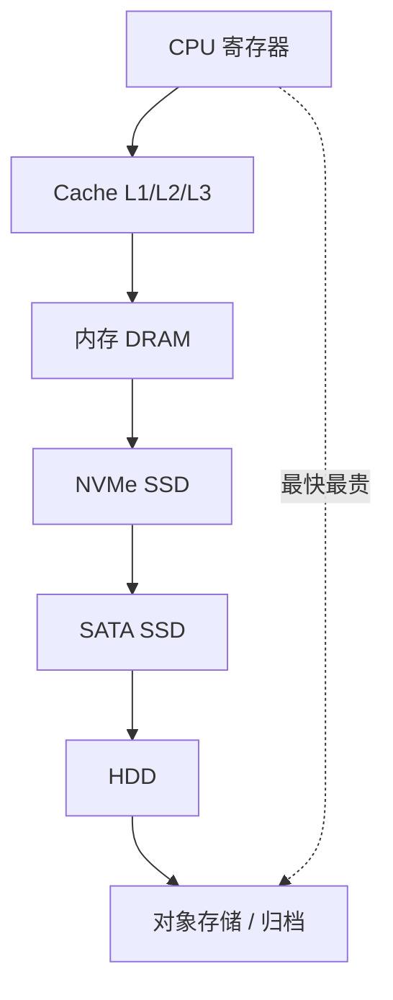
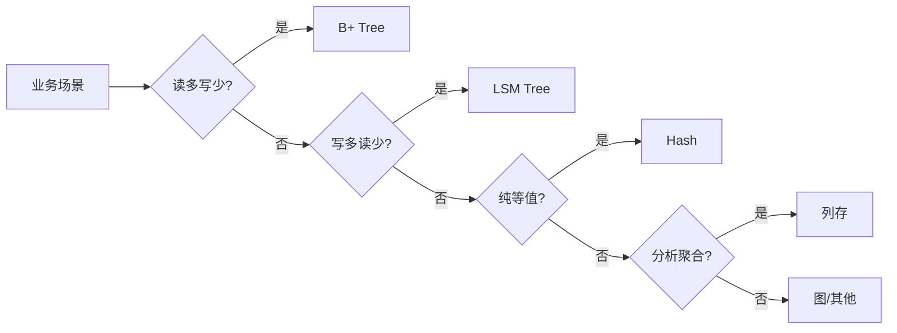
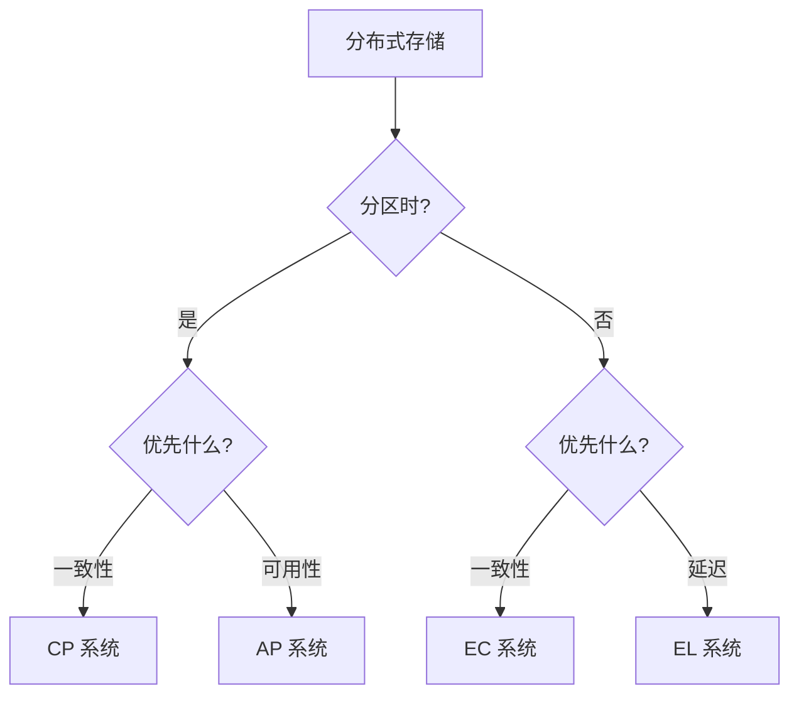

# 存储系统

> 存储系统是数据持久化的基础设施，从单机磁盘到全球分布式存储。与 [[数据库原理]] 关注关系模型与 SQL、[[分布式系统]] 关注 CAP 与一致性不同，本文聚焦存储引擎内部结构与分布式存储架构。

**关键词**：存储引擎、LSM Tree、分布式存储、一致性、IOPS

## 抽象类比

存储系统像一座超大型图书馆：单机磁盘是图书馆本身，B+ Tree 是书架上的目录索引，LSM Tree 是先写到暂存簿再定期归架。SSD 与 HDD 是不同材质的书架（一快一慢），分布式文件系统是把图书馆开到多个城市互为备份。

选存储就像选房：吞吐是房间的总面积、延迟是从门口到沙发的距离、可用性是房子会不会突然消失、持久性是你的东西会不会丢。不同业务对这些指标的优先级不同——电商订单要低延迟、日志系统要高吞吐、归档系统要极低成本的持久性。

## 适合人群

- 后端工程师，需要为业务选型合适的存储方案
- 数据库内核开发者，想理解存储引擎的设计原理
- 架构师，需要设计可扩展的存储系统
- 准备面试的学生，需要梳理存储方向高频考点
- SRE / DBA，希望理解存储性能调优原理

## 预备知识

- 理解 B+ Tree、Hash 索引等基本数据结构，参考 [[数据结构]]
- 了解关系数据库与 SQL，参考 [[数据库原理]]
- 理解 CAP、一致性、Paxos/Raft，参考 [[分布式系统]]
- 有 Redis、MySQL 等存储系统使用经验，参考 [[Redis]]

## 一、存储系统是什么

### 1.1 定义与范围

存储系统（Storage System）是数据持久化的基础设施，提供数据的写入、读取、检索、删除接口。范围涵盖：

- 单机存储：文件系统、单机数据库
- 分布式存储：分布式文件系统、对象存储、NoSQL
- 云存储：块存储、对象存储、归档存储
- 新型存储：NewSQL、时序库、向量库

### 1.2 与相关领域的关系

- [[数据库原理]]：关系模型、SQL、事务 ACID 的理论基础
- [[分布式系统]]：CAP、一致性、共识算法的理论基础
- 存储系统：上述理论的具体工程实现

### 1.3 存储系统的核心目标

- 持久性（Durability）：数据写入后不会丢失
- 可用性（Availability）：服务随时可访问
- 一致性（Consistency）：多副本数据保持一致
- 性能（Performance）：高 IOPS、高吞吐、低延迟
- 成本（Cost）：单位数据存储成本

### 1.4 存储系统发展史

存储系统的演化是性能、容量与成本的持续博弈：

- 1950s：磁带与磁鼓，顺序访问为主
- 1960s：硬盘 HDD 出现，IBM 350 RAMAC 开启随机访问时代
- 1970s：关系模型提出，B+ Tree 与 ISAM 成为索引结构
- 1980s：Oracle/DB2 商业数据库兴起，事务 ACID 完备
- 2003：Google 发表 GFS 与 MapReduce 论文，开启分布式存储时代
- 2006：BigTable 论文催生 HBase、Cassandra 等 NoSQL
- 2007：AWS S3 上线，对象存储进入主流
- 2010s：SSD 普及、NVMe 标准化，云原生存算分离兴起
- 2020s：NewSQL、向量库、时序库百花齐放，AI 驱动新型存储

每一次跃迁都对应硬件（SSD、NVMe、RDMA）或业务（大数据、AI）的变革，存储系统始终是基础设施中最贴近硬件的一层。

## 二、存储层次

### 2.1 存储金字塔

### 2.2 各层性能量级

- 寄存器：亚纳秒
- L1 Cache：约 1ns
- L2/L3 Cache：5-30ns
- 内存：约 100ns
- NVMe SSD：10-100μs
- SATA SSD：100μs-1ms
- HDD：1-10ms
- 对象存储：10-100ms

### 2.3 成本与性能权衡

- 内存比 SSD 贵约 100 倍
- SSD 比 HDD 贵约 5-10 倍
- HDD 比对象存储贵约 10 倍
- 冷数据放对象存储归档，热数据放 SSD，极热数据放内存

## 三、单机存储引擎

### 3.1 B+ Tree

B+ Tree 是关系数据库的事实标准：

- 所有数据都在叶子节点，内部节点只存索引
- 叶子节点用链表相连，范围扫描高效
- 树高通常 3-4 层，单次查询 3-4 次磁盘 IO
- 写入需要分裂/合并节点，随机写性能差
- 代表：InnoDB、PostgreSQL heap

### 3.2 LSM Tree

LSM Tree（Log-Structured Merge Tree）是写优化引擎：

- 写入先追加到 WAL，再写入内存 MemTable
- MemTable 满后变成不可变 ImMemTable，刷盘成 SSTable
- 后台 Compaction 合并多层 SSTable
- 读需要查 MemTable + 多层 SSTable，需 Bloom Filter 加速
- 写放大、读放大、空间放大三者权衡
- 代表：LevelDB、RocksDB、Cassandra、HBase

### 3.3 Hash 索引

- 键到值位置的哈希表
- O(1) 点查询，但不支持范围查询
- 适合 KV 存储，如 Redis、Memcached
- 持久化的 Hash 索引需处理扩容与碰撞

### 3.4 列式存储

- 数据按列而非按行存储
- 同列数据类型一致，压缩率高
- 分析型查询只扫描相关列，IO 少
- 代表：ClickHouse、Druid、Parquet 文件
- OLAP 场景的事实标准

### 3.5 WAL 与压缩

- WAL（Write-Ahead Log）：写入前先记日志，崩溃恢复用
- 压缩：列存用 RLE、字典编码、列编码；行存用前缀压缩、LZ4
- 牺牲少量 CPU 换取更大 IO 节省

### 3.6 存储引擎选型

不同存储引擎的取舍：

- B+ Tree：读多写少、范围查询多，OLTP 首选
- LSM Tree：写多读少、海量数据，日志、时序、KV 场景
- Hash：纯等值查询，缓存场景
- 列存：聚合分析，OLAP 场景
- 图存储：关系密集查询

实际选型还需考虑：

- 是否需要事务：B+ Tree 强，LSM 弱
- 是否需要强一致：B+ Tree 易实现，最终一致场景 LSM 更友好
- 硬件特性：SSD 上 LSM 写放大敏感，B+ Tree 随机写也开销大
- 运维复杂度：LSM 需调 Compaction，B+ Tree 需调页面大小与缓冲池

## 四、关系型数据库存储

### 4.1 InnoDB（MySQL）

- 基于 B+ Tree 聚簇索引，主键即数据存储顺序
- 二级索引存主键值而非行指针
- 表空间由段、区、页（默认 16KB）组成
- Change Buffer 优化二级索引随机写
- Double Write Buffer 防页撕裂

### 4.2 MyISAM

- 非事务引擎，索引与数据分离
- MyISAM 数据文件 .MYD、索引文件 .MYI
- 表级锁，并发差，已被 InnoDB 取代

### 4.3 PostgreSQL heap

- 表数据存于 heap 文件，索引指向 TID（行位置）
- 索引与数据分离，无聚簇索引概念
- 8KB 页面，MVCC 多版本存于同一表
- 死元组需 VACUUM 清理

### 4.4 MVCC 多版本并发控制

- 读不阻塞写、写不阻塞读
- 每行带 xmin/xmax 事务 ID 标记可见性
- InnoDB 在 Undo Log 中保留旧版本
- PostgreSQL 在表中保留多版本，需 VACUUM

### 4.5 索引类型

- B+ Tree：默认，等值与范围查询
- Hash：仅等值
- 全文索引：倒排索引
- 空间索引：R-Tree、GiST
- Bitmap 索引：低基数列

### 4.6 事务与锁

存储引擎的事务实现是核心难点：

- 事务隔离级别：读未提交、读已提交、可重复读、串行化
- 锁粒度：表锁、行锁、间隙锁、next-key 锁
- 共享锁 S 与排他锁 X
- 意向锁 IS/IX：表级粗粒度标记行级锁
- 死锁检测：等待图、超时回滚

InnoDB 的事务实现：

- Redo Log：物理日志，记录页变更，崩溃恢复
- Undo Log：逻辑日志，记录旧版本，支持 MVCC 与回滚
- 两阶段提交：先写 Redo Log prepare，再写 Binlog，最后 Redo Log commit
- 事务 ID 与 ReadView 实现可见性判断

PostgreSQL 用 MVCC + VACUUM 替代传统锁回滚段：

- 写入产生新版本，旧版本标记 xmin/xmax
- 长事务会导致表膨胀，需定期 VACUUM
- 优势：读不阻塞写，写不阻塞读

## 五、NoSQL 存储

### 5.1 KV 存储：Redis

- 纯内存，单线程模型，微秒级延迟
- 丰富数据结构：String、List、Hash、Set、ZSet
- 持久化：RDB 快照、AOF 日志
- 集群：分片 + 主从复制
- 详见 [[Redis]]

### 5.2 文档存储：MongoDB

- BSON 格式存储文档，模式灵活
- 支持二级索引、聚合管道
- 分片集群：mongos 路由 + config server + shard
- 副本集：Primary + Secondary + Arbiter

### 5.3 列族存储：HBase / Cassandra

- 基于 BigTable 论文，LSM Tree 引擎
- HBase：强一致，依赖 HDFS，行级事务
- Cassandra：去中心化，可调一致性，多 DC 友好
- 适合海量稀疏数据写入

### 5.4 图存储：Neo4j

- 节点、边、属性的三元组存储
- 免索引邻接：节点直接指向邻居，遍历快
- Cypher 查询语言
- 适合社交、知识图谱、反欺诈

## 六、分布式文件系统

### 6.1 GFS / HDFS

- 主从架构：NameNode 管元数据，DataNode 存数据
- 大文件分块（HDFS 128MB），三副本
- 顺序写入、追加写入友好，随机写差
- 适合大数据批处理，不适合低延迟
- HDFS 是 GFS 的开源实现

### 6.2 Ceph

- 统一存储：对象、块、文件三种接口
- CRUSH 算法计算数据位置，无中心元数据
- PG（Placement Group）作为数据分布单元
- 副本或 EC（Erasure Code）冗余

### 6.3 其他分布式文件系统

- GlusterFS：无元数据服务器，DHT 分布
- MooseFS：Master + Chunkserver，类似 GFS
- JuiceFS：元数据与数据分离，数据存对象存储
- Lustre：HPC 场景并行文件系统

## 七、对象存储

### 7.1 概念

对象存储以"对象"为基本单位，扁平命名空间，无目录层级：

- Bucket + Key + Value + Metadata
- 通过 RESTful API 访问（HTTP）
- 无限容量，按使用计费
- 适合非结构化数据：图片、视频、备份

### 7.2 主流产品

- AWS S3：对象存储的事实标准，API 兼容是事实
- 阿里云 OSS、腾讯云 COS：国内对标 S3
- MinIO：开源 S3 兼容，可自建
- Ceph RGW：Ceph 的对象网关

### 7.3 一致性模型

- 写后读强一致（S3 自 2020 起支持）
- 多版本：写入产生新版本，可回滚
- 对象锁：WORM 模式，合规场景必备
- 跨区域复制：异步，最终一致

### 7.4 对象存储的典型应用

对象存储的应用场景远超普通文件存储：

- 静态网站托管：HTML/CSS/JS 直传 S3 + CDN 加速
- 大数据湖：原始日志、CSV、Parquet 文件统一存放
- AI 训练数据：图片、视频、模型权重 PB 级存储
- 备份与归档：低频访问层成本极低
- 内容分发：与 CDN 结合，源站为对象存储

常见架构模式：

- 上传：客户端 -> API 签名 -> 直传对象存储（避免中转）
- 处理：上传事件触发 Lambda/函数计算处理
- 分发：CDN 回源对象存储
- 冷热分层：标准 + 低频 + 归档，自动生命周期
- 跨区域复制：异步同步到异地容灾

对象存储与传统文件系统的关键差异：

- 无目录层级，扁平 key-value 模型
- 不支持原子修改，只能整体覆盖
- 强一致写后读，但列表操作最终一致
- 海量小文件性能差，建议合并存放大对象

## 八、块存储与云盘

### 8.1 块存储概念

- 提供原始块设备接口，无文件系统概念
- 单机数据库、虚拟机磁盘常用
- 性能介于对象存储与内存之间

### 8.2 iSCSI

- SCSI 协议跑在 TCP 上
- Initiator + Target 架构
- 局域网内常用，成本低

### 8.3 Ceph RBD

- Ceph 的块存储接口
- RADOS 块设备，精简配置
- 支持快照、克隆
- 配合 QEMU/KVM 作虚拟机磁盘

### 8.4 云盘

- AWS EBS：gp3、io2 等多种类型
- 阿里云 ESSD：PL0-PL3，性能分级
- 多副本冗余，可用区内一致
- 可挂载、卸载、扩容

### 8.5 NVMe-oF

- NVMe over Fabrics：远程访问 NVMe 设备
- 支持 RDMA、TCP 传输
- 微秒级延迟，接近本地 NVMe
- 适合高性能数据库与 AI 训练

## 九、数据复制与一致性

### 9.1 主从复制

- 单主：写主，同步/异步复制到从
- 优点：实现简单，强一致
- 缺点：主节点故障需切换，写性能受单点限制
- 代表：MySQL 主从、Redis 主从、PG 流复制

### 9.2 多主复制

- 多个主节点可同时接受写入
- 冲突解决：时间戳、CRDT、应用层
- 适合多 DC 写入场景
- 代表：Cassandra、DynamoDB、CockroachDB

### 9.3 Quorum

- N 个副本，写 W 个，读 R 个，满足 W+R > N
- 调整 W/R 权衡一致性与性能
- W=N, R=1：读快写慢，强一致
- W=1, R=N：写快读慢
- 代表：Cassandra、Dynamo

### 9.4 共识算法在存储中的应用

- Raft：etcd、TiKV、CockroachDB
- Paxos：Google Spanner、Chubby
- ZAB：ZooKeeper
- 保证多副本日志一致，从而保证状态机一致

### 9.5 最终一致性 vs 强一致

- 最终一致：写入后短时间内可能读到旧值，但最终收敛
- 强一致：写入立即可见，线性一致
- 因果一致：保证因果关系的操作顺序
- 选型：金融场景必须强一致，社交场景可最终一致

### 9.6 CAP 在存储中的实践

CAP 定理在分布式存储中的具体表现：

- CP：强一致 + 分区容忍，分区时拒绝写
  - 例：HBase、MongoDB（默认）、etcd
  - 应用：金融账户、配置中心
- AP：可用 + 分区容忍，分区时各分区继续写
  - 例：Cassandra、DynamoDB、Redis Cluster
  - 应用：社交时间线、推荐列表
- CA：单机数据库，无分区容忍
  - 例：单机 MySQL、PostgreSQL

实际系统多在 CP 与 AP 间权衡：

- Cassandra 通过 consistency level 调节：ONE 偏 AP，QUORUM 偏 CP
- MongoDB 通过 write concern 调节
- Spanner 用 TrueTime 实现外部一致性，CAP 中偏 CP

PACELC 定理是对 CAP 的扩展：

- 分区时（PA）：在可用性与一致性间权衡
- 无分区时（EL）：在延迟与一致性间权衡
- 例：Cassandra 是 PA/EL，MongoDB 是 PC/EC

## 十、存储的关键指标

### 10.1 IOPS

- 每秒 IO 次数，衡量随机访问能力
- HDD：约 100，SATA SSD：约 10K，NVMe：约 100K-1M
- 数据库、虚拟机对 IOPS 敏感

### 10.2 吞吐

- 每秒读写数据量（MB/s）
- 顺序 IO 性能，大文件场景关注
- HDD：约 100MB/s，SSD：约 3GB/s

### 10.3 延迟

- 单次 IO 响应时间
- HDD：ms 级，SSD：μs 级，内存：ns 级
- 实时业务对延迟敏感

### 10.4 可用性

- 服务可访问时间占比
- 通常用"几个 9"描述：99.9%、99.99%、99.999%
- 多 AZ + 多 Region 实现

### 10.5 持久性

- 数据不丢失的概率
- 对象存储常宣称 11 个 9（99.999999999%）
- EC + 多副本 + 校验实现

### 10.6 业务场景选型

- OLTP 数据库：低延迟、强一致 → MySQL/PG + NVMe
- OLAP 数据仓库：高吞吐、列存 → ClickHouse、Doris
- 日志系统：高吞吐、可丢 → Kafka + 对象存储
- 视频存储：大容量、低成本 → 对象存储归档
- 缓存：低延迟、可丢失 → Redis

### 10.7 性能调优实战

存储性能调优的常见手段：

- 数据模型层面：
  - 选择合适主键，避免热点
  - 反范式化减少 join
  - 分表分库分散压力
- 索引层面：
  - 高频查询字段建索引
  - 联合索引遵循最左前缀
  - 避免索引失效（函数、隐式转换）
- 引擎层面：
  - 调整缓冲池大小（innodb_buffer_pool_size）
  - LSM 调整 Compaction 策略
  - 适当增大页面减少 IO 次数
- 硬件层面：
  - SSD 替换 HDD
  - NVMe 替换 SATA
  - RDMA 网络降低延迟
- 架构层面：
  - 读写分离
  - 分库分表
  - 引入缓存层
  - 冷热数据分层

诊断工具：

- 数据库：EXPLAIN、slow query log、Performance Schema
- OS：iostat、vmstat、sar、blktrace
- 分布式：Prometheus + Grafana 监控
- 火焰图：perf + FlameGraph 定位内核与用户态瓶颈

## 十一、新型存储方向

### 11.1 NewSQL

- 兼具 SQL 与水平扩展
- TiDB：MySQL 兼容，TiKV 存储，Raft 共识
- CockroachDB：PG 兼容，全球分布
- Spanner：Google 内部，全球强一致
- 解决传统 RDBMS 难以水平扩展的问题

### 11.2 时序数据库

- 优化时间序列数据写入与查询
- InfluxDB：单机友好，Flux 查询语言
- TDengine：国产，高性能，类 SQL
- Prometheus：监控场景事实标准
- TimescaleDB：基于 PG 扩展

### 11.3 向量数据库

- 存储与检索高维向量
- 用于 AI / RAG / 相似度搜索
- Milvus：国产开源，云原生
- Qdrant：Rust 实现，性能优
- Pinecone：商业 SaaS
- Faiss：库而非数据库

### 11.4 存算分离与云原生

- 存算分离：计算节点无状态，存储节点共享
- Aurora：MySQL + 共享分布式存储
- PolarDB：PG/MySQL + 共享存储
- Snowflake：数据仓库的存算分离典范
- 详见 [[云原生架构]]

## 面试速答

**Q1：B+ Tree 和 LSM Tree 的区别？**

B+ Tree 是读优化，数据在叶子节点用链表相连，范围查询快，单次查询 3-4 次 IO；但写入需分裂节点，随机写差。LSM Tree 是写优化，写入先到内存 MemTable 再刷盘成 SSTable，后台 Compaction 合并；写入是顺序追加，性能高；但读需要查多层 SSTable，需 Bloom Filter 加速。InnoDB 用 B+ Tree，RocksDB/Cassandra 用 LSM Tree。

**Q2：分布式存储怎么保证数据不丢？**

主要手段：多副本（通常 3 副本）+ 跨机架/机房分布；纠删码（EC）以更低的存储开销达到同等持久性；CRC 校验检测静默错误，定期 Scrub 修复；WAL 保证写入原子性；快照与跨区域复制应对逻辑错误与地域灾难。对象存储常宣称 11 个 9 持久性就是这些手段叠加。

**Q3：对象存储和块存储的区别？**

对象存储以对象为粒度，扁平命名空间，RESTful API 访问，无限容量，适合非结构化数据如图片视频；延迟通常 10-100ms。块存储提供原始块设备，挂载后需自己格式化文件系统，性能介于对象与内存之间，适合数据库和虚拟机磁盘；延迟 μs-ms 级。对象存储成本远低于块存储。

**Q4：MVCC 是怎么实现的？**

MVCC 通过为每行数据维护多个版本实现读写不阻塞。InnoDB 在每行加隐藏的 trx_id（最近修改事务 ID）和 roll_pointer（指向 Undo Log 中的旧版本）。读取时根据当前事务的 ReadView 判断哪个版本可见，不可见就沿 roll_pointer 找上一个版本。PostgreSQL 把多版本直接存在表中，靠 xmin/xmax 标记可见性，靠 VACUUM 回收死元组。

**Q5：Raft 在存储系统中怎么用？**

Raft 保证多副本日志一致，从而保证状态机一致。在 TiKV 中，每个 Region 是一个 Raft Group，写入需多数派确认。在 etcd 中，所有 key-value 修改走 Raft 日志。Raft 通过 Leader 选举与日志复制简化了 Paxos 的工程实现，是现代分布式存储的事实共识算法。
