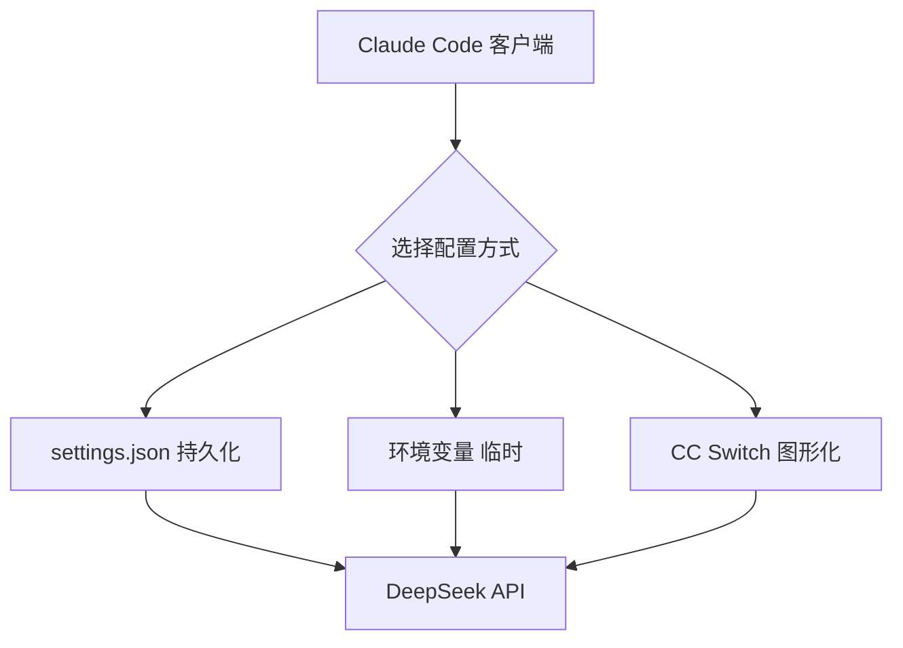

# Claude Code 外接 API 使用指南

> 将 Anthropic 官方命令行编程助手 Claude Code 的工程化能力，与 DeepSeek 等模型结合起来。可以把 DeepSeek 想象成 Claude 的"平替电池"——容量差不多、价格便宜一大截，日常 CRUD、写测试、生成文档这类模板化活儿完全够用；遇到复杂架构和难 bug 再切回原装 Claude。整体成本可降到原来的 1/10 到 1/20。

**关键词**：Claude Code、DeepSeek、API 中转、低成本编程、国产模型

## 抽象类比

DeepSeek 就像 Claude 的"平替电池"——容量差不多、价格便宜一大截。日常 CRUD、写测试、生成文档这类模板化活儿，DeepSeek 完全够用，就像家里日常用电用平价电就行；遇到复杂架构和难 bug 这种"高功率活"，再切回原装 Claude，相当于临时拉一根工业电。整体成本能降到原来的 1/10 到 1/20，又不用搭中间代理、不用改协议——DeepSeek 官方就提供了兼容 Anthropic API 的端点，Claude Code 的请求可以原样发过去。

## 适合人群 / 预备知识

- 有一定命令行使用经验的开发者
- 了解环境变量、JSON 配置文件的基本写法
- 已有或准备注册 DeepSeek 账号
- 本机已安装 Node.js 18+（或愿意安装）

## 一、为什么用 Claude Code + DeepSeek

### 1.1 价格对比

Claude API 贵是出了名的：

- Claude Sonnet：$3 / 百万 tokens
- Claude Opus：$15 / 百万 tokens

DeepSeek V3.2 只要 ¥1 / 百万 tokens，约为 Claude 的 1/10 到 1/20，高强度使用一天也花不了几块钱。

### 1.2 为什么能直接接

DeepSeek 官方提供了一个兼容 Anthropic API 协议的端点：

```
https://api.deepseek.com/anthropic
```

Claude Code 的请求可以原样发过去，不用搭中间代理、不用改协议，这是它比其他国产模型更省事的地方。

### 1.3 适用场景一句话总结

日常 CRUD、写测试、生成文档这类模板化活儿交给 DeepSeek；复杂架构设计、排查疑难 bug、大规模代码理解、跨文件复杂改动再切回 Claude。详细对比见第十节。

## 二、安装 Claude Code

### 2.1 环境要求

- Node.js 18 或更高版本
- 用 `node -v` 检查当前版本

### 2.2 安装命令

```bash
npm install -g @anthropic-ai/claude-code
```

### 2.3 验证安装

安装完成后直接运行：

```bash
claude
```

能进入交互界面即安装成功。

## 三、获取 DeepSeek API Key

### 3.1 注册账号

访问 `platform.deepseek.com` 注册账号，新用户有 ¥10 左右的免费额度，足够试用一段时间。

### 3.2 创建 API Key

- 登录后进入 "API Keys" 页面
- 点击 "创建 API Key"
- 复制生成的 Key（以 `sk-` 开头）

注意：Key 只在创建时显示一次，关闭页面后无法再查看，务必立即保存到密码管理器或本地安全位置。

## 四、模型选择

DeepSeek 提供两个主要模型：

- `deepseek-chat`：V3.2 非思考模式，响应快，适合常规任务
- `deepseek-reasoner`：V3.2 思考模式，推理能力强，适合复杂任务

在 Claude Code 中，思考模式可以通过按 Tab 键启用。

注意：思考模式对 Cline、RooCode 等非标准工具调用组件适配不充分，如果用这些工具建议先用 `deepseek-chat`。

## 五、三种配置方式

整体配置思路可以用下面的流程图概括：



### 5.1 方式一：settings.json（推荐，持久化）

这是官方推荐的持久化方式，配置一次后所有终端窗口都生效。

文件位置：

- macOS / Linux：`~/.claude/settings.json`
- Windows：`C:\Users\用户名\.claude\settings.json`

文件内容：

```json
{
  "env": {
    "ANTHROPIC_AUTH_TOKEN": "sk-你的DeepSeek API Key",
    "ANTHROPIC_BASE_URL": "https://api.deepseek.com/anthropic",
    "ANTHROPIC_MODEL": "deepseek-reasoner",
    "ANTHROPIC_DEFAULT_OPUS_MODEL": "deepseek-reasoner",
    "ANTHROPIC_DEFAULT_SONNET_MODEL": "deepseek-reasoner",
    "ANTHROPIC_DEFAULT_HAIKU_MODEL": "deepseek-reasoner",
    "CLAUDE_CODE_SUBAGENT_MODEL": "deepseek-reasoner",
    "CLAUDE_CODE_MAX_OUTPUT_TOKENS": "32000"
  }
}
```

字段说明：

- `ANTHROPIC_AUTH_TOKEN` 填你的 DeepSeek API Key；`ANTHROPIC_BASE_URL` 指向 DeepSeek 的 Anthropic 兼容端点
- 三个 `DEFAULT_*_MODEL` 把 Claude Code 内部会切换的 Opus / Sonnet / Haiku 全部映射到 DeepSeek，避免调用不存在的模型
- `CLAUDE_CODE_SUBAGENT_MODEL` 配子代理模型；`CLAUDE_CODE_MAX_OUTPUT_TOKENS` 调大单次输出上限，避免长文档被截断

### 5.2 方式二：环境变量（临时）

适合临时切换、测试用途。

macOS 写入 `~/.zshrc` 或 `~/.bashrc`：

```bash
export ANTHROPIC_BASE_URL=api.deepseek.com/anthropic
export ANTHROPIC_AUTH_TOKEN=${DEEPSEEK_API_KEY}
export ANTHROPIC_MODEL=deepseek-chat
export ANTHROPIC_SMALL_FAST_MODEL=deepseek-chat
```

Windows PowerShell 临时设置：

```powershell
$env:ANTHROPIC_BASE_URL = "https://api.deepseek.com/anthropic"
$env:ANTHROPIC_AUTH_TOKEN = "sk-你的Key"
$env:ANTHROPIC_MODEL = "deepseek-chat"
```

这种方式只在当前终端窗口有效，关闭窗口后失效。

### 5.3 方式三：CC Switch 图形化工具

CC Switch 像一个"中间转发站"，它拦截 Claude Code 的请求再转发给指定供应商，可以预设 DeepSeek、Qwen、GLM 多套配置，鼠标点几下就能切换。

下载地址：

```
github.com/farion1231/cc-switch/releases
```

安装方式：

- Windows：下载 `CC-Switch-Setup-x.x.x.exe` 安装包
- macOS：`brew tap farion1231/ccswitch && brew install --cask cc-switch`

使用流程：

- 启动后在界面里添加 DeepSeek 配置（填入 API Key）
- 一键切换到 DeepSeek
- 想用回 Claude 再点一下切回来

注意：Windows Defender 可能因为无代码签名而拦截，点 "更多信息" → "仍然运行" 即可。

## 六、Windows 持久化配置（PowerShell $PROFILE）

如果不想改 settings.json，也可以把环境变量写入 PowerShell 的 `$PROFILE` 文件，每次开 PowerShell 都自动加载。

### 6.1 操作步骤

1. 打开 PowerShell
2. 检查 profile 文件是否存在：

```powershell
Test-Path $PROFILE
```

3. 如果返回 False，先创建文件：

```powershell
New-Item -Type File -Force $PROFILE
```

4. 用记事本打开：

```powershell
notepad $PROFILE
```

5. 在文件中追加：

```powershell
$env:ANTHROPIC_BASE_URL = "https://api.deepseek.com/anthropic"
$env:ANTHROPIC_AUTH_TOKEN = "sk-你的Key"
$env:ANTHROPIC_MODEL = "deepseek-reasoner"
$env:ANTHROPIC_DEFAULT_SONNET_MODEL = "deepseek-reasoner"
$env:ANTHROPIC_DEFAULT_HAIKU_MODEL = "deepseek-reasoner"
```

6. 保存关闭，重启 PowerShell 即可生效

### 6.2 执行策略问题

如果 PowerShell 报错 "无法加载文件，因为在此系统上禁止运行脚本"，执行一次：

```powershell
Set-ExecutionPolicy -Scope CurrentUser RemoteSigned
```

## 七、验证配置是否生效

### 7.1 看左下角模型名

启动 `claude`，界面左下角会显示当前正在使用的模型，配置正确的话应该显示 `deepseek-reasoner` 或 `deepseek-chat`。

### 7.2 直接问它

在 Claude Code 里输入：

```
介绍下你自己，你底层对接的模型是啥？
```

它会告诉你底层是 DeepSeek 而不是 Claude。

### 7.3 用 /model 命令

输入 `/model` 可以查看和切换当前模型。

## 八、绕过国内限制的小技巧

Claude Code 首次启动可能会触发登录或区域检查导致卡住，可以通过修改 `~/.claude.json` 来跳过：

- 找到文件 `~/.claude.json`（Windows: `C:\Users\用户名\.claude.json`）
- 用文本编辑器打开
- 添加或修改这一行：

```json
"hasCompletedOnboarding": true
```

这样下次启动会跳过引导流程，直接进入主界面。

## 九、其他国产模型替代方案

如果 DeepSeek 不可用或想试试别的，下面几个国产模型也都兼容 Anthropic 协议或提供 OpenAI 兼容端点：

- 通义千问（百炼）：`dashscope.console.aliyun.com`，¥8 / 百万 tokens，中文能力很强
- 智谱 GLM：`open.bigmodel.cn`，¥10 / 百万 tokens
- 硅基流动 Siliconflow：`api.siliconflow.cn`，支持 Qwen、QwQ-32B 等多种模型，价格灵活

替换方法就是把 `ANTHROPIC_BASE_URL` 和 `ANTHROPIC_AUTH_TOKEN` 换成对应供应商的地址和 Key，其他配置不变。

## 十、使用技巧与适用场景

### 10.1 何时用 DeepSeek / 何时切回 Claude

适合用 DeepSeek 的活儿：写 CRUD 接口、生成单元测试、写注释文档、代码格式化与简单重构、解释陌生代码。

建议切回 Claude 的场景：复杂系统架构设计、调试难复现的 bug、涉及大量上下文理解的改动、跨多个仓库的代码迁移。

### 10.2 混用策略

可以用 CC Switch 预设两套配置：日常用 DeepSeek，遇到难题一键切到 Claude，解决后再切回去，兼顾成本和质量。

## 面试速答

- Q：启动 claude 报错 "Invalid API key"？ A：检查 `ANTHROPIC_AUTH_TOKEN` 是否以 `sk-` 开头、有没有多余空格
- Q：响应特别慢？ A：`deepseek-reasoner` 思考模式本来就慢，常规任务换 `deepseek-chat`
- Q：输出被截断？ A：调大 `CLAUDE_CODE_MAX_OUTPUT_TOKENS`，比如设到 32000 或更高
- Q：Windows 下 settings.json 不生效？ A：确认路径是 `C:\Users\你的用户名\.claude\settings.json`，JSON 格式无语法错误
- Q：CC Switch 被杀毒软件拦截？ A：无代码签名会被误报，确认是从官方 GitHub release 下载后添加信任
- Q：思考模式在 Cline 里乱码？ A：Cline 等工具对思考模式适配不完善，建议这些工具用 `deepseek-chat`

## 十二、参考资源链接

- Claude Code 官方仓库：`github.com/anthropics/claude-code`
- DeepSeek 开放平台：`platform.deepseek.com`
- DeepSeek Anthropic 兼容端点文档：`api-docs.deepseek.com/zh-cn/guides/anthropic_api`
- CC Switch 项目：`github.com/farion1231/cc-switch`
- 通义千问百炼：`dashscope.console.aliyun.com`
- 智谱开放平台：`open.bigmodel.cn`
- 硅基流动：`siliconflow.cn`
