# Mermaid 使用指南

> Mermaid 是一个基于 JavaScript 的图表绘制工具，通过文本描述生成图表，可嵌入 Markdown 文档，版本控制友好。本文介绍 Mermaid 的语法、图表类型和高级功能，适合在文档中快速画流程图、时序图、甘特图等。

**关键词**：Mermaid、文本图表、Markdown、流程图、代码生成图

## 抽象类比

Mermaid 就像"用文字画图"。你不用鼠标拖拽形状，只要写几行类似代码的描述——节点叫什么、谁连谁、用什么箭头——它就自动帮你画出对应图表。最大的好处是图表和文档一起存为文本，跟着 Git 走，改起来比画图工具快，也不会因为换个电脑就打不开。Obsidian、VS Code、GitHub 都原生支持，写完就能预览。

## 一、介绍

### 1.1 什么是 Mermaid

Mermaid 是一个基于 JavaScript 的图表绘制工具，通过文本描述生成图表。

**特点**：
- 代码生成图表
- 版本控制友好
- Markdown 嵌入
- 自动化生成

**应用场景**：
- Markdown 文档嵌入
- Git 版本控制
- Docs as Code 工作流
- 自动化生成
- 团队协作文档

## 二、安装配置

### 2.1 在线使用

- 网址：https://mermaid.live/
- 特点：无需安装，在线编辑和预览

### 2.2 VS Code 配置

安装扩展：
- Markdown Preview Mermaid Support
- Mermaid Markdown Syntax Highlighting

### 2.3 Obsidian 配置

- Obsidian 原生支持 Mermaid
- 直接在 Markdown 中使用即可

## 三、基本语法

### 3.1 代码块

````markdown
```mermaid
图表代码
```
````

### 3.2 方向设置

```mermaid
graph TD  % 从上到下
graph LR  % 从左到右
graph RL  % 从右到左
graph BT  % 从下到上
```

### 3.3 节点定义

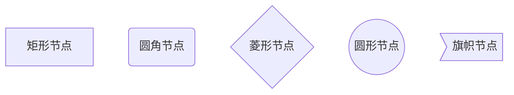

### 3.4 连接方式

```mermaid
graph TD
    A --> B      % 箭头
    A --- B      % 无箭头
    A -.-> B     % 虚线箭头
    A -.-> B     % 虚线无箭头
    A ==> B      % 粗箭头
    A === B      % 粗无箭头
```

### 3.5 文本标签

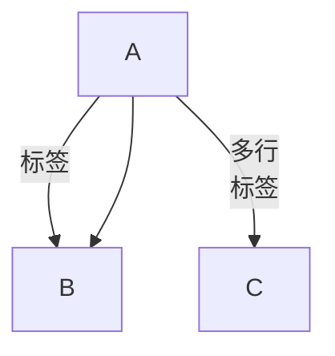

## 四、图表类型

### 4.1 流程图

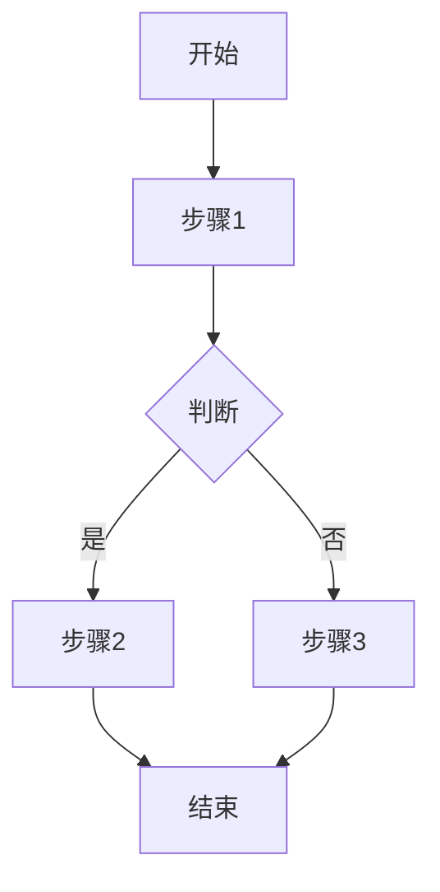

### 4.2 时序图

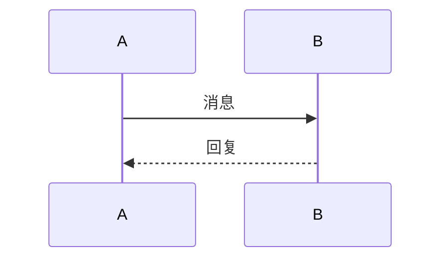

### 4.3 状态图

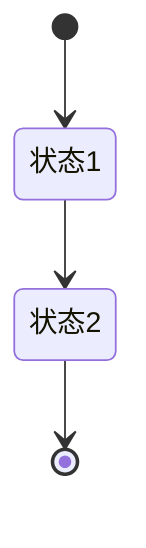

### 4.4 类图

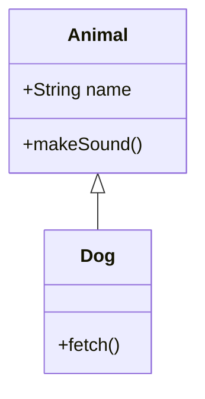

### 4.5 甘特图

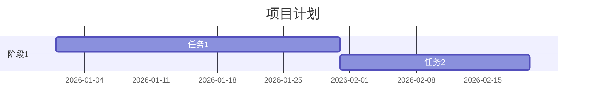

### 4.6 饼图

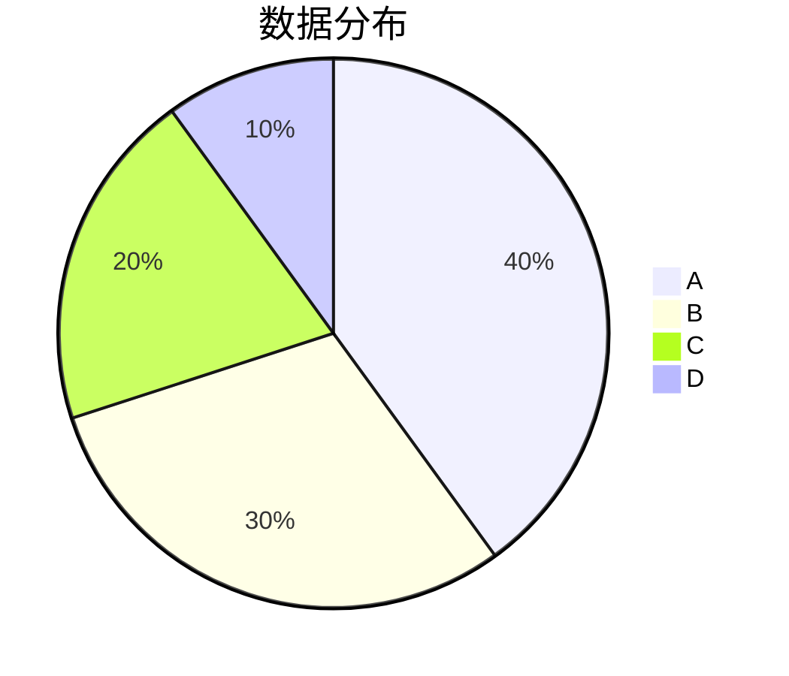

### 4.7 Git 图

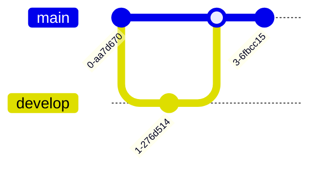

### 4.8 ER 图

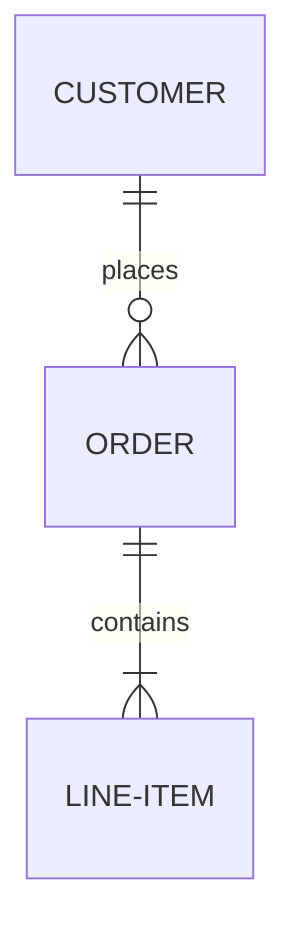

## 五、高级功能

### 5.1 子图

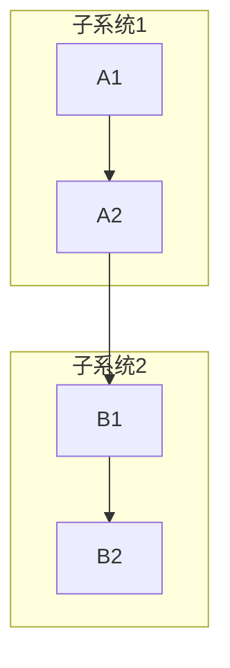

### 5.2 样式设置

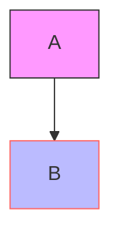

### 5.3 点击事件

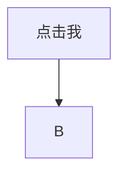

---

## 面试速答

### Q: Mermaid 适合什么样的场景？
A: 适合在 Markdown 文档、Git 仓库、Docs as Code 工作流中嵌入图表。核心是用文本描述生成图表，版本控制友好。Obsidian、VS Code、GitHub 都原生支持。不适合需要精细调整位置和样式的复杂图表。

### Q: Mermaid 和 draw.io 有什么区别？
A: Mermaid 是"用文字画图"，代码生成图表，优势是版本控制友好、改起来快、跟文档一起存，劣势是不能精细调整布局；draw.io 是"用鼠标画图"，所见即所得，优势是布局自由、内置专业形状库，劣势是文件是二进制或 XML，diff 不友好。文档嵌入选 Mermaid，复杂图表选 draw.io。

### Q: 为什么 Mermaid 适合版本控制？
A: Mermaid 图表存为纯文本代码，Git 能清晰 diff 每次改了哪个节点、哪条线。而 draw.io、Visio 等工具的文件是二进制或 XML，Git 无法看出具体改动，合并冲突难解决。Docs as Code 工作流首选 Mermaid。

### Q: Mermaid 支持哪些图表类型？
A: 常用类型：流程图（graph）、时序图（sequenceDiagram）、状态图（stateDiagram）、类图（classDiagram）、甘特图（gantt）、饼图（pie）、Git 图（gitGraph）、ER 图（erDiagram）。基本覆盖技术文档常见图表需求。

### Q: Mermaid 常见误区有哪些？
A: 一是节点 ID 用中文导致解析错误，建议用英文 ID、中文标签；二是图表太复杂时自动布局很乱，这种情况应拆分或换 draw.io；三是以为 Mermaid 什么图都能画，实际上对位置精确控制很弱。复杂拓扑图建议用 draw.io。
