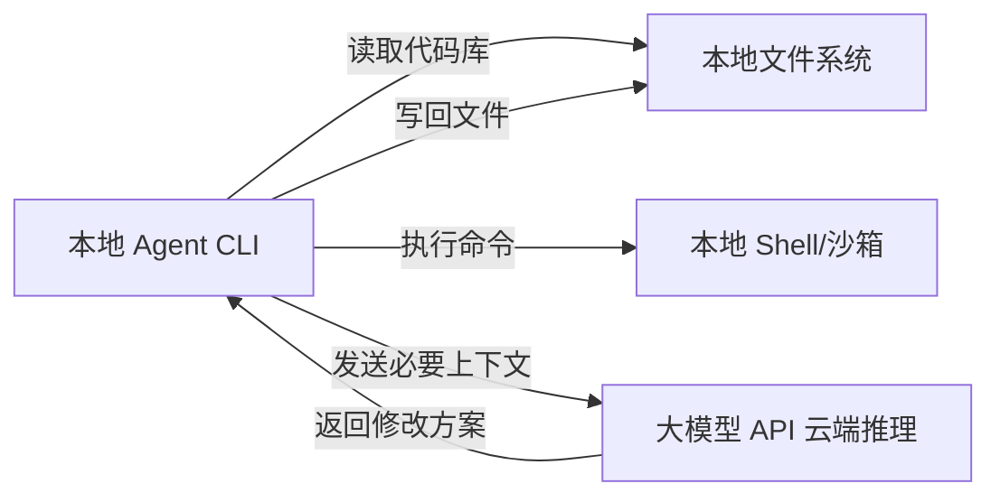
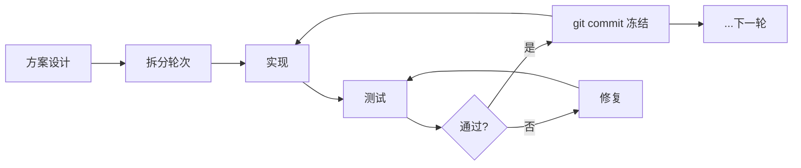

# 本地 Agent 工具

> 本地 Agent 工具指能直接读取代码库、修改文件、执行 shell 命令、跑测试的 AI 编程代理，如 Claude Code、Codex、Cursor、Trae、Qoder、Workbuddy 等。它不是"能聊代码的聊天框"，而是真正动手干活的"使唤 AI"。本文梳理主流工具对比、通用核心概念与轮次开发工作流。

**关键词**：Claude Code、Codex、Cursor、Trae、AI 编程代理、AGENTS.md、国产模型

## 抽象类比

本地 Agent 工具就像坐在你旁边的资深程序员。你把项目代码、报错信息、需求描述丢给它，它能自己读代码、改文件、跑命令、跑测试，再给你一份带着 diff 的修改方案。和"网页 AI 助手"不同，它不只是回答问题，而是真正动手干活——读你的代码库、写回磁盘、执行 shell 命令，把"问 AI"变成"使唤 AI"。代码留在本地，只把必要上下文发到大模型 API，因此既快又安全。

## 适合人群 / 预备知识

- 想用 AI 提升编码效率的后端/前端/全栈开发者
- 熟悉命令行基础操作（cd、git、npm 等命令）
- 了解 Git 基本工作流（status、diff、commit）
- 有一个可访问的代码仓库用于练习

## 一、什么是本地 Agent 工具

与网页 AI 助手的本质区别：

- 能直接读取整个代码库的上下文
- 能修改文件并写入磁盘
- 能执行 shell 命令、跑测试、跑 lint
- 能通过 MCP（Model Context Protocol）连接外部工具
- **本地执行 + 云端推理**的混合架构：代码、文件、命令执行都发生在本地，只有推理请求发送到模型服务器



## 二、主流工具对比

| 工具             | 形态        | 厂商/模型        | 特点                       |
| -------------- | --------- | ------------ | ------------------------ |
| Claude Code    | CLI       | Anthropic    | 工程化能力口碑最佳，支持接兼容 API      |
| Codex          | CLI + 桌面版 | OpenAI       | 专为编程优化，沙箱完善，ChatGPT 订阅可用 |
| Cursor         | AI 原生 IDE | 多模型可选        | 集成度最高，Tab 补全 + Agent 模式  |
| Trae           | AI IDE    | 字节跳动 / 多模型   | 国内可直接用，免费额度大             |
| Qoder          | AI IDE    | 阿里 / 多模型     | 国产新锐，Quest 模式异步执行任务      |
| GitHub Copilot | IDE 插件    | GitHub / GPT | 补全为主，Agent 模式后起          |

**选型思路**：

- 终端党、要最强工程能力 → Claude Code / Codex
- IDE 党、想要一体化体验 → Cursor / Windsurf
- 国内直连、零成本上手 → Trae / Qoder
- 只是想要补全 → GitHub Copilot

各家核心概念高度相通（模式、规则文件、MCP、会话），学会一个迁移成本很低。

## 三、通用核心概念

### 3.1 权限模式阶梯

模式决定 Agent 干活时有多少自主权，各家叫法不同但思路一致：

| 阶梯 | Claude Code / Codex 表现 | 适用 |
| --- | --- | --- |
| 只读/建议 | 每步需手动批准 | 安全探索、学习陌生代码库、代码审查 |
| 自动编辑 | 文件自动改，命令需批准 | 重构、批量重命名、重复性编辑 |
| 全自动 | 沙箱内自主读写执行 | 修构建错误、原型开发、长任务 |

**推荐配置阶梯**：先用只读模式（只看不改）→ 熟悉后允许写工作区但每步审批 → 再放开到"失败才问"。永远不要一开始就给完全访问权限。

### 3.2 沙箱与审批

- **沙箱**（技术上能做什么）：read-only → workspace-write → full-access
- **审批策略**（什么时候停下来问）：每次都问 → 失败再问 → 从不打断（危险）
- **安全建议**：在 Git 仓库内运行便于回滚；重要操作前 `git status` 确认工作区干净；不熟悉的命令让它解释后再批准

### 3.3 规则文件（AGENTS.md）

给 Agent 的"项目说明书"（"项目宪法"），放项目根目录，启动时自动读取，解决"每次都要重复说明项目规则"的痛点。内容应包括：

- 项目启动：怎么编译、怎么跑、怎么部署
- 测试方式：测试框架、测试命令、预期输出
- 目录禁区：哪些目录绝对不能碰
- 编码规范：命名、缩进、注释风格
- 环境与依赖清单：已装什么、未装什么（避免 Agent 盲目调用工具）
- 已知坑点和注意事项

Cursor 用 `.cursorrules`，Trae/Qoder 有各自的 Rules 配置，Claude Code 与 Codex 用 `AGENTS.md`（Codex 的 `/init` 会自动生成初稿）。

### 3.4 MCP 与工具扩展

MCP（Model Context Protocol）是连接外部工具的标准协议，可让 Agent 访问数据库、API 文档、浏览器、设计稿等，扩展能力边界。

### 3.5 会话管理

- **一会话一主题**：修 bug、写功能、重构分开会话，上下文才不乱
- **明确划定范围**：Agent 很"勤快"，你说"测一下启动流程"，它可能顺便把重启流程也测了——明确说"只测 X，不要测 Y"
- **恢复会话**：`codex resume --last`、Claude Code 的 `/resume` 可恢复上下文，省去重新解释

## 四、安装与登录（以 CLI 类为例）

### 4.1 安装

```bash
# Claude Code（需 Node.js 18+）
npm install -g @anthropic-ai/claude-code

# Codex（需 Node.js 22+）
npm install -g @openai/codex

# 验证
claude
codex --version
```

IDE 类（Cursor / Trae / Qoder）直接下载安装包即可。

### 4.2 登录认证

两种方式，各家类似：

- **官方订阅登录**（默认）：终端运行 `codex login` 或 `claude`，浏览器 OAuth 授权，凭据写入 `~/.codex/auth.json` / `~/.claude/`
- **API Key 登录**：适合 CI/CD、脚本自动化、接第三方模型。设置环境变量 `OPENAI_API_KEY` / `ANTHROPIC_AUTH_TOKEN` + `*_BASE_URL`

凭据文件像密码一样保护，绝对不能提交到 Git 仓库（把 `~/.codex/`、`~/.claude/` 加入 gitignore）。

## 五、低成本方案：接国产模型（重点）

### 5.1 价格对比

Claude API 贵是出了名的：Sonnet $3 / 百万 tokens，Opus $15 / 百万 tokens。DeepSeek V3.2 只要约 ¥1 / 百万 tokens，约为 Claude 的 1/10 到 1/20，高强度使用一天也花不了几块钱。

**平替电池类比**：国产模型就像"平替电池"——容量差不多、价格便宜一大截。日常 CRUD、写测试、生成文档这类模板化活儿完全够用（日常用电用平价电）；遇到复杂架构和难 bug 这种"高功率活"，再切回原装 Claude/GPT（临时拉工业电）。

### 5.2 Claude Code + DeepSeek（官方兼容端点）

DeepSeek 官方提供兼容 Anthropic API 的端点，Claude Code 的请求可以原样发过去，不用搭代理、不用改协议：

```
https://api.deepseek.com/anthropic
```

推荐用 `settings.json` 持久化（文件位置：Windows `C:\Users\用户名\.claude\settings.json`）：

```json
{
  "env": {
    "ANTHROPIC_AUTH_TOKEN": "sk-你的DeepSeek API Key",
    "ANTHROPIC_BASE_URL": "https://api.deepseek.com/anthropic",
    "ANTHROPIC_MODEL": "deepseek-reasoner",
    "ANTHROPIC_DEFAULT_OPUS_MODEL": "deepseek-reasoner",
    "ANTHROPIC_DEFAULT_SONNET_MODEL": "deepseek-reasoner",
    "ANTHROPIC_DEFAULT_HAIKU_MODEL": "deepseek-reasoner",
    "CLAUDE_CODE_SUBAGENT_MODEL": "deepseek-reasoner",
    "CLAUDE_CODE_MAX_OUTPUT_TOKENS": "32000"
  }
}
```

要点：三个 `DEFAULT_*_MODEL` 把内部会切换的 Opus/Sonnet/Haiku 全部映射到 DeepSeek；`CLAUDE_CODE_MAX_OUTPUT_TOKENS` 调大单次输出上限避免截断。

也可以用环境变量（临时）或写入 PowerShell `$PROFILE`（持久）：

```powershell
$env:ANTHROPIC_BASE_URL = "https://api.deepseek.com/anthropic"
$env:ANTHROPIC_AUTH_TOKEN = "sk-你的Key"
$env:ANTHROPIC_MODEL = "deepseek-reasoner"
```

验证：启动 `claude` 看左下角模型名，或直接问"你底层对接的模型是啥"。

### 5.3 Codex + 中转/国产模型

编辑 `~/.codex/config.toml`，把 `base_url` 指向中转或国产模型端点：

```toml
model = "gpt-5"
model_provider = "openai-chat-completions"

[model_providers.openai-chat-completions]
name = "OpenAI Chat Completions"
base_url = "https://你的中转地址/v1"
env_key = "AGENT_ROUTER_TOKEN"
```

再在 `~/.codex/auth.json` 填 `{"OPENAI_API_KEY": "你的Key"}`，用 `codex doctor` 验证。

### 5.4 其他国产模型替代方案

- 通义千问（百炼）：`dashscope.console.aliyun.com`，中文能力强
- 智谱 GLM：`open.bigmodel.cn`
- 硅基流动：`api.siliconflow.cn`，聚合多种开源模型

替换方法就是把 `BASE_URL` 和 `AUTH_TOKEN` 换成对应供应商的地址和 Key。

### 5.5 图形化切换：CC Switch

CC Switch 像"中间转发站"，可预设 DeepSeek、Qwen、GLM 多套配置，鼠标点几下就能在原装模型和国产模型之间切换，兼顾成本和质量。下载：`github.com/farion1231/cc-switch/releases`（Windows Defender 拦截时点"更多信息"→"仍然运行"）。

### 5.6 混用策略

适合国产模型的活儿：写 CRUD 接口、生成单元测试、写注释文档、格式化与简单重构、解释陌生代码。

建议切回原装模型的场景：复杂系统架构设计、调试难复现的 bug、大量上下文理解的改动、跨仓库迁移。

## 六、通用工作流

### 6.1 第一次使用的稳妥流程

1. 进入 Git 仓库，确认工作区干净（`git status`，有改动先 commit 或 stash）
2. 让它先解释项目："先阅读这个仓库，解释主要目录、启动命令和测试命令。不要修改文件。"
3. 给小任务试水：修文档拼写、加注释
4. 让它跑测试："运行项目测试，报告结果。如果有失败，先分析原因再修复。"
5. 用 `git diff` 审查所有改动，满意后 `git add` + `git commit`
6. 再逐步放大任务，保持低权限模式

### 6.2 轮次开发（长周期复杂项目的关键方法）

一次性丢给 AI"全做完"必然翻车：上下文超限、改了这里坏那里、无法定位 bug。轮次开发的思路是**用 git 把完整方案切成多个可独立验证的轮次，每轮做完就测试、测试通过就冻结提交，再开下一轮**。



核心规则：每轮有明确的入口和出口（入口是上一轮 commit，出口是本轮测试通过后的 commit）；每轮只做一件事；测试不通过不提交。

单轮次六步法：

1. **设计**：在网页 AI 助手（或会话里）讲清楚本轮要做什么、改哪些文件、预期效果
2. **可行性分析**：让 Agent 针对项目现状分析可行性、指出风险——这步往往比直接要方案更准，因为它能读到真实代码
3. **开发计划**：根据可行性反馈制定具体计划（改哪些文件、顺序、测试点）
4. **实现**：按计划动手改代码
5. **测试**：跑测试，人工审查 diff
6. **提交**：`git add` + `git commit`，写清楚本轮做了什么

### 6.3 "网页助手想方案 + Agent 实现"的分工

- **网页 AI 助手负责"想"**：梳理需求、产出整体方案、拆分轮次、制作提示词、编写规则文件族
- **Agent 负责"做"**：读取规则文件、对真实代码做可行性分析、制定计划、实现、跑测试、提交 git
- **关键衔接**：把网页端产出的提示词和文件保存到项目目录（如 `AGENTS.md`、`docs/prompts/`），Agent 会自动读取

### 6.4 IDE 类的"多次对话，一次修改"

Agent 类 IDE 的 diff 面板通常只显示最新一次对话的改动。推荐模式：先多次对话讨论方案、确认设计，最后一次让它动手改——这样 diff 完整、好审查。如果分多次修改，用 `git diff` 审查累计改动，每段对话后及时 commit 锁定。

## 七、实战技巧十条

1. 用规则文件（AGENTS.md 等）固化项目规则，避免每次重复说明编码规范
2. 大任务拆小步骤，每步用 git commit 锁定，便于回滚
3. 让它先解释再修改："先解释这段代码的作用，再提议修改方案"
4. 用非交互模式（`codex exec --json` 等）接入 CI/CD，自动跑 code review
5. 全自动模式前先 `git stash` 保护未提交工作
6. 复杂 bug 让它先列假设再验证："列出 3 个可能的根因，逐一验证"
7. 用 resume 命令恢复中断的会话，省去重新解释上下文
8. 模型分层：日常用编程专用模型，架构审查用推理模型，简单任务用便宜模型
9. 让它写测试再让它跑测试，形成闭环验证
10. 用 MCP 连接外部工具（数据库、API 文档），扩展能力边界

## 常见问题速答

- Q：安装失败？
  A：检查 Node.js 版本（Claude Code 需 18+，Codex 需 22+），用 `node -v` 验证。

- Q：启动报错 "Invalid API key"？
  A：检查 `AUTH_TOKEN` 是否以 `sk-` 开头、有无多余空格，`BASE_URL` 是否配对。

- Q：响应特别慢？
  A：思考模式本来就慢，常规任务换非思考模型（如 `deepseek-chat`）。

- Q：输出被截断？
  A：调大输出上限（如 `CLAUDE_CODE_MAX_OUTPUT_TOKENS` 设 32000 或更高）。

- Q：改了不该改的文件？
  A：降低沙箱权限为 workspace-write，立即 `git checkout` 恢复。

- Q：全自动模式跑飞了？
  A：Ctrl+C 中断，`git reset --hard` 回滚到安全点。

- Q：国内连不上官方 API？
  A：科学上网或配置中转/国产模型端点，参考第五节。

- Q：凭据泄露风险？
  A：把 `~/.codex/`、`~/.claude/` 加入 .gitignore，绝不提交；Key 只在创建时显示一次，立即存好。

- Q：Windows 下配置不生效？
  A：确认路径正确（如 `C:\Users\用户名\.claude\settings.json`）、JSON 无语法错误、重启终端。

- Q：多会话改同一文件冲突？
  A：同一项目内不要并行改同一批文件，跨项目可以并行跑会话。

## 参考资源链接

- Claude Code 官方仓库：`github.com/anthropics/claude-code`
- Codex 官方文档：`developers.openai.com/codex/cli`
- Codex 仓库：`github.com/openai/codex`
- DeepSeek 开放平台：`platform.deepseek.com`
- DeepSeek Anthropic 兼容端点文档：`api-docs.deepseek.com/zh-cn/guides/anthropic_api`
- CC Switch：`github.com/farion1231/cc-switch`
- MCP 协议：`modelcontextprotocol.io`
- Cursor：`cursor.com`　Trae：`trae.cn`　Qoder：`qoder.com`

---

## 可执行实践闭环

1. **练习任务**：让 Agent 完成一次小改动，并要求其先读规则、后测试、再报告 diff。
2. **完成标准**：权限按最小化开放，提示词包含目标、边界、验收标准和禁止事项。
3. **排错顺序**：先审查计划、命令和 diff；涉及删除、凭据、发布时必须人工把关。
4. **沉淀结果**：保留最小示例、关键命令、失败现象与解决依据；过一周不看原文重新完成一次。
